# Tetris Universe

A Tetris game inspired by **Tetris Effect** that plays **any music you like**: your own folder or a YouTube
playlist. Each song is analysed ahead of time (tempo, key, intro, verse, build, chorus, drop...) and the game stages
it: pieces fall on the beat, the pace follows the song's energy, and each song plays in its own **universe**.

```sh
uvx tetris-universe            # the default playlist
uvx tetris-universe ~/Music    # or any folders, files and YouTube URLs
```

## Universes

Each universe is a hand-directed world with its own palette, materials, typography and way of staging the music:
calm parts stay quiet, drops and choruses bring the whole picture. Each one comes in several variants picked per
song, and between songs the game takes a short break into the next universe. Fifty universes so far, each with its status:
✅ <i>ok</i> (reviewed and tested) or 🔍 <i>to review</i> (new, still to be played and tested):

<table>
<tr>
<td width="50%"><br><b>VECTOR</b>: phosphor beams on a dark CRT<br><sub>✅ <i>ok</i></sub></td>
<td width="50%"><br><b>SUMI</b>: ink on washi paper<br><sub>✅ <i>ok</i></sub></td>
</tr>
<tr>
<td><br><b>DIORAMA</b>: a sunlit clay island<br><sub>✅ <i>ok</i></sub></td>
<td><br><b>ABYSS</b>: the deep sea, lit by living things<br><sub>✅ <i>ok</i></sub></td>
</tr>
<tr>
<td><br><b>SMOKE</b>: a dark stage, slow smoke and one hard spotlight<br><sub>✅ <i>ok</i></sub></td>
<td><br><b>WATERCOLOR</b>: transparent washes on cold-press paper<br><sub>✅ <i>ok</i></sub></td>
</tr>
<tr>
<td><br><b>POLAR NIGHT</b>: a snowfield under the aurora<br><sub>✅ <i>ok</i></sub></td>
<td><br><b>RISOGRAPH</b>: a two-ink risograph print<br><sub>✅ <i>ok</i></sub></td>
</tr>
<tr>
<td><br><b>WHITE ROOM</b>: a seamless white studio, matte blocks and soft shadows<br><sub>✅ <i>ok</i></sub></td>
<td><br><b>KINTSUGI</b>: dark polished stone, ceramic mended with gold<br><sub>✅ <i>ok</i></sub></td>
</tr>
<tr>
<td><br><b>LASER SHOW</b>: every piece projected by its own laser<br><sub>✅ <i>ok</i></sub></td>
<td><br><b>GARDEN</b>: tiles of earth growing pixel grass and flowers<br><sub>✅ <i>ok</i></sub></td>
</tr>
<tr>
<td>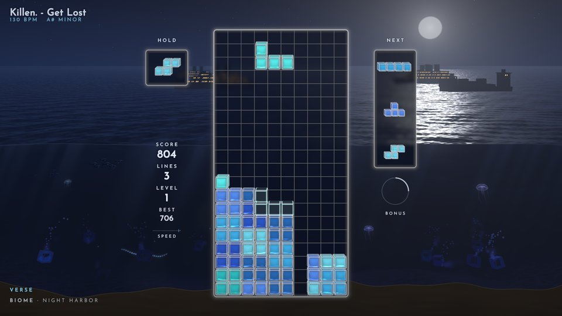<br><b>BIOME</b>: glass cubes of water or seeds bringing a 3D world to life: a sea rising over dry sand, or a jungle growing on parched clay<br><sub>✅ <i>ok</i></sub></td>
<td><br><b>FLUO</b>: fluorescent paint splashed on a dark wall, glowing under a blacklight on drops<br><sub>✅ <i>ok</i></sub></td>
</tr>
<tr>
<td><br><b>MARBLES</b>: glass marbles in square tiles, shot out across a dark table where they collide and stain the felt<br><sub>✅ <i>ok</i></sub></td>
<td><br><b>PRISM</b>: glass cubes in the dark, slow beams of light, a rainbow on the drop<br><sub>✅ <i>ok</i></sub></td>
</tr>
<tr>
<td><br><b>LIGHTSOURCE</b>: a dim room lit by the falling piece, the stack casting its shadows<br><sub>✅ <i>ok</i></sub></td>
<td><br><b>NOTEPAD</b>: a squared notebook drawn by hand in stop motion, erased and redrawn<br><sub>✅ <i>ok</i></sub></td>
</tr>
<tr>
<td>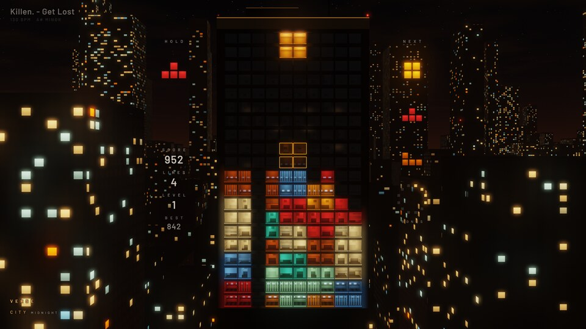<br><b>CITY</b>: a tower in a dark 3D night city, its lit rooms the blocks<br><sub>✅ <i>ok</i></sub></td>
<td>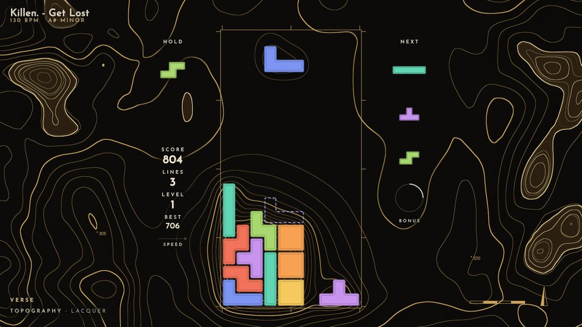<br><b>TOPOGRAPHY</b>: a contour map whose terrain is the stack, a slowly shifting land; rivers in the rain, a flood and living peaks on the drop<br><sub>✅ <i>ok</i></sub></td>
</tr>
<tr>
<td>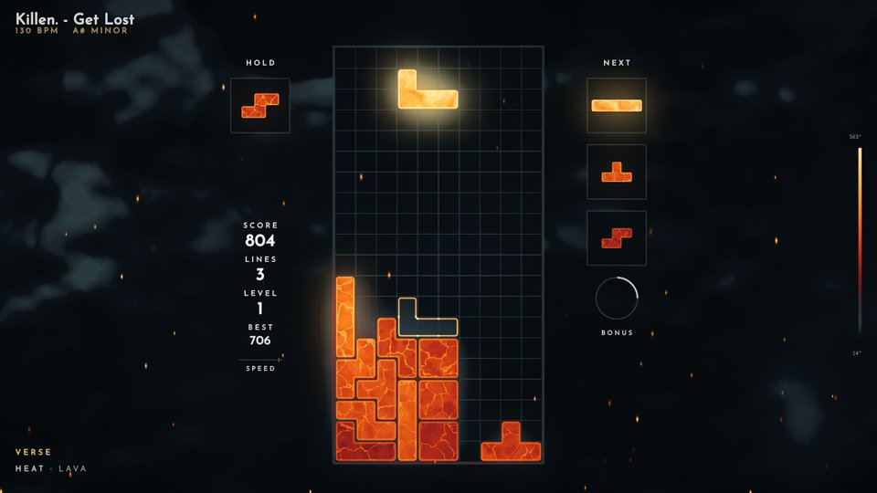<br><b>HEAT</b>: a thermal camera; pieces land white hot and cool down, the heat conducts through the stack and rises, the drop flares into another colormap<br><sub>🔍 <i>to review</i></sub></td>
<td>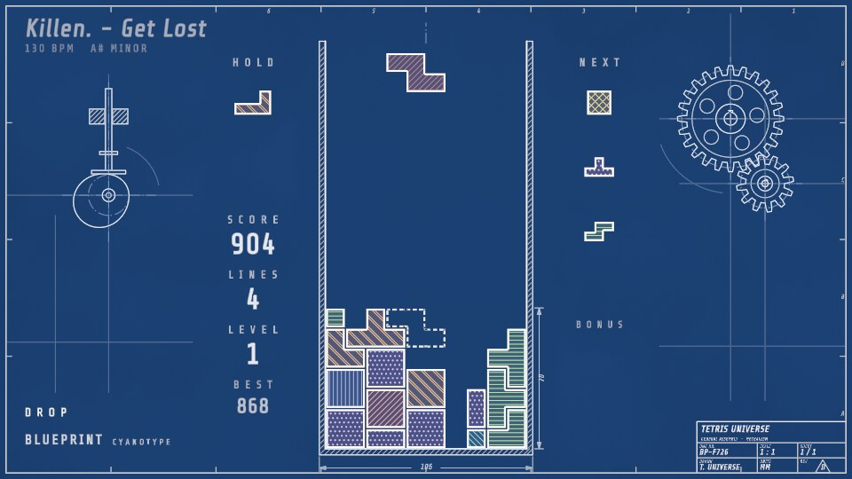<br><b>BLUEPRINT</b>: a technical drawing of hatched, dimensioned parts; a machine drawn in the margins comes alive on the drop<br><sub>🔍 <i>to review</i></sub></td>
</tr>
<tr>
<td><br><b>RECYCLE</b>: a table seen from above, the pieces assembled from heaps of cubes beside the well and cleared rows recycled into them<br><sub>🔍 <i>to review</i></sub></td>
<td>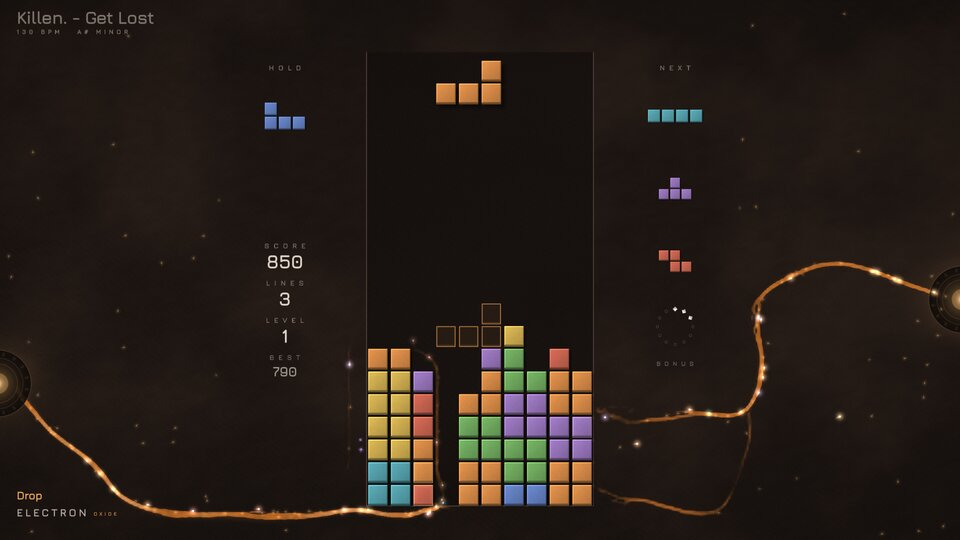<br><b>ELECTRON</b>: solid cubes on a dark substrate, wired up by roaming charges whose glowing connections emerge between two terminals<br><sub>🔍 <i>to review</i></sub></td>
</tr>
<tr>
<td>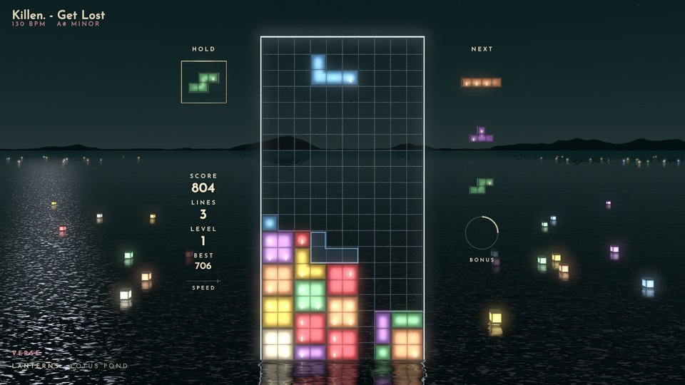<br><b>LANTERNS</b>: a 3D night lake of paper lanterns; each cleared row slides out of the well and floats onto the water as lanterns that stay lit, the drop lifts them all into the sky<br><sub>🔍 <i>to review</i></sub></td>
<td>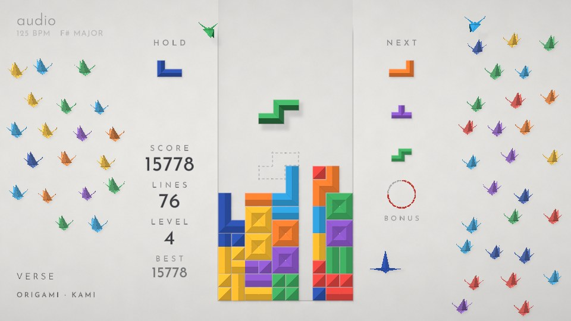<br><b>ORIGAMI</b>: folded paper pieces on a sheet; each cleared row slides out of the well and is folded into a paper crane step by step, the cranes gather around the well and the drop sets the flock flying<br><sub>🔍 <i>to review</i></sub></td>
</tr>
<tr>
<td><br><b>RAINY WINDOW</b>: a night window in the rain, the city out of focus behind it; drops run around the stained glass pieces on the beat, the drop turns the city's lights<br><sub>🔍 <i>to review</i></sub></td>
<td>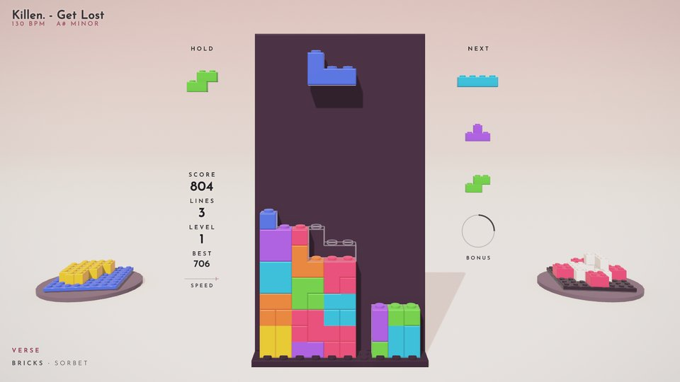<br><b>BRICKS</b>: glossy toy bricks in a photo studio; each cleared row flies off as bricks that build models on turntables, the drop takes them apart and rebuilds them<br><sub>🔍 <i>to review</i></sub></td>
</tr>
<tr>
<td>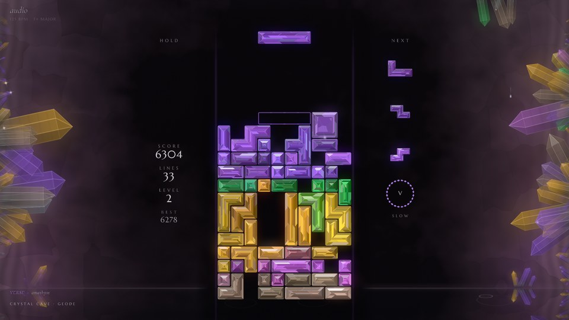<br><b>CRYSTAL CAVE</b>: gemstone pieces in a geode cave; each phase of the song is its own mineral, frozen into the stack at lock time, so the stack grows in strata that record the song<br><sub>🔍 <i>to review</i></sub></td>
<td>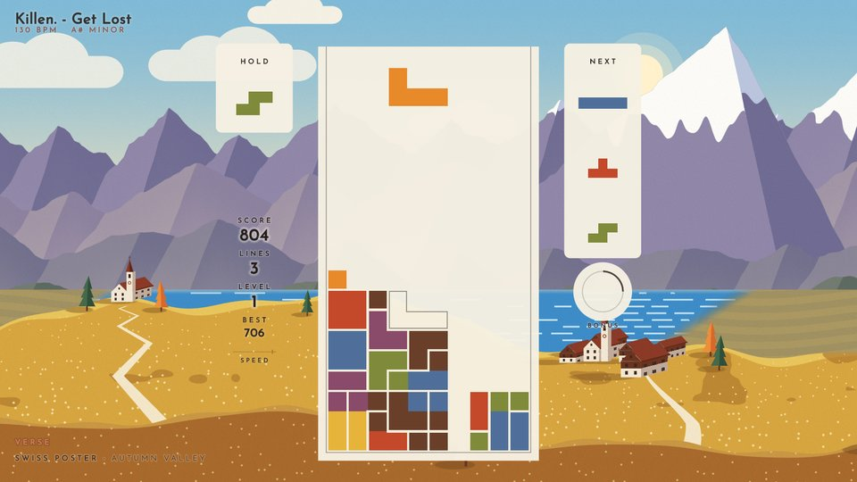<br><b>SWISS POSTER</b>: a Swiss typographic poster set from the song's words, recomposed on the bar grid; flat pieces lock in each section's palette, the drop cuts to the negative print, the title giant<br><sub>🔍 <i>to review</i></sub></td>
</tr>
<tr>
<td><br><b>LIMBO</b>: black silhouettes in a luminous fog; each cleared row adds something to the landscape (birds, trees, lanterns, distant towers), the drop parts the fog and turns the scene to negative<br><sub>🔍 <i>to review</i></sub></td>
<td>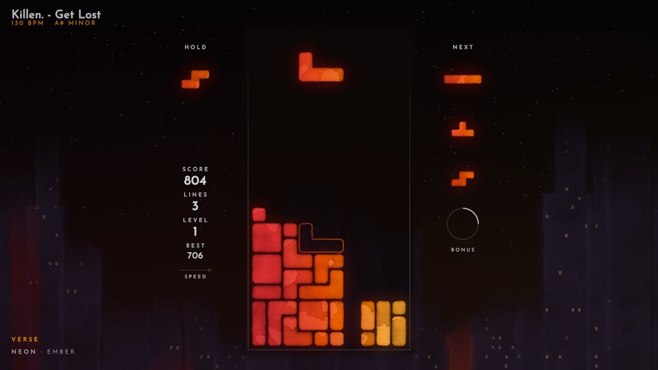<br><b>NEON</b>: glowing watercolor shapes swept in a spectrum over a painted night skyline; each piece keeps its section's colors, each cleared row paints a building into the city, the drop washes the skyline in the spectrum<br><sub>🔍 <i>to review</i></sub></td>
</tr>
<tr>
<td>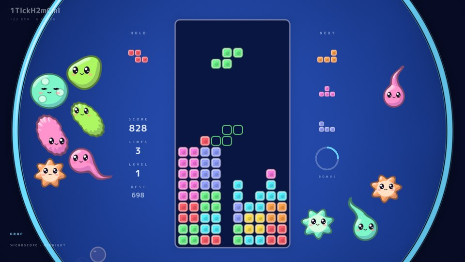<br><b>MICROSCOPE</b>: a Petri dish through the eyepiece, the pieces stained plant cells, some with a microorganism living inside; a cleared row frees them to swim in the dish for the rest of the song, the drop washes in a new stain<br><sub>🔍 <i>to review</i></sub></td>
<td>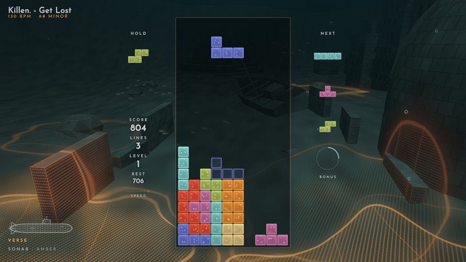<br><b>SONAR</b>: a glide through a dark 3D sunken city where shapes glow up from the black as echoes return on the beat; each cleared row charts the seabed for good, the drop lights the whole world and the glide surges<br><sub>🔍 <i>to review</i></sub></td>
</tr>
<tr>
<td>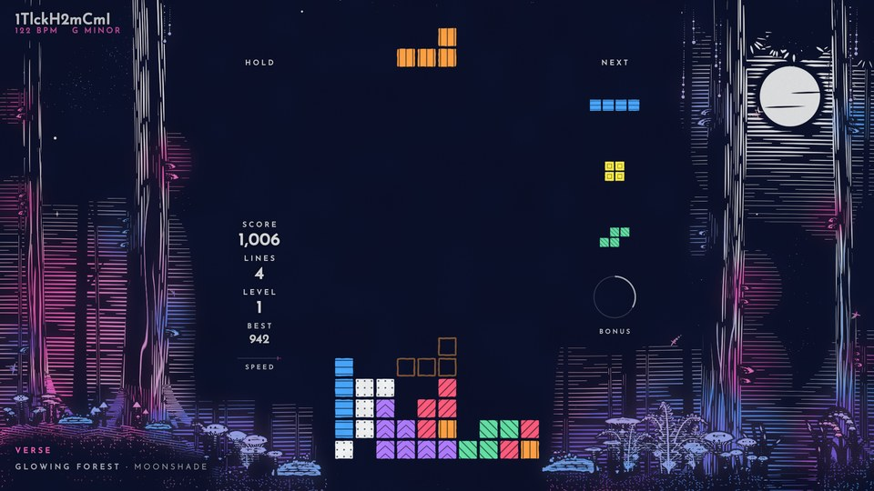<br><b>GLOWING FOREST</b>: a night forest lit only by bioluminescence, trunks fading into the mist, a mossy rock and a still pool; glowing fungus cubes, each cleared row sows a glowing plant that stays, plants glow on the beat grid and the drop sends a slow wave of light through the forest<br><sub>🔍 <i>to review</i></sub></td>
<td><br><b>DOCKS</b>: a container port at dusk in 3D; the falling container piece hangs from a gantry on hairline cables, cleared rows are craned onto ships that fill up over the song, the drop switches the port to full light<br><sub>🔍 <i>to review</i></sub></td>
</tr>
<tr>
<td>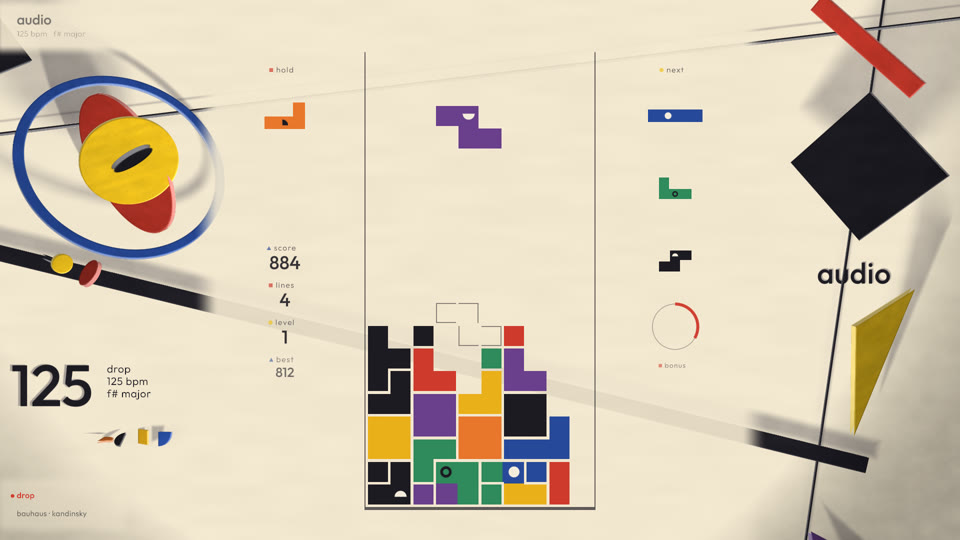<br><b>BAUHAUS</b>: a Bauhaus poster of circles, triangles and squares cut out of thick colored paper and laid on the sheet in relief (soft shadows, lit edges), recomposed on the bar grid; each cleared row joins the poster as a small cut-out in a growing sampler, the drop lifts the forms off the sheet into a turning kinetic sculpture under a circling spotlight, then folds them back into a new composition<br><sub>🔍 <i>to review</i></sub></td>
<td>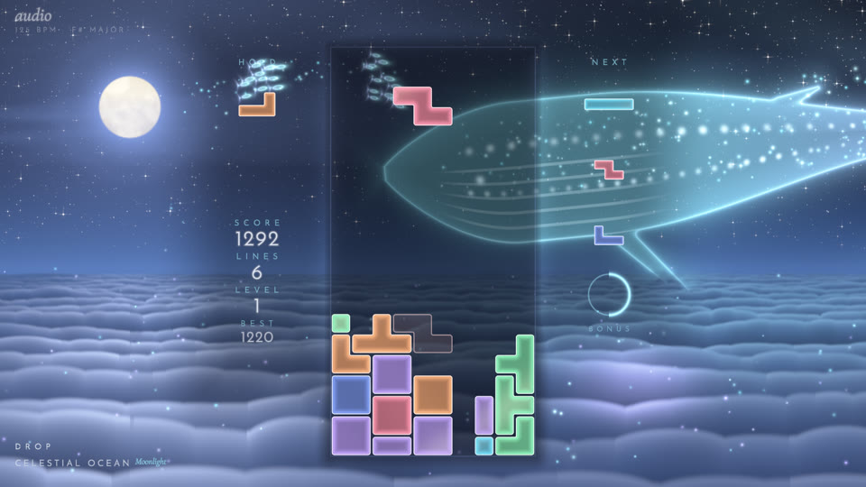<br><b>CELESTIAL OCEAN</b>: a sea of clouds at night under a big moon; moonstone pieces, each cleared row rises out of the clouds as a translucent creature of light (a school of fish, jellyfish, a manta ray, a whale for a Tetris) swimming away through the starry sky, the drop brings a giant whale slowly across the whole sky<br><sub>🔍 <i>to review</i></sub></td>
</tr>
<tr>
<td>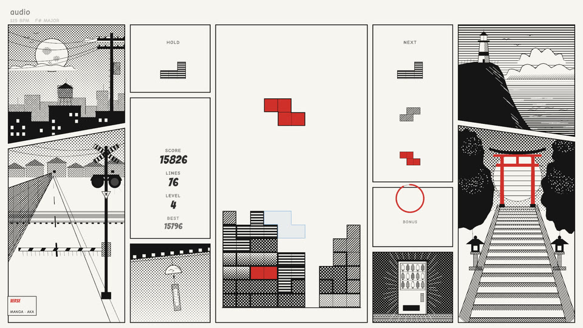<br><b>MANGA</b>: a manga color page in ink, screentones and watercolor washes, drawn in pencil, then inked and colored panel by panel as rows clear; the pieces are inked blocks of color under their screentones, the drop is a full-page splash of color, focus lines and a huge sound effect<br><sub>🔍 <i>to review</i></sub></td>
<td>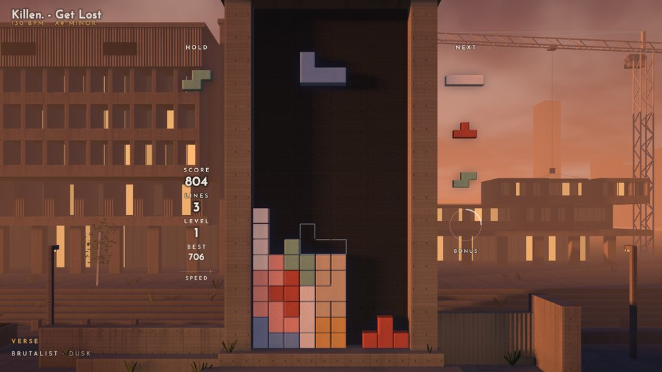<br><b>BRUTALIST</b>: raw board-marked concrete under a hard sun in 3D; the pieces are cast blocks in a slot cut into a monument, the sun moves on with the song and its shadows sweep the plaza, each cleared row has a crane lower a module onto a growing building, the drop is the sun breaking through<br><sub>🔍 <i>to review</i></sub></td>
</tr>
<tr>
<td>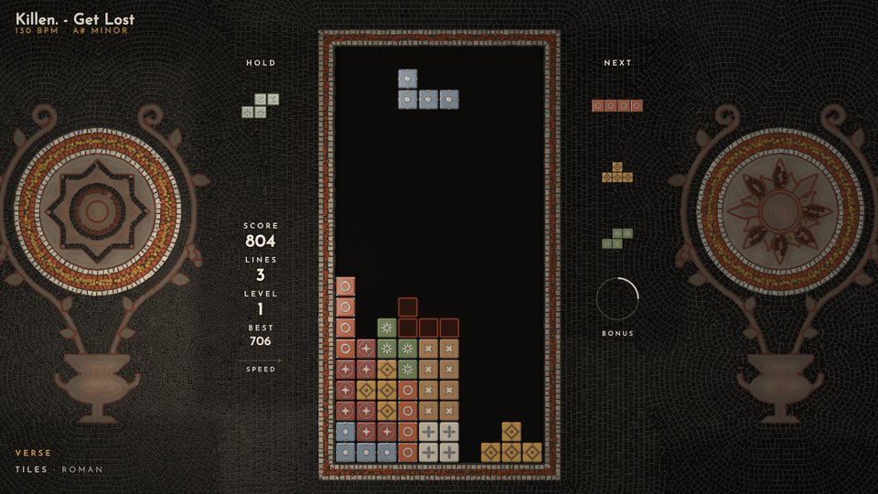<br><b>TILES</b>: a great wall mosaic of tesserae laid in rows following its figures (andamento), gold, glass and stone glinting under a moving lamp; the pieces are glazed azulejo-like tiles, each cleared row breaks into chips tapped one by one into the figures sketched on the bare bed, the drop sets the smalti ablaze<br><sub>🔍 <i>to review</i></sub></td>
<td><br><b>GIANT TREE</b>: a toon world tree shooting up absurdly with every cleared line, from a round sapling in a bright meadow through the clouds, the stratosphere and orbit until the planet is a ball under its roots and its crown passes the moon; the drop beams a rainbow up the trunk into space<br><sub>🔍 <i>to review</i></sub></td>
</tr>
<tr>
<td>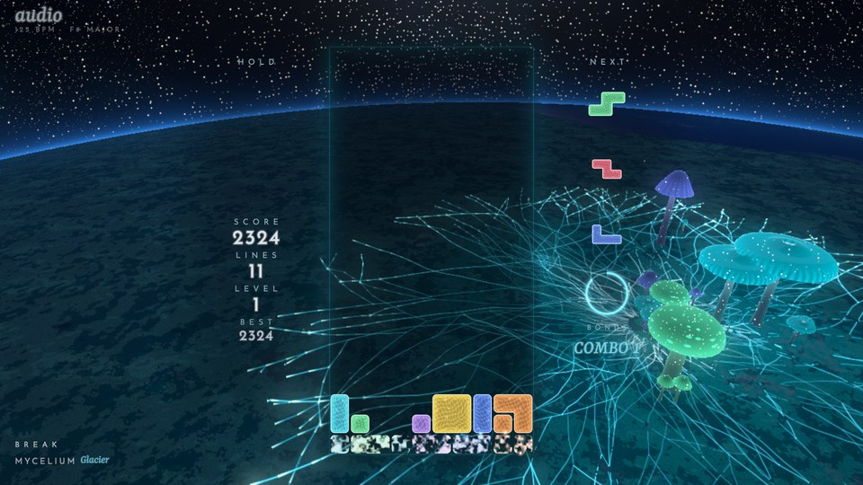<br><b>MYCELIUM</b>: a glowing fungal network grows over the forest floor at night with the cleared lines, from a single spore among the moss (mushrooms bursting up into glowing caps) through a clearing, the forest, a valley with a village and a river, the clouds, a region where the threads glow under the land like veins, until the Earth seen from space on its night side is wrapped in a living web of light, the moon beside it; each clear spurts it outward with a pulse of light from the spore, the drop sends a wave of light through the whole network, up every mushroom's stem, and clouds of spores into the night<br><sub>🔍 <i>to review</i></sub></td>
<td><br><b>MEGACITY</b>: a hut on a riverbank at dusk sprawling with every cleared line along its river, highways and bay into a village, a walled town, a long night skyline of towers and megatalls, arcologies and a space elevator, until the planet is one glowing ball of city lights under an orbital ring; the drop raises a whole district whose lights come on block by block on the beat<br><sub>🔍 <i>to review</i></sub></td>
</tr>
<tr>
<td>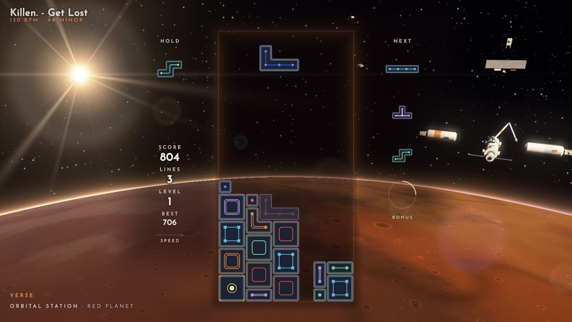<br><b>ORBITAL STATION</b>: a space station building itself in orbit and growing absurdly, a stage an order of magnitude bigger: from a lone capsule to a habitat wheel, a forest ring, nested rings, shipyards, a space elevator, a ring round the planet, more rings and elevators, an O'Neill fleet, the Moon taken in hand, and two rings dwarfing the planet; tugs and traffic never stop; the drop spins the rings up and chases light round them on the beat<br><sub>🔍 <i>to review</i></sub></td>
<td><br><b>LIBRARY</b>: the blocks are clean book-bound cells; each cleared line sends two big books, behind the board, to a cosy toon library room seen as a diorama (in the spirit of Link's Awakening: cut-away walls, round windows, a reading nook, a big plant) that fills slowly: the bookcases, a ladder, piles on the floor, a mezzanine; on the drop the books breathe on their shelves and loose pages flutter<br><sub>🔍 <i>to review</i></sub></td>
</tr>
<tr>
<td>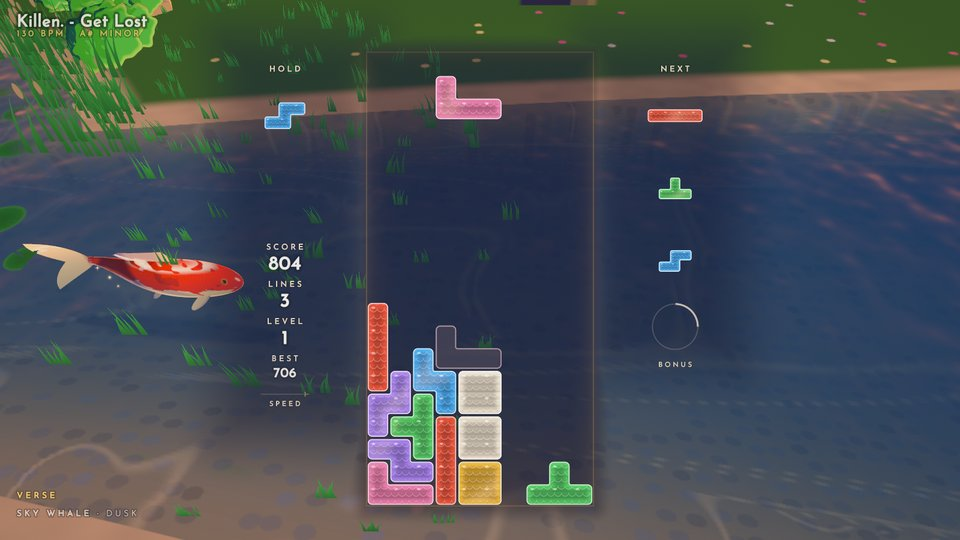<br><b>SKY WHALE</b>: a little koi in a lily pond at dusk, growing with every cleared line, a few strokes of its tail each time: it slips down the river to the sea, breaches as a whale by a lighthouse, swims up through the clouds with seabirds and balloons in its wake, glides around the Earth trailing aurora from its fins, then heads out to the Moon and glides low over its craters; on the drop it sings, soft rings of light rippling out through the sky<br><sub>🔍 <i>to review</i></sub></td>
<td>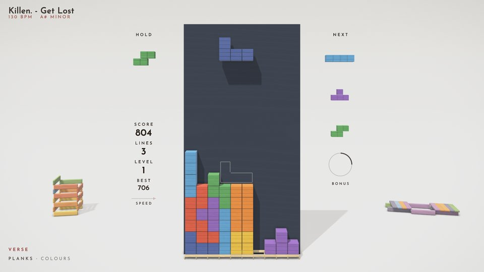<br><b>PLANKS</b>: wooden plank blocks in a white studio, each cell a solid block of three stained planks; each cleared row's planks slip out behind the well, Jenga style, to build a plank village beside it (a tower, a temple, a train on its track, a pagoda), the train shuttles at a peak and the village topples at game over<br><sub>🔍 <i>to review</i></sub></td>
</tr>
<tr>
<td><br><b>TIDE POOL</b>: a humble rock pool at low tide, and every cleared line zooms deeper into it, one continuous dive: the floor's anemones and limpets, plankton in the water, a diatom's glass rose window, a living cell, then imagined physics (molecules, breathing orbital clouds, a boiling quantum foam, strings of light ringing with the song) until a rock pool resolves out of them again; the pieces are sea glass<br><sub>🔍 <i>to review</i></sub></td>
<td>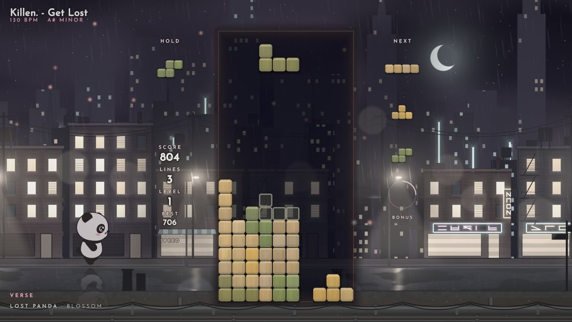<br><b>LOST PANDA</b>: a little kawaii panda, lost in the city at night under the rain, finds its way home one cleared line at a time, in one continuous shot through a world cut away like a cross-section: the shopping street, down the stairs into the subway, a train through the tunnel and out at dawn, the industrial district, the fields, the bamboo forest; fed by bamboo snacks from each clear it grows stronger, and at the end it runs across the screen to its family; the blocks are bamboo segments<br><sub>🔍 <i>to review</i></sub></td>
</tr>
</table>

Disabled for now (not built; their code stays in the repository):

| Universe | Status |
|---|---|
| PIXEL | Too close to a classical Tetris look |
| SYNTHWAVE | To be redesigned (minimal neon) |
| CLOUDSCAPE | To be reworked (nights only) |
| MAGNETS | Iron filings on paper; not convincing yet, waiting for a better idea |
| GARDEN (smooth) | Replaced by its 16-bit version, now GARDEN (`src/universes/garden16/`) |
| SUNPRINT | A sheet turning between two tints, keeping the old one under the stack; to be judged later |
| EMBROIDERY | Cross-stitch on aida; to be judged later |
| SUSHI | Maki in a bento box fed to kawaii cats; on hold |
| RIPPLES | Cut stone blocks in still water seen from above, rippled by every move; on hold |
| STAR CHART | An engraved celestial map filling with constellations; replaced by CELESTIAL OCEAN |
| STAINED GLASS | A cathedral window glazed by molten glass from the cleared rows; disabled |
| GROCERIES | A checkout counter seen from above, cleared rows packed into bags; disabled |
| MUSIC BOX | A cylinder music box pinned with the cleared rows; disabled, not convincing yet |

More in [docs/universes.md](docs/universes.md): every universe and its variants, the transitions, and the
roadmap of the universes to come. To make a new one, see [docs/adding-a-universe.md](docs/adding-a-universe.md).

## Install

[](https://pypi.org/project/zentris/)

Packages for Linux, macOS and Windows are on [PyPI](https://pypi.org/project/zentris/). Run them with
[uv](https://docs.astral.sh/uv/) as above, or install them:

```sh
pipx install tetris-universe        # or: uv tool install tetris-universe
tetris-universe ~/Music     # with no argument it plays the default YouTube playlist
```

Quote YouTube URLs (`&` is special in the shell). YouTube also needs a JavaScript runtime
([Deno](https://deno.com) or Node.js) on your system.

## Controls

Keyboard and gamepad both work at the same time. A gamepad is detected at startup and on hot-plug,
and the on-screen hints follow whichever device you used last.
Controllers are recognised through the bundled [SDL_GameControllerDB](https://github.com/mdqinc/SDL_GameControllerDB)
(`third_party/gamecontrollerdb.txt`; extra mappings can be given in `SDL_GAMECONTROLLERCONFIG`). A controller
missing from it still works with a generic layout.

| Action | Keyboard | Gamepad |
|---|---|---|
| Move | ← → | D-pad / left stick |
| Soft / hard drop | ↓ / Space | Down / Up |
| Rotate | ↑ or X (Z or J to rotate left) | A (B/X to rotate left) |
| Hold | C / Shift (tap) | LB / RB |
| Slow motion (when the gauge is full) | V / E | ZL / ZR (LT / RT) |
| Next universe (with `--universe`: its next variant, a new seed) | T | Y |
| Next song | N / Tab / Enter / PageDown | Back |
| Seek ±10 s in the song (testing) | Ctrl+Shift+Left/Right | |
| Next level (debugging) | L | |
| Fill the bonus gauge (testing) | B | |
| Pause | Esc / P (Q quits while paused) | Start |
| Fullscreen | F / F11 | |

## Tools

- `tetris-universe-scope [songs...]`: see what the game hears (the song's structure, phases, beats and spectrum), and write
  notes on it.
- `tetris-universe-scene [UNIVERSE[:VARIANT]]`: browse universes, variants, song phases and transitions while the computer plays.

Both come with the package (`uvx --from tetris-universe tetris-universe-scope`). Every option, the tools and how the music drives the
game are in [docs/reference.md](docs/reference.md).

## Build from source

```sh
sudo apt install cmake g++ libglfw3-dev libglew-dev    # Debian/Ubuntu
cmake -S . -B build && cmake --build build -j
./build/tetris-universe ~/Music
```

`-DZENTRIS_DISABLED_UNIVERSES="pixel;cloudscape;synthwave;garden;magnets;sunprint;embroidery;sushi;ripples;starchart;stainedglass;groceries;musicbox"` (the default) lists the universes left out of the build;
`-DZENTRIS_DISABLED_UNIVERSES=""` builds them all.
