<p align="center">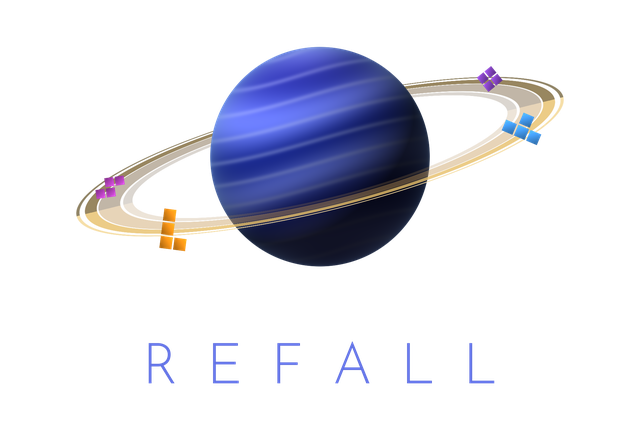</p>

A falling-block puzzle game across **61 hand-directed universes**, each staged by the music: pieces fall on the
beat and the pace follows the song. Play the game's Voyage, or **any music you like**: your own folders or YouTube
playlists.

[](https://www.youtube.com/watch?v=RY9UekAFT1c)

```sh
uvx refall
```

Or download the game itself, nothing to install: the
[Windows .exe](https://github.com/Gregwar/refall/releases/latest/download/Refall-windows-x64.exe), the
[Linux AppImage](https://github.com/Gregwar/refall/releases/latest/download/Refall-linux-x86_64.AppImage) or the
[macOS app](https://github.com/Gregwar/refall/releases/latest/download/Refall-macos-arm64.dmg) (Apple silicon;
[Intel](https://github.com/Gregwar/refall/releases/latest/download/Refall-macos-x64.dmg)).

## Universes

Each song plays in one of them, in one of its variants.

<table>
<tr><td width="25%"><br><b>VECTOR</b><br><sub>phosphor beams on a dark CRT</sub></td><td width="25%"><br><b>SUMI</b><br><sub>ink on washi paper</sub></td><td width="25%"><br><b>DIORAMA</b><br><sub>a sunlit clay miniature on an island</sub></td><td width="25%">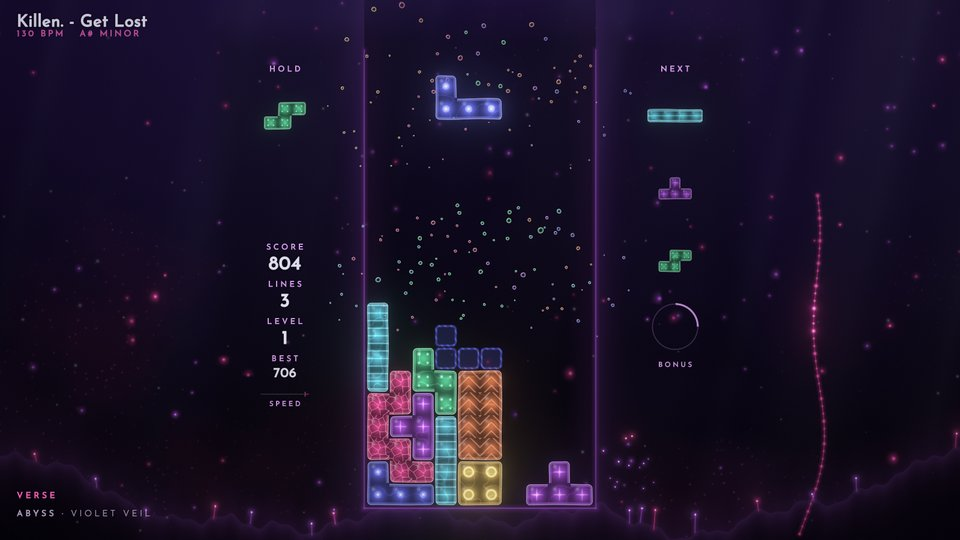<br><b>ABYSS</b><br><sub>the deep sea, lit only by living things</sub></td></tr>
<tr><td width="25%"><br><b>SMOKE</b><br><sub>a dark stage, slow smoke and one hard spotlight</sub></td><td width="25%"><br><b>WATERCOLOR</b><br><sub>watercolor on cold-press paper</sub></td><td width="25%">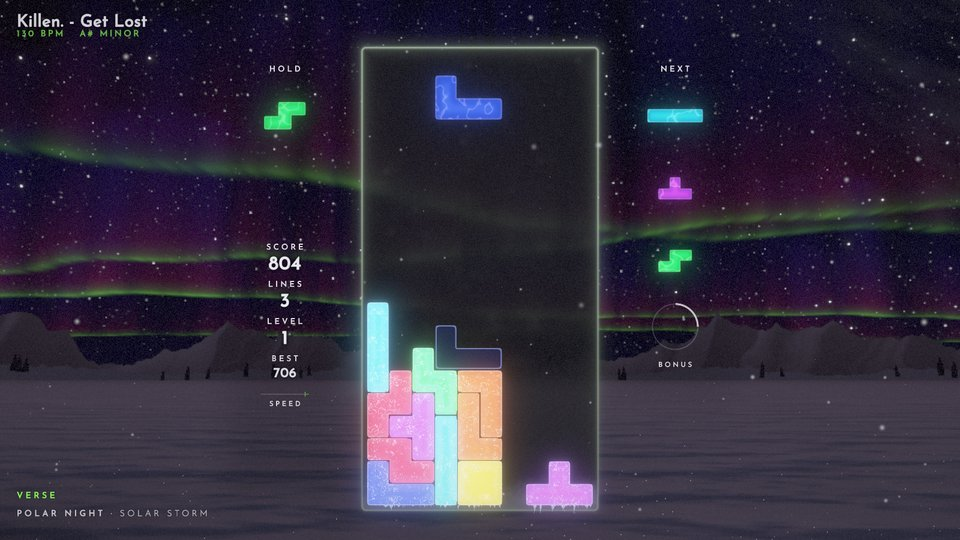<br><b>POLAR NIGHT</b><br><sub>a snowfield under the stars, aurora ribbons</sub></td><td width="25%">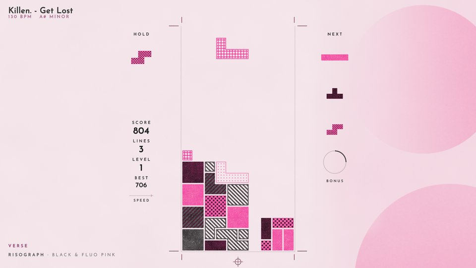<br><b>RISOGRAPH</b><br><sub>a two-ink risograph print</sub></td></tr>
<tr><td width="25%">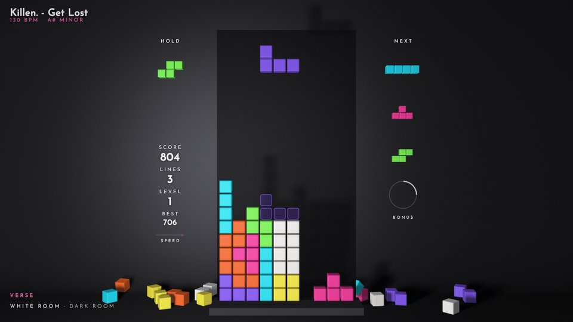<br><b>WHITE ROOM</b><br><sub>a seamless white studio, matte blocks and soft shadows</sub></td><td width="25%"><br><b>KINTSUGI</b><br><sub>dark polished stone, ceramic pieces mended with gold</sub></td><td width="25%">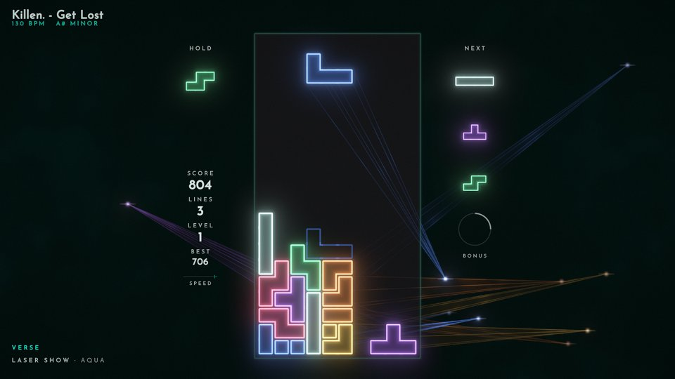<br><b>LASER SHOW</b><br><sub>every piece projected by its own laser in a dark haze</sub></td><td width="25%"><br><b>GARDEN</b><br><sub>tiles of earth growing pixel grass and flowers</sub></td></tr>
<tr><td width="25%"><br><b>BIOME</b><br><sub>glass cubes of water or seeds bringing a 3D world to life</sub></td><td width="25%"><br><b>FLUO</b><br><sub>fluorescent paint splashed on a dark wall</sub></td><td width="25%"><br><b>MARBLES</b><br><sub>glass marbles in square tiles</sub></td><td width="25%"><br><b>PRISM</b><br><sub>glass cubes in the dark, crossed by slow beams of light</sub></td></tr>
<tr><td width="25%">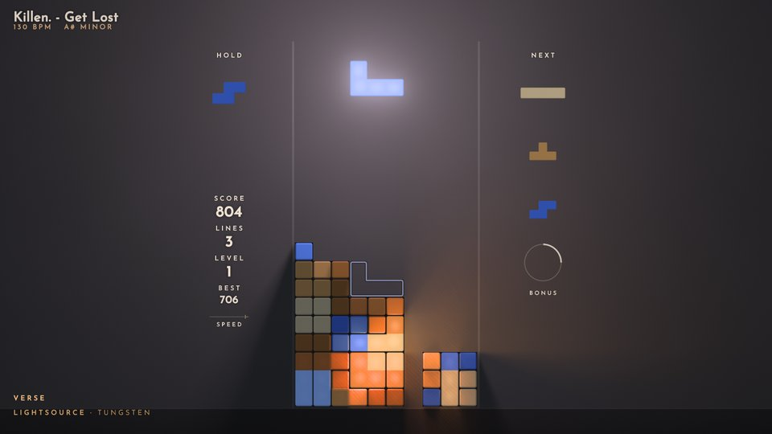<br><b>LIGHTSOURCE</b><br><sub>dim room where the falling piece is the light</sub></td><td width="25%">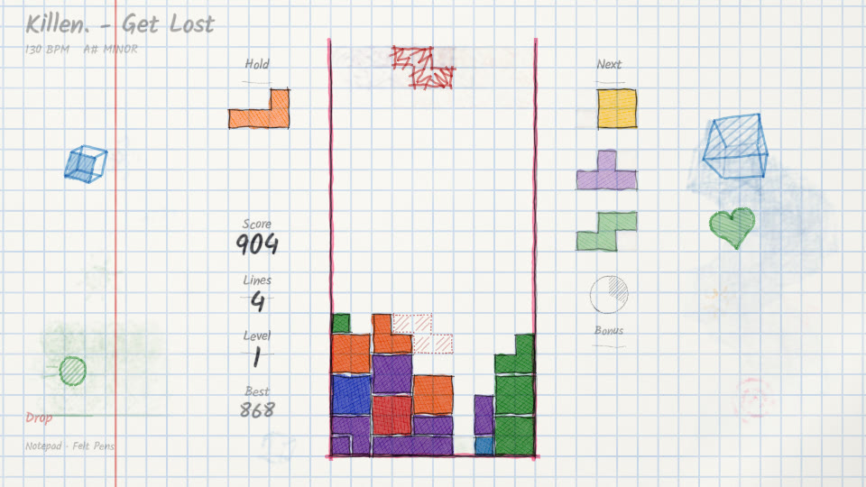<br><b>NOTEPAD</b><br><sub>a squared notebook drawn by hand in stop motion</sub></td><td width="25%"><br><b>CITY</b><br><sub>a tower's facade in a night city, its lit rooms the blocks</sub></td><td width="25%"><br><b>TOPOGRAPHY</b><br><sub>contour map whose terrain is the stack, rain carving it</sub></td></tr>
<tr><td width="25%"><br><b>HEAT</b><br><sub>a thermal camera</sub></td><td width="25%"><br><b>BLUEPRINT</b><br><sub>a technical drawing</sub></td><td width="25%">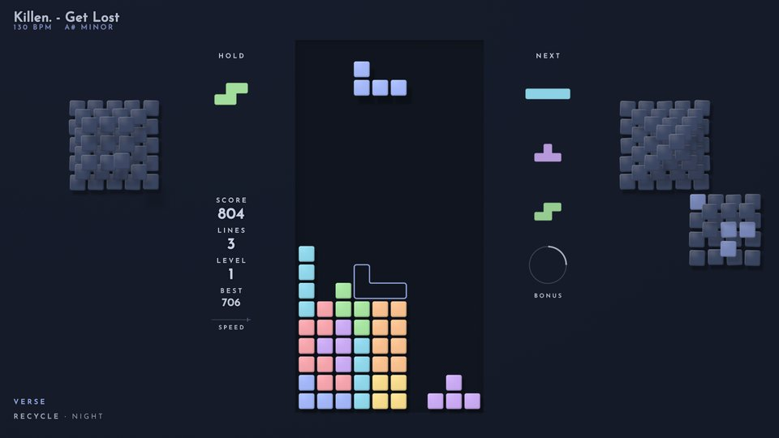<br><b>RECYCLE</b><br><sub>sorting recyclables on a table</sub></td><td width="25%"><br><b>ELECTRON</b><br><sub>bare silicon dies on a dark substrate</sub></td></tr>
<tr><td width="25%"><br><b>LANTERNS</b><br><sub>paper lanterns on a night lake</sub></td><td width="25%"><br><b>ORIGAMI</b><br><sub>folded paper pieces on a sheet</sub></td><td width="25%">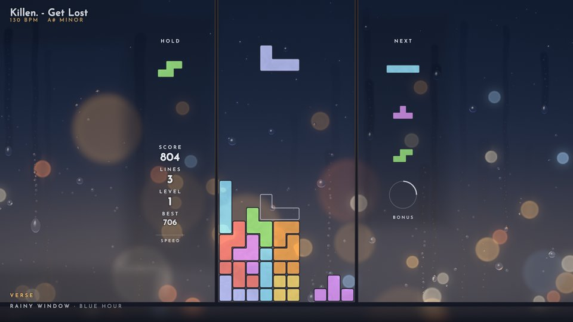<br><b>RAINY WINDOW</b><br><sub>a rainy night window, the city blurred behind</sub></td><td width="25%"><br><b>BRICKS</b><br><sub>glossy toy bricks in a photo studio</sub></td></tr>
<tr><td width="25%"><br><b>CRYSTAL CAVE</b><br><sub>gemstone pieces in a geode cave</sub></td><td width="25%"><br><b>SWISS POSTER</b><br><sub>a vintage travel poster in flat design</sub></td><td width="25%">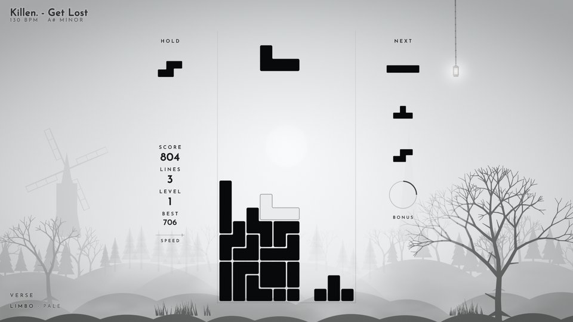<br><b>LIMBO</b><br><sub>black silhouettes in a luminous fog</sub></td><td width="25%"><br><b>NEON</b><br><sub>glowing watercolor shapes in a spectrum over a painted night skyline</sub></td></tr>
<tr><td width="25%"><br><b>SONAR</b><br><sub>sonar echoes lighting a sunken world</sub></td><td width="25%"><br><b>GLOWING FOREST</b><br><sub>a night forest in relief print and neon inks</sub></td><td width="25%">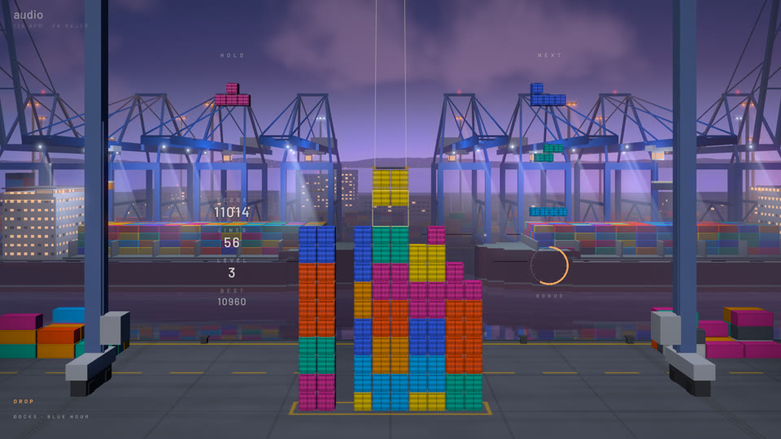<br><b>DOCKS</b><br><sub>a container port at dusk in 3D</sub></td><td width="25%"><br><b>BAUHAUS</b><br><sub>a Bauhaus poster</sub></td></tr>
<tr><td width="25%"><br><b>CELESTIAL OCEAN</b><br><sub>a sea of clouds at night under a big moon</sub></td><td width="25%"><br><b>MANGA</b><br><sub>a manga color page in ink, screentones and watercolor washes</sub></td><td width="25%"><br><b>BRUTALIST</b><br><sub>raw concrete under a hard sun in 3D</sub></td><td width="25%"><br><b>TILES</b><br><sub>a great wall mosaic of tesserae</sub></td></tr>
<tr><td width="25%">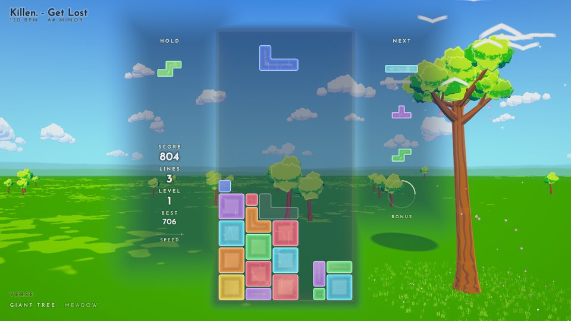<br><b>GIANT TREE</b><br><sub>a toon world tree shooting up with every cleared line</sub></td><td width="25%"><br><b>MYCELIUM</b><br><sub>a glowing fungal network growing over the forest floor at night</sub></td><td width="25%">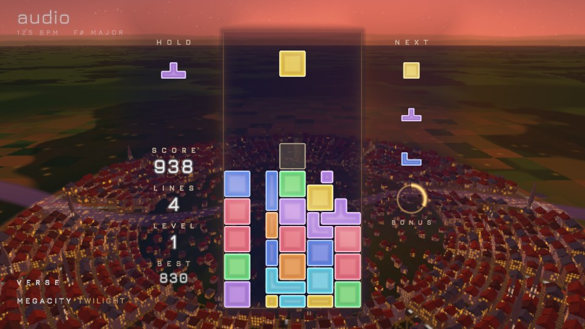<br><b>MEGACITY</b><br><sub>a riverbank hut growing into a megacity</sub></td><td width="25%"><br><b>ORBITAL STATION</b><br><sub>a space station building itself in orbit</sub></td></tr>
<tr><td width="25%">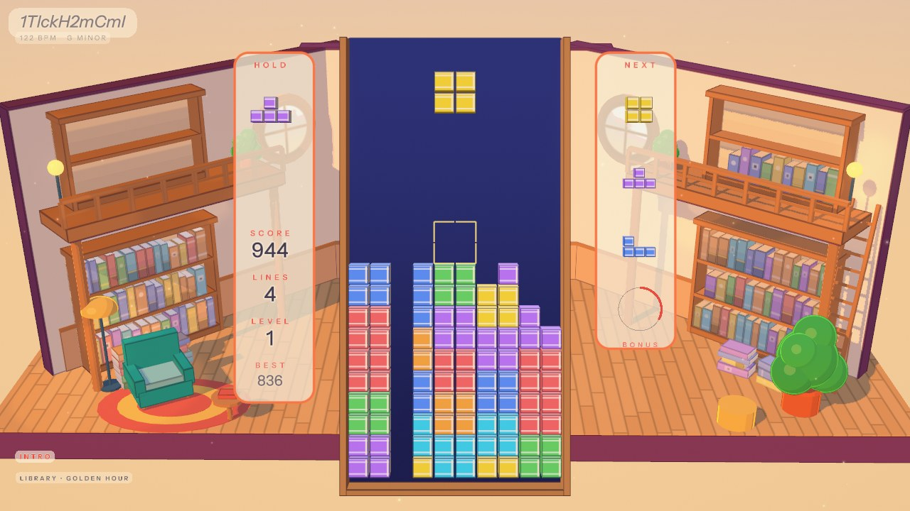<br><b>LIBRARY</b><br><sub>the blocks are books</sub></td><td width="25%"><br><b>SKY WHALE</b><br><sub>a koi in a pond growing into a sky whale</sub></td><td width="25%"><br><b>PLANKS</b><br><sub>wooden plank blocks in a white studio</sub></td><td width="25%">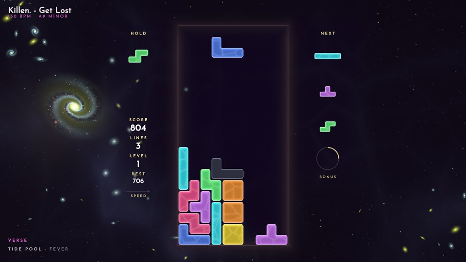<br><b>TIDE POOL</b><br><sub>a rock pool at low tide, seen from above</sub></td></tr>
<tr><td width="25%"><br><b>LOST PANDA</b><br><sub>a little panda lost in the city at night</sub></td><td width="25%"><br><b>TERRARIUM</b><br><sub>a sealed glass jar on a windowsill</sub></td><td width="25%"><br><b>CORAL REEF</b><br><sub>a sunny shallow reef that grows with every cleared line</sub></td><td width="25%">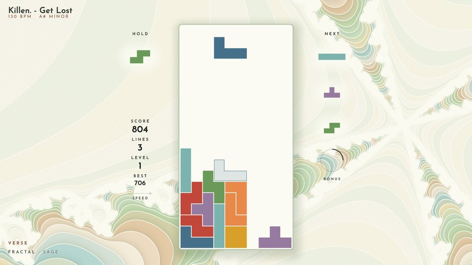<br><b>FRACTAL</b><br><sub>an infinite pastel flower</sub></td></tr>
<tr><td width="25%">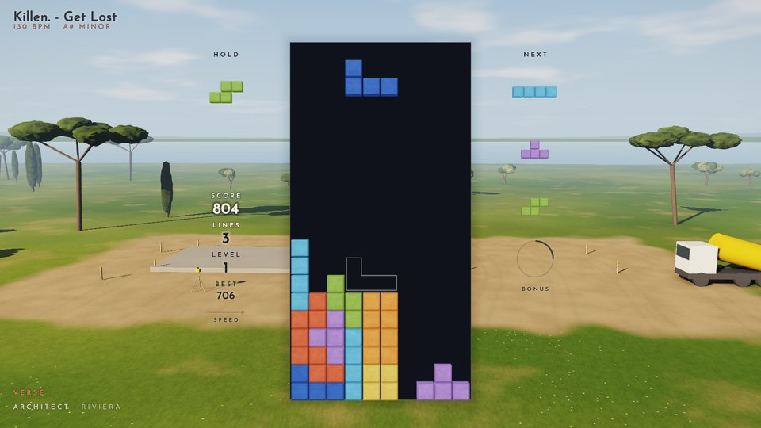<br><b>ARCHITECT</b><br><sub>a modern villa built over the song by two tower cranes</sub></td><td width="25%"><br><b>ISLANDS</b><br><sub>a flight over an endless tropical archipelago, like drone footage</sub></td><td width="25%"><br><b>RAIN</b><br><sub>rain everywhere over a colorful street at dusk</sub></td><td width="25%">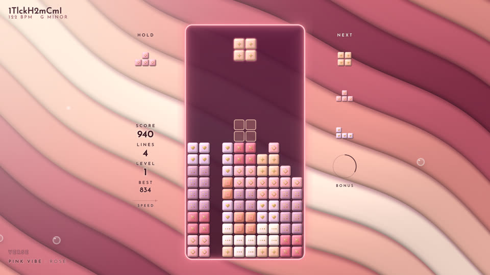<br><b>PINK VIBE</b><br><sub>a soft pink world of satin ribbons in relief</sub></td></tr>
<tr><td width="25%">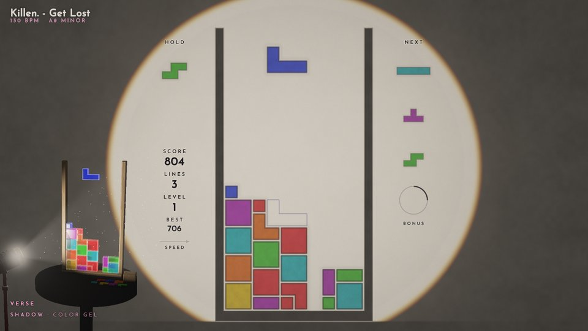<br><b>SHADOW</b><br><sub>a little model of the game on a table, lit by a projector</sub></td><td width="25%">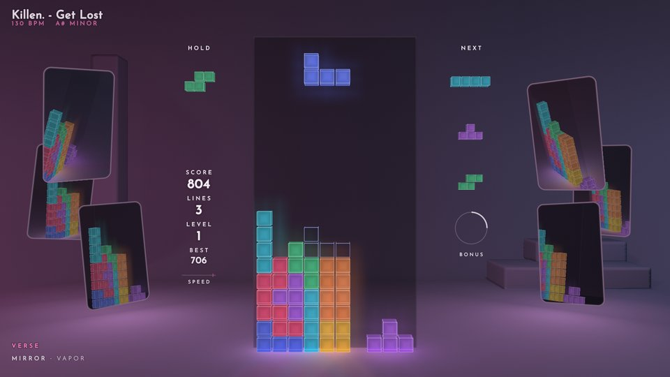<br><b>MIRROR</b><br><sub>glass cubes in a liminal room, softly lit</sub></td><td width="25%"><br><b>RUINS</b><br><sub>time runs backwards over the song</sub></td><td width="25%"><br><b>PIXEL</b><br><sub>native low-resolution pixel art, sixteen colors, dithered skies</sub></td></tr>
<tr><td width="25%">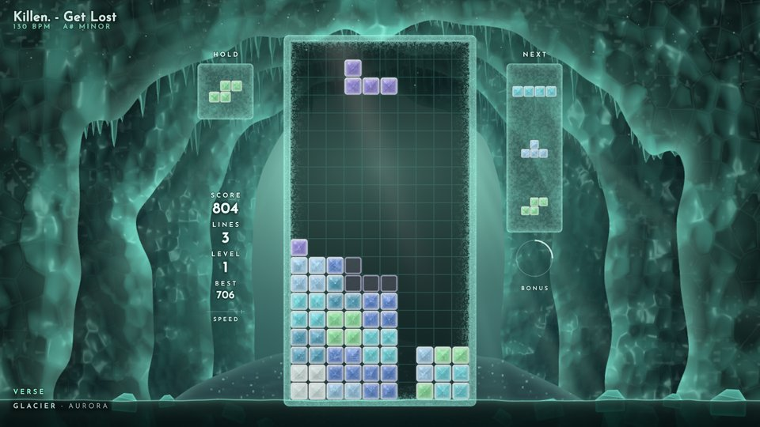<br><b>GLACIER</b><br><sub>ice cubes melting into a rising pool in an ice cave</sub></td></tr>
</table>

Every universe, its variants and the transitions: [docs/universes.md](https://github.com/Gregwar/refall/blob/main/docs/universes.md). To make one: [docs/adding-a-universe.md](https://github.com/Gregwar/refall/blob/main/docs/adding-a-universe.md).

## Modes

- **Voyage**: a campaign of 15 stages, each a few songs in chosen universes, faster and faster, on EASY, NORMAL, HARD, EXPERT or MASTER (every song at the top velocity).
- **Free play**: any folders, files or YouTube playlists, at the difficulty and starting level you pick.

Menu details and the Voyage file format: [docs/reference.md](https://github.com/Gregwar/refall/blob/main/docs/reference.md#menu-and-modes).

## Install

[](https://pypi.org/project/refall/)

**Windows:** download [Refall-windows-x64.exe](https://github.com/Gregwar/refall/releases/latest/download/Refall-windows-x64.exe)
and run it: one file, nothing to install.

**Linux:** download [Refall-linux-x86_64.AppImage](https://github.com/Gregwar/refall/releases/latest/download/Refall-linux-x86_64.AppImage)
([aarch64](https://github.com/Gregwar/refall/releases/latest/download/Refall-linux-aarch64.AppImage)), make it
executable (`chmod +x Refall-linux-x86_64.AppImage`) and run it.

**macOS:** open [Refall-macos-arm64.dmg](https://github.com/Gregwar/refall/releases/latest/download/Refall-macos-arm64.dmg)
(Apple silicon; [Intel](https://github.com/Gregwar/refall/releases/latest/download/Refall-macos-x64.dmg)) and drag
Refall to Applications. It is not signed by an Apple developer: the first time, right-click it and choose Open (or
System Settings > Privacy & Security > Open Anyway).

These three fetch yt-dlp, ffmpeg and Deno (about 100 MB, into the game's cache) at the first YouTube song.

Packages for Linux, macOS and Windows are on [PyPI](https://pypi.org/project/refall/). Run them with
[uv](https://docs.astral.sh/uv/) as above, or install them:

```sh
pipx install refall        # or: uv tool install refall
refall
```

YouTube needs a JavaScript runtime ([Deno](https://deno.com) or Node.js) on your system.

## Controls

Keyboard and gamepad both work, at the same time.

| Action | Keyboard | Gamepad |
|---|---|---|
| Move | ← → | D-pad / left stick |
| Soft / hard drop | ↓ / Space | Down / Up |
| Rotate | ↑ or X (Z or J to rotate left) | A (B/X to rotate left) |
| Hold | C / Shift (tap) | LB / RB |
| Slow motion (when the gauge is full) | V / E | ZL / ZR (LT / RT) |
| Next universe (with `--universe`: its next variant, a new seed) | T | Y |
| Next song | N / Tab / Enter / PageDown | Back |
| Pause (its menu: continue, the controls, back to the menu; Q quits at once) | Esc / P | Start |
| Fullscreen | F / F11 | |

Testing keys, gamepad mappings and playing from a phone: [docs/reference.md](https://github.com/Gregwar/refall/blob/main/docs/reference.md#controls-in-detail).

## Tools

- `refall-scope [songs...]`: see what the game hears (structure, beats, spectrum).
- `refall-voyage-viewer [campaign]`: watch the computer play through a campaign.

Both ship with the package (`uvx --from refall refall-scope`). Every option and how the music drives the game:
[docs/reference.md](https://github.com/Gregwar/refall/blob/main/docs/reference.md).

## Build from source

```sh
sudo apt install cmake g++ libglfw3-dev libglew-dev    # Debian/Ubuntu
cmake -S . -B build && cmake --build build -j
./build/refall
```

`-DREFALL_DISABLED_UNIVERSES=""` also builds the universes left out by default (see [docs/universes.md](https://github.com/Gregwar/refall/blob/main/docs/universes.md)).

## License

Refall is free for any noncommercial use (personal, education, research, non-profit) under the
[PolyForm Noncommercial License 1.0.0](https://github.com/Gregwar/refall/blob/main/LICENSE). For commercial use, contact the author. Fonts and bundled libraries
keep their own licenses (see [LICENSE](https://github.com/Gregwar/refall/blob/main/LICENSE)). Contributions are welcome: see [CONTRIBUTING.md](https://github.com/Gregwar/refall/blob/main/CONTRIBUTING.md).

