# Universes

Each song is played in a **universe**: a complete, hand-directed art direction with its own world, palette,
materials, HUD style and its own way of staging the music (beats, kicks, calm / mid / peak levels, line clears,
Tetris, slow motion, game over). A universe is one world, not a set of random options. The song chooses
the intensity inside that world, never a different world.

A universe is picked for each song from its footprint (each universe says how well it suits a song: tempo,
brightness, density...) and the run's seed, never the same one twice in a row; `--universe` forces one, T / Y
moves on to the next. Every universe ships a few curated **variants**, picked per song or forced
(`--universe VECTOR:AMBER`, `--universe SUMI:AIZOME`); the bottom-left corner shows `UNIVERSE · VARIANT`.

## VECTOR

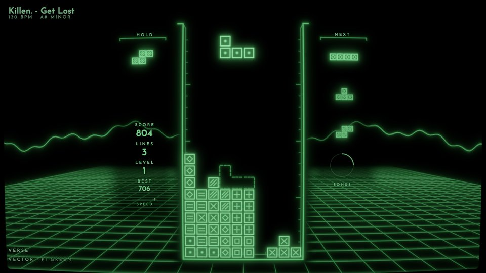

Phosphor beams on a dark CRT. Four phosphors (P1 green, P3 amber, P4 white, P22 rose), from the key. The pieces burn with a white-hot core and a faint lit interior; the world behind (horizon trace, floor grid, mountains) is dimmer, thinner and fades out around the well. Peaks stay calm: low mountains breathing with the spectrum, two faint Lissajous scopes, a soft bloom swell on the drop. A drop retunes the tube to another phosphor for its whole length (green and rose turn amber, amber and white turn rose), back to the song's own when it ends.

## SUMI

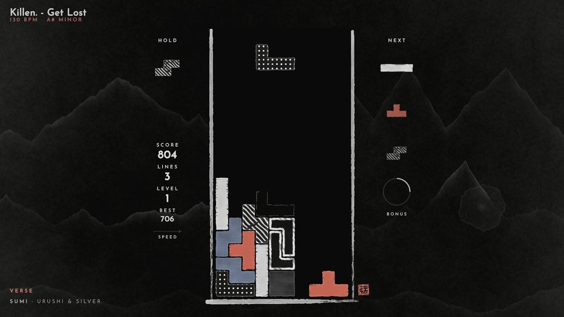

Ink on washi paper. Eight inks (SUMI & SHU, AIZOME & OCHRE, SEPIA & CELADON, MURASAKI & GOLD, MATCHA & RUST, KAKI & CHARCOAL, and two lacquer negatives, URUSHI & SILVER and YORU & GOLD), from the key's hue (half of the night songs and about one song in five take a negative). Calm is a faint far mountain on white paper, mid brings mist, drifting ranges and a few petals; the peak brushes the ensō around a red sun and paints a plum branch in from the bottom right corner, stroke by stroke, its blossoms (the accent's wash or pale ink) opening behind the brush while petals drift down across the paper on a gentle wind (faint behind the well). A drop waits for its first downbeat to brush the ensō and the branch, blows a flurry of petals off the blossoms and hurls them all down very fast on a gust that dies down over a few seconds (the petals visibly slowing to the drop's steady fall, denser than a chorus'), and soaks the lower sky in a wash of color (the accent, or a deeper second ink where the accent is gold), with one swell on the downbeat and a steady level for the whole drop. Slow motion turns the print to its negative.

## DIORAMA

A clay miniature by night, the well a tower on a small island in a still sea, its lanterns lit. Twelve places, from the key and mode (MEADOW COVE, TERRACOTTA MESA, LAVENDER SNOW, PINE AND SEA, AUTUMN MAPLES, MANGO LAGOON, SAKURA STONES, JADE VOLCANO, HEATHER HIGHLANDS under the shared night sky; MOONLIT COVE, LANTERN HARBOR, FIREFLY FJORD with skies of their own); the song's phases move the moon across the sky (moonrise, midnight, starlight, lantern hour), a drop turns the night to a golden evening for its whole length (a low warm sun, back to night when it ends), and slow motion brings the day: the place sunlit, its clay pale, the time slowed. Cleared blocks pop off the tower and shrink away as they tumble; a landing pushes one puff of dust out from under the piece. The HUD has no plaques or cards: cream lettering set straight over the scene, each glyph on a feathered dark halo, so it reads on the pale clay by day and on the night sea alike; its font is Comfortaa (SIL Open Font License, `src/universes/diorama/OFL-Comfortaa.txt`).

## PIXEL

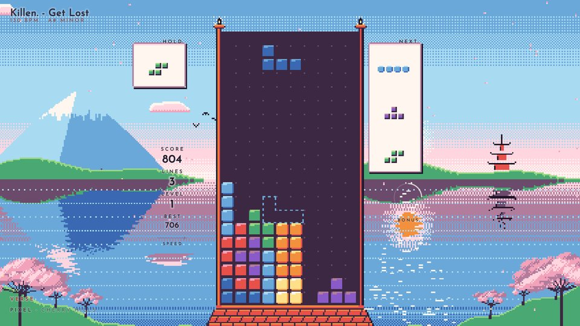

Native low-resolution pixel art, drawn on a small canvas (a well cell is 8 canvas pixels) and scaled up with nearest sampling: sixteen colors per variant, ordered Bayer dithering, parallax ranges, stepped animation. Eight places (PINE DUSK, RED CANYON, SNOW PEAKS, NEON CITY, SEA CLIFFS, CHERRY HILLS, EMBER PEAKS, JADE FALLS), from the key's hue and the mood (`--universe pixel:cherry`). Calm is a still dusk landscape, mid brings nearer layers and critters moving on the beat, peak adds weather (rain and lightning, sand, snow and aurora, petals, ash, leaves) and a foreground that hops by whole pixels. Locks squash, clears explode into pixels, a Tetris fires pixel fireworks across the screen, slow motion swaps to a night palette, and a game over crumbles the stack grain by grain. Its two pixel fonts are drawn by hand in `src/universes/pixel/font.cpp`.

## SYNTHWAVE

A night drive, shot like a film (Drive, The Midnight): one soft sun (or moon) low on the horizon to one side, deep haze, a wet road that mirrors it in a long broken column, a few fine grid lines running into the fog, street lamps passing, the well a slab of smoked glass with hairline rails. The pieces are frosted glass lit from inside (a soft inner glow, a thin bright rim). Finished like film: bloom with a little halation, anamorphic streaks on the brightest lights, a filmic curve with rich blacks, a fine grain. Eight nights (MIDNIGHT, SODIUM, MOONLIGHT, TAIL LIGHTS in the rain, VIOLET FOG, MINT DAWN, CITY LIGHTS, ROSE DUSK), from the key, mode and brightness. Calm is a quiet empty road (the sun nearly set, thick fog, the floor still), mid drives forward with the tempo (the lines scroll, lamps pass, light pulses run into the fog on the beat), peak is the fast drive (head- and tail-light trails, the haze lit up, flares blooming on the kicks). A cleared row leaves as a light trail toward the sun, a Tetris flares the sun and the lens, slow motion is a time stretch (letterbox, the night drained of color, a timecode), game over turns the lights off row by row while the camera tilts down into the fog; it leaves and enters through the fog. Its HUD font is Sora (SIL Open Font License, `src/universes/synthwave/OFL-Sora.txt`).

## CLOUDSCAPE

Above an endless sea of clouds, no ground, only sky: a ray-marched sea of cumulus tops fading into the haze, the well and the HUD columns floating panes of frosted glass (only the blur of the sky behind them, no frame), the pieces flat, soft-colored rounded tiles. Eight skies (DAWN, AZURE NOON, GOLDEN HOUR, STORM VIOLET, POLAR NIGHT with aurora, ROSE SUNSET, MONSOON, BLUE HOUR), from the key, mode, brightness and dynamics (`--universe cloudscape:storm`). Calm is a still, hazy sea of clouds, mid drifts the clouds with the tempo (a glide on each beat) while flocks of birds cross the distance flapping on the beat and gentle beams fall from the sun, peak raises the camera while towering cumulus grow out of the sea, god rays stream through their gaps and the kicks light them from inside. A lock breathes a puff of mist, a cleared row dissolves into mist drifting away on the wind, a Tetris parts the high veil and the sun bursts through, slow motion is night above the clouds (the moon, stars, silver cloud tops), game over drops the stack through the sea of clouds as the mist rises; it leaves and enters with the clouds closing in. The sky is drawn at a reduced resolution (at most 540 lines), the rays at a quarter of that. Its HUD fonts are EB Garamond Italic and Lato (SIL Open Font License, `src/universes/cloudscape/OFL-*.txt`).

## ABYSS

The deep sea, lit only by living things: near-black water with real depth (the far surface a faint glow overhead, slow murk, a dark seabed with glowing worms), sparse marine snow, the well a faint glass column. The pieces are translucent gelatinous blocks lit from within (an inner glow, a bright membrane, caustic veins, and a pattern of their own per piece: filaments, a ring, radial canals, photophores, a cellular net, a nucleus, chevrons); blocks of the same kind merge into one jelly mass. Eight palettes (CYAN LANTERN, VIOLET VEIL, EMERALD TRENCH, EMBER VENT, ICE LIGHT, ULTRAMARINE, CORAL GHOST, MOON JELLY), from the key, mode and brightness. Calm is deep silence (snow, a few distant lights, god rays slanting down from the far surface), mid darkens the water and brings jellyfish and siphonophores pulsing their light on the beat and schools of lanternfish, peak brings a giant whale with bioluminescent spots passing slowly behind the well and the bioluminescence blooming: the water itself lights up in the palette's accent (a milky sea, in slow patches) and plankton lights up densely through it (thinned behind the stack), its brightness pulsing with the kicks while nothing moves faster. A chorus' peak blooms softly; a drop's (the song structure driving harder) floods the water with it, denser and in the accent color, and its first downbeat surges the light at once before it settles over a few seconds; for the whole drop the water takes another variant's light (cyan and emerald turn violet, violet and coral cyan, ember ultramarine and back, ice coral, moon jelly emerald), the jellies keeping their hues. Nothing ever expands across the water (no ring, no shockwave): a lock makes the jelly quiver and stirs a few motes from under it, a cleared row's jelly breaks into points of light drifting up, a Tetris makes the plankton bloom all through the water at once, slow motion puts every light out but the pieces' and an anglerfish's lure, and a game over sinks the stack into the dark, its lights going out one by one; it leaves and enters with the water closing over it. Its HUD fonts are Cantarell Light and EB Garamond Italic (SIL Open Font License, `src/universes/abyss/OFL-*.txt`).

## SMOKE

A black stage: one hard spotlight hangs out of frame and cuts a single crisp cone of light through slow, curling smoke (ray-marched through the beam, with the smoke shading itself into shafts), everything else falls into deep black. The well is a slab of smoked black glass standing in the light (a hairline catches the lamp along its edge, it casts its own shadow into the smoke behind), the pieces satin blocks caught in the key light (their edges toward the lamp lit, a soft sheen across the face, a shadow on the glass); dust motes glint where the beam is. Eight lights, each with its own angle and its own seven blocks (TUNGSTEN, DAYLIGHT, RED GEL, TEAL GEL, VIOLET, SODIUM, WHITE NOIR, ROSE), from the key, mode and brightness (`--universe "smoke:red gel"`). Calm is a clean thin shaft in a light haze, mid sets the smoke rolling with the tempo (a slow glide on each beat) and the bass swirling it, peak fills the stage with smoke and opens the iris (a wider, brighter beam, sharp shafts inside it), the kicks surging the smoke. For a whole drop, smoke curls out of the beam still holding its light (the thick billows just past the cone's edge glow, the haze stays dark, the beam keeps its crisp edge). A hard drop kicks dust of the piece's color up from where the piece lands on something, at the ends of the contact that open to the air (a bar resting on its left end puffs on the left alone; a piece set down slowly makes none), which shoots up, slows and sags back a little as it fades, the blocks of a cleared row turn to smoke (each block eaten by the noise from its edges inward in under half a second while its body streams up out of it as smoke of its own color, in curling tendrils, some climbing faster than others; the row's smoke shares one field, so it rises as one billowing sheet through the beam, behind the stack, tearing open and gone in about 1.3 s, at the real speed even in slow motion; a Tetris makes a bigger, taller plume), a Tetris blows a smoke ring up out of the well and clears the smoke outward as the light opens, slow motion is a cold pin spot straight overhead with the smoke hanging still, game over turns the lamp off (its filament cooling to orange) row by row while the smoke rises over the stack; it leaves and enters with the smoke thickening until it fills the frame. The smoke is drawn at a reduced resolution (at most 400 lines), marched only where the ray crosses the cone. The bonus gauge is a camera iris opening as it fills. Its HUD fonts are Yrsa Light Italic and Lato Light (SIL Open Font License, `src/universes/smoke/OFL-*.txt`).

## WATERCOLOR

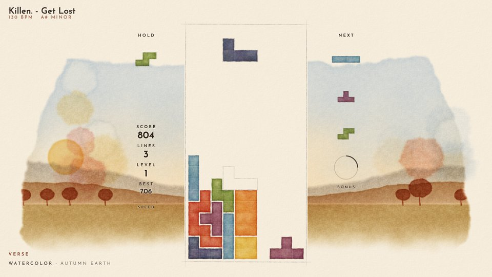

Wet watercolor on cold-press paper. A landscape painted in a few loose, transparent washes and vignetted on the white sheet with ragged edges (a graded wet-in-wet sky with backruns, a far range fading into mist, a crisp middle range with dried darker rims, still water, fields or trees in front); colors are absorbances, so washes glaze over each other and granulate in the paper's tooth. The well is masked-out paper inside a light pencil frame; the pieces are transparent pigment washes (one wash per patch of a color, a hairline of paper between colors), landing wet and drying with a dark rim; the ghost is their pencil underdrawing. Eight paintings with their own pigments, pieces included (TURNER SUNSET, NORDIC FJORD, PROVENCE LAVENDER, MONSOON GREENS, STORM GREY, CHERRY SPRING, AUTUMN EARTH, and INDIGO NIGHT on toned paper with gouache pieces and lettering), from the key, mode, brightness and dynamics. Calm is a quick sketch on a mostly white sheet, mid paints the middle range, the foreground and the trees in and the beats drop pigment that blooms in the wet sky, peak glazes everything deeper up to the top of the sheet and the kicks flick spatter. A cleared row's pigment dissolves back into the paper in a moment (nothing painted over the row, nothing left behind), a Tetris floods the sheet (a great backrun and a fresh glaze), slow motion is a night glaze of indigo with the moon lifted out, game over runs the stack down in drips while the painting is washed back to paper; it leaves by washing the sheet back to plain paper from the well outward. The landscape and the blooms are drawn at a reduced resolution (at most 540 lines). Its HUD font is Yrsa (Italic and Medium, SIL Open Font License, `src/universes/watercolor/OFL-Yrsa.txt`).

## POLAR NIGHT

A snowfield under the stars: snowy ranges and a dark treeline on the horizon, a deep starry sky (the Milky Way faint across it) and the aurora, ray-marched as curtains with a bright lower edge, fine rays and a diffuse top; each ribbon follows a group of frequency bands (the far, low one the bass, the nearer, higher ones the highs) and its light falls on the snow and the pieces. The well is a sheet of dark ice with a hairline rim; the pieces are ice cubes that visibly freeze: the falling piece (and the previews) is clear colored water, saturated, the night seen through it; a landed piece freezes over 7 s like a cube in a freezer, frost creeping in from its outside faces (needles of feathery crystals ahead of a frosted band thickening inward) while the body clouds over to a milky core and the color goes pastel, a slight wisp of cold vapor rising off its top while it sets; old ice is a matte frosted cube, whitish but clearly tinted, its core a little whiter. No outline, bevel, gloss or reflection streak: crisp only at the silhouette, so new, freezing and old pieces read apart at a glance. Each piece is one body of ice with no junction between its cells (two pieces never join, a thin seam stays between them; a stack inherited from another universe is grouped into bodies of at most four cells), its frost in its own frame so it travels with it. As the freeze ends, small icicles of clear blue ice grow under each free bottom face (the well's floor too), irregular: a few long drips among many small ones, each face its own count, spacing, length and slight bend. Eight nights (EMERALD, VIOLET VEIL, CRIMSON, ARCTIC TEAL, MOONLIT, BLUE HOUR, SOLAR STORM, ICE FOG with a 22° moon halo), each with its own seven ices, from the key, mode, brightness, dynamics and density (`--universe polar:crimson`). Calm is a still night (one faint ribbon low on the horizon, a few flakes), mid wakes several curtains folding with the tempo and rippling on the beat while the snow falls, peak fills the sky (curtains overhead, the camera looking up, surges of light running along them on the kicks, blowing snow over the drifts). A lock leaves a tiny sparkle where the piece touched down, then it freezes (above); a cleared row cracks (the cracks running from where the piece landed) and shatters into shards that tumble and fall off the bottom of the screen (a Tetris throws them further), a Tetris is an auroral substorm, slow motion freezes time (the snowflakes hang and glint, the aurora barely moves, the colors drain to silver, frost creeps in at the screen's edges), game over freezes the stack white from the bottom up, then it crumbles while blowing snow buries the field; it leaves and enters through a whiteout of blowing snow. The world is drawn at a reduced resolution (at most 540 lines). Its HUD font is Josefin Sans (SIL Open Font License, `src/universes/polar/OFL-JosefinSans.txt`).

## RISOGRAPH

A risograph print: the whole frame is two spot inks on a paper stock, a third ink joining at the peaks. The pieces and the marks are laid by the drums as flat shapes and halftone tints (dots at a fixed angle per drum, or a line screen), overprints darkening where two inks cross, a riso grain in the ink; the background is soft, a riso gradient print: big flat shapes and broad gradients of ink density on the paper, with a fine, almost invisible grain and no visible screen, kept off the well and the text's side so that the HUD reads cleanly. Only the background's drums are slightly out of register (drifting slowly); the stack, the pieces and the HUD are always printed in register. Lots of paper, little else: each variant has its own neutral stock (a cool white, light grey, pale blue, pink or mint, two blacks; never cream) with a faint tone and tooth; the world is one big gradient disc fading toward the well and, at the peaks, the third ink's shape overprinting it. The well is marked by crop marks and a registration target, with hairline trims; the pieces are flat ink shapes, each type its own recipe (a solid ink, the overprint of both, a solid with the other ink's dots, a hatched tint with a keyline...), so the seven types read by color and pattern; the cells of one piece print as one clean shape, two pieces always keep a hairline of paper between them; the ghost is a keyline and a light tint. Eight ink sets, each with its own pieces through its inks (FLUO PINK & BLUE, TEAL & YELLOW, RED & FEDERAL BLUE, BLACK & FLUO PINK, VIOLET & GREEN, BURGUNDY & MINT, and on black paper, where the inks lie like light, YELLOW & PURPLE and AQUA & ORANGE), from the key, mode, brightness and dynamics (`--universe "risograph:teal & yellow"`). Calm is a still print, a single pale gradient disc on the paper; mid deepens the disc and the second ink's gradient across the sheet and prints a half sun of the second ink rising from the bottom edge, the shapes floating very slowly; peak brings the third ink's shape, a broad bloom of the third ink from the shapes' edge of the sheet and a new layer of cut-paper forms in a fourth, hot fluorescent ink of the variant (fluo orange, pink or yellow): a big circle and a tall block of the third ink on the free side of the sheet (between the title and the bottom lines, clear of the score), while the half sun turns to the hot ink, all overprinting each other. On the drop they ink in one after the other within a third of a second, growing a little as they ink, stay for the whole peak and lift slowly after it. A real drop (the peak at a drop's pace, not a chorus) also reprints the pieces from another pair of drums for its whole length: the stack, the falling piece, the ghost, the previews and the clearing strips keep their recipes (the same solids, dots, lines and keylines) but change ink, easing over half a second from the downbeat and back over a second when the drop ends (no flash, no beat). Each variant has its own drop pair, picked for its paper and away from its inks and the peak's background inks: FLUO PINK & BLUE prints in teal and orange, TEAL & YELLOW in medium blue and fluo pink, RED & FEDERAL BLUE in burgundy and orange, BLACK & FLUO PINK in green and orange, VIOLET & GREEN in blue and bright red, BURGUNDY & MINT in medium blue and fluo coral, YELLOW & PURPLE in aqua and fluo green, AQUA & ORANGE in fluo pink and fluo green. The HUD stays in the variant's inks; slow motion stays a monotone print. The kicks breathe the inks' density (about 0.2 s in, 0.5 s out) and swell the forms by a few percent, smoothly. The background print moves on a slow current, like paper cut-outs floating: still at calm, a slow drift at mid (the half sun and the world's discs wander and turn a little), clearly moving at the peak, the drop gathering pace over its first second and settling over a few (the speed is eased twice, so nothing ever changes speed abruptly). At the peak the big forms wander around their places, each at its own pace and heading, the block and the half sun turning, the gradient across the circle turning; smaller printed forms glide across the sheet, entering from one edge and leaving by the other at a few board units a second (a strip of the third ink along the upper sheet, a crescent of the hot ink across the lower sheet, a small disc rising on the shapes' side, a zigzag ribbon through the middle), turning slowly and overprinting the big forms and each other as they cross. Forms crossing the well and the HUD's columns print there only faintly (nearly not at all for the gliders), so the stack stays on clean paper. Two other drop treatments were tried (a huge sun of the third ink behind the well with a hot horizon band; the hot ink flooding in from both edges with concentric arcs behind the well) and set aside for the cut paper. The stack, the falling piece, the previews and the HUD never move; the background moves only smoothly and continuously (no jumps, no re-composing on beats, no shake). A lock presses a small soft blot of the second ink out under the piece, a cleared row is torn off as a strip (ragged edges, its dots shrinking away in under half a second), a Tetris stamps the third ink in one huge soft disc over the sheet, slow motion is a monotone print (one ink, the drums locked in register), game over runs the drum dry (the stack fading in vertical streaks); it leaves and enters with the ink lifting off the paper, the stack left plain. The bonus gauge is a keyline circle filling with a deepening tint. Its HUD font is Space Mono (SIL Open Font License, `src/universes/risograph/OFL-SpaceMono.txt`).

## WHITE ROOM

A seamless white studio and a shadow play: an endless cyclorama (the floor curving up into the back wall, no corner, no horizon), the well an opaque matte pane standing on a low white plinth, the blocks matte cubes (soft plastic, unglazed ceramic) standing in front of it, their front faces on the board's plane; nothing else in the room but the cleared blocks piled on the floor. Every cube (the stack, the falling piece, the previews and hold, the thrown ones) is the same real cube: one instanced mesh rasterized with a depth buffer in the layout's camera, lit by the room's two lamps, its ambient and the light bounced off the white room, its edges softly bevelled (they catch the light) with a fine darker crease where neighbours meet, so each block reads apart; the ghost stays a hairline outline. A lamp in front of the well throws the stack and the falling piece onto the wall behind as enlarged, soft shadows: the tetrominoes themselves, in shade, beside the well. The pane casts nothing and receives nothing: no shadow ever falls on it, it keeps its own color at one steady level whatever the lamps and the gels do, and it veils what lies behind it (at 80%: the room shows faintly through), so the real stack always reads on a calm, even ground and its shadow is clearly another thing (larger, softer, lighter, behind). The room (cyclorama, plinth, pane) is ray-traced through the layout's camera once per pixel and writes its depth, the cubes are drawn over it multisampled; the stack's shadow play comes from a blurred occupancy map of the board seen from each lamp (the penumbra growing with the distance), the thrown cubes' shadows from a shadow map per lamp (soft: a few taps find the casters and widen the penumbra with their distance), and the piles darken the floor around them through their heightmap, so the room's cost does not grow with the number of cubes. Five rooms, each one color story, a family of related hues in spaced values with one accent and two gels that belong to it (GALLERY: ink blues, stone and terracotta, amber and blue gels; LINEN: earth tones and clay, amber and violet; NORDIC: the cold sea and coral, ice cyan and coral; CERAMIC: celadon, tenmoku and kaki, gold and jade; DARK ROOM: the same play in a black studio, a black pane, flashy blocks (electric cyan, lemon, hot pink, acid lime, tangerine, ultraviolet, white) and a hard spotlight whose pool holds the shadow play, hot pink and cyan gels), from the key, mode and brightness (`--universe "white room:nordic"`). The song moves the lamp: calm is a soft light high in front, the shadows hidden behind the pane, the room almost shadowless; mid brings the lamp lower and to the side and the stack's shadow starts to climb the wall; a chorus is a warm lamp low on the side, the shadow large and crisp beside the well. A drop changes the room for its whole length: the key turns into a colored gel low on one side and a second gel comes in low from the other, so the white room splits into two colors and the stack throws two enlarged colored copies of itself up the wall, one on each side, each lit by the other gel; on the drop's downbeat the two gels swing in from far out, so the two shadow copies sweep in across the wall from the edges and settle, then the gels slowly circle (eight bars a turn), the shadow copies sweeping across the wall. A new section swings the lamp across to the other side. The light never pulses and the beats move nothing. A lock presses the piece for an instant; a cleared row vacates at once and its blocks are thrown out from behind the pane as solid cubes (never drawn over the well), each one to the left, the right or back toward the wall with an upward kick and a tumble. They are rigid bodies (qu3e, Randy Gaul's box engine, zlib license, `third_party/qu3e/`): they fly under gravity, knock into each other, bounce, tumble and come to rest on the floor, the cove or the cubes already there, stacking and leaning on their neighbours without ever passing through each other, so over a song they pile up beside and behind the well into messy mounds; they never go in front of the well or over it, nor rest on the plinth behind the pane (where the next ones are thrown from), and soft bounds keep them in the room, clear of the HUD's text. They cast soft shadows from both lamps on the floor, the wall and each other, lie there 60 to 120 seconds and fade away; a cube gone wakes the cubes it held, which fall and settle again. At most 300 at a time, the oldest fading early. The physics stays cheap: a fixed 120 Hz step (the cubes drawn between steps), and a cube still for a moment freezes into a static body, so a pile costs nothing and a cube landing on it only wakes what it hits; it runs at the real speed, even in slow motion; slow motion is evening (the room blue-grey, a single warm lamp hanging over the well), game over sinks the lamp to the floor and turns the stack to white plaster row by row; it leaves and enters with the shadows dissolving into a flat, shadowless light. The bonus gauge is a fine groove in the wall, its arc filled in ink. The HUD is set on the wall like a gallery's wall text, with a faint shadow; its fonts are Manrope Light and Medium (SIL Open Font License, `src/universes/white_room/OFL-Manrope.txt`).

## KINTSUGI

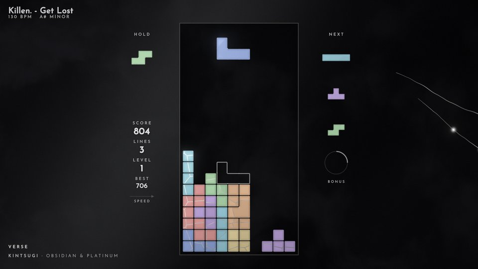

Dark polished stone and ceramic mended with gold: one slab of stone under a soft raking light (a broad reflection of a soft box lying across it, a soft clouding, no veining behind the HUD), the well a honed, darker panel set into it with a hairline of metal. The pieces are glazed ceramic vessels, broken and mended: the cells of a piece join into one shape, crossed by fine gold seams that run across the cells (continuous over the piece, a different pattern for each piece, never on the grid). The gold lives in the stone too, as cracks that grow only in the open stone on both sides of the HUD. Seven stones and their metal, each with its own seven glazes (NERO & GOLD, SERPENTINE & GOLD, SLATE & SILVER, PORPHYRY & GOLD, BASALT & COPPER, SODALITE & GOLD, OBSIDIAN & PLATINUM), from the key, mode and brightness (`--universe "kintsugi:basalt & copper"`). Calm and breaks are the bare stone in a low, cool light; mid warms the light and lets four thin veins creep into the stone, a glint of light running over them every two beats; a chorus lights the slab fully and the veins spread in polished metal. A drop melts the metal: on its first downbeat white-hot gold races in through new cracks from the edges of the slab while flakes of gold leaf burst out of them, then for the whole drop the veins stay molten (glowing amber, lighting the stone around them), the stone takes a warm grade, the seams of the pieces glow, new branches keep spreading slowly, the gold leaf keeps drifting down turning in the light, and a surge of light runs out along the cracks every two beats (the scene's light never pulses: one swell on the drop that settles). The stack, the pieces and the HUD never move. A piece falls whole (no seam); landing cracks it: its gold seams open from the contact up through the piece in a quick ragged front, molten, then cool; a cleared row breaks along the gold seams of its pieces (the fragments between the same seams fall as one shard, across the cells of a piece) and its shards, solid slabs of the ceramic, are thrown out in random directions and tumble all the way down out of the frame, their broken walls gold (at the real speed even in slow motion); a Tetris sends eight molten cracks bursting in from the edges with gold leaf; slow motion is moonlight (a cold silver light from the other side, the metal turned to platinum, the gold leaf hanging in the air); game over opens every seam of the stack wide with gold, row by row, before it sinks into the dark; it leaves and enters with the slab dimming to the bridge, the stack in plain ink. The bonus gauge is a thin ring of metal mended as it fills. Its HUD fonts are Cormorant Garamond and Marcellus (engraved capitals) (SIL Open Font License, `src/universes/kintsugi/OFL-*.txt`).

## LASER SHOW

A dark, hazy room where every piece is projected by its own laser. Each piece (the falling one and each piece of the stack) has a small projector standing at a random spot of the room, away from the well and the HUD: a point of light from which a faint sheet of light opens toward the piece, with thin rays running to each corner of its outline, as if the laser were drawing it. The rays are made visible only by the haze they cross, so each one is uneven along its length (bright where the haze is thick, nearly gone in the gaps, the haze drifting slowly); they are fainter over the well, a slab of black glass, and fade behind the HUD's text, previews and gauge. The pieces are dark acrylic, edge-lit: a smoked, tinted body whose silhouette glows in the piece's color, one shape per piece with no seam inside it (two pieces never join). Seven laser sets, each with its own drop pair and its own seven acrylics (GREEN, its drop cyan and magenta; RGB WHITE, red and blue; MAGENTA CYAN, gold and deep blue; RED, violet and cyan; BLUE VIOLET, ice white and red; AMBER, green and violet; AQUA, rose and amber), from the key, mode and brightness (`--universe "laser:magenta cyan"`). The song decides how many projectors are on, the newest pieces first and the older ones dimmer: calm keeps the falling piece's and one or two more, dim, in faint haze; mid a few, drifting slowly around their spots and breathing every two beats; a build switches more on as the pace rises; a peak without a drop (a chorus) lights most of the stack, each projector in its piece's color. A drop is the signature: on its downbeat the display turns two-color: every piece, its acrylic and its laser, takes one of the drop's pair (the pieces alternate, so the stack is split evenly; the falling piece and the previews too), every projector switches on one after the other, the haze glows in the mix of the two with one swell that settles over seconds, and the sources sweep slowly around their spots for the whole drop; the colors ease in over a fraction of a second and back to the pieces' own over about one second when it ends. The light of the room never pulses with the beat; the projectors move slowly, the stack and the HUD never move. A lock leaves a small point of light where the piece touched down, and the falling piece's projector stays with it; a cleared row burns out (the blocks' edges flare, then a hot burning front eats each block from its edges in, gone in under half a second, at the real speed even in slow motion; nothing is drawn over the row) while the projectors of its cells get weak, blink and switch off (a piece cleared only in part keeps its projector for its other cells); a Tetris flares every projector white once; slow motion freezes the projectors in a thick, cold haze, the lasers ice white like rods of light; game over switches the projectors off one by one while the stack goes dark row by row from the top; it leaves and enters with the haze filling the room. The haze and the projectors' sheets of light are drawn at a reduced resolution (at most 360 lines), the thin rays at full resolution. The bonus gauge is a ring of laser light drawn clockwise as it fills. Its HUD font is Jura (Light and Medium, SIL Open Font License, `src/universes/laser/OFL-Jura.txt`).

## GARDEN

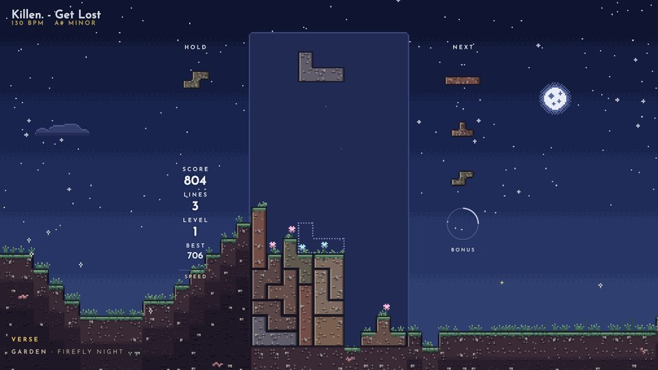

Tiles of earth growing pixel grass and flowers, a 16-bit indie game (code in `src/universes/garden16/`; it replaced the first, smooth GARDEN below). The world (clods of earth growing grass and flowers, a line of earth with banks that rise toward the edges and beside the well with its outer columns, worms in the dirt, a plain sky with one sun or moon, a pale panel over the well) drawn as pixel art at a true low resolution: an indexed canvas drawn on the CPU where a board cell is a 12 x 12 tile (about 530 x 300 pixels on a 16:9 screen), scaled up with nearest filtering. Every variant has a limited palette that animates like a console's: flat sky bands joined by thin ordered-dither seams, pixel outlines, motion in whole pixels and stepped sprite frames. Each landed cell is the very dirt tile the ground is made of (the same lumps, light specks and grey pebbles, the same lit left edge and shaded right edge on a step), its ramp tinted a little toward the piece's own soil so the seven pieces stay apart (brown, red clay, ochre, humus, sand, grey clay, moss) inside a clean dark 1px outline, no seam inside a piece; the ground's banks step up tile by tile, so stack and ground read as one earth. An open tile top grows a grass cap in three frames, then swaying tufts, then now and then a flower that blooms bud, half open, open. Calm parts dry the grass to straw with seed-head stems; mid turns it green; a chorus makes it tall and lush, the sky deeper, leaves blowing off on the wind in gusts every two bars and a small flock of birds crossing; a drop shifts the sky toward the variant's glow from the horizon and bursts flowers open across the banks frame by frame (big asters on the far banks), petals fly, butterflies swarm, worms hurry, pollen puffs on the kicks. A cleared row pops: its tiles burst into 3x3 bits of their own pixels that fly, fall and shrink away in under half a second; a hard landing pushes two small dust puffs out from the contact; a falling piece sheds crumbs; a Tetris sends dandelion seeds up; slow motion brings dusk and fireflies; game over crumbles the stack into bits row by row. Four variants: SPRING DAY, APRIL RAIN (a light rain through its drops: thin pixel streaks, faint behind the well's pane, tiny splashes on the tops), GOLDEN DUSK and FIREFLY NIGHT (pastel earths under a moon, fireflies). The HUD letters over the earth are straw-pale with a dark drop shadow, the earth under them calm (no pebbles, no worms); over the sky they take its ink with a soft halo. Fonts: PIXEL's two bitmap fonts.

## GARDEN (smooth, disabled)

The first GARDEN, replaced by the 16-bit one above; its code stays in `src/universes/garden/`, left out of the default build (`-DZENTRIS_DISABLED_UNIVERSES=""` builds it). Its description as it was:

Clods of earth that grow grass and flowers. One wide line of earth runs along the bottom of the picture, flat under the well and rising in gentle banks toward the edges, never mirrored (per song one side rises tall and far, the other stays low), under a plain sky with one sun or moon and lots of empty air. The pieces are clods of earth, all of the same earth: a lumpy clod with a crumbly edge, a fine grain and a soft relief lit from above (the ground line has the very same texture), with rare pale pebbles of all sizes; the texture stays with the earth, sinking with it when rows below are cleared; landed, the clods merge into one mass of earth whose base grows out of the ground line. While a clod falls, a crumb of soil drops from its underside now and then (a few per second, more when it is pushed down fast); each falls through the ghost until it touches the stack, the floor or the ground, and is gone there with a tiny puff. Small pink-brown earthworms crawl inside the earth, in the ground line and inside the landed clods (they pass from one to the other through the stack's base), on slow wandering paths, sunk in the soil (a dark burrow around them, the earth's lumps covering them here and there); a few in calm parts, about five at mid, and on a drop many more (about fourteen) crawling two or three times faster, the change eased in and out, each worm fading in where it appears; a worm in a cleared or collapsing row fades out where it is. The clods and the ground share one gradient by height: dark deep down, the earth's own color at the well's floor, a little lighter as it rises. The area of play is a pale, see-through panel over the sky. Wherever the top of a clod is open to the air, life takes hold: a fringe of grass sprouts within a second or two, then a few small flowers open slowly over about twelve seconds; a block landing on top buries them, the grass and the flowers lying down and folding back into the soil in one quick, smooth motion. The ground line has its own vegetation and follows the song: calm parts and breaks leave it dry (a pale dusty haze in the sky, a few dry stems with seed heads), mid brings the green back with a seed drifting up on some bars, a chorus makes it lush (tall grass swaying every four beats, the sky deeper), and a drop makes it bloom: on its first downbeat flowers open across the whole line, quickly at first and then slowing, a flurry of petals rises from them on a gust that dies down, and the sky takes a glow from the horizon in a color that contrasts with the variant's own sky (pink in spring, magenta at dusk, amber in autumn, gold at dawn); it stays in bloom for the whole drop, swaying slowly, petals drifting, pollen puffing from a few flowers on the kicks, and when the drop ends the flowers close, drop their petals and the line dries out over seconds. Whether a peak is a drop or a chorus comes from the section shown in the HUD (or the song's drive when there is none). Four variants, from the key, mode and brightness: SPRING MORNING, SUMMER DUSK, AUTUMN FIELD and MISTY DAWN, each with its own sky, earth, grass and flowers. A cleared row collapses: the earth above slumps down into it, faster and faster, crushing it flat while small sharp crumbs of dirt spill out of it, pushed out to the sides and falling (harder as the earth above slams down, and the more rows go at once), falling over everything until they reach the ground or leave the picture (0.4 s, at the real speed even in slow motion), all of it staying one mass of earth, its flowers falling; a hard landing pushes one puff of dust out from the contact; a Tetris sends dandelion seeds up from the whole ground line and opens the stack's flowers at once; slow motion brings dusk (a deep blue sky, the first stars, fireflies over the grass); game over crumbles the stack back into the earth, row by row, and dries the line; it leaves and enters with the plants sinking and the sky fading to the bridge, the stack in plain ink. The pieces and the HUD never move (the stack only settles when a row collapses), and the scene's light never pulses. The HUD is set straight on the sky, its letters dark or pale by the sky behind them, and the corner lines lie in the earth in a pale straw tone (the plants keep below them). Its fonts are Lora Italic and Lora Medium (SIL Open Font License, `src/universes/garden/OFL-Lora.txt`).

## BIOME

Glass cubes over a 3D diorama world that the cleared lines bring to life (code in `src/universes/biome/`). One universe, two worlds, each a few variants: the **sea** (the cubes hold water; a sea rises from dry sand) and the **land** (the cubes hold seeds; parched clay grows into a jungle). The song picks the world (airy, flowing songs over a deep bass go to the sea, dense songs that build and drop to the land, the run's seed tipping the close ones) and then the world picks its light from the key and the mode.

What both worlds share (`biome.cpp`, `render.cpp`, `shaders.hpp`): the whole scene is a real 3D world seen by a fixed, slightly elevated perspective camera whose lens is shifted so the well's plane keeps the exact reference layout (the stack and the HUD are a clean 2D grid in front) while the world behind it is seen from above. The world is cut open like a diorama just behind the well, its section showing its layers. The sky is one framework for both (a gradient per variant, one sun or moon with its halo, soft clouds drifting, stars at night, the dust of a dry land veiling it, an aerial haze toward the horizon); the sun or moon lights everything and casts soft shadows (a filtered shadow map). Every cell of a piece is its own small glass cube with a gap to its neighbours, ray-traced per pixel (four rays a pixel, so every edge stays smooth) in a slight three-quarter view, lit by the scene's sun or moon (Fresnel sky reflection, a sharp highlight, bright edge lines); what fills it is the world's. The ghost is an empty cube of clear glass, its edges bright; hold and next show the same cubes. The stack keeps its contrast against the world: a calm, dark pane lies behind the well. A drop is the weather: whether a peak is a drop or a chorus comes from the section shown in the HUD (or the song's drive when there is none); a drop's storm comes in fast (lightning far out in the clouds on its first downbeat and every four bars, a gust, slanting rain in layers, an overcast down to the horizon that hides the sun) and calms back over a few seconds after it. The kicks at a peak are the world's (spray, gusts through the leaves), never a brightness pulse. Nothing is ever drawn over the stack or the falling piece: a cleared row's cubes leave the stack at once and what flies out of them passes behind the well's pane. Game over cracks the stack row by row from the top, each cube then leaving it as a cleared one does; slow motion is a dusk; it leaves and enters with the world fading to the bridge, the stack in plain ink. The HUD is set in Lora (SIL Open Font License, `src/universes/biome/OFL-Lora.txt`), italic for the song, the section and the celebrations, spaced capitals for labels, its ink dark or light by what is behind it, always on a soft halo. T cycles through all ten variants with `--universe biome`; any of them by name, for example `--universe "biome:night harbor"` or `--universe "biome:moonlit clay"`.

**The sea** (`sea.cpp`, `sea_render.cpp`, `sea_shaders.hpp`). A sandy seabed with dunes (a heightfield mesh, sloping down far out to sea), its cut face showing sand strata, and the sea as a real water volume whose surface rises with the cleared lines (linearly: every line raises it by the same amount, a Tetris half as much again per line, about sixty lines to fill it up to three quarters of the well's height; a song starts with no sea near the well, only the beach, the water creeping up the sloping sand from far out; a new song drains it back); the eye rises a little as the sea deepens. Under the surface the light is absorbed with depth (down to a near-black blue in the deep), with shafts of light from the surface and a caustic network rippling on the sand; above it, the sun's or moon's glitter path on the water. The surface is a 3D mesh with Fresnel reflections of the sky and crested directional swells, calmed close to the well: calm parts leave it glassy, mid brings a gentle swell, a chorus a livelier one with a few whitecaps and a puff of spray on the kicks. A drop raises a storm: big, faster waves with sharp crests, whitecaps and foam, spray torn off the crests, boats rocking hard; under the surface the fish dart away and the deep glows a little brighter. Boats are low-poly models riding the waves (lit windows at night), bigger as the sea deepens: dinghies and sailboats, then fishing boats, ferries, container ships and liners far out. Life fills the depths in layers, only where there is water: schools of pale fish near the surface, jellyfish pulsing softly in the middle water, and in the dark an anglerfish with its lit lure, siphonophores and drifting motes of light. The stack's cubes are solid glass full to the brim with the sea's own water, under pressure, each piece type a small shift of the variant's sea, traced through the glass and the water. A cleared row's cubes are thrown out of the well to their side, at the real speed even in slow motion, tumbling under rigid-body physics: they come down on the sand or into the water, bounce, roll and knock into the cubes already lying there; each cracks where it first hits and its water jets out of the crack under pressure, kicking the cube back; on the sand the water runs downhill into the sea, raising it; a cube landing in the sea churns its water out as a plume of bubbles and sinks; empty, it sinks into the sand. A Tetris sends spray up from the sea on both sides. Four variants, from the key, mode and brightness: CALM NOON (a high sun, crisp shadows), GOLDEN HOUR (a low sun on the horizon), GREY NORTH SEA (an overcast sky, soft diffuse light) and NIGHT HARBOR (the moon, lit windows on the boats, luminous glass).

**The land** (`land.cpp`, `land_render.cpp`, `land_shaders.hpp`). A wide plain of dry, cracked clay (not sand) under a bleached, dusty sky, a few dead trees standing on it, low hills on the horizon; its cut face shows the soil's layers and, later, roots. The stack's cubes are three quarters full of seeds of their piece's color, each piece its own seed (long grains, peas, flat almonds, big beans, striped sunflower seeds, fine millet, lentils), traced through the glass. A cleared row's cubes vanish at once and their seeds burst out of where they were, each on its own high arc into the land behind the well, a faint trail of its color behind it, at the real speed even in slow motion. Each seed lands with a small hop and a puff of dust (a splash on wet soil), comes to rest, then sinks into the soil while a small mound of turned, darker earth heaps up over it. A few of them are sown near, in the open land on either side of the well (two plus two per cleared line, never more than a dozen sprouting at once), and these are seen coming up one after the other: after a short pause a pale stem pushes out of the mound bent in a hook, straightens, and its two seed leaves unfold; the plant then grows out of it from a speck while the seed leaves wither and the mound settles flat. The seeds sown further out just come up after their own pause. What grows does so slowly: grass in seconds, flowers in their seed's color, ferns and bushes, and trees over minutes (round canopies, tall emergent trees, palms), vines hanging from the grown trees; tall trees keep out of the HUD's columns. The more lines are cleared, the more the land comes alive: the soil darkens and greens around what grows, the forest spreads on its own over the plain and the far hills, the sky clears from dust to a humid haze, birds arrive and fly between the trees, butterflies come to the flowers, mist settles in the distance, the dead trees leaf out again; about sixty lines turn the plain into a jungle. A drop is the rain: the soil soaks dark and puddles form (rain rings in them), everything grows several times faster, flowers open, a flock lifts from the trees; the growth stays. A chorus is a bright, breezy bloom, mid a breeze, a break a still, hazy land. A lock pushes a small puff of dust out from under the piece; a Tetris opens every flower and raises a flock; slow motion is a blue dusk with fireflies. A new song in the same land brings a short dry season (the grass and the flowers wither, the grown trees stay). Six variants, each with its own seeds: SAVANNA NOON, OCHRE HAZE and RED EARTH DUSK for major songs, MISTY MORNING, GREY MONSOON and MOONLIT CLAY for minor ones, the key's hue picking among them. Plants are instanced low-poly meshes (a near and a far level of detail) under the shadow map; the ground's grass, damp and flowers come from a small life map stamped on the CPU.

## FLUO

Fluorescent paint splashed on a dark wall. The background is a matte, textured wall (a fine grain, broad blotches of the coat, pits in raw concrete), even and calm, the well marked only by a slightly deeper patch of it and three faint hairlines; the pieces are blocks of flashy fluorescent paint (fluo pink, yellow, green, orange, cyan, violet, blue), one solid shape per piece with rounded outer corners, a glossy rim catching the light along their top edges, running on around the inside corners of a piece (the joints of a T, the inside of an L) with a small fillet, and a soft halo of their own color. When a line clears, its blocks vanish at once and burst into gobs of their paint (one per run of up to three cells of a color) thrown out of the well to the side they are on, the nearest to the completing piece first: each flies along an arc for a third to half a second (a glossy drop, its tail stretched behind it, two droplets trailing, shrinking a little as it goes to the wall) and splashes where it lands, mostly on the free wall beyond the HUD's columns, sometimes under a column, never over its text: a ragged blob spreading from the impact, stretched along the flight, with a few lobes, streaks and trails of droplets flung onward, a spray of fine drops, and sometimes a drip that runs down the wall and slows to a stop in a bead. The paint never goes away: every splash of the song stays on the wall, the newest over the oldest (they are stamped into a persistent paint layer, so the cost is the same with ten splashes or a thousand), until a new song fades the wall back to clean (a change of universe always arrives on a clean wall). Behind the well and the stack (down to the screen's bottom) the paint sinks into the wall, leaving only a faint colorless trace (it comes back gradually beyond the well's edges), and it is softened under the HUD's columns and under each line of text, so the stack and the HUD stay readable however much paint piles up. The stains' edges are anti-aliased at any resolution: a splash is drawn into a "wet" layer while it spreads and stamped once into the persistent one when done (stamping it every frame used to harden its soft edge into jaggies), and the ragged edge's noise is never finer than a few pixels. The paint is real, wet paint, with a relief: its thickness (rising over a short width from the edge, a thicker rim where it piled up as it spread, domed droplets and drips, paint over paint thicker) is lit by a light drifting slowly across the wall (a minute or so to cross it), so sharp glints and a soft sheen slide along the rims, the drips and the droplets; there is no halo around the stains. The room's light follows the song: low at calm, fuller at mid, brightest in a chorus; under it the paint is dull, a little greyed and matte-ish. A drop (a real one, not a chorus: the section shown in the HUD, or the song's drive) turns the lights off and a blacklight on, in a third of a second on its first downbeat: the wall sinks into a deep, slightly darker violet and the stains light up one region after another, saturated and fluorescent like paint under UV (swelling a little on the drop and settling: no pulse), the tube's light glinting violet on their relief; the pieces glow brighter, and the drop's kicks set the wet paint dripping here and there. When the drop ends the lights come back and the stains go dull again over a few seconds. A lock flicks a few specks of paint sideways from the impact, under the piece; a Tetris throws its gobs bigger and two big ones far onto the walls on either side; slow motion drains the paint of its color (only the pieces keep theirs); game over bursts the whole stack onto the wall, from the top down. Four variants, from the key, mode and brightness: BLACKLIGHT (a matte black coat), CONCRETE (raw dark concrete, blotchy and pitted), SLATE (green-black slate) and NIGHT BLUE (a night-blue coat), each with its own seven fluo paints and accent. The stack, the pieces and the HUD never move, and the scene's light never pulses. The HUD is set on the wall in chalk white over a soft shadow, the section and the universe's name in the variant's accent paint. Its font is Syne (SIL Open Font License, `src/universes/fluo/OFL-Syne.txt`).

## MARBLES

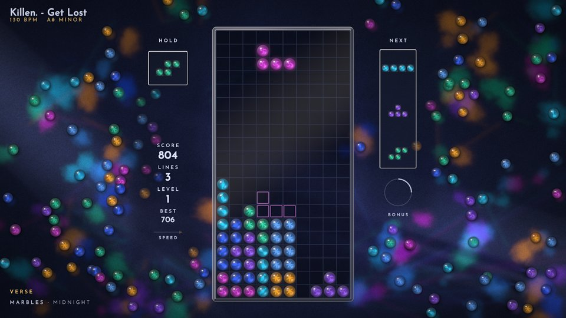

Glass marbles in square tiles, shot out across a dark table where they collide and stain the felt. One world seen from above: a dark table with a fine grain, never busy (navy felt, teal slate or black brushed metal, one per variant), the well floating over it as a dark pane of smoked glass with a hairline edge. Everything on the table (the marbles, the dye, the light) lies under the well and the HUD, never over the game: under the pane a marble is at most a dim shape, under the HUD's columns and text a rolling marble is dimmed and its halo dropped, and the HUD is a gentle slope: a slow or resting marble there is pushed out (to the nearest side away from the well) until it rests outside, so nothing ever settles under the HUD, and no dye settles there either. Each cell of a piece is a big glass marble (nearly the cell's width) held prisoner in a very faint glass box: a barely-there hairline edge and a whisper of frost, so that the marble alone nearly carries the piece and the pieces read by their marbles' colors. The marbles are clear glass: through each one the table under it is seen upside down, as through a lens, tinted a little and darker toward the rim; inside, magnified and in two layers for depth, its core, one per piece type (a twisted ribbon, a cat's eye of three curved vanes or a swirl of strands), a few tiny bubbles; on the table each casts a soft shadow away from the light. They are lit by real light: two lamps beyond the table's sides throw wide soft beams grazing it, one over each side of the well, turning and drifting very slowly (a few minutes to sweep the table outside a drop, livelier in one) and fading with distance, the second one coming up from mid on; their rays are traced in 2D on the CPU through the marbles (each a glass ball: refracted in and out, a Fresnel reflection, the light tinted by its glass on the way, focused like a ball lens into a narrow caustic just behind it that opens out into thin streaks of tinted light, a shadow around them; a marble lights its neighbours; the cost is bounded: 44 rays a beam, a capped number of segments, the hashed grid). Each marble is lit by the light that actually crosses it, smoothed: its glass and core glow in their tint, a focused spot inside on the far side, the rim facing the light catching it, the lamp's highlight where its surface faces it; the marbles in the well take the key light from the same side. The light on the table shows the grain and, above all, the dye; it stays secondary, soft-shouldered, never blinding, and it never pulses. Outside a drop it is calm and steady: the traced light is eased into what the table shows over about 0.7 s (0.1 s in a drop) and each marble's received light over about as long, so caustics fade in and out as the beams drift and marbles roll, nothing pops or flickers when the marbles are still, and there are no sparkles: at most a marble now and then swelling softly with light over a second and a half. A cleared row pops: its tiles swell a little and vanish in a moment and each marble drops onto the table under its cell and is shot out in a random direction (mostly out to its side) at a real speed (fast enough to carry it past the HUD's columns), gliding out from under the pane (touching nothing there: nothing ever comes to rest hidden under the well) and rolling across the table, slowed by the felt, knocking into the marbles already lying there: elastic collisions (restitution 0.86), billiard chains; a marble at rest sleeps until it is hit hard enough (a gentle touch leaves it be: no jitter, no creeping); no walls: a marble pushed off the edge of the picture is gone; at most about 250, the oldest at rest fading away; at the real speed, even in slow motion. Every hit spreads color: both marbles stain the felt around them with their dye (a richer shade of their glass), soft ragged blots soaked into the grain, the harder the hit the wider and deeper, and rolling marbles leave faint traces; the dye is painted into a persistent layer (anti-aliased, the cost the same with ten stains or thousands), so a song starts on a dark, empty table and ends on a colorful one; a new song washes the dye out over a couple of seconds and its marbles fade away. Three variants, each with its table and a palette of three or four related hues and an accent for its seven pieces, from the key, mode and brightness: MIDNIGHT (navy felt; blues, cyans and moon white, a gold accent), SEA GLASS (dark teal slate; pastel aquas and greens, a coral accent) and OBSIDIAN (black brushed metal; greys and fire). The colors are soft through the song, a little richer in a chorus, and ramp up to rich, saturated, glowing ones for a drop, easing back over a few seconds after it (`--universe "marbles:sea glass"`). Calm is still; mid sets a resting marble rolling now and then and lets one swell softly with light on some bars; a chorus brings now and then a marble swelling with light on a kick (no glow around the well, ever). A drop sends waves of light flowing through the marbles every two beats (a stronger, double band on the bars), each drop its own shape: out from the well, in from the edges, sweeping across, rising, rings spreading from a marble, or diagonal bands; the fronts are light travelling through the marbles (each lit from the side the front comes from), their cores glowing first, glints sparkling along it; the beams turn whiter (no brighter: the table and the well's surroundings stay as dark as in the verse, the drop's light lives on the marbles) and each marble splits them into a wider spectrum, rainbow fans across the felt; each lit marble burns brighter (highlights, rims) and throws its light on the table just behind it, a pool of its color split into a little spectrum; and on the kicks a few lit marbles are nudged into their neighbours (more color); its first downbeat sends a triple wave. A lock settles the piece's marbles in their tiles; a hard drop jolts them, the jolt carries a little into the tiles under it and the glass of the bottom marbles flashes. A Tetris shoots its marbles harder and sends a wave of light out from the well through every marble; slow motion is night (the table sinks into the dark, the marbles glow softly like lanterns); game over shoots every marble out of its tile, row by row from the top; it leaves and enters with the world fading to the bridge, the stack in plain squares of ink. The bonus gauge is a ring of twelve small marbles, one more for each cleared line, a light running around it once it is full. Its HUD fonts are Outfit Light and Outfit Medium (SIL Open Font License, `src/universes/marbles/OFL-Outfit.txt`).

## PRISM

Glass cubes in the dark, crossed by slow beams of light. A near-black room where light is the subject: a breath of depth in the backdrop, a dark polished floor under the well that mirrors the light faintly, a faint haze the beams are seen through (uneven along their length, dust glinting in them), the well marked only by three hairlines of glass edge that catch the light crossing them. The pieces are cubes of optical glass, one per cell, delicately tinted per piece type: nearly invisible where no light falls (a faint tinted body, a hairline at the silhouette, narrow chamfers catching a dim key light, the back edges seen through the glass, so every cube stays readable), coming alive where a beam crosses them (the body glowing in its tint, the chamfers facing the light blazing, those it leaves by glowing in the glass's color, slow caustic veins inside). One to three soft beams fall from out of frame and drift very slowly across the well (a minute or more to cross it, the angle swaying slowly). Each beam is a bundle of rays traced on the CPU through the glass in 2D: refraction at each face (cut slightly off square, a hand-made glass), total internal reflection (light piped down through the stack), a Fresnel reflection that sends a dimmer beam off the faces, absorption in the glass's tint (light leaving a rose cube is rose), pools of light where the rays reach the floor, glints where they cross a face; the light each cube receives lights it, smoothed so that nothing flickers, and the falling piece takes part (it throws the light around as it falls). Five lights, each with its own seven glasses (CRYSTAL, a neutral white and pale tints; TUNGSTEN, a warm lamp and amber glass; MOONLIGHT, a cold blue light and jewel glass; ROSE QUARTZ, a rose light and pastel glass; AURORA, a pale green light and sea glass), from the key, mode and brightness (`--universe "prism:rose quartz"`). Calm is one beam in a light haze; mid brings a second from the other side and a glint on a lit cube every bar; a chorus brings a third, low and raking, and faint fringes of color. A drop (the section shown in the HUD, or the song's drive) is a rainbow in motion: on its downbeat the beams swell slightly (settling over seconds) and turn white, and the glass disperses them: every ray entering a cube splits into a spectrum that fans out of it (and out of the faces' reflections, diffracted), throwing soft rainbow bands across the room and rainbow pools on the floor for the whole drop, while the white shafts step back. And the light rig moves with the music: each beam swings to a new angle and position on its own bar line (the second answers the first two beats later, the third every other bar), a decisive eased move of under a second (quick to leave, soft to settle), so the paths through the stack re-route and the rainbow fans and the pools on the floor sweep across the room; three thin white beams snap in from the dark on the downbeat (a little stronger at first) and swing to and fro like stage lights over two bars, at rest on the bar lines (the two from the upper corners in counter-phase, crossing like scissors, a third raking up and down the stack from the right), each dispersed by the glass like the others; the kick widens the spectra for an instant (only the fans breathe, the room's brightness does not); a glint every two beats. When the drop ends the rig fades out over two seconds and the beams ease back to their slow drift. The cubes stay the brightest things on screen at every level (a lit cube glows on a soft knee and never burns to white); the shafts, the haze and the light scattered on the backdrop stay secondary, and nothing saturates over large areas. Nothing pulses the room with the beat, no move is jerky (outside a drop the beams drift over minutes), the stack and the HUD never move. A lock flashes one glint where the piece touched down (a hard drop a brighter one with a few sparks along the contact); a cleared row's cubes vanish at once and the row itself becomes a short burst of light (about 0.4 s, at the real speed even in slow motion), fed to the same ray tracer as the beams: each vanished cube sends rays out in every direction that refract and pipe through the neighbouring cubes (which light up from it), reach only a few cells into the room and pool on the floor, dispersed into spectra in a drop; nothing is drawn over the row, its light is only seen where the rays cross the haze, the glass and the floor. A Tetris is a stronger, longer burst and throws the beams into a full spectrum for a few seconds; slow motion is moonlight (cold beams, the haze and the dust slowed); game over turns the stack to light, row by row from the top; it leaves and enters with the light going out, the stack in plain ink. The beams are drawn into a half-resolution light buffer (its mipmaps give the light scattered on the backdrop), the tracing is capped at a few thousand segments a frame. The bonus gauge is a thin ring of light. Its HUD font is Tenor Sans (SIL Open Font License, `src/universes/prism/OFL-TenorSans.txt`).

## LIGHTSOURCE

A dim room where the falling piece is the light. One world: a dark plaster wall, a floor under the well and two thin rails marking its sides, under an ambient fill that never lets the darkest places sink to black (the shadows stay clear, the holes under an overhang and the blocks in shadow stay readable); the dominant light is the pieces themselves. The falling piece is the brightest thing on screen at every moment: its face glows in its own color around a white-hot core, a slight bloom around it, and it lights everything around it as an area light reaching across the whole room (its four cells, each sampled four times with a per-pixel rotated pattern), with a soft falloff and real shadows cast in the board's plane: the stack's blocks shadow the wall, the floor and each other, light pours down an open column, the holes under an overhang stay dark, the stack's shadows swing across the wall as the piece moves. The blocks facing a light catch it on their narrow bevels (the light's mean direction is kept per pixel), their far faces stay dark; the cells of one piece are drawn as one shape. A new piece eases its light in as it appears. When a piece locks it takes over the falling piece's light exactly (the room does not dim nor flare on the lock; a small glow along its contact, brighter after a hard drop), eases into a lamp's light over a few seconds, then dims smoothly (an eased fade of about two seconds, its color cooling to a deeper tone, nothing blinks) down to its ember while the next piece already falls and lights the room: two or three lights at once for a while; the cells keep a faint ember afterwards. The ghost is one closed contour around the whole piece, a thin self-lit line in the falling piece's hue on a darker rim: it reads anywhere, deep in shadow or on a lit wall. Every variant paints its pieces in a two-color palette: side A (I, T, Z, L) in one hue, side B (O, J, S) in the other, the pieces of a side told apart by their value, and the falling light carries its piece's hue. Four variants: TUNGSTEN (warm against cold: amber and moonlit blue), NEON (hot magenta against cyan, in a concrete room), CANDLE (the flame's orange against a cool sea green, in a brown room) and SILVER (pale blush against pale ice, in a grey room under a white light), from the key, mode, brightness and tempo (`--universe "lightsource:candle"`). A break dims the room and softens the light (wide penumbrae, a short reach); mid is the plain light; a chorus adds a slow stage spot low in one corner whose narrow beam crosses the well (the stack cutting its shadow into it); a drop hardens the light (crisp shadows), brightens it, lights both corner spots (their beams rising and falling slowly) and relights the whole stack in another pair of fluorescent colors picked for that drop (designed pairs of electric magenta, acid green, cyan, hot orange, UV violet, laser yellow, hot pink and electric blue; from the song and the drop's number, never the last pair, in every variant, SILVER included): each piece keeps its side of the split (the A pieces take the first color, the B pieces the second) and becomes an emissive light again, each type at its own value so the pieces still read apart, casting shadows on the others; each corner spot takes one of the two colors and the room's fill both, the falling piece in its side's color at its brightest with a whiter core. Its first downbeat sends a ripple of light up through the stack from the bottom of the well, which brings the colors (the next and hold previews take them at the same pace, each as it will spawn); for the whole drop each piece shimmers at its own slow pace and a few pieces swell and ease back every two beats (smoothly, no flicker), so the stack lives while the room's brightness stays steady and the falling piece remains the brightest light; when the drop ends they settle back to embers and their own colors over a couple of seconds. The five brightest pieces are lights with shadows, the others glow without shadow tests, so the cost stays bounded (a piece entering or leaving the five crossfades between the two; a light past the budget becomes a glow, never dropped). Every light change is continuous: nothing pulses or flashes but the clears. The room's brightness never pulses with the beat. A cleared row's blocks flare into light and burn out from their edges (under half a second, at the real speed even in slow motion), the row itself a line of light that floods sideways out of the well, lit from the very frame the blocks vanish, its afterlight lingering for a second where the rows were so the room never drops into the dark before the next piece; a Tetris slowly warms the embers of the whole stack; slow motion turns the light cold and lets the lamps linger; game over puts the stack's lights out row by row from the top, each block fading into the dark; it leaves and enters with the lights going out, the stack in plain ink. The light is computed in a half-resolution buffer (at most 540 lines): each sample is tested against the stack row by row with one 10-bit mask per row (rows falling after a clear at their visual height), so a frame costs a few dozen bit tests per pixel and light. The bonus gauge is a hairline ring. Its HUD font is Sora (SIL Open Font License, `src/universes/lightsource/OFL-Sora.txt`).

## NOTEPAD

A page of a squared notebook, drawn by hand in stop motion. The well is a box drawn on the grid, one cell per printed square; the pieces are drawn in the squares: one outline per piece that wobbles and overshoots its corners, coloured in with strokes that never stay quite inside the lines, each piece type its own colour and its own way of colouring in (felt-pen bands, hatching, cross-hatching, scribbles, shading). Where the falling piece will land, a dashed outline in its own colour, lightly hatched with a few diagonals: clearly there, clearly not a piece. The HUD is handwritten (Kalam), the labels underlined in pencil. Nothing moves smoothly: the page is redrawn a few times a second (on the beat grid, at once when the game changes), and each drawing is compared with the last one: what stayed is left exactly as it was drawn (no boil: everything keeps its own hand-drawn imperfection, it is not redrawn), what is new is drawn: the falling piece is a quick, loose scribble in its colour (a sketchy outline and a zigzag through each square, a new scribble wherever it goes), and when it lands it gets a proper outline and is coloured in, both in the drawing it lands in. What steps down after a clear keeps its colouring. On a drop's downbeat the whole stack gets a second, crossing layer of colour at once (bolder, deeper); when the drop ends, that layer is rubbed out at once, leaving a fading eraser ghost, and the calm colouring is back. A piece landing during a drop gets that layer at once too, what moved or disappeared is rubbed out: it leaves a ghost in a residue layer (broken, streaky remains) that the eraser keeps going over, fainter on every drawing, never quite clean. A falling piece leaves a fading trail of its scribbles; old scores leave their ghosts under the new ones. Three notebooks, from the song: **FELT PENS** (a school notebook, blue squares, a red margin, a black fineliner and felt pens), **PENCIL** (engineering graph paper, a bolder line every five squares, graphite and coloured pencils), **CHALK** (a squared blackboard and pastel chalks; dark songs). The music sets the hand: the pieces are always solidly coloured in with a firm outline; a break is drawn slowly, the outlines in pencil, with an empty margin; the verse draws in colour with a pencil doodle now and then; a chorus draws faster, small doodles appearing in the margins; a drop is frantic: about twelve drawings a second, bolder strokes, the well gone over in marker on the drop's downbeat with a burst of doodles (stars, hearts, spirals, bolts, notes, cubes, coloured in), a new one every two beats, the hearts and stars hopping on the kicks. During a drop, two or three drawings also travel in the margins on either side of the well (never over the well or the HUD), redrawn at a new pose on every drawing while the eraser rubs out the old one, so each leaves a fading trail of ghosts: a wireframe cube turning in 3D as it drifts, its nearest face hatched; a ball bouncing on the beat, squashed on the ground and stretched in the air; a running stick figure; a paper plane on a loop; a rocket with a scribbled flame. They come in on the drop's downbeat and are rubbed out when it ends. A landing piece is just drawn in place, with no marks at the contact; cleared rows are rubbed out with an eraser in streaks (in real time, even in slow motion), crumbs rolling off, a faint ghost left behind, and the stack above steps down drawing by drawing; a Tetris gets two big coloured-in stars in the margins. The slow motion turns the page into an animator's blue-pencil rough, drawn more slowly. Game over: the stack is scribbled over, then rubbed out. Between universes the margin and the doodles fade, the stack stays in the bridge's ink.

## CITY

A tower's facade in a 3D night city, its windows the board (code in `src/universes/city/`). We look across at a tall modern tower from about thirty floors up, through a shift lens (the camera looks straight ahead and its image is shifted, so the facade faces the camera, the 10 × 20 window grid stays crisp and the board keeps the layout's pixels while the rest of the city is seen in perspective). Each cell is a recessed window: reveals and a sill seen in perspective, glass reflecting the night sky and the skyline (more at grazing angles, beaded with rain in RAIN), and behind it a real room traced per pixel (back wall, side walls, floor, ceiling). The interior belongs to the window, not to the piece: each floor has its use (offices with strip lights, desks and screens; flats with a sofa, a picture, shelves and a lamp; hotel rooms with a bed head and a ceiling light) and each window its own furniture and its own blinds, drapes, roller blind or sheer, so a cell keeps the same room whatever piece lands in it. There are no people anywhere, in the tower or in the city: the rooms are furnishings and light only. A block is a lit window, its room lit by the piece's lamp; the seven pieces are told apart by their light's color only, and the colors are those of real lamps behind windows at 2 am (a Hopper "Nighthawks" night): I an office fluorescent (pale green-white), O a warm tungsten bulb (amber), T a red paper lantern, S the cold blue of a TV, Z a pale halogen cream, J a deep sodium orange (darker and more saturated than the amber, so O, J and Z part by value and saturation), L an aquarium's teal. The light behaves like a lamp in a room: a pool of light around the ceiling light or the floor lamp, a soft cone on the back wall, paler near the bulb and deeper in the falloff, shadowed corners, blinds and curtains lit from behind. The lit rooms spill light on the mullions and the sill around them and glow into the haze; an empty cell is a dark room behind dark glass. The falling piece is four rooms lighting up as it moves, a little brighter, settling softly to their own brightness when it lands; the ghost is four window frames lit in its color. Lights only ever change smoothly (short eased blends, no surge, no flicker, no blink): only a cleared floor goes dark quickly. The tower has stone piers with a light strip, floodlights washing its base, a louvred crown, a parapet light and a mast. Around it the city in perspective: blocks of towers on a street grid far below, glass or stone, their faces lit by a dim moon, the sky and the streets' glow from below, the glass reflecting the sky, their small windows lit and put out slowly, in the same real lamp colors (mostly tungsten, some fluorescent offices, halogen, the odd TV, a sodium stairwell), no neon; the streets with their lamps and traffic; light pollution on the horizon, a deck of clouds lit from below, haze thickening with distance; red aircraft beacons on the tallest towers, a crane turning slowly; bloom on every light and a filmic curve with deep blacks. Six nights, each tilting the same seven lamps to its mood and with its own tower: BLUE HOUR (a glass tower, the last blue in the sky, the lamps a touch cooler), MIDNIGHT (bronze frames, a sodium glow, the lamps warmest), RAIN (a low sodium haze, rain falling and on the glass), FOG DAWN (the far towers lost in a cold fog, the lamps softer), BRUTALIST (raw concrete, deep-set windows, the tower floodlit, the lamps richest) and SNOWFALL (dark brick, falling snow, the lamps colder), from the mode, brightness, tempo, bass and density (`--universe "city:rain"`). A break is the city asleep (few windows, thick haze, the beacons blinking on their own); mid wakes it (more windows, the traffic, the beacons on the beat grid every two beats); a chorus lights the crowns of the towers and the tower's piers, two volumetric searchlights sweeping slowly through the haze; a new section puts the city's windows out and lights them again elsewhere. A drop switches the city at once on its downbeat: the towers in the middle distance turn their windows to two of the night's lamps, brighter (a warm one, which also takes the horizon's glow and the crowns, and a second warm one or the night's accent lamp; a new pair each drop) in stripes, checks, diagonals or level meters following the music's bands, a new pattern every two bars, the other buildings keep their scattered windows in the drop's colors; four colored searchlights cut through the haze, the crowns and piers lit, the beacons hitting with the kicks. Nothing pulses the whole scene, the stack and the HUD never move, and the buildings behind the HUD's columns stay quiet. A lock leaves the piece lit with a soft glow along the ledge under it; a cleared floor's rooms go dark in about a seventh of a second (at the real speed even in slow motion; nothing is drawn over the row), then the floors above step down one by one in smooth crossfades. A Tetris sends fireworks up over the city and a chase of the pieces' colors up the tower's piers. Slow motion is a long exposure: a colder, deeper night, the city's lights cold and fewer, a wider bloom. Game over is a blackout floor by floor from the top, the city going dark with it and waking up again a few seconds later. It leaves and enters with the world fading to the bridge, the lit windows in its ink. Rendered in HDR: the sky, the ground and the instanced buildings into a depth buffer, the facade as one quad reading the board from two 10 × 20 textures, depth-tested light points (beacons, fireworks, rain, snow), bloom, then the volumetric searchlight beams, cut by the depth, in the final pass. The bonus gauge is twelve small windows in a ring, one lit per line. Its HUD font is Barlow (SIL Open Font License, `src/universes/city/OFL-Barlow.txt`).

## MAGNETS (disabled)

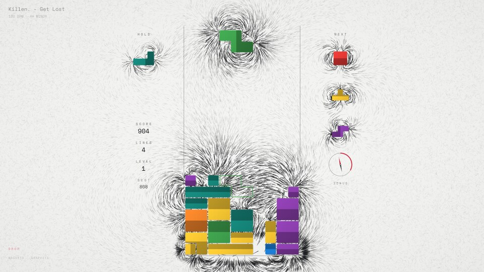

Left out of the default build for now (`-DZENTRIS_DISABLED_UNIVERSES=""` builds it). The school experiment: magnets lying on a sheet of paper strewn with iron filings (code in `src/universes/magnets/`). Every piece is a matte ferrite magnet painted in two halves, north and south across its axis (its colour, and the same colour darkened); each cell is a small dipole, so inside a piece the poles cancel and each piece is one bar magnet with its poles at its ends; the falling piece and the previews are magnets too. 65,000 filings are simulated on the GPU: each turns toward the real field where it lies (a damped torque: smooth, no jitter), creeps slowly toward the strong field around the poles and stops at a magnet's edge, so the paper keeps the memory of where the stack has been; far from the magnets friction wins and they stay scattered, faint. The falling piece drags its field down the well and the filings turn as it passes. The music taps the paper: a calm part shows a few fine filings, lines only near the poles; the verse taps the sheet on each bar; a chorus taps it on the kicks, with more, darker filings and lines reaching further. The drop turns every magnet's polarity over on its downbeat: every filing spins half a turn the same way at once, the magnets change to their second paint, and for the whole peak the kicks tap the paper hard while every four bars half of the magnets turn over again and the lines re-route. A cleared row is lifted off the paper (a quick fade, its shadow growing), the filings under it jump and resettle and the ones clinging to the stack slide down with it; a landing piece pushes a little dust of filings out from under it; a Tetris makes the whole sheet shiver round once. The bonus gauge is a compass whose needle follows the field. Slow motion inverts the sheet (pale filings on dark paper). Four variants with their own paints: **GRAPHITE** (white paper, black filings), **SILVER** (black paper, steel filings), **BLUEPRINT** (white filings on cyanotype blue), **COPPER** (copper filings on black). Its HUD font is Space Mono (SIL Open Font License, `src/universes/magnets/OFL-SpaceMono.txt`).

## TOPOGRAPHY

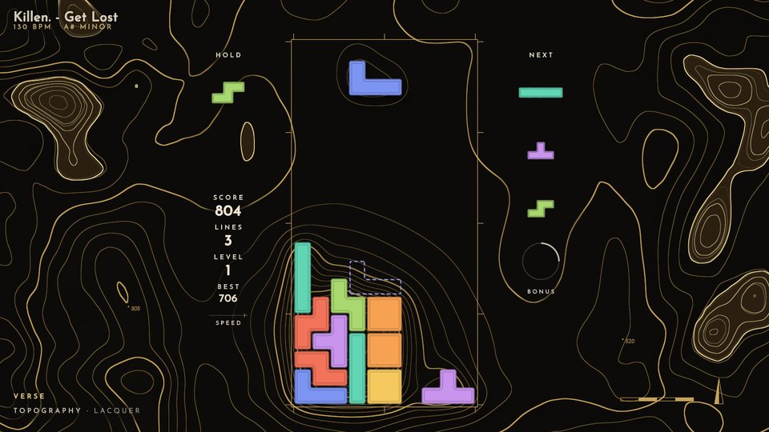

A contour map whose terrain is the stack (code in `src/universes/topography/`). Fine isolines on white or black paper, an index contour every fifth line, a neat line around the well, spot heights, a scale bar and a north arrow. Every locked cell is elevation: the stack stands as a plateau with its foothills (taller stacks stand higher), so the contours hug its skyline, climb the empty well and run out over the margins, redrawn on every lock and always gliding (the map eases toward the terrain). The ground itself is never still: its hills drift, swell, part and merge over tens of seconds (each octave of its noise drifting its own way through a slowly moving warp), slowest at a break and quicker in a chorus and a drop, so the contours, the lakes and the rivers flow with it; the rivers' carving heals slowly and the spot heights follow their hilltops. The pieces are small tinted plateaus, each type its own tint, with a crisp outline and two form lines inside (one shape per piece, two pieces never merge); a landing piece's form lines spring out from its middle as the land rises under it; the falling piece hovers with a soft shadow; the ghost is a dashed border. The song is the weather, and its consequences stay for the song: the rain gathers into a real drainage network (long rivers that join, drawn as smooth lines widening downstream) and carves its valleys, so the map keeps a record. A break drizzles (a few streams, a quiet sheet); mid parts rain (tributaries appear, showers sweep one side on the bars, the hollows fill into ponds, gaps in the stack become tarns); a chorus at the peak floods the valleys; a drop is the flood: the water surges past the well's terrace on the downbeat so the stack stands as an island, the layer tints come in, lines parallel to the shores ripple outward with the kicks and the level swells slowly over two bars. Unlike a chorus, a drop is also a living relief: the land heaves up around the stack on the downbeat, six peaks in the margins rise and fall with the bass, mid and high bands (eased, so their contours flow and tighten as they grow, only breathing in a chorus), one of them sinks and another pushes up elsewhere every four bars, half-interval contours come in so the map gets denser, the rivers run faster, and the pieces and contours switch to the sheet's drop colors (back over a couple of seconds after it). A hard drop swells the ground a little under the piece; a cleared row sinks into the map (its cells shrink and fade in a third of a second, the contours relax as the land slumps) and leaves its debris as fans against the walls; a Tetris is a flash flood; slow motion is a low cold dusk sun raking the relief; game over is the sea rising over the stack. Five sheets, each with its own seven tints: SWISS (brown contours, blue water), NIGHT SURVEY (pale lines on near-black, cyan water, pastel plateaus; dark minor songs), QUADRANGLE (survey colors, woodland green), GRAPHITE (grey and black only for the map) and GLACIER (blue contours, warm plateaus) (`--universe "topography:night survey"`). The terrain is a CPU grid of four samples per cell (well under a millisecond a frame), drawn in one full-screen pass with B-spline sampling. The map's lines and shores fade out behind the HUD's text and the previews. Its HUD font is Barlow (SIL Open Font License, `src/universes/topography/OFL-Barlow.txt`).

## HEAT

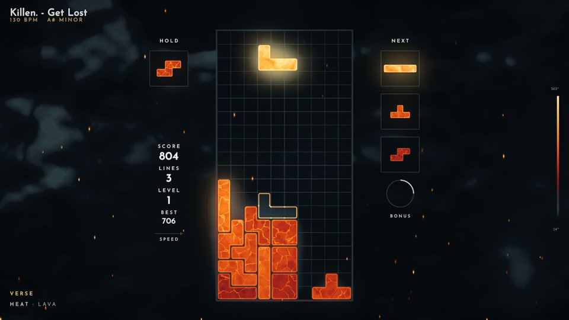

The stack seen through a thermal camera (code in `src/universes/heat/`). The frame is one thermal image: the room, the air and the pieces are written as temperatures into a float target and mapped through the camera's colormap. Every piece lands white hot and cools down through the colormap (white, yellow, orange, red, magenta, deep blue), so the stack shows its own history as temperature. The heat is simulated on the 10 × 22 grid: it conducts between neighbouring locked cells (a fresh piece warms the old ones under it), into the well's walls and floor (thin frames that warm where the stack touches them), and leaves through the exposed faces into the air, a coarse grid over the whole view where it rises, sways, spreads and fades: the stack glows, a warm column stands over it, and the room shimmers behind the hot air. Hot things have a soft halo. The pieces stay apart and recognizable: each piece radiates through its own outline (a cooler rim, a warmer core, a thin seam between pieces), and the seven types are seven materials of different emissivity, so each settles to its own band of the colormap when its heat has gone (J the coldest, then O, S, L, T, Z, I the warmest) and the previews show each material's band. The falling piece is the hottest thing on screen; the ghost is a cold outline, its imprint a shade colder than the room. The room is minimal: a cold wall with very slow, low-contrast temperature drifts, the well a pane a shade colder, a warmer floor below, two or three soft warm shapes far away in the margins. The camera's overlay is restrained: a thin scale bar on the right edge with the range in degrees, the bonus gauge as a thin ring whose charge is drawn in the hot color, the lettering in Noto Sans Mono. The song is the room's weather, with the camera's auto-range: a break or a calm part is cold and quiet (a wide range, cold far shapes, still air, pieces losing their heat faster); a chorus is warmer (the range narrows, the far shapes warm up, the air rises faster, and at the peak a bubble of hot air leaves the stack with the kicks, alternating sides, while a far shape warms on each bar). The drop flares: on its downbeat the whole stack flashes hot and cools over seconds, a sheet of hot air leaves its top, and the camera switches to another colormap for the whole drop (back slowly afterwards). A lock is the piece landing white hot; a hard drop also heats the cells it hits and pushes a breath of hot air out at the contact. A cleared row vents its heat: its blocks cool and fade out in a third of a second (at the real speed even in slow motion, nothing drawn over the row), the heat passes into the cells above it (they glow where the row was) and a plume of hot air rises out of the stack. A Tetris is an updraft that warms the whole stack. Slow motion is the camera's isotherm mode: everything grey but the hottest band. Game over is the stack cooling into the room from the top down. Four cameras, each with its drop colormap: IRONBOW (drop: RAINBOW), ARCTIC (blues and cyans, the heat in gold; drop: LAVA), WHITE HOT (grey; drop: IRONBOW) and LAVA (teal, wine, red; drop: GLOW, black-red-yellow hot metal) (`--universe "heat:arctic"`). It also takes the FORGE idea of the roadmap (glowing pieces darkening as they cool). Cost: the heat and the air (~150 × 85) on the CPU, two full-screen passes and a quarter-resolution blur. Its HUD font is Noto Sans Mono (a subset, SIL Open Font License, `src/universes/heat/OFL-NotoSansMono.txt`).

## BLUEPRINT

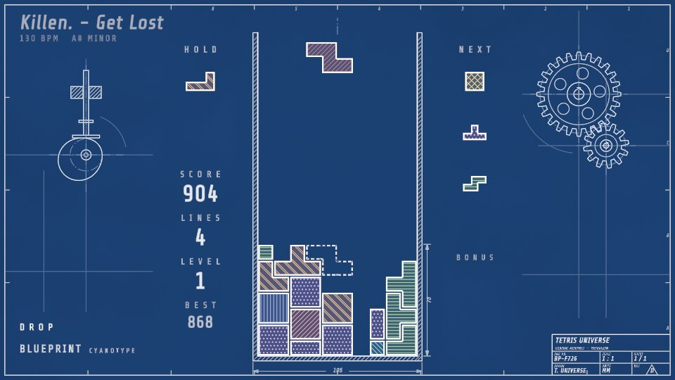

A technical drawing whose parts are the pieces (code in `src/universes/blueprint/`). A drafting sheet with its border, zone marks and title block (drawing number, scale, sheet, revision). The well is a container drawn in section: hatched walls, an open top, a center line stub, its width dimensioned below it. The pieces are drafted parts: a crisp outline, a light wash of their tint and the section hatching of their type (45 degrees, cross-hatch, stipple, horizontal, 135 degrees, vertical, steel pairs), so the seven types read apart at a glance; the falling part is lightly hatched, the ghost is a hidden line (a dashed outline). The drafter draws: every line comes in as a pen stroke. A landing part gets its hatching drawn up from the impact, and is dimensioned: extension lines, arrows and its width lettered above it, fading after a few seconds (only the last part, lifted at once if anything comes above it); the stack's overall height is dimensioned beside the well and glides when it changes. The song is the drawing, and it stays for the song: a break is sparse paper with a few construction lines (a machine drawn earlier left as a faint ghost, inked again by the pen when the music comes back); verse and mid parts draw a machine elevation in the margins, a part every four bars (a spur gear, a cam and its follower, a pinion, a four-bar linkage, a crank and piston in its cylinder, an idler, a Scotch yoke, a spring, the linkage's coupler curve); a chorus draws every two bars and adds center lines, section hatching and the coupler curve. The drop brings the machine to life: the print changes on the downbeat (the blueprint turns into a white redline print, the film is exposed into a blueprint...) and the pieces' fills with it, the gears turn at tempo fractions with an eased ratchet every two beats (one turn of the big gear every two bars), the piston strokes once a bar and its chamber fires on the kicks, the cam lifts its follower, the linkage rocks, the yoke slides; every four bars a new part is drawn. A cleared row is rubbed out (its lines lift in eraser streaks in a third of a second, nothing is drawn over the row); every clear is a revision in the title block (a pen-drawn delta and the next letter, in the accent), a Tetris adds a revision cloud around the title block. Slow motion dims the sheet and slows the machine; game over strikes the parts' hatching out from the bottom and stamps VOID. Four sheets, each with its own seven tints and drop sheet: CYANOTYPE (white lines on Prussian blue; drop: a white redline print), VELLUM (graphite and non-photo blue on white film; drop: exposed into a blueprint with amber machine lines), CAD (thin colored layers on a black screen; dark minor songs; drop: the simulation in amber with hot layers) and DIAZO (a whiteprint, blue-violet lines; drop: a deep violet print with warm lines) (`--universe "blueprint:vellum"`). The pen lines are instanced segments gathered with MAX blending (joints and crossings never darken). Its font is Share Tech (SIL Open Font License, `src/universes/blueprint/OFL-ShareTech.txt`), slanted like hand lettering for dimensions.

## RECYCLE

A table seen from straight above where nothing is created or destroyed (code in `src/universes/recycle/`). The well is a shallow tray in the table; on both sides, in the margins, stand stepped pyramids of loose cubes, the same cubes the pieces are made of, neutral in color, their courses told by soft, airy shadows and a delicate contact shade (lit from the upper left) and a slight long-lens parallax. The world holds a fixed number of cubes (176): a new piece takes its four cubes from the top of a heap, and they fly in on a short eased arc (their shadows stretching with the height), taking the piece's color on the way and converging onto it while it is already playable. A cleared row unzips outward: its cubes lift out, the left half flies to the left heaps and the right half to the right, landing on top with a tiny bounce, still tinted by their piece for a moment. The heaps fill one after the other, so they shrink, pyramid by pyramid, as the stack grows: the stack's height reads in the margins at a glance. Holding a piece sends its cubes back; the previews are flat silhouettes printed on the table (the plan, not the material); the ghost is a fine outline on the tray; the bonus gauge is twelve printed pips, one per line. A break is still; mid parts move one cube from a heap to another every bar, a chorus every two beats (the heaps get tidied). A drop throws every cube in the air on its downbeat and lands them in a new formation in the drop's colors (short two-course bars of color with gaps between them, concentric double rings opening away from the well, or towers casting long shadows; a new one every four bars), the pieces switch to the drop's palette, and a hop ripples through the cubes outward from the well every two beats, stronger with the kicks; after the drop they gather back into neutral heaps. A hard drop squashes the landing cubes a little; a Tetris sends forty cubes high over the table; slow motion is a low evening light with long shadows; game over sends the whole stack back to the heaps, from the top down. Four tables, each with its own pieces and drop colors: PORCELAIN (matte white cubes on a cool white table, pastel pieces; bright major songs), ONYX (glossy graphite cubes on black, jewel pieces), TERRAZZO (honey-oak blocks on a pale warm terrazzo floor with sparse stone chips, under a broad window light; painted pieces) and NIGHT (slate-blue cubes on a navy table, pastel pieces) (`--universe recycle:onyx`). Its HUD font is Outfit (SIL Open Font License, `src/universes/recycle/OFL-Outfit.txt`).

## SUNPRINT (disabled)

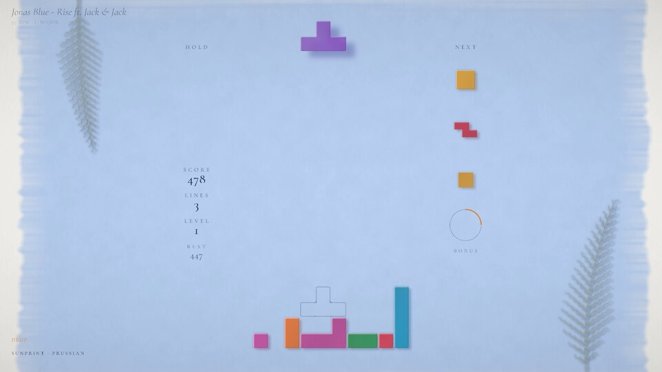

Left out of the default build for now (`-DZENTRIS_DISABLED_UNIVERSES=""` builds it). A cyanotype photogram exposed under the stack (code in `src/universes/sunprint/`). A sheet of paper brushed with sensitizer lies in the sun (the coat's ragged, streaky brush ends show left and right), the pieces are glass plates laid on it, seven tinted glasses with a bevel lit on the sun's side and a fine dark edge. The coat has two close, light tints, and the sheet goes over from one to the other on the bar grid (in about a second), except where a plate lies or the falling plate is held at that moment: there the paper keeps the tint it had. The frame keeps a tint map (two half-resolution float targets, each frame reading the last), so the sheet records where the stack was: a cleared row leaves the stack's old shape in the other tint until the sheet turns again, and the ferns print the same way. The sheet always stays light, so the glass and the dark lettering and ghost outline read on it in every tint. The plates cast soft shadows that keep the glass's color; the falling plate, held above the sheet, casts a longer, softer shadow that tightens as it lands; the ghost is a fine pencil outline. Two pressed ferns lie in the outer margins, as in Anna Atkins's prints. The song is the sun: a calm part is a low sun behind passing clouds (long soft shadows, the sheet turning every eight bars), a chorus raises it (shorter shadows, the ferns stirring every two beats on the beat grid, the sheet turning every four bars), a peak is full sun (crisp colored shadows, a glint running along one plate's bevel on the kicks, the sheet turning every two bars). The drop brings both tints up a little more saturated on the downbeat and every plate catches the sun; they go back slowly after it. A cleared row's plates are lifted off the sheet in a third of a second (they fade as they rise, their shadows growing soft); a Tetris is a burst of sun over the cleared rows. Slow motion is the sun going behind a cloud (a cool, quiet afternoon); game over turns the sheet once more and lifts the plates off from the top down, leaving the stack's silhouette in the old tint. A new song rinses the sheet to its tint over a few seconds. Four processes, each with its two tints and seven glasses: PRUSSIAN (two pale blues), TANNIN (two mauves), VAN DYKE (two sands) and CHLOROPHYLL (two pale greens) (`--universe "sunprint:tannin"`). Cost: two half-resolution shadow targets blurred into penumbras, the tint pass and one full-screen pass for the sheet. Its font is Cormorant Garamond (SIL Open Font License, `src/universes/sunprint/OFL-CormorantGaramond.txt`).

## EMBROIDERY (disabled)

Left out of the default build for now (`-DZENTRIS_DISABLED_UNIVERSES=""` builds it). Cross-stitch on aida cloth (code in `src/universes/embroidery/`). A sheet of aida under a soft daylight (its weave kept very soft: no grid of holes behind the HUD), the well a backstitched outline on it, open at the top. The pieces are embroidered: every cell is four by four cross stitches of stranded floss (two plies twisted, shaded round, their crests catching the light), and each piece is outlined in a backstitch of a dark shade of its own thread, as charted patterns are, so two pieces of one color never merge. The falling piece is held over the cloth with a soft shadow under it; the ghost is a running stitch around where it will land. In the outer margins, clear of the HUD columns, a sampler is stitched over the song: charted motifs (a heart, a tree, a flower, a bird, a star, a strawberry, a medallion) stacked in two panels in an order of the song's own, then each panel's frame, a budding vine. A needle does it one strand at a time, its thread sagging back to the cloth: the thread comes from the game (each cleared row is a run of stitches, a Tetris a long one) and from the music (a stitch every two bars in a break, two a bar at mid, one a beat at a peak, two a beat in a drop), so the cloth fills up with the song and with the play. The sampler's state is a small texture (a texel a stitch: its thread and whether one or both strands are in) drawn with the cloth in one full-screen pass; the pieces are instanced cells drawing their crosses procedurally. A cleared row is unpicked: its crosses come out one by one, the top strand first, in a third of a second. A lock pulls the piece's thread tight (a glint); the kicks of a peak run a glint along one piece's floss. The drop turns the cloth over to its drop side and the threads to brighter silks (the sampler with them), on the downbeat, and back slowly after it. Slow motion is the evening: a warm lamp over the frame, the corners in the dark. Game over unpicks the stack row by row from the top; a new song unpicks the old sampler and starts a new one. The lettering is in a thread color, dark on a pale cloth and pale on a dark one; the bonus gauge is a ring of running stitches, stitched solid in the accent as it charges. Four cloths, each with its seven threads and its drop: WHITE AIDA (classic floss; drop: black aida and bright silks), LINEN (natural linen, earthy threads; drop: indigo and pale silks), BLACK AIDA (bright floss; drop: a deep crimson cloth and pale gold silks) and INDIGO (white and pastel threads; drop: white linen and saturated floss) (`--universe "embroidery:linen"`). Its font is Lora (SIL Open Font License, `src/universes/embroidery/OFL-Lora.txt`).

## LANTERNS

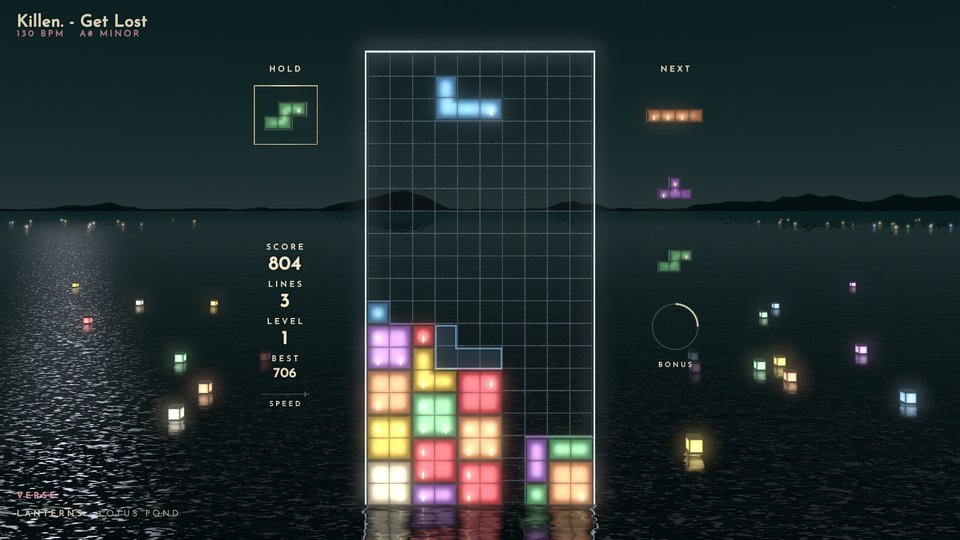

Paper lanterns floating on a dark lake, in real 3D (code in `src/universes/lanterns/`). The camera is the layout's reference camera raised to a low eye height and looking straight ahead with a lens shift, so the board's plane keeps its pixels while the lake, a true horizontal plane at the well's floor, recedes in perspective up to a horizon a little above the middle of the screen: a far shore of low hills, a sky darkening upward with a few faint stars (never behind the HUD). The water is drawn per pixel from the camera's ray: rippled normals reflect the sky (Fresnel: dark near, mirror-like far away, hazy at the shore) and distort a planar reflection of the whole scene (the stack, the poles and every lantern rendered mirrored into a half-resolution texture). The well is two bamboo poles standing in the water, and the stack floats on the lake, mirrored under it. The pieces are 3D paper lanterns: every cell is a thin opaque box (a third of a cell deep), the faces between a piece's own cells removed so each piece is one solid panel of lit paper whose top and inner sides show in perspective as thin darker rims: washi (a fine fiber, ribs between the cells' junctions), deeper and more saturated toward a crisp dark wooden frame along the piece's edges and inner corners, warmer at its candle at the piece's heart; the previews are thin panels; the ghost is a fine outline of the paper's light; a quarter-resolution bloom. The cleared row becomes the lanterns, visibly: each run of one piece in the row turns into a box of its paper that slides out of the well to the nearer side (each half as one block, past the poles, in the 0.3 s the row stays empty, so nothing is left over the row), then folds into a box lantern (a dark cap and base growing on it) as it floats down beside the well onto the water behind it, one after the other, and drifts across the lake to a free place, far into the distance, where it stays lit for the whole song (up to ninety, the oldest going out), each with its rippled reflection. On the lake they keep clear of the HUD's lettering, and any lantern seen behind it dims. A calm part is a still mirror (more stars); mid parts ripple the water on the beat grid (every two beats) and light far lanterns along the opposite shore; a peak ripples harder, lights more of them, and its kicks make candles flicker (on the lake and in one piece of the stack). The drop lifts every lantern off the water into the sky, each in its own time, rising and receding, smaller and smaller, their reflections following them, while more go up from the whole lake every two beats and the horizon warms with one soft swell: a sky full of lights over a lake full of their reflections; after it they hurry away and go out, and new ones gather again. A lock is the piece's candle catching (on that piece only), a hard drop pushes a few embers out at the contact; a Tetris sends its four rows out as lanterns and a dozen more up from the lake. Slow motion is moonlight: a full moon rises in the right margin, its path of glints on the water, a mist lies on the lake (never over the pieces) and the world turns cool around the warm lanterns. Game over puts the stack's candles out one by one from the top; a new song lifts the old song's lanterns away. Six nights, each with its own seven papers and drop sky: MIDNIGHT (deep blue, classic papers), LOTUS POND (teal, pastel papers), MOONLESS (black water, jewel papers; dark minor songs), DUSK (a plum sky), FROST (a winter night, ice papers and one warm one) and FESTIVAL (indigo, red and gold papers; bright songs) (`--universe "lanterns:dusk"`). The HUD is set straight on the night in warm paper light over a dark halo; the bonus gauge is a thin ring whose charge glows in the accent. Its fonts are Josefin Sans and Cormorant Garamond Italic (SIL Open Font License, `src/universes/lanterns/OFL-*.txt`).

## ORIGAMI

Folded paper on a sheet, every cleared row folded into a paper crane before your eyes (code in `src/universes/origami/`). A large sheet of paper under a soft light from its upper left (a fine, soft grain), the well a shallow tray folded into it: two valley creases and a floor, a lip of light outside them, open at the top. The sheet was folded before: a giant crease pattern lies over the whole view (a square base, a sixteen-fold star, a square base set lower and turned...), its large facets tilted a little and catching the light, a fine pressed line between them; faint at calm, they come up at mid and more at a peak, and after each drop the old pattern fades and another one comes up. The light is two-toned, warm where it comes from and cool across the sheet, and warms at a peak. The pieces are folded paper, each of its own colour: every piece is a strip folded along its length, a ridge running through its cells' centres from neighbour to neighbour (mitred where the strip turns, a valley crease in the inner corner, a lone cell a square folded on its diagonal), its two sides sloping down to the cut edges and lit facet by facet, the cut edge lit on the sides toward the light; a piece has no seam between its cells and lies on the sheet with its own soft shadow (max-blended in a half-resolution target), which keeps two pieces of one colour apart. The falling piece looks exactly like a locked piece of its type, only held a little above the sheet (its shadow wider and further), and its shadow settles on lock. The ghost is a dashed valley-fold line, as in folding diagrams. A cleared row slides out of the well through one of its walls, the other one than the last row's (a double clear sends one row each way), as one strip of paper (out of the row in under half a second, passing under the stack as it settles) and pleats against the wall, a pleat a cell, valley and mountain in turn, each pleat lit by its own slope, its papers turning to the row's most common one; the pleated packet glides to the folding corner on that side (on the right the free corner under the HUD column; on the left the margin above the corner texts, reached along the well's wall and under the HUD column, clear of its text; both kept free of perched cranes, with four spots each so that several rows fold at once), turns over into a square, and is folded into a crane step by step, every flap turning about its crease in 3D and lit by its normal: the kite (the corners fold to the centre), the petal fold (the lower layer swings up and stretches into the near wing), the bird base, the legs narrowed (their outer parts folded behind), the neck and the tail swung up, the head folded down, the wings opened. The crane (a diamond body, a long tail and neck, a pointed head, two wings, every part in two facets with a raised middle crease, a darker rim for the paper's edge, a soft contact shadow) then takes off to a place on its side of the well (or, when that side is full, over the top of the well, behind the pieces, to the other one), and settles there for the rest of the song, facing the well, a shade quieter than the pieces; the margins fill up with the play (when every place is taken, the oldest crane flies off). A row is folded in about 3 s at the real speed, even in slow motion. A Tetris folds one larger crane in the accent paper and sends a ripple of wing beats through the flock. Calm: the cranes are still, the light soft. Mid: every two beats a few cranes beat their wings (a wing turning about the body in 3D). Peak: half the flock beats its wings in turn every two beats and the kicks make one crane hop; a new section sends a ripple of wing beats. The drop turns the sheet over to its coloured side (and the papers to their drop shades) and sets every crane flying: they take off one after another and fly slow loops in their margins, spread evenly around them, wings on the two-beat grid, their shadows further and fainter, until the peak ends and they land back in their places. Slow motion is the blue hour: a low light raking in from the right (the facets light the other way, the shadows long and to the left). Dimmed (pause, game over) the world fades into the sheet so the text reads; game over folds the stack away row by row from the top (each cell's upper half folding down over its lower half, its white back turning up) and greys the paper; a new song sends the flock away. The lettering is graphite on a pale sheet and chalk white on a dark one (from the sheet's own value, so it follows the sheet when the drop turns it over); the bonus gauge is a ring of folded paper segments, charged in the accent paper. Six papers, each with its seven papers and its other side: KAMI (white paper, classic kami colours; drop: deep blue), SNOW (cool snow grey, soft papers; drop: black, bright papers), GRAPHITE (bright papers; drop: deep crimson, pale papers), INDIGO (pale papers; drop: the white side, saturated papers), FOIL (black paper and foil papers with a metallic glint on the facets; drop: deep teal) and CELADON (pale celadon grey, jewel papers; drop: forest green) (`--universe "origami:foil"`). Its font is Josefin Sans (Regular and Light, SIL Open Font License, `src/universes/origami/OFL-JosefinSans.txt`).

## RAINY WINDOW

A window pane at night in the rain, the city out of focus behind it (code in `src/universes/rainy/`). The city is only soft bokeh discs of light, slow and quiet (street lamps and windows, most of them low where the streets are, a few big near ones, tower lights up high, cars drifting along a street far below), over a night gradient with the city's glow low behind the glass; the lights stay dim behind the HUD's columns and corners. The glass and the water are the subject: small beads of rain sit everywhere on it, bigger drops hang still and swell as the rain feeds them, and on the music's beat grid some of them let go and run down, meandering, picking up the beads they meet and the drops they hit, leaving a trail of tiny beads that dry away and wiping the mist off the glass (the clear trails fog over again in about ten seconds, so the pane keeps the streaks of the last runs). Each drop is a small lens: the city upside down inside it, sharper than through the mist, the light gathered in its lower part, its rim dark, a small highlight. The well is the middle pane of the window, between two thin dark mullions, above the bottom rail and the sill of the dark room. The pieces are stained glass stuck on the pane: one slab of tinted cathedral glass per piece (a hammered ripple, a brighter line where the glass meets the lead, a broad reflection of the room), leaded around with filleted corners so two pieces never merge, lit from behind by the city (the bokeh glows through the tiles); the falling piece is a slab sliding on the glass, the ghost a pale line traced where it will land. The stack is an obstacle to the water: a drop that runs onto a piece slides along its top to the nearer edge and runs down its side, or settles in a pit, and leaves water resting on the piece, so beads pool along the tops of the stack and stay there (a face covered by the next piece loses its pool). A calm part is a light rain under a thick mist, a drop letting go every eight beats, some windows out; mid sets the drops running every two beats and lights more windows (one changes on each bar); a peak is a downpour: runs of three drops every two beats, the rain thick on the glass, the mist washed thin, the lights brighter, and the kicks light a few of the city's lights (local, never the scene). The drop shifts the whole city to the night's other colors in a second on the downbeat (SODIUM's amber city turns neon pink and cyan, TAIL LIGHTS' red lights all turn green...), with one soft swell, lets every hanging drop go at once and brings more from above; the colors come back slowly after the peak. A hard drop squeezes the water from under the tile: a drop leaves each lower corner and runs down. A cleared row melts: its glass drains down the cell with a bright meniscus and clears to water in a third of a second (at the real speed even in slow motion; nothing is drawn over the row), a few beads of water running down over the stack. A Tetris lets every drop go and sends the rows' colors into the city as a dozen lanterns of light rising on both sides of the well. Slow motion is a later, colder hour: the rain almost still, the mist thicker, the city drained to blue. Game over melts the stack from the top row by row while the pane mists over. It leaves and enters with the world fading to the bridge, the stack in its ink. Six nights, each with its own city lights, drop lights and seven glasses: SODIUM (amber street lamps; drop: neon), NEON (pink and cyan; drop: gold), BLUE HOUR (a lighter blue sky, warm windows; drop: rose and violet), TAIL LIGHTS (red and amber in the dark; drop: everything turns green), HARBOR FOG (pale lamps in a teal fog; drop: rose and gold) and AFTER MIDNIGHT (deep indigo, a few cold lights, vivid glass; drop: warm gold and red), from the mode, brightness, bass and dynamics (`--universe "rainy window:neon"`). Cost: the city at half resolution (instanced discs) blurred at a quarter, the water as a height field of a few hundred instanced domes max-blended at full resolution, a 400 × 225 mist grid and the drops on the CPU, one full-screen pass for the pane. The bonus gauge is a ring of beads of water, the charged ones lit in the accent. Its HUD font is Josefin Sans (Light and Regular, SIL Open Font License, `src/universes/rainy/OFL-JosefinSans.txt`).

## BRICKS

Glossy toy bricks in a photo studio, every cleared row building small models that turn on turntables beside the well (code in `src/universes/bricks/`). Real 3D: the layout's camera raised a little and looking straight ahead with a lens shift (the board's plane keeps its pixels), a seamless studio sweep (the table curving up into the backdrop, a fine grain, a soft pool of light around the well) under one soft key light with a 4096 shadow map, rendered 4x multisampled. The well is a plastic board standing on a floor plate with studs; the pieces are interlocking plastic bricks clipped onto it: one brick per piece (the faces between its cells removed, molded bevels and a fine groove only on its free edges, so two pieces of one color never fuse), a stud on every top face left open, glossy ABS shading (a soft highlight, the studio's softbox in the reflection, a little warmth on the shadow side), real contact shadows on the board and on each other. The falling piece is exactly a locked brick held a little off the board, only its shadow shows it; the lock clicks it onto the board (a stiff spring, one small overshoot); the ghost is a fine outline on the board; the previews are small bricks. A cleared row pops off the board: each run of one piece in it becomes a 1 x N brick that slides out of the well (the left half to the left, the right half to the right, out of the row in 0.3 s) and flies on an arc to the model on its side, reshaping and, when needed, repainting on the way, and snaps into place with a small settle. The models are authored as voxel paintings cut into real bricks (1 x 1 to 2 x 4 in a running bond, rows of slopes for roofs) and built bottom-up, a course at a time: each ejected brick takes one of the bricks the model can take now (nothing missing under it), of its own color when one waits for it, the closest in length; nine models (a cottage, a lighthouse, an apple tree, a windmill whose sails start turning once it is finished, a castle tower, a rocket, a pagoda, a duck, a sailboat), each side in its own shuffled order. A finished model glows softly and turns once, then leaves for the gallery at the back of the table (four per side, receding into the studio's haze, the oldest fading away), and the next baseplate drops onto the turntable (bricks ejected meanwhile wait above it). Outside the drop a model never comes apart: its bricks only move when they fly in and snap on. Calm: slow turntables, a soft light; mid: each model lifts gently, whole, on its turntable on the beat grid (every two beats), the turntables a little faster; peak: a little more light, a higher lift, and the kicks give the models a soft glow. The drop spins the turntables up (eased) and the models come apart and back together on the beat grid, two beats out, two hovering, two back, two still (top bricks leave first and come back last, so it rebuilds bottom-up), a new figure every two bars: a spiral staircase around the axis, an exploded view (the courses apart, as in a building guide), a twisted column of rings; when the drop ends the bricks come home in about a second (eased, the lowest first) and the turntables slow down. A Tetris throws its bricks higher, makes the models (and the gallery) glow softly, lifts both models whole and gives both turntables one extra turn. Slow motion is an evening light raking in from the right (long shadows to the left, a warm tint, nearly still turntables). Game over pops the stack's bricks off the board from the top down, tumbling off the table. It leaves and enters through the bridge (the studio fading, the stack in the bridge's ink). Five studios, each with its own seven bricks: CLASSIC (white studio, primaries), SORBET (blush studio, sorbet bricks on a dusky board), NIGHT (dark studio, bright bricks), EARTH (sand studio, earth tones on a walnut board) and SLATE (slate studio, vivid bricks) (`--universe bricks:night`). The HUD is graphite on a pale studio and chalk on a dark one; the bonus gauge is a ring of twelve studs seen from above, charged in the accent. Its font is Outfit (Medium and Light, SIL Open Font License, `src/universes/bricks/OFL-Outfit.txt`).
## CRYSTAL CAVE

Gemstone pieces in a dark geode cave, each phase of the song cut from its own mineral, so the stack records the song's structure in strata (code in `src/universes/crystal/`). A flat view at the layout's scale with depth in the light: the cave's rock is near black, broken into large angular chunks that catch the light toward the walls (kept smooth and quiet behind the well and the HUD columns), with a thin banded agate shell at the far sides. Clusters of quartz points line both walls in the outer margins, a few hang from the vault on the right and a few stand on the far shore of a still pool along the bottom of the screen: hexagonal prisms with an off-axis point, milky at the root and clearer toward the tip, faces lit differently, fine growth striations, translucent bodies with bright edges, each softly glowing from within and lighting the rock around it. The pool mirrors the cave (the shore crystals, the falling water) and ripples. The pieces are cut gems: each piece one stone (its cells merged, a thin seam between stones), faceted over its whole outline like an emerald cut: concentric steps of facets that follow the outline and meet in sharp mitres at every corner (inner corners too), each side stepped on its own so the steps of neighbouring sides do not line up, each step broken by slanted cuts that zigzag from step to step, and wide parts of a stone get a table of irregular facets. As in a real gem, each facet mirrors another part of the stone: its brightness and its shade of the color are seeded per stone (the falling piece already has the cut it will lock with), from the deep, saturated body to the color lit through, with a slight turn of hue from facet to facet and, on rare facets, a spark of the complementary color; the core glows deep, a thin paler girdle catches the light on the lit side, crisp small highlights sit on the facets turned to the light, and there is only a faint bloom (no halo). The steps' spacing is the piece type's own; the ghost is a fine line of the mineral's light, the well two faint veins of it. The song chooses the mineral: calm, mid and peak each have one, and the drop a special one (GEODE: smoky quartz, amethyst, emerald, citrine). The falling piece and the previews are cut from the mineral of the moment and ease into the next one over a second or two when the phase changes (no snap); a stone keeps the color it locked in, so the stack grows in bands like an agate and a game played over the song shows calm, verse, drop and chorus as layers. A new section of the same level, or a level coming back later in the song (a second verse, a second drop), moves its mineral on to another of its three hand-picked tones, so two choruses stay apart in the stack. Within a mineral the seven piece types differ by a slight shade (a touch of hue, a value of their own) and the spacing of their facet steps. The cave's crystals echo the stack: each one takes a share of the minerals in it (and of the current one), changing slowly, so the walls fill with the song's colors. A calm part is a dim, still cave where a drop of water falls from a hanging crystal every four beats; mid lights the crystals more and the water drips every two beats; a peak lights the whole cave, two drops land together every two beats and the kicks make one cluster glow. Each drop gathers on its crystal's point, falls and lands on the beat with a small ring on the pool. The highs make crystals glint (a small star on a point, the edges lighting up) and now and then a gem's crown flashes softly, never the scene. The drop turns the mineral to the drop's stone for its first eight bars and lights the cave in it, the walls and crystals swelling in over a beat or two (two eased stages: no jump) and settling after; the peak's own mineral follows. A lock flashes the stone's crown and leaves a small star where it touched down; a hard drop knocks a few chips off at the contact. A cleared row shatters: its cells break into shards in their own colors that tumble down behind the stack, flashing as they turn, and fall into the pool, where they sink (the row is empty in under half a second, at the real speed even in slow motion). A Tetris rings every crystal of the cave, a ring of light running outward from the well. Slow motion stills the cave in a cold, silver light (the minerals drained, the water slowed). Game over puts the light out of the stack's stones row by row from the top, then each row crumbles into the pool; a stack inherited from another universe is cut in strata of the cave's minerals from the bottom up. It leaves and enters through the bridge (the cave fading, the stack in the bridge's ink). Five caves, each with its four minerals in three tones: GEODE (smoky quartz, amethyst, emerald, citrine), AMETHYST (a violet cave: celestite, amethyst, tourmaline, rose quartz; dark minor songs), ICE (a blue-black cave: rock crystal, aquamarine, sapphire, citrine; airy songs), EMBER (a warm cave: smoky topaz, amber, ruby, opal; heavy bass) and FLUORITE (a teal cave: green, purple, blue and yellow fluorite) (`--universe "crystal cave:ice"`). The HUD is set in pale crystal light over a dark halo, the section followed by the name of the mineral of the moment (`DROP · citrine`); the bonus gauge is a ring of small facets, charged in the mineral's light. Cost: one full-screen pass for the rock, about 150 instanced crystals, one pass for the pool, instanced gems and shards, a quarter-resolution bloom. Its fonts are Marcellus and Cormorant Garamond Italic (SIL Open Font License, `src/universes/crystal/OFL-*.txt`).

## ANTS

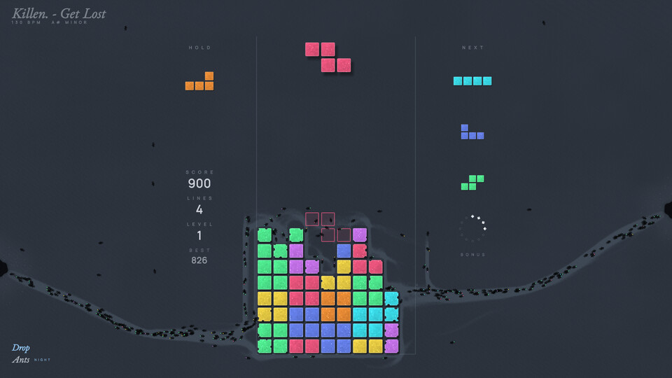

Sugar cubes and a colony of ants on a plain ground, seen from above (code in `src/universes/ants/`). The pieces are raised sugar cubes: compressed grains tinted the piece's colour, matte with tiny sparkling facets, crumbly edges, a chamfered top lit from the upper left, a shaded front wall and a soft contact shadow. Two nests sit half off screen, one on each side. Their ants are slim, crisp silhouettes with walking legs (faint while they cross the well). The colony is a classic ant-colony model, and nothing is scripted: no ant knows where the sugar is. Each ant only feels two pheromones under three sensors ahead of it, plus the sugar its antennae touch. Many ants wander at all times. Searchers lay a home pheromone; an ant that finds sugar nibbles a crumb (the cube keeps the bites, never eaten away) and carries it home, laying a food pheromone that weakens with the distance walked. Both fields diffuse and evaporate. Each crumb brought home calls recruits out, ants meeting head-on stop and touch antennae, and the trails grow, straighten and branch differently on every run, worn faintly into the ground. A clear bursts the row's cubes into sugar grains (the row is gone at once); the grains thrown out of the well wait to be discovered. A lock scatters the ants at the impact. A drop pours ants out of both nests and speeds everyone up, so the trails thicken and the swarm explores more, and the cubes take candy colours. Game over crumbles the stack from the top. Four variants come from the song: **LINEN** and **ASH** (light grounds, ASH with graphite ants) for bright songs, **NIGHT** and **TERRACOTTA** for dark ones (`--universe "ants:night"`). The fonts are EB Garamond and Manrope (SIL Open Font License, `src/universes/ants/OFL-*.txt`).

## SWISS POSTER

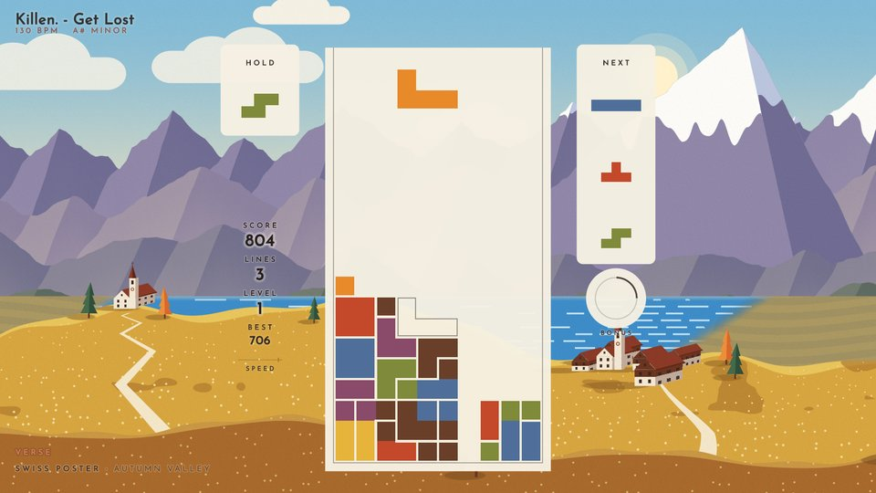

A poster in the International Typographic Style (Müller-Brockmann, Neue Grafik), set from the song (code in `src/universes/swiss/`). The whole screen is the poster, on a strict modular grid that is the well's own grid: every element sits on whole cells. Its words come from the song: the title (an artist before " - " goes under it, small), the section's name (verse, chorus, drop...) and a small block of information (section, tempo, key) under a thin rule, all in lower-case Inter Bold set flush left, with flat color fields, a disc and thin rules in asymmetric balance and a lot of empty ground. The game lies on the poster like a translucent sheet: from grid line −12 to +12 (the well and both HUD columns) the poster shows only faintly, so the words and fields can run behind the well and the HUD without competing with them, and the free zones on both sides carry it at full strength (the HUD's corner lines get a quiet patch of their own). The pieces are flat, crisp color blocks: one clean shape per piece (its cells merge, its outline cut cleanly at inner corners, a narrow gutter of ground around it so two pieces never fuse), no bevels or gradients; the falling piece is exactly a locked piece, the ghost a fine outline, the well two side rules and a baseline. Every kind of section has its own poster palette (three colors plus the ink: intro and outro, verse, build and break, chorus, drop); the falling piece takes the current palette and keeps it when it locks, so the stack records the song's structure in bands. Within a palette the seven types read by color and value (the three colors, a shade of the first, a pastel tint of the second, the ink and a grey). On the bar grid the poster recomposes: the words and fields slide and resize along the grid lines with slow eased motion (a field wipes shut along its length and opens elsewhere, a big move crosses by a fade instead of sliding across the screen), the details every bar, the structure every two bars (four when calm). Calm is sparse: a small title stacked in one zone, or one line running across, one column of color. Mid turns the title up the left zone or sets it larger across, and turns the section's name up the right zone. A peak is dense: bigger type, a stripe across the whole poster, a square, a block or a disc, a long rule; every two beats a rule steps along the grid and a small square moves along the information rule, and the kicks thicken the rules for an instant. The drop sets the title giant across the poster in the drop's palette, eased in over two beats, over a block and a band of color. A cleared row closes into a flat bar and slides out of the well sideways in 0.3 s, clipped at the well's edge (nothing drawn over the row); a hard drop leaves a thin rule at the contact that closes toward its middle; a Tetris sets "tetris" up the right zone in the signature color for two bars. Slow motion is the negative print (ground and ink swap). Game over slides the stack out row by row from the top. It leaves and enters through the bridge (the poster giving way to the bridge's color, the stack in its ink). Five posters, each with its own palettes: KUNSTHALLE (white, black, red), ZURICH (a cool white, blue, black), NIGHT (black ground, white type, signal orange; dark minor songs), CONCRETE (concrete grey, black, yellow; bass-heavy songs) and LAUSANNE (white, black, magenta) (`--universe "swiss poster:night"`). Cost: instanced flat shapes and SDF type into one poster target, one composite pass. The bonus gauge is a fine ring charged in the signature color. Its font is Inter (Bold and Regular, SIL Open Font License, `src/universes/swiss/OFL-Inter.txt`).

## LIMBO

A monochrome world of silhouettes in fog (code in `src/universes/limbo/`). Layered planes of black shapes fade into a luminous grey fog: low hills and grass in front, a big bare tree, a lantern and gears hanging from above on the right, a mid ground of bare trees and fence posts, a forest edge of pines all along, distant towers, pylons, a water tower and a windmill far away, and behind it all a vast mountain range the fog only shows at a drop. Each depth fades to the fog's own color at its pixel (brighter around the light, which also washes out what stands before it), and a drifting fog bank lies between each two depths, so the fog has real depth. A soft light sits low behind the well. The shapes stay faint behind the well, the HUD columns and the title (they fade out there rather than turning to fog in front of what is behind), so the stack and the lettering always stand on bright, quiet fog; a very fine grain (under a step of value: no visible dots) and a soft vignette finish the frame. The pieces are deep black silhouettes: one shape per piece (its cells merged, a thin gap from the others), a thin rim of the fog's light along its edges, brighter where they face the light, the color each piece type scatters into its rim the only color on the stack; the falling piece is the same silhouette, the ghost a faint shadow with a firmer outline, the previews small silhouettes. The well is two faint posts and a floor line in the fog. **The world fills up with the play**: each cleared row adds one thing to the landscape for good, in a varied order (a bird glides in and lands on a branch, grass comes up, a tree grows, a distant tower or windmill rises out of the fog, a lantern is lit, a fence post, a gear on a chain...), 48 in all, so the world at the end of a song is much richer than at its start (a new game takes them back). Calm: a thick fog (the far planes gone, the nearest shapes dark, a dim diffuse light, a slow breeze); mid: the fog thins (the forest edge and the towers come through), the trees, grass, ropes and lanterns sway on the beat grid (one side, then the other, every two beats) and the gears turn a notch every two beats; peak: the fog opens (the far planes clear, a brighter light and a soft disk, the banks drifting faster, the windmill turning faster), and the kicks brighten the lanterns (local lights only). The drop tears the fog open, eased in over a beat or two (no jump): the fog banks part from the middle and roll away to the sides, the fog thins to almost nothing, and a vast mountain range stands far away, its crests lit, as the light sinks into a big low sun setting behind the well; light shafts (the bright fog smeared toward the sun, occluded by every silhouette, sweeping slowly, never over the stack) fan out through the trees, the silhouettes facing the sun catch a rim of light (the pieces do not: they turn flat black for the whole drop), a gust bends the trees outward and tears leaves off the big tree, a flock of forty birds takes off from the forest on both sides, every lantern brightens, the gears spin and the windmills turn faster. Black silhouettes pass through the side areas and the sky, calm, on the beat grid (a wing stroke or a stride every two beats), never over the well or the lettering: herons gliding up and out across the side skies at varied sizes and depths (a new one or a few crows every two bars), deer walking along the near hills, a far train with its smoke crossing the plain, a balloon rising on the right. The far range stays faint behind the HUD columns and the title, so the lettering keeps its contrast. The look holds for the whole peak (or 16 s for a drop called outside a peak), then the fog closes in slowly over several seconds. A cleared row dissolves into the fog: its edges erode into mist (gone in under 0.4 s, at the real speed even in slow motion, behind the rows that settle over it) while a few dark motes drift up; a hard drop pushes a breath of mist out from under the piece. A Tetris sends a flock up from the forest edge, flying off slowly, and warms the light for a moment. Slow motion is a still, moonlit fog (cold, colorless, the world slowed); game over dissolves the stack from the top down while the fog closes in. It leaves and enters through the bridge (the fog fading to the bridge's color, the stack in its ink). Six moods, each with its own fog, light, lantern light and seven rim tints: ASH (neutral grey, a white light), DUSK (a hint of warm grey), MOOR (cool blue-grey), DEEP (a dark fog, a single faint light behind the well, pale lettering), EMBER (grey fog, the light alone in color: a low red sun and red lanterns) and PALE (high key, graphic black) (`--universe limbo:moor`). Cost: one full-resolution float target and a quarter-resolution one for the light shafts, the sky and three fog banks full-screen passes, the silhouettes a few thousand instanced primitives (tapered branches, discs, boxes, gears, triangles) rebuilt every frame. The HUD is quiet lettering with a soft halo of the fog; the bonus gauge a fine ring, charged in the accent. Its fonts are Lato Regular (labels, numbers) and EB Garamond Italic (the song, the section, the celebrations) (SIL Open Font License, `src/universes/limbo/OFL-Lato.txt`, `src/universes/limbo/OFL-EBGaramond.txt`).

## SUSHI

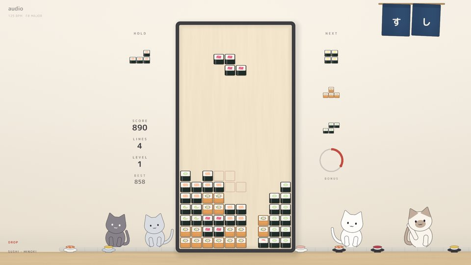

A kawaii kaiten sushi bar where the cleared rows feed a counter of cats (code in `src/universes/sushi/`). Everything is drawn flat in soft pastel colors, with rounded shapes and thick soft outlines. The well is a lacquered bento box (a dark inside, a colored rim) standing on a wooden counter; a conveyor belt runs along the counter behind it, carrying little dishes of nigiri (it starts with a rounded end left of the seats, clear of the corner lettering). Each cell is one maki standing on its own, a short roll seen from a little above (the cut face on top, the nori wrapped around its side, rice and sesame for the inside-out roll): crab (I), tamago (O), an inside-out roll with sesame, avocado and salmon (T), cucumber (S), tuna (Z), avocado (J) and salmon with its white lines of fat (L); the dark lacquer under them keeps the stack contrasted in every variant. The falling piece is exactly a locked one, the ghost the rolls' faint outlines, the previews small maki. Behind the counter sit round cats of an original design (white, calico, black with white socks and amber eyes, ginger and grey tabbies, a cream colorpoint), each with big eyes, blush, a collar and a little bell. **A cleared row feeds them**: its maki slide sideways out of the box (the left half to the left, the right half to the right, out of the row within 0.3 s, before the stack settles), then hop in arcs to the cats, who look up, open their mouths, catch them and chew, eyes squeezed shut with joy, a heart and a little "nom" rising. **The counter fills up over the song**: two cats at its start, one more popping up from behind the counter every two lines, two more for a Tetris (a feast: a stream of maki, sparkles all along the counter), up to the seats on both sides (fewer on the left, where the song's section and the universe are written); a new song sends the extra cats away. Paper lanterns hang on cords on both sides and a noren with す and し hangs in the upper right; sakura petals drift down behind the box and fade out behind the lettering. Calm: a quiet shop (the belt still, most cats dozing with sleepy eyes and a drifting "z", one lantern glowing). Mid: the belt starts, the cats wake and bob their heads on the beat grid (one way, then the other, every two beats), the lanterns and the noren sway, more lanterns light up. Peak: every lantern lit with a warm glow, more petals, the cats bounce on the two-beat grid and the maneki-neko among them wave a raised paw, the wall a touch warmer. The drop is a festival, eased in over two beats: every cat cheers with both paws up, mouths open, a shower of petals, the lanterns swell, the belt runs faster; it settles back over the following bars. Locks give the maki a small bounce. Slow motion is dusk at the counter (a violet evening, the lanterns warm, the cats sleepy); game over feeds the whole stack to the cats from the top down. It leaves and enters through the bridge. Five shops, each with its own plates: PASTEL (strawberry milk, a plum box with a coral rim), NIGHT MARKET (indigo night, glowing lanterns, a black box with a vermilion rim; dark minor songs), SAKURA (white-pink, a cherry-wood box, petals everywhere), MATCHA (soft green tea house, a dark green box) and RAMUNE (sky blue, a navy box) (`--universe "sushi:night market"`). Cost: one full-screen pass for the shop, instanced signed-distance sprites for everything else (one quad per cat, per maki, per petal). The HUD is rounded lettering with a soft halo of the wall (light on the box for the dialogs); the bonus gauge a soft ring charged in the accent. Its font is M PLUS Rounded 1c (Bold and Medium, subset to ASCII and four kana; SIL Open Font License, `src/universes/sushi/OFL-MPLUSRounded1c.txt`).

## Transitions between universes

A new song comes in with its universe through a transition, started on the next downbeat (or the next beat when
the bar is far) and lasting 1 to 4 bars (about 4 s at the song's tempo). Both universes render during it (each
gets every game event and phase change, so locks and line clears look right in both halves, and persistent
buffers such as VECTOR's phosphor keep running); outside transitions only one renders. Since every universe puts
the well at the same pixels (the layout contract), the stack stays where it is and only its material and its world
change. The transitions, universe-agnostic and driven only by data each universe declares once (its hints):

- **REBUILD**: the stack re-materializes row by row from the bottom under a scan beam, then the world follows,
  outward from the well.
- **RIPPLE**: a refracting ring leaves the well's outline, with an echo ring a beat behind. Never picked at random (it read as a shockwave on the drop); only with `--transition ripple`.
- **INK**: an organic dissolve spreading from the well, with fibrous edges (inked toward a light universe,
  glowing toward a dark one).
- **CURTAIN**: the old universe opens like curtains from the well's axis, gathered in folds at the edges.
- **LUMA**: darks switch first, highlights last.
- **TILES**: the screen in cells of the well's size, aligned with it, flipping like cards: the well from the
  bottom up, then the cells around it, on the eighth notes.

The pick favours the styles both universes declare, transitions that bridge brightness gracefully between a
dark and a light universe, and never repeats the last one. Between a dark and a light universe the blend goes
through the lighter (or darker) of the two instead of gray, and the front glows (toward a dark universe) or is
inked (toward a light one). In the middle of a change both universes go to the **bridge**: their world fades,
the stack turns plain, in their own tones; so the two halves meet in a neutral state whatever the pair.

## Roadmap

The list below is the roadmap, in implementation order: first the universes already built (✅, or disabled), then
the ideas waiting to be built. The ideas are ranked by how well they fit what play testing showed works:

- one material or medium rendered for real (ink, paper, glass, stone, metal, sand), minimal, with one strong idea;
- the stack drives the world and the world keeps its memory over the song (FLUO's stains, TOPOGRAPHY's rivers,
  HEAT's cooling, MARBLES' felt, BLUEPRINT's revisions);
- light in the dark or a quiet surface, calm and eased: no flashes or shakes, and the drop is one big change of the
  world (a colormap, a blacklight, a flood);
- not a backdrop that ignores the stack (CLOUDSCAPE), not a retro game or kitsch look (PIXEL, SYNTHWAVE), and not too
  close to a universe that exists (SHADOW PLAY and LIGHTSOURCE, CRYSTAL CAVE and PRISM, CHALKBOARD and NOTEPAD).

The ideas rated A in review (very interesting) come first, then those rated B (maybe), then the unrated ones; the
busy, kitsch or classical ideas and those rated C (not interesting, like DE STIJL) come last. To build one, see [Adding a universe](adding-a-universe.md).

| # | Universe | Look | How the music plays it | Status |
|---|---|---|---|---|
| 1 | SUMI | Ink on washi paper, sumi black + one vermilion seal; brushed pieces told apart by ink treatment | Beats diffuse ink in the paper; calm = faint far mountain, peak = ensō brush circle, red sun, a plum branch painted in and falling petals; a drop colors the sky | ✅ |
| 2 | VECTOR | Phosphor beams on black CRT glass, one phosphor per song, persistence trails; pieces are line glyphs | Calm = a lone oscilloscope trace; mid = scrolling vector grid; peak = low spectrum mountains and faint Lissajous scopes, breathing on the beat (no flash, no shake); clears shatter into vector debris | ✅ |
| 3 | DIORAMA | Clay miniature by night: the board on a floating island, soft shadows, tilt-shift | Phases move the moon across the sky; kicks ripple the water; cleared blocks tumble into the sea; slow motion is a sunlit day | ✅ |
| 4 | PIXEL | Native 320×180 pixel art, 16-color palette, Bayer dithering, parallax layers | Sprites animate on the beat; peak adds parallax layers and weather; clears are pixel explosions | ✅ |
| 5 | SYNTHWAVE | Cinematic night drive: a soft low sun in the haze, a wet road, fine lines into the fog, frosted glass pieces | The road moves with the tempo; light pulses on the beat; peak = light trails and anamorphic flares on the kicks | ✅ |
| 6 | CLOUDSCAPE | Above the clouds, volumetric light, endless sky | Calm = still dawn sea of clouds; peak = towering cumulus and sun rays; clears drift away as mist | ✅ |
| 7 | ABYSS | Deep-sea darkness, bioluminescent jelly pieces, marine snow | Creatures pulse their light with the beat; peak brings a giant glowing whale passing by; clears break into points of light | ✅ |
| 8 | POLAR NIGHT | Snowfield under the stars, aurora ribbons, water pieces freezing into ice cubes | Aurora ribbons follow the frequency bands; peak fills the sky; pieces freeze on lock, clears shatter; slow motion freezes the falling snow | ✅ |
| 9 | WATERCOLOR | A landscape in transparent washes on cold-press paper: granulation, blooms, dried rims; pigment-wash pieces, pencil ghost | Beats drop pigment into wet washes; peak adds saturated glazes; clears dissolve back into the paper | ✅ |
| 10 | SMOKE | Volumetric smoke and one hard spotlight on a black stage; satin blocks caught in the key light | The smoke swirls with the bass; peak = more light cuts through; a Tetris blows a smoke ring | ✅ |
| 11 | WHITE ROOM | Pure white space, soft shadows only, product-design minimalism | Shadows lengthen with the phases; beats press the blocks gently | ✅ |
| 12 | RISOGRAPH | Two-ink riso print (fluo pink + blue), soft ink gradients, halftone pieces | Kicks breathe the inks' density; peak prints cut-paper forms in a hot fourth ink; clears are torn-off strips | ✅ |
| 13 | KINTSUGI | Black marble, gold-filled cracks | Cleared rows crack and fall away; gold veins spread through the marble at peak | ✅ |
| 14 | LASER SHOW | Every piece projected by its own laser in a haze | More projectors on as the song rises; drops turn pieces and lasers into a two-color display; cleared parts blink off | ✅ |
| 15 | GARDEN | Tiles of earth growing pixel grass and flowers, a 16-bit indie game (it replaced a smooth, painterly first version) | The ground line is dry in breaks, green at mid, lush in a chorus, and blooms across its whole length on a drop; flowers grow slowly on the stack's open tops; clears crumble into soil dust | ✅ |
| 16 | BIOME | A 3D diorama world under a fixed elevated camera, ray-traced glass cubes; two worlds: a sea over dunes (a real water volume, boats, life in the depths; cubes of water) or a parched plain of cracked clay (cubes of seeds) | Sea: cleared cubes are thrown out with real physics, crack and jet their water out, raising the sea; a drop raises a storm. Land: cleared cubes burst into seeds that fly into the land, bury themselves and sprout, growing a jungle with birds and mist; a drop brings the rain and a growth surge | ✅ |
| 17 | MARBLES | Big clear glass marbles (refraction, ribbon/cat's-eye/swirl cores, bubbles) prisoners of faint glass boxes, a palette per variant; a dark table seen from above (felt, slate, brushed metal) under the well; slow beams grazing it, traced through the marbles (caustics, tinted shadows) | Cleared tiles pop and their marbles shoot out from under the well across the table, billiard collisions staining the felt with their colors (dark at the start of a song, colorful at its end); colors soft, rich in a drop; a drop sends waves of light flowing through the marbles every two beats, each drop its own shape | ✅ |
| 18 | PRISM | Glass cubes in the dark, slow beams of light through haze | Beams drift across the well and refract, reflect and pipe through the glass; the light the cubes receive lights them; a drop disperses every beam into rainbow fans and sets the light rig swinging on the bar grid; clears shatter into spectral sparks | ✅ |
| 19 | LIGHTSOURCE | A dim room lit by the falling piece itself, real 2D shadows cast by the stack | A locked piece keeps shining and dims smoothly while the next one falls; a chorus adds a corner spot, a drop crosses two spots and relights every piece of the stack in a pair of fluorescent colors picked per drop (one per side of the two-color palette) (a ripple on the downbeat, then pieces swelling in turn); cleared blocks flare into light and burn out | ✅ |
| 20 | BLUEPRINT | Technical drawing (cyanotype, vellum, CAD, diazo): drafted, hatched parts, a sheet with its title block | Locks get hatched and dimensioned, the stack's height too; the pen draws a machine in the margins as the song goes on; the drop changes the print and runs the machine on the beat; clears are rubbed out and counted as revisions | ✅ |
| 21 | TOPOGRAPHY | Contour map whose terrain is the stack: tinted plateau pieces, isolines hugging the stack and running out over the margins | Rain gathers into rivers that carve the land for the whole song, hollows fill into ponds; the drop floods the valleys and makes the stack an island; clears slump the land | ✅ |
| 22 | HEAT | Thermal camera: pieces land white hot and cool through the colormap, each type a material of its own emissivity; a cold room, heat rising over the stack (FORGE merged in) | Heat conducts through the stack and rises as air; chorus warmer, breaks cold; the drop flares the stack and switches the colormap; clears vent a plume | ✅ |
| 23 | FORGE | Molten metal, a blacksmith's anvil, cooling steel | Merged into HEAT: pieces glowing and darkening as they cool | ✅ (HEAT) |
| 24 | NOTEPAD | A squared notebook page drawn by hand in stop motion: wobbly outlines, pieces coloured in felt pen, pencil or chalk, eraser ghosts | The page is redrawn a few times a second; what changed is erased (a ghost stays, fading) and redrawn; a break is drawn slowly in pencil outlines (the pieces still solidly coloured in), a drop is a frantic hand with doodles and travelling drawings in the margins; clears are rubbed out | ✅ |
| 25 | FLUO | Fluorescent paint splashed on a dark textured wall; flashy fluo pieces | Every cleared block splashes its paint on the wall and the paint stays for the whole song; a drop turns the lights off and a blacklight on, the stains glowing | ✅ |
| 26 | CITY | A tall modern tower in a dark 3D night city, seen straight on through a shift lens, its 10 × 20 windows the board (real rooms behind glass, furnished per floor and per window); towers on a street grid far below, haze, beacons, a crane, traffic | Lit rooms are the blocks, told apart by their light's color; mid wakes the city, a chorus lights the crowns and volumetric searchlights, a drop switches the towers' windows into patterns and level meters; cleared floors go dark | ✅ |
| 27 | MAGNETS | Magnets on paper, iron filings tracing their real field | The filings turn and gather around the poles and keep the stack's memory; the music taps the paper; a drop turns every polarity over (every filing spins at once) | disabled |
| 28 | ANTS | Sugar-cube pieces, two ant nests at the sides, a pheromone colony | Ants nibble the cubes and wear trails to them; clears burst cubes into grains the ants fetch; a drop pours out faster ants and candy colours | ✅ |
| 29 | RECYCLE | A table seen from above: heaps of loose cubes beside the well, the pieces made of the same cubes | A new piece takes its cubes from the heaps, a cleared row flies back to them; the chorus tidies the heaps on the beat; a drop throws them up into colored formations (rows, rings, towers) that hop with the kicks | ✅ |
| 30 | SUNPRINT | A cyanotype photogram: sun-sensitive paper exposed under the stack, which casts the shadows | The paper darkens where the stack does not cover it, so the sheet records the stack's history as blues; phases move the sun; the drop rinses the print and it develops deep Prussian blue; clears leave pale ghosts of the rows || disabled |
| 31 | LANTERNS | Paper lanterns floating on a dark lake, the pieces lit from inside | Each clear releases its lanterns, which drift and stay lit for the whole song; beats ripple the reflections; the drop lifts every lantern into the sky | ✅ |
| 32 | ORIGAMI | Folded paper pieces with crease shading, soft paper light | Pieces unfold on lock; cleared rows fold into paper cranes that settle around the well and stay; the drop sets every crane flying | ✅ |
| 33 | RAINY WINDOW | Droplets on a window, a blurred city behind (bokeh) | Drops run down the glass and around the stack on the beats; the peak is a downpour; the city's lights pulse with the bass; clears are wiped by a running sheet of water | ✅ |
| 34 | EMBROIDERY | Cross-stitch on linen in a hoop, thread sheen | Locks are stitched in; a design is stitched in the margins over the song; beats tug the threads; clears are unpicked || disabled |
| 35 | SONAR | A dark sea where shapes surface from the black, no sweeping beam | Shapes glow up from the dark on beats; the peak reveals a sunken city; cleared cells sink into the dark |  |
| 36 | MICROSCOPE | A Petri dish under a microscope, empty at the start of the song | Each cleared row releases microorganisms (paramecia, amoebas, diatoms) that swim around the dish for the rest of the song, so the dish fills with life as you play; beats pulse their cilia; the drop changes the stain |  |
| 37 | BOOM | An electrical machine in a dark room: copper wires, insulators, coils, gauges; the pieces are metal parts (steel, copper, brass, zinc...), an electrode on each side of the well | A full row closes the circuit between the electrodes: an arc runs through it, the row shorts and blows out (sparks, molten bits, a puff of smoke) in under half a second; calm = an idle hum, a stray spark; mid = current running along the wires on the beats; peak = coils glowing, arcs jumping between the electrodes on the kicks; the drop powers the whole machine up (every lamp, tube and coil lit); a Tetris is one big discharge through the four rows |  |
| 38 | BRICKS | Glossy toy bricks in a photo studio, the pieces one brick each with studs and bevels | Each cleared row is ejected as bricks that build models on turntables beside the well; finished models fill a gallery; the drop takes the models apart and rebuilds them on the beat grid | ✅ |
| 39 | MARBLING | Suminagashi / ebru: inks floating on a water bath, the pieces dropped into it as pigment | The stack combs the floating inks into veins that drift and keep the whole song; beats drop new rings of ink; the drop lays a sheet of paper on the bath and pulls the print (a fresh bath, the print kept in the margin); clears dissolve into the swirls |  |
| 40 | ZEN GARDEN | Raked sand seen from above, the stack as stones, a little moss | Rake lines flow around the stack and keep its memory as it grows; beats ripple them from the stones; the drop rakes the whole garden into a new pattern; cleared blocks sink into the sand and leave their imprint |  |
| 41 | SAND ART | Layers of colored sand in a glass frame, the pieces poured sand | Locks settle and slump a little; a cleared row pours down into the frame's bottom as one clean stripe dyed by the part of the song (not the mixed colors of its pieces), so the layers record the song's structure; the drop turns the frame over and the sand flows |  |
| 42 | STAINED GLASS | A cathedral window: lead between cells, colored light falling on a stone floor | The sun moves behind the window through the phases and the floor shows its colors; beats glint the glass; the drop is the sun striking full through it; clears crack and fall as shards |  |
| 43 | OP ART | Black and white Bridget Riley stripes and moirés, calm and never flickering | The stripe field bends around the stack; beats ripple it gently; the peak makes the whole field undulate |  |
| 44 | FROST | Frost ferns growing on a dark window pane | Frost crystals grow out of the stack across the glass for the whole song; the highs sparkle on their edges; the drop is a breath that fogs and refreezes the pane; clears melt clear |  |
| 45 | MOSAIC | Roman tesserae, grout lines, slight irregularity | A picture reveals itself in the margins tile by tile as lines are cleared; the drop shines its gold tesserae |  |
| 46 | UKIYO-E | Colored woodblock print, Prussian blue, wood grain in the inks | A great wave grows with the energy and breaks on the drop; clears are wiped by foam |  |
| 47 | LIGHT PAINTING | A long-exposure photograph in the dark: the falling piece is a light that paints its own trail | Trails build up on the exposure over a bar and fade; the stack is what the shutter kept; the drop opens a new exposure in another color; clears burn out as streaks |  |
| 48 | PATINA | Copper and bronze pieces that oxidize over the song into verdigris | Each piece greens with age, so the stack shows its own history; beats bead the condensation; the drop polishes the stack bright again; clears expose raw metal before they fall |  |
| 49 | TYPEWRITER | Typed paper, ribbon ink, the carriage | Pieces are typed glyphs; the carriage returns on bars; clears are crossed out with x's; the drop switches the ribbon to red |  |
| 50 | SHORELINE | A beach from above: waves washing the sand, foam | Waves come in on bars and wear the sand around the stack; the drop is a big wave; clears are washed off by the foam |  |
| 51 | TRANSIT MAP | A Vignelli subway map: colored lines and stations | Lines route between the pieces as the stack grows; trains (dots) run with the beat; the drop opens a new line across the map |  |
| 52 | STAR CHART | An antique engraved celestial map, gold on navy | Constellations are drawn through the stack's corners on bars; the drop animates the zodiac figures |  |
| 53 | MIRAGE | Desert dunes, heat haze, a white sun | Wind piles sand around the stack into dunes; the haze shimmers with the highs; the drop raises a sandstorm; clears blow away as sand |  |
| 54 | SOAP BUBBLES | Thin-film iridescence on a soft backdrop | The films thin and change color as they age; bubbles drift and pop on beats; clears burst into droplets |  |
| 55 | X-RAY | A radiograph: the glowing bones of the blocks on dark blue | Beats pulse like a heart monitor; the drop takes a new exposure; clears fade out like an exposure |  |
| 56 | SHADOW PLAY | Silhouettes behind a backlit paper screen, warm lamp | Puppets dance on the beat; the lamp flickers; peak brings more puppets |  |
| 57 | SWISS POSTER | International typographic style: huge words from the song title, strict grid | Words recompose on bars; beats shift the grid; peak sets the title giant | ✅ |
| 58 | LIMBO | Monochrome silhouettes in fog | Fog thickens and opens with the phases; distant shapes move on beats; each cleared row adds something to the landscape; the drop parts the fog on a vast landscape and a low sun | ✅ |
| 59 | BAUHAUS | Flat primaries, circles, triangles and squares in a strict composition | The composition recomposes on each bar; peak rotates the big forms; clears slide out as flat shapes |  |
| 60 | BRUTALIST | Raw concrete, hard sunlight, deep geometric shadows | Shadows move with the sun across the phases; beats are dust in the light shafts |  |
| 61 | KANDINSKY | Abstract musical painting: one shape family per instrument band | Bass, mids and highs paint circles, lines and dots; peak fills the canvas |  |
| 62 | CRYSTAL CAVE | Geodes, refracting crystals, dripping water | Crystals ring and glow with the highs; peak lights the whole cave | ✅ |
| 63 | GLOWING FOREST | Night forest of bioluminescent mushrooms and plants | Plants pulse with the bass; peak = a wave of light across the forest |  |
| 64 | ORBIT | A space station window, Earth slowly turning below | Calm = night side and city lights; peak = sunrise over the limb; clears float away weightless |  |
| 65 | NOIR | High-contrast black and white, venetian blind shadows, rain and smoke | The blinds' shadows sway on beats; peak = lightning; clears dissolve into smoke |  |
| 66 | MANGA | Black and white screentones, ink speed lines | Drops add dramatic focus lines; cleared cells crumble into screentone dots |  |
| 67 | BLACK-FIGURE | Ancient Greek vase painting, terracotta and black | Figures run around the vase at tempo; clears crack the pottery |  |
| 68 | GIRIH | Islamic geometric star patterns, tiles unfolding | The pattern unfolds from the center with the energy; peak = full star field |  |
| 69 | AZULEJO | Blue and white glazed tiles, cracks, glaze sheen | Tile patterns rotate on bars; peak adds a figurative panel |  |
| 70 | CHALKBOARD | Chalk on slate, smudges, dusty light | Equations and diagrams scribbled to the beat; clears erased by a sponge leaving wet streaks |  |
| 71 | CIRCUIT | PCB green, copper traces, chips | Signals run along the traces on beats; peak lights the whole board; clears blow fuses |  |
| 72 | MOEBIUS | Clean-line French comic, flat colors, desert planets and giant birds | Calm = still vistas, peak = flying creatures crossing; clears are inked away |  |
| 73 | IMPRESSIONIST | Monet-like visible brush strokes, water lilies, dappled light | The brush strokes shimmer with the highs; phases move the light across the pond |  |
| 74 | CAMPFIRE | Night forest clearing, fire light on trees, sparks | The fire breathes with the bass; sparks rise on kicks; peak = a big blaze, clears turn to embers |  |
| 75 | FIREWORKS | Harbor at night, reflections | Fireworks launch on kicks; peak = the finale |  |
| 76 | AUTUMN PARK | Falling leaves, low warm sun, puddles | Leaves fall with the beat; gusts on drops; clears are swept up as leaves |  |
| 77 | ART DECO | Gold lines on black lacquer, fans and sunbursts, strict symmetry | Gold sunburst rays open with energy; beats glint the gold; clears slide away as gold leaf |  |
| 78 | KILIM | Woven rug geometry, natural dyes | Patterns are woven row by row; beats shift the weave |  |
| 79 | HERBARIUM | Scientific botanical plates, labels, pressed flowers | Specimens are drawn and labelled as the song advances |  |
| 80 | MANUSCRIPT | Medieval vellum, gold leaf, illuminated drop caps | Ornaments are drawn with the song's progress; gold catches the light on beats |  |
| 81 | FELT | Stop-motion felt and wool, stitches, 12 fps motion | Everything boils slightly; beats squash the felt; clears are cut out with scissors |  |
| 82 | CARDBOARD | Cardboard cut-outs, tape, craft knife edges | The set pieces wobble on their stands with the beat; peak adds more layers of cardboard scenery |  |
| 83 | KNIT | Wool knit stitches, yarn texture, warm light | Rows are knitted in; clears unravel into loose yarn |  |
| 84 | TERRARIUM | A glass jar ecosystem, moss, condensation | Fog and condensation follow the phases; a beetle wanders; peak = fireflies |  |
| 85 | ORRERY | A brass planetarium machine, planets on arms | Planets orbit at tempo fractions; peak opens the whole machine |  |
| 86 | SNOW GLOBE | The board inside a snow globe on a shelf | Drops shake the globe; snow settles in calm parts |  |
| 87 | GREENHOUSE | Victorian glasshouse, plants, warm humid light | Plants grow and unfold with the song's progress; peak opens flowers; rain on the glass in calm parts |  |
| 88 | MUSIC BOX | A wooden music box, brass comb, rotating pinned cylinder | The cylinder turns at the tempo; locks pluck the comb; the dancer spins at peak |  |
| 89 | TOMB | Hieroglyph wall, gold and lapis, torchlight | Torches flicker on beats; peak reveals gold hieroglyphs |  |
| 90 | VOXEL VALLEY | Voxel landscape with rivers and trees | Seasons follow the phases (spring → summer → autumn); the voxel water ripples on kicks |  |
| 91 | CORAL REEF | Sunny shallows, caustics, colorful reef | Fish schools follow the melody; kicks pulse the caustics; clears burst into bubbles |  |
| 92 | ANIME SKY | Makoto Shinkai skies, painted clouds, lens flares | Clouds race with energy; peak = golden hour; Tetris = a meteor across the sky |  |
| 93 | MEMPHIS | 80s Memphis design: squiggles, terrazzo, pastels with black outlines | Squiggles bounce on beats; peak spawns more shapes and pattern swaps |  |
| 94 | ART NOUVEAU | Mucha arabesques, organic frames, floral ornaments | Vines grow around the board with the song; peak blooms the ornaments |  |
| 95 | JAZZ CLUB | Velvet, brass, a smoky single spotlight | The spotlight breathes with the music; peak opens the stage lights |  |
| 96 | TRAIN WINDOW | Landscape rushing past a train window | The landscape's speed follows the tempo; tunnels on drops; calm = countryside at dusk |  |
| 97 | SUPER 8 | Faded home movie, warm light leaks, gate weave | Light leaks flare on kicks; peak = sunny summer footage |  |
| 98 | HOLOGRAM | Sci-fi holographic UI, cyan scanlines, depth layers | Hologram jitter on kicks; peak opens extra panels around the board |  |
| 99 | WET NEON STREET | Rainy Tokyo alley at night, reflections on wet asphalt, signs | Signs flicker on beats, rain thickens with energy, a train passes on drops |  |
| 100 | NIGHT DRIVE | Highway at night, headlights, lane markers | Lane markers flash past on beats; peak = city lights and tunnels |  |
| 101 | LO-FI ROOM | Cozy bedroom at night, desk lamp, the city through the window | The cat's tail and the plant sway on the beat; peak lights the city; slow motion = a sleepy, blurred room |  |
| 102 | DATAMOSH | Compression artifacts, pixel sorting, glitch blocks | Glitches only on strong hits; drops pixel-sort the screen; clears datamosh away |  |
| 103 | SILENT FILM | Sepia, grain, scratches, iris transitions | Frame rate stutters gently with the tempo; phase changes are iris wipes and intertitles |  |
| 104 | COMIC | Ben-Day dots, panels, speed lines | Clears shout onomatopoeias (POW, BAM); peak splits the screen into panels |  |
| 105 | VAPORWAVE | Marble busts, 90s desktop windows, pink and teal | Windows pop up on bars; peak = slowed, chorused visuals with a sunset |  |
| 106 | Y2K CHROME | Liquid chrome, iridescent bubbles, blobby type | Chrome blobs melt and reform on beats; peak = full liquid metal |  |
| 107 | DISCO | Mirror ball, light dots, a lit dance floor | Floor tiles light up on beats; the mirror ball speeds up at peak |  |
| 108 | TOY ROOM | Plastic bricks with studs, a child's room floor, tilt-shift | Bricks click into place on locks; peak brings toy trains and spinning tops; clears scatter bricks |  |
| 109 | CANDY SHOP | Glossy candy and gummy pieces, sugar crystals, pastel kitchen | Pieces wobble like jelly on beats; clears burst into sprinkles |  |
| 110 | CLOCKWORK | Brass gears and springs, steampunk | Gears tick on beats; peak spins the mechanism; clears pop springs |  |
| 111 | BAROQUE CEILING | Trompe-l'œil fresco sky, clouds and gilded frames | The painted sky opens with energy; light rays at peak |  |
| 112 | PUPPET THEATER | A small stage, velvet curtains, spotlights | Phases are acts; spotlights follow the active piece; Tetris gets a curtain call |  |
| 113 | PINBALL | A pinball playfield, bumpers, lights, chrome | Bumpers flash on beats; Tetris = multiball and jackpot lights |  |
| 114 | ARCADE CABINET | The game seen inside a cabinet in a dark arcade, bezel art, CRT glare | Neighboring cabinets light up with the music; peak = the arcade's neon wakes up |  |
| 115 | TERMINAL | Text mode: everything is characters on an 80×25 grid, ANSI colors | Characters cascade on beats; peak floods the screen with scrolling logs; clears are typed away |  |
| 116 | POCKET LCD | 4-shade green handheld LCD, visible pixel grid, ghosting | Peak uses the screen's full contrast and LCD smearing; the bonus fades the screen as if the batteries were low |  |
| 117 | DE STIJL | A Mondrian grid: the stack itself is the composition | New grid lines are drawn on bars; the drop reorganizes the color blocks |  |
| 118 | SUSHI | A kawaii kaiten sushi bar: maki rolls in a bento box, cats at the counter | Cleared rows hop to the cats, who eat them; more cats come with the lines; the belt runs and the cats bob on the beat grid; the drop is a festival of cheering cats, lanterns and petals | ✅ |
