# Universes

Each song is played in a **universe**: a complete, hand-directed art direction with its own world, palette,
materials, HUD style and its own way of staging the music (beats, kicks, calm / mid / peak levels, line clears,
quads, slow motion, game over). A universe is one world, not a set of random options. The song chooses
the intensity inside that world, never a different world.

A universe is picked for each song from its footprint (each universe says how well it suits a song: tempo,
brightness, density...) and the run's seed, never one of the last 10 played (while another one can play); `--universe` forces one, T / Y
moves on to the next. Every universe ships a few curated **variants**, picked per song or forced
(`--universe VECTOR:AMBER`, `--universe SUMI:AIZOME`); the bottom-left corner shows `UNIVERSE · VARIANT`.

## VECTOR

Phosphor beams on a dark CRT. Four phosphors (P1 green, P3 amber, P4 white, P22 rose), from the key. The pieces burn with a white-hot core and a faint lit interior; the world behind (horizon trace, floor grid, mountains) is dimmer, thinner and fades out around the well. Peaks stay calm: low mountains breathing with the spectrum, two faint Lissajous scopes, a soft bloom swell on the drop. A drop retunes the tube to another phosphor for its whole length (green and rose turn amber, amber and white turn rose), back to the song's own when it ends.

## SUMI

Ink on washi paper. Eight inks (SUMI & SHU, AIZOME & OCHRE, SEPIA & CELADON, MURASAKI & GOLD, MATCHA & RUST, KAKI & CHARCOAL, and two lacquer negatives, URUSHI & SILVER and YORU & GOLD), from the key's hue (half of the night songs and about one song in five take a negative). Calm is a faint far mountain on white paper, mid brings mist, drifting ranges and a few petals; the peak brushes the ensō around a red sun and paints a plum branch in from the bottom right corner, stroke by stroke, its blossoms (the accent's wash or pale ink) opening behind the brush while petals drift down across the paper on a gentle wind (faint behind the well). A drop waits for its first downbeat to brush the ensō and the branch, blows a flurry of petals off the blossoms and hurls them all down very fast on a gust that dies down over a few seconds (the petals visibly slowing to the drop's steady fall, denser than a chorus'), and soaks the lower sky in a wash of color (the accent, or a deeper second ink where the accent is gold), with one swell on the downbeat and a steady level for the whole drop. Slow motion turns the print to its negative.

## DIORAMA

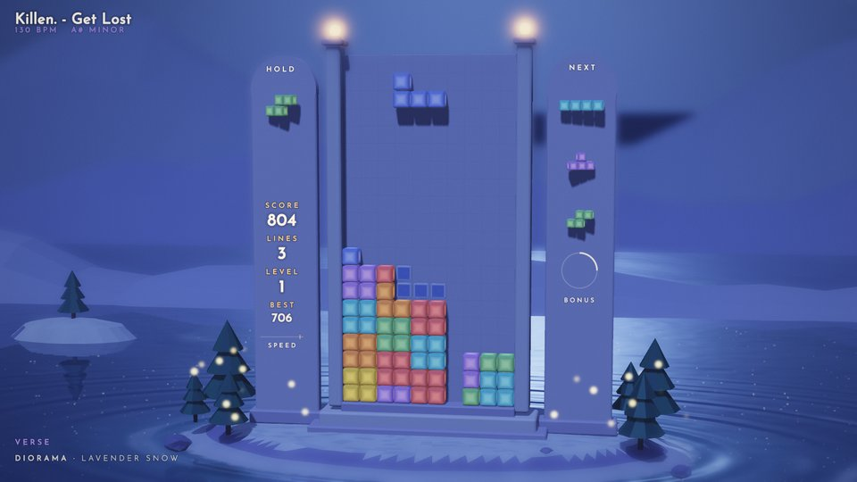

A clay miniature by night, the well a tower on a small island in a still sea, its lanterns lit. Twelve places, from the key and mode (MEADOW COVE, TERRACOTTA MESA, LAVENDER SNOW, PINE AND SEA, AUTUMN MAPLES, MANGO LAGOON, SAKURA STONES, JADE VOLCANO, HEATHER HIGHLANDS under the shared night sky; MOONLIT COVE, LANTERN HARBOR, FIREFLY FJORD with skies of their own); the song's phases move the moon across the sky (moonrise, midnight, starlight, lantern hour), a drop turns the night to a golden evening for its whole length (a low warm sun, back to night when it ends), and slow motion brings the day: the place sunlit, its clay pale, the time slowed. Cleared blocks pop off the tower and shrink away as they tumble; a landing pushes one puff of dust out from under the piece. The HUD has no plaques or cards: cream lettering set straight over the scene, each glyph on a feathered dark halo, so it reads on the pale clay by day and on the night sea alike; its font is Comfortaa (SIL Open Font License, `src/universes/diorama/OFL-Comfortaa.txt`).

## PIXEL

Native low-resolution pixel art, drawn on a small canvas (a well cell is 8 canvas pixels) and scaled up with nearest sampling: sixteen colors per variant, ordered Bayer dithering, parallax ranges, stepped animation. Eight places (PINE DUSK, RED CANYON, SNOW PEAKS, NEON CITY, SEA CLIFFS, CHERRY HILLS, EMBER PEAKS, JADE FALLS), from the key's hue and the mood (`--universe pixel:cherry`). Calm is a still dusk landscape, mid brings nearer layers and critters moving on the beat, peak adds weather (rain and lightning, sand, snow and aurora, petals, ash, leaves) and a foreground that hops by whole pixels. Locks squash, clears explode into pixels, a quad fires pixel fireworks across the screen, slow motion swaps to a night palette, and a game over crumbles the stack grain by grain. Its two pixel fonts are drawn by hand in `src/universes/pixel/font.cpp`.

## SYNTHWAVE

A night drive, shot like a film (Drive, The Midnight): one soft sun (or moon) low on the horizon to one side, deep haze, a wet road that mirrors it in a long broken column, a few fine grid lines running into the fog, street lamps passing, the well a slab of smoked glass with hairline rails. The pieces are frosted glass lit from inside (a soft inner glow, a thin bright rim). Finished like film: bloom with a little halation, anamorphic streaks on the brightest lights, a filmic curve with rich blacks, a fine grain. Eight nights (MIDNIGHT, SODIUM, MOONLIGHT, TAIL LIGHTS in the rain, VIOLET FOG, MINT DAWN, CITY LIGHTS, ROSE DUSK), from the key, mode and brightness. Calm is a quiet empty road (the sun nearly set, thick fog, the floor still), mid drives forward with the tempo (the lines scroll, lamps pass, light pulses run into the fog on the beat), peak is the fast drive (head- and tail-light trails, the haze lit up, flares blooming on the kicks). A cleared row leaves as a light trail toward the sun, a quad flares the sun and the lens, slow motion is a time stretch (letterbox, the night drained of color, a timecode), game over turns the lights off row by row while the camera tilts down into the fog; it leaves and enters through the fog. Its HUD font is Sora (SIL Open Font License, `src/universes/synthwave/OFL-Sora.txt`).

## CLOUDSCAPE

Above an endless sea of clouds, no ground, only sky: a ray-marched sea of cumulus tops fading into the haze, the well and the HUD columns floating panes of frosted glass (only the blur of the sky behind them, no frame), the pieces flat, soft-colored rounded tiles. Eight skies (DAWN, AZURE NOON, GOLDEN HOUR, STORM VIOLET, POLAR NIGHT with aurora, ROSE SUNSET, MONSOON, BLUE HOUR), from the key, mode, brightness and dynamics (`--universe cloudscape:storm`). Calm is a still, hazy sea of clouds, mid drifts the clouds with the tempo (a glide on each beat) while flocks of birds cross the distance flapping on the beat and gentle beams fall from the sun, peak raises the camera while towering cumulus grow out of the sea, god rays stream through their gaps and the kicks light them from inside. A lock breathes a puff of mist, a cleared row dissolves into mist drifting away on the wind, a quad parts the high veil and the sun bursts through, slow motion is night above the clouds (the moon, stars, silver cloud tops), game over drops the stack through the sea of clouds as the mist rises; it leaves and enters with the clouds closing in. The sky is drawn at a reduced resolution (at most 540 lines), the rays at a quarter of that. Its HUD fonts are EB Garamond Italic and Lato (SIL Open Font License, `src/universes/cloudscape/OFL-*.txt`).

## ABYSS

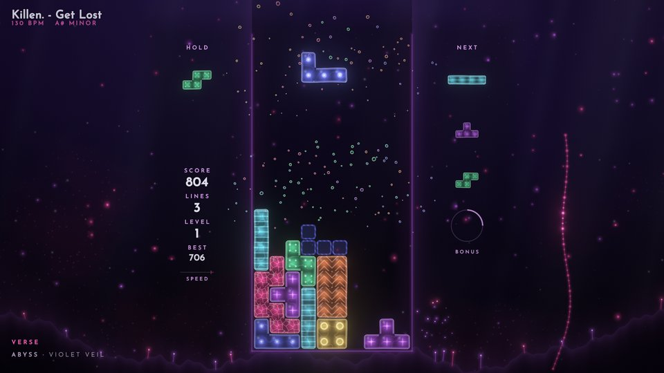

The deep sea, lit only by living things: near-black water with real depth (the far surface a faint glow overhead, slow murk, a dark seabed with glowing worms), sparse marine snow, the well a faint glass column. The pieces are translucent gelatinous blocks lit from within (an inner glow, a bright membrane, caustic veins, and a pattern of their own per piece: filaments, a ring, radial canals, photophores, a cellular net, a nucleus, chevrons); blocks of the same kind merge into one jelly mass. Eight palettes (CYAN LANTERN, VIOLET VEIL, EMERALD TRENCH, EMBER VENT, ICE LIGHT, ULTRAMARINE, CORAL GHOST, MOON JELLY), from the key, mode and brightness. Calm is deep silence (snow, a few distant lights, god rays slanting down from the far surface), mid darkens the water and brings jellyfish and siphonophores pulsing their light on the beat and schools of lanternfish, peak brings a giant whale with bioluminescent spots passing slowly behind the well and the bioluminescence blooming: the water itself lights up in the palette's accent (a milky sea, in slow patches) and plankton lights up densely through it (thinned behind the stack), its brightness pulsing with the kicks while nothing moves faster. A chorus' peak blooms softly; a drop's (the song structure driving harder) floods the water with it, denser and in the accent color, and its first downbeat surges the light at once before it settles over a few seconds; for the whole drop the water takes another variant's light (cyan and emerald turn violet, violet and coral cyan, ember ultramarine and back, ice coral, moon jelly emerald), the jellies keeping their hues. Nothing ever expands across the water (no ring, no shockwave): a lock makes the jelly quiver and stirs a few motes from under it, a cleared row's jelly bursts into a spray of air bubbles that gather and merge as they rise (a merged bubble glides to its new centre and swells, never jumping), a quad makes the plankton bloom all through the water at once, slow motion puts every light out but the pieces' and an anglerfish's lure, and a game over sinks the stack into the dark, its lights going out one by one; it leaves and enters with the water closing over it. Its HUD fonts are Cantarell Light and EB Garamond Italic (SIL Open Font License, `src/universes/abyss/OFL-*.txt`).

## SMOKE

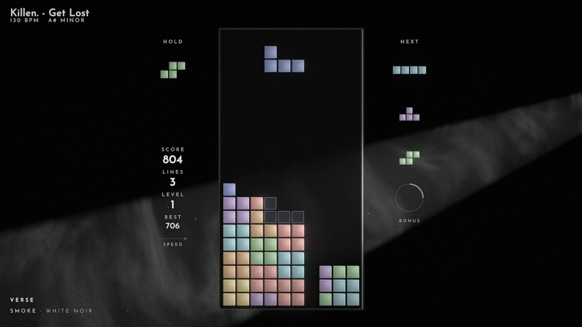

A black stage: one hard spotlight hangs out of frame and cuts a single crisp cone of light through slow, curling smoke (ray-marched through the beam, with the smoke shading itself into shafts), everything else falls into deep black. The well is a slab of smoked black glass standing in the light (a hairline catches the lamp along its edge, it casts its own shadow into the smoke behind), the pieces satin blocks caught in the key light (their edges toward the lamp lit, a soft sheen across the face, a shadow on the glass); dust motes glint where the beam is. Eight lights, each with its own angle and its own seven blocks (TUNGSTEN, DAYLIGHT, RED GEL, TEAL GEL, VIOLET, SODIUM, WHITE NOIR, ROSE), from the key, mode and brightness (`--universe "smoke:red gel"`). Calm is a clean thin shaft in a light haze, mid sets the smoke rolling with the tempo (a slow glide on each beat) and the bass swirling it, peak fills the stage with smoke and opens the iris (a wider, brighter beam, sharp shafts inside it), the kicks surging the smoke. For a whole drop, smoke curls out of the beam still holding its light (the thick billows just past the cone's edge glow, the haze stays dark, the beam keeps its crisp edge). A hard drop kicks dust of the piece's color up from where the piece lands on something, at the ends of the contact that open to the air (a bar resting on its left end puffs on the left alone; a piece set down slowly makes none), which shoots up, slows and sags back a little as it fades, the blocks of a cleared row turn to smoke (each block eaten by the noise from its edges inward in under half a second while its body streams up out of it as smoke of its own color, in curling tendrils, some climbing faster than others; the row's smoke shares one field, so it rises as one billowing sheet through the beam, behind the stack, tearing open and gone in about 1.3 s, at the real speed even in slow motion; a quad makes a bigger, taller plume), a quad blows a smoke ring up out of the well and clears the smoke outward as the light opens, slow motion is a cold pin spot straight overhead with the smoke hanging still, game over turns the lamp off (its filament cooling to orange) row by row while the smoke rises over the stack; it leaves and enters with the smoke thickening until it fills the frame. The smoke is drawn at a reduced resolution (at most 400 lines), marched only where the ray crosses the cone. The bonus gauge is a camera iris opening as it fills. Its HUD fonts are Yrsa Light Italic and Lato Light (SIL Open Font License, `src/universes/smoke/OFL-*.txt`).

## WATERCOLOR

Wet watercolor on cold-press paper. A landscape painted in a few loose, transparent washes and vignetted on the white sheet with ragged edges (a graded wet-in-wet sky with backruns, a far range fading into mist, a crisp middle range with dried darker rims, still water, fields or trees in front); colors are absorbances, so washes glaze over each other and granulate in the paper's tooth. The well is masked-out paper inside a light pencil frame; the pieces are transparent pigment washes (one wash per patch of a color, a hairline of paper between colors), landing wet and drying with a dark rim; the ghost is their pencil underdrawing. Seven paintings with their own pigments, pieces included (TURNER SUNSET, NORDIC FJORD, PROVENCE LAVENDER, MONSOON GREENS, STORM GREY, CHERRY SPRING and AUTUMN EARTH), from the key, mode, brightness and dynamics. Calm is a quick sketch on a mostly white sheet, mid paints the middle range, the foreground and the trees in and the beats drop pigment that blooms in the wet sky, peak glazes everything deeper up to the top of the sheet and the kicks flick spatter. A cleared row's pigment dissolves back into the paper in a moment (nothing painted over the row, nothing left behind), a quad floods the sheet (a great backrun and a fresh glaze), slow motion is a night glaze of indigo with the moon lifted out, game over runs the stack down in drips while the painting is washed back to paper; it leaves by washing the sheet back to plain paper from the well outward. The landscape and the blooms are drawn at a reduced resolution (at most 540 lines). Its HUD font is Yrsa (Italic and Medium, SIL Open Font License, `src/universes/watercolor/OFL-Yrsa.txt`).

## POLAR NIGHT

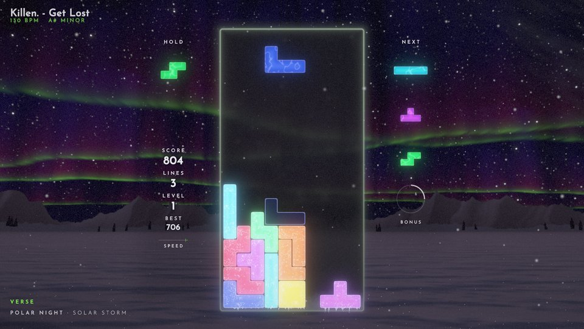

A snowfield under the stars: snowy ranges and a dark treeline on the horizon, a deep starry sky (the Milky Way faint across it) and the aurora, ray-marched as curtains with a bright lower edge, fine rays and a diffuse top; each ribbon follows a group of frequency bands (the far, low one the bass, the nearer, higher ones the highs) and its light falls on the snow and the pieces. The well is a sheet of dark ice with a hairline rim; the pieces are ice cubes that visibly freeze: the falling piece (and the previews) is clear colored water, saturated, the night seen through it; a landed piece freezes over 7 s like a cube in a freezer, frost creeping in from its outside faces about two thirds of the way to its middle (needles of bright feathery crystals ahead of a frosted band thickening inward, the piece's own colour turned to coloured ice: deeper, glassier and cooler, the frost drawn as thin white crystal lines on it, never a flat white), a thin bright frosted rim growing at its faces as soon as it lands and a sheen sweeping diagonally across it as it sets, while the body clouds over to a milky core and the color goes pastel, a slight wisp of cold vapor rising off its top while it sets; old ice is a block of coloured ice, its colour still the dominant read, laced with crystal lines, a few of them twinkling. No outline, bevel, gloss or reflection streak: crisp only at the silhouette, so new, freezing and old pieces read apart at a glance. Each piece is one body of ice with no junction between its cells (two pieces never join, a thin seam stays between them; a stack inherited from another universe is grouped into bodies of at most four cells), its frost in its own frame so it travels with it. As the freeze ends, small icicles of clear blue ice grow under each free bottom face (the well's floor too), irregular: a few long drips among many small ones, each face its own count, spacing, length and slight bend. Eight nights (EMERALD, VIOLET VEIL, CRIMSON, ARCTIC TEAL, MOONLIT, BLUE HOUR, SOLAR STORM, ICE FOG with a 22° moon halo), each with its own seven ices, from the key, mode, brightness, dynamics and density (`--universe polar:crimson`). Calm is a still night (one faint ribbon low on the horizon, a few flakes), mid wakes several curtains folding with the tempo and rippling on the beat while the snow falls, peak fills the sky (curtains overhead, the camera looking up, surges of light running along them on the kicks, blowing snow over the drifts). A lock leaves a tiny sparkle where the piece touched down, then it freezes (above); a cleared row cracks (the cracks running from where the piece landed) and shatters into shards that tumble and fall off the bottom of the screen (a quad throws them further), a quad is an auroral substorm, slow motion freezes time (the snowflakes hang and glint, the aurora barely moves, the colors drain to silver, frost creeps in at the screen's edges), game over freezes the stack white from the bottom up, then it crumbles while blowing snow buries the field; it leaves and enters through a whiteout of blowing snow. The world is drawn at a reduced resolution (at most 540 lines). Its HUD font is Josefin Sans (SIL Open Font License, `src/universes/polar/OFL-JosefinSans.txt`).

## RISOGRAPH

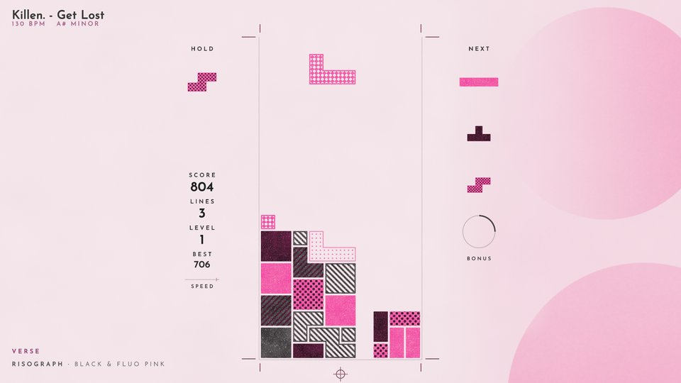

A risograph print: the whole frame is two spot inks on a paper stock, a third ink joining at the peaks. The pieces and the marks are laid by the drums as flat shapes and halftone tints (dots at a fixed angle per drum, or a line screen), overprints darkening where two inks cross, a riso grain in the ink; the background is soft, a riso gradient print: big flat shapes and broad gradients of ink density on the paper, with a fine, almost invisible grain and no visible screen, kept off the well and the text's side so that the HUD reads cleanly. Only the background's drums are slightly out of register (drifting slowly); the stack, the pieces and the HUD are always printed in register. Lots of paper, little else: each variant has its own neutral stock (a cool white, light grey, pale blue, pink or mint, two blacks; never cream) with a faint tone and tooth; the world is one big gradient disc fading toward the well and, at the peaks, the third ink's shape overprinting it. The well is marked by crop marks and a registration target, with hairline trims; the pieces are flat ink shapes, each type its own recipe (a solid ink, the overprint of both, a solid with the other ink's dots, a hatched tint with a keyline...), so the seven types read by color and pattern; the cells of one piece print as one clean shape, two pieces always keep a hairline of paper between them; the ghost is a keyline and a light tint. Eight ink sets, each with its own pieces through its inks (FLUO PINK & BLUE, TEAL & YELLOW, RED & FEDERAL BLUE, BLACK & FLUO PINK, VIOLET & GREEN, BURGUNDY & MINT, and on black paper, where the inks lie like light, YELLOW & PURPLE and AQUA & ORANGE), from the key, mode, brightness and dynamics (`--universe "risograph:teal & yellow"`). Calm is a still print, a single pale gradient disc on the paper; mid deepens the disc and the second ink's gradient across the sheet and prints a half sun of the second ink rising from the bottom edge, the shapes floating very slowly; peak brings the third ink's shape, a broad bloom of the third ink from the shapes' edge of the sheet and a new layer of cut-paper forms in a fourth, hot fluorescent ink of the variant (fluo orange, pink or yellow): a big circle and a tall block of the third ink on the free side of the sheet (between the title and the bottom lines, clear of the score), while the half sun turns to the hot ink, all overprinting each other. On the drop they ink in one after the other within a third of a second, growing a little as they ink, stay for the whole peak and lift slowly after it. A real drop (the peak at a drop's pace, not a chorus) also reprints the pieces from another pair of drums for its whole length: the stack, the falling piece, the ghost, the previews and the clearing strips keep their recipes (the same solids, dots, lines and keylines) but change ink, easing over half a second from the downbeat and back over a second when the drop ends (no flash, no beat). Each variant has its own drop pair, picked for its paper and away from its inks and the peak's background inks: FLUO PINK & BLUE prints in teal and orange, TEAL & YELLOW in medium blue and fluo pink, RED & FEDERAL BLUE in burgundy and orange, BLACK & FLUO PINK in green and orange, VIOLET & GREEN in blue and bright red, BURGUNDY & MINT in medium blue and fluo coral, YELLOW & PURPLE in aqua and fluo green, AQUA & ORANGE in fluo pink and fluo green. The HUD stays in the variant's inks; slow motion stays a monotone print. The kicks breathe the inks' density (about 0.2 s in, 0.5 s out) and swell the forms by a few percent, smoothly. The background print moves on a slow current, like paper cut-outs floating: still at calm, a slow drift at mid (the half sun and the world's discs wander and turn a little), clearly moving at the peak, the drop gathering pace over its first second and settling over a few (the speed is eased twice, so nothing ever changes speed abruptly). At the peak the big forms wander around their places, each at its own pace and heading, the block and the half sun turning, the gradient across the circle turning; smaller printed forms glide across the sheet, entering from one edge and leaving by the other at a few board units a second (a strip of the third ink along the upper sheet, a crescent of the hot ink across the lower sheet, a small disc rising on the shapes' side, a zigzag ribbon through the middle), turning slowly and overprinting the big forms and each other as they cross. Forms crossing the well and the HUD's columns print there only faintly (nearly not at all for the gliders), so the stack stays on clean paper. Two other drop treatments were tried (a huge sun of the third ink behind the well with a hot horizon band; the hot ink flooding in from both edges with concentric arcs behind the well) and set aside for the cut paper. The stack, the falling piece, the previews and the HUD never move; the background moves only smoothly and continuously (no jumps, no re-composing on beats, no shake). A lock presses a small soft blot of the second ink out under the piece, a cleared row is torn off as a strip (ragged edges, its dots shrinking away in under half a second), a quad stamps the third ink in one huge soft disc over the sheet, slow motion is a monotone print (one ink, the drums locked in register), game over runs the drum dry (the stack fading in vertical streaks); it leaves and enters with the ink lifting off the paper, the stack left plain. The bonus gauge is a keyline circle filling with a deepening tint. Its HUD font is Space Mono (SIL Open Font License, `src/universes/risograph/OFL-SpaceMono.txt`).

## WHITE ROOM

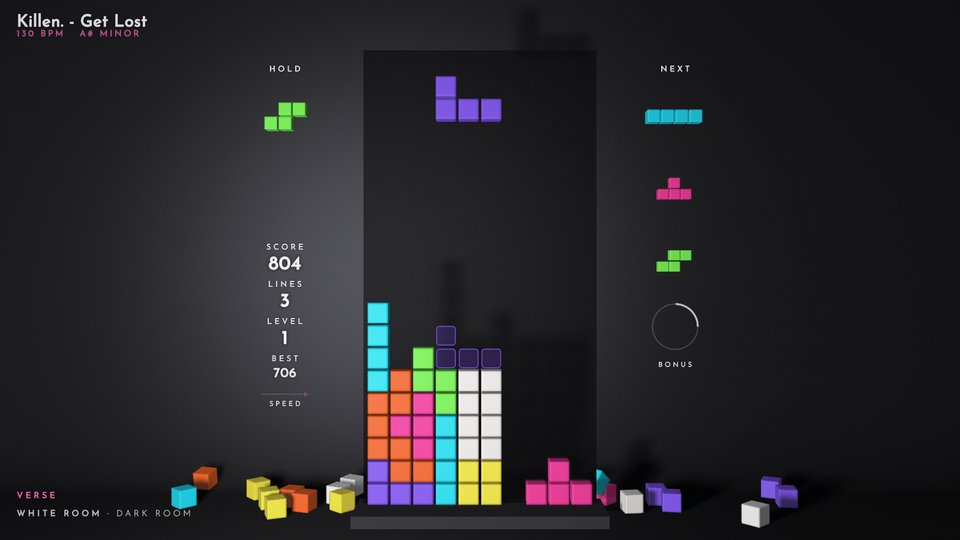

A seamless white studio and a shadow play: an endless cyclorama (the floor curving up into the back wall, no corner, no horizon), the well an opaque matte pane standing on a low white plinth, the blocks matte cubes (soft plastic, unglazed ceramic) standing in front of it, their front faces on the board's plane; nothing else in the room but the cleared blocks piled on the floor. Every cube (the stack, the falling piece, the previews and hold, the thrown ones) is the same real cube: one instanced mesh rasterized with a depth buffer in the layout's camera, lit by the room's two lamps, its ambient and the light bounced off the white room, its edges softly bevelled (they catch the light) with a fine darker crease where neighbours meet, so each block reads apart; the ghost stays a hairline outline. A lamp in front of the well throws the stack and the falling piece onto the wall behind as enlarged, soft shadows: the tetrominoes themselves, in shade, beside the well. The pane casts nothing and receives nothing: no shadow ever falls on it, it keeps its own color at one steady level whatever the lamps and the gels do, and it veils what lies behind it (at 80%: the room shows faintly through), so the real stack always reads on a calm, even ground and its shadow is clearly another thing (larger, softer, lighter, behind). The room (cyclorama, plinth, pane) is ray-traced through the layout's camera once per pixel and writes its depth, the cubes are drawn over it multisampled; the stack's shadow play comes from a blurred occupancy map of the board seen from each lamp (the penumbra growing with the distance), the thrown cubes' shadows from a shadow map per lamp (soft: a few taps find the casters and widen the penumbra with their distance), and the piles darken the floor around them through their heightmap, so the room's cost does not grow with the number of cubes. Five rooms, each one color story, a family of related hues in spaced values with one accent and two gels that belong to it (GALLERY: ink blues, stone and terracotta, amber and blue gels; LINEN: earth tones and clay, amber and violet; NORDIC: the cold sea and coral, ice cyan and coral; CERAMIC: celadon, tenmoku and kaki, gold and jade; DARK ROOM: the same play in a black studio, a black pane, flashy blocks (electric cyan, lemon, hot pink, acid lime, tangerine, ultraviolet, white) and a hard spotlight whose pool holds the shadow play, hot pink and cyan gels), from the key, mode and brightness (`--universe "white room:nordic"`). The song moves the lamp: calm is a soft light high in front, the shadows hidden behind the pane, the room almost shadowless; mid brings the lamp lower and to the side and the stack's shadow starts to climb the wall; a chorus is a warm lamp low on the side, the shadow large and crisp beside the well. A drop changes the room for its whole length: the key turns into a colored gel low on one side and a second gel comes in low from the other, so the white room splits into two colors and the stack throws two enlarged colored copies of itself up the wall, one on each side, each lit by the other gel; on the drop's downbeat the two gels swing in from far out, so the two shadow copies sweep in across the wall from the edges and settle, then the gels slowly circle (eight bars a turn), the shadow copies sweeping across the wall. A new section swings the lamp across to the other side. The light never pulses and the beats move nothing. A lock presses the piece for an instant; a cleared row vacates at once and its blocks are thrown out from behind the pane as solid cubes (never drawn over the well), each one to the left, the right or back toward the wall with an upward kick and a tumble. They are rigid bodies (qu3e, Randy Gaul's box engine, zlib license, `third_party/qu3e/`): they fly under gravity, knock into each other, bounce, tumble and come to rest on the floor, the cove or the cubes already there, stacking and leaning on their neighbours without ever passing through each other, so over a song they pile up beside and behind the well into messy mounds; they never go in front of the well or over it, nor rest on the plinth behind the pane (where the next ones are thrown from), and soft bounds keep them in the room, clear of the HUD's text. They cast soft shadows from both lamps on the floor, the wall and each other, lie there 60 to 120 seconds and fade away; a cube gone wakes the cubes it held, which fall and settle again. At most 300 at a time, the oldest fading early. The physics stays cheap: a fixed 120 Hz step (the cubes drawn between steps), and a cube still for a moment freezes into a static body, so a pile costs nothing and a cube landing on it only wakes what it hits; it runs at the real speed, even in slow motion; slow motion is evening (the room blue-grey, a single warm lamp hanging over the well), game over sinks the lamp to the floor and turns the stack to white plaster row by row; it leaves and enters with the shadows dissolving into a flat, shadowless light. The bonus gauge is a fine groove in the wall, its arc filled in ink. The HUD is set on the wall like a gallery's wall text, with a faint shadow; its fonts are Manrope Light and Medium (SIL Open Font License, `src/universes/white_room/OFL-Manrope.txt`).

## KINTSUGI

Dark polished stone and ceramic mended with gold: one slab of stone under a soft raking light (a broad reflection of a soft box lying across it, a soft clouding, no veining behind the HUD), the well a honed, darker panel set into it with a hairline of metal. The pieces are glazed ceramic vessels, broken and mended: the cells of a piece join into one shape, crossed by fine gold seams that run across the cells (continuous over the piece, a different pattern for each piece, never on the grid). The gold lives in the stone too, as cracks that grow only in the open stone on both sides of the HUD. Seven stones and their metal, each with its own seven glazes (NERO & GOLD, SERPENTINE & GOLD, SLATE & SILVER, PORPHYRY & GOLD, BASALT & COPPER, SODALITE & GOLD, OBSIDIAN & PLATINUM), from the key, mode and brightness (`--universe "kintsugi:basalt & copper"`). Calm and breaks are the bare stone in a low, cool light; mid warms the light and lets four thin veins creep into the stone, a glint of light running over them every two beats; a chorus lights the slab fully and the veins spread in polished metal. A drop melts the metal: on its first downbeat white-hot gold races in through new cracks from the edges of the slab while flakes of gold leaf burst out of them, then for the whole drop the veins stay molten (glowing amber, lighting the stone around them), the stone takes a warm grade, the seams of the pieces glow, new branches keep spreading slowly, the gold leaf keeps drifting down turning in the light, and a surge of light runs out along the cracks every two beats (the scene's light never pulses: one swell on the drop that settles). The stack, the pieces and the HUD never move. A piece falls whole (no seam); landing cracks it: its gold seams open from the contact up through the piece in a quick ragged front, molten, then cool; a cleared row breaks along the gold seams of its pieces (the fragments between the same seams fall as one shard, across the cells of a piece) and its shards, solid slabs of the ceramic, are thrown out in random directions and tumble all the way down out of the frame, their broken walls gold (at the real speed even in slow motion); a quad sends eight molten cracks bursting in from the edges with gold leaf; slow motion is moonlight (a cold silver light from the other side, the metal turned to platinum, the gold leaf hanging in the air); game over opens every seam of the stack wide with gold, row by row, before it sinks into the dark; it leaves and enters with the slab dimming to the bridge, the stack in plain ink. The bonus gauge is a thin ring of metal mended as it fills. Its HUD fonts are Cormorant Garamond and Marcellus (engraved capitals) (SIL Open Font License, `src/universes/kintsugi/OFL-*.txt`).

## LASER SHOW

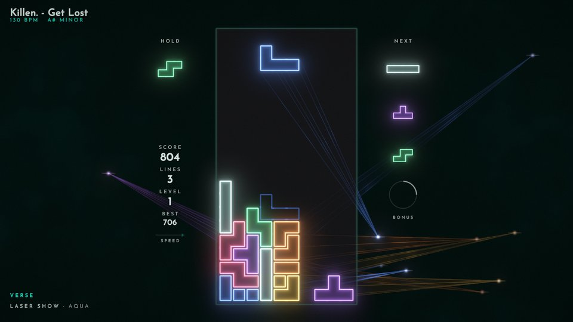

A dark, hazy room where every piece is projected by its own laser. Each piece (the falling one and each piece of the stack) has a small projector standing at a random spot of the room, away from the well and the HUD: a point of light from which a faint sheet of light opens toward the piece, with thin rays running to each corner of its outline, as if the laser were drawing it. The rays are made visible only by the haze they cross, so each one is uneven along its length (bright where the haze is thick, nearly gone in the gaps, the haze drifting slowly); they are fainter over the well, a slab of black glass, and fade behind the HUD's text, previews and gauge. The pieces are dark acrylic, edge-lit: a smoked, tinted body whose silhouette glows in the piece's color, one shape per piece with no seam inside it (two pieces never join). Seven laser sets, each with its own drop pair and its own seven acrylics (GREEN, its drop cyan and magenta; RGB WHITE, red and blue; MAGENTA CYAN, gold and deep blue; RED, violet and cyan; BLUE VIOLET, ice white and red; AMBER, green and violet; AQUA, rose and amber), from the key, mode and brightness (`--universe "laser:magenta cyan"`). The song decides how many projectors are on, the newest pieces first and the older ones dimmer: calm keeps the falling piece's and one or two more, dim, in faint haze; mid a few, drifting slowly around their spots and breathing every two beats; a build switches more on as the pace rises; a peak without a drop (a chorus) lights most of the stack, each projector in its piece's color. A drop is the signature: on its downbeat the display turns two-color: every piece, its acrylic and its laser, takes one of the drop's pair (the pieces alternate, so the stack is split evenly; the falling piece and the previews too), every projector switches on one after the other, the haze glows in the mix of the two with one swell that settles over seconds, and the sources sweep slowly around their spots for the whole drop; the colors ease in over a fraction of a second and back to the pieces' own over about one second when it ends. The light of the room never pulses with the beat; the projectors move slowly, the stack and the HUD never move. A lock leaves a small point of light where the piece touched down, and the falling piece's projector stays with it; a cleared row burns out (the blocks' edges flare, then a hot burning front eats each block from its edges in, gone in under half a second, at the real speed even in slow motion; nothing is drawn over the row) while the projectors of its cells get weak, blink and switch off (a piece cleared only in part keeps its projector for its other cells); a quad flares every projector white once; slow motion freezes the projectors in a thick, cold haze, the lasers ice white like rods of light; game over switches the projectors off one by one while the stack goes dark row by row from the top; it leaves and enters with the haze filling the room. The haze and the projectors' sheets of light are drawn at a reduced resolution (at most 360 lines), the thin rays at full resolution. The bonus gauge is a ring of laser light drawn clockwise as it fills. Its HUD font is Jura (Light and Medium, SIL Open Font License, `src/universes/laser/OFL-Jura.txt`).

## GARDEN

Tiles of earth growing pixel grass and flowers, a 16-bit indie game (code in `src/universes/garden16/`; it replaced the first, smooth GARDEN below). The world (clods of earth growing grass and flowers, a line of earth with banks that rise toward the edges and beside the well with its outer columns, worms in the dirt, a plain sky with one sun or moon, a pale panel over the well) drawn as pixel art at a true low resolution: an indexed canvas drawn on the CPU where a board cell is a 12 x 12 tile (about 530 x 300 pixels on a 16:9 screen), scaled up with nearest filtering. Every variant has a limited palette that animates like a console's: flat sky bands joined by thin ordered-dither seams, pixel outlines, motion in whole pixels and stepped sprite frames. Each landed cell is the very dirt tile the ground is made of (the same lumps, light specks and grey pebbles, the same lit left edge and shaded right edge on a step), its ramp tinted a little toward the piece's own soil so the seven pieces stay apart (brown, red clay, ochre, humus, sand, grey clay, moss) inside a clean dark 1px outline, no seam inside a piece; the ground's banks step up tile by tile, so stack and ground read as one earth. An open tile top grows a grass cap in three frames, then swaying tufts, then now and then a flower that blooms bud, half open, open. Calm parts dry the grass to straw with seed-head stems; mid turns it green; a chorus makes it tall and lush, the sky deeper, leaves blowing off on the wind in gusts every two bars and a small flock of birds crossing; a drop shifts the sky toward the variant's glow from the horizon and bursts flowers open across the banks frame by frame (big asters on the far banks), petals fly, butterflies swarm, worms hurry, pollen puffs on the kicks. A cleared row pops: its tiles burst into 3x3 bits of their own pixels that fly, fall and shrink away in under half a second; a hard landing pushes two small dust puffs out from the contact; a falling piece sheds crumbs; a quad sends dandelion seeds up; slow motion brings dusk and fireflies; game over crumbles the stack into bits row by row. Four variants: SPRING DAY, APRIL RAIN (a light rain through its drops: thin pixel streaks, faint behind the well's pane, tiny splashes on the tops), GOLDEN DUSK and FIREFLY NIGHT (pastel earths under a moon, fireflies). The HUD letters over the earth are straw-pale with a dark drop shadow, the earth under them calm (no pebbles, no worms); over the sky they take its ink with a soft halo. Fonts: PIXEL's two bitmap fonts.

## GARDEN (smooth, disabled)

The first GARDEN, replaced by the 16-bit one above; its code stays in `src/universes/garden/`, left out of the default build (`-DREFALL_DISABLED_UNIVERSES=""` builds it). Its description as it was:

Clods of earth that grow grass and flowers. One wide line of earth runs along the bottom of the picture, flat under the well and rising in gentle banks toward the edges, never mirrored (per song one side rises tall and far, the other stays low), under a plain sky with one sun or moon and lots of empty air. The pieces are clods of earth, all of the same earth: a lumpy clod with a crumbly edge, a fine grain and a soft relief lit from above (the ground line has the very same texture), with rare pale pebbles of all sizes; the texture stays with the earth, sinking with it when rows below are cleared; landed, the clods merge into one mass of earth whose base grows out of the ground line. While a clod falls, a crumb of soil drops from its underside now and then (a few per second, more when it is pushed down fast); each falls through the ghost until it touches the stack, the floor or the ground, and is gone there with a tiny puff. Small pink-brown earthworms crawl inside the earth, in the ground line and inside the landed clods (they pass from one to the other through the stack's base), on slow wandering paths, sunk in the soil (a dark burrow around them, the earth's lumps covering them here and there); a few in calm parts, about five at mid, and on a drop many more (about fourteen) crawling two or three times faster, the change eased in and out, each worm fading in where it appears; a worm in a cleared or collapsing row fades out where it is. The clods and the ground share one gradient by height: dark deep down, the earth's own color at the well's floor, a little lighter as it rises. The area of play is a pale, see-through panel over the sky. Wherever the top of a clod is open to the air, life takes hold: a fringe of grass sprouts within a second or two, then a few small flowers open slowly over about twelve seconds; a block landing on top buries them, the grass and the flowers lying down and folding back into the soil in one quick, smooth motion. The ground line has its own vegetation and follows the song: calm parts and breaks leave it dry (a pale dusty haze in the sky, a few dry stems with seed heads), mid brings the green back with a seed drifting up on some bars, a chorus makes it lush (tall grass swaying every four beats, the sky deeper), and a drop makes it bloom: on its first downbeat flowers open across the whole line, quickly at first and then slowing, a flurry of petals rises from them on a gust that dies down, and the sky takes a glow from the horizon in a color that contrasts with the variant's own sky (pink in spring, magenta at dusk, amber in autumn, gold at dawn); it stays in bloom for the whole drop, swaying slowly, petals drifting, pollen puffing from a few flowers on the kicks, and when the drop ends the flowers close, drop their petals and the line dries out over seconds. Whether a peak is a drop or a chorus comes from the section shown in the HUD (or the song's drive when there is none). Four variants, from the key, mode and brightness: SPRING MORNING, SUMMER DUSK, AUTUMN FIELD and MISTY DAWN, each with its own sky, earth, grass and flowers. A cleared row collapses: the earth above slumps down into it, faster and faster, crushing it flat while small sharp crumbs of dirt spill out of it, pushed out to the sides and falling (harder as the earth above slams down, and the more rows go at once), falling over everything until they reach the ground or leave the picture (0.4 s, at the real speed even in slow motion), all of it staying one mass of earth, its flowers falling; a hard landing pushes one puff of dust out from the contact; a quad sends dandelion seeds up from the whole ground line and opens the stack's flowers at once; slow motion brings dusk (a deep blue sky, the first stars, fireflies over the grass); game over crumbles the stack back into the earth, row by row, and dries the line; it leaves and enters with the plants sinking and the sky fading to the bridge, the stack in plain ink. The pieces and the HUD never move (the stack only settles when a row collapses), and the scene's light never pulses. The HUD is set straight on the sky, its letters dark or pale by the sky behind them, and the corner lines lie in the earth in a pale straw tone (the plants keep below them). Its fonts are Lora Italic and Lora Medium (SIL Open Font License, `src/universes/garden/OFL-Lora.txt`).

## BIOME

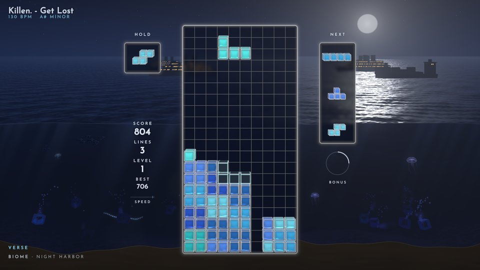

Glass cubes over a 3D diorama world that the cleared lines bring to life (code in `src/universes/biome/`). One universe, two worlds, each a few variants: the **sea** (the cubes hold water; a sea rises from dry sand) and the **land** (the cubes hold seeds; parched clay grows into a jungle). The song picks the world (airy, flowing songs over a deep bass go to the sea, dense songs that build and drop to the land, the run's seed tipping the close ones) and then the world picks its light from the key and the mode.

What both worlds share (`biome.cpp`, `render.cpp`, `shaders.hpp`): the whole scene is a real 3D world seen by a fixed, slightly elevated perspective camera whose lens is shifted so the well's plane keeps the exact reference layout (the stack and the HUD are a clean 2D grid in front) while the world behind it is seen from above. The world is cut open like a diorama just behind the well, its section showing its layers. The sky is one framework for both (a gradient per variant, one sun or moon with its halo, soft clouds drifting, stars at night, the dust of a dry land veiling it, an aerial haze toward the horizon); the sun or moon lights everything and casts soft shadows (a filtered shadow map). Every cell of a piece is its own small glass cube with a gap to its neighbours, ray-traced per pixel (four rays a pixel, so every edge stays smooth) in a slight three-quarter view, lit by the scene's sun or moon (Fresnel sky reflection, a sharp highlight, bright edge lines); what fills it is the world's. The ghost is an empty cube of clear glass, its edges bright; hold and next show the same cubes. The stack keeps its contrast against the world: each world ends its drawing with the shared lens (`Ctx::drawLens`): a bloom of its brightest light (capped: a glint never blots), the sun's glare (a broad warm veil, a tighter glow, faint ghosts; none behind the eye), and the well as a pane of dark smoky glass in every light (the world behind it half seen and blurred, its bright light held down; the bloom and the glare held down over it) with a fine grid of its cells etched in it and a bright rim; the cubes over it always take their luminous look. A drop is the weather: whether a peak is a drop or a chorus comes from the section shown in the HUD (or the song's drive when there is none); a drop's storm comes in fast (lightning far out in the clouds on its first downbeat and every four bars, a gust, slanting rain in layers, an overcast down to the horizon that hides the sun) and calms back over a few seconds after it. The kicks at a peak are the world's (spray, gusts through the leaves), never a brightness pulse. Nothing is ever drawn over the stack or the falling piece: a cleared row's cubes leave the stack at once and what flies out of them passes behind the well's pane. Game over cracks the stack row by row from the top, each cube then leaving it as a cleared one does; slow motion is a dusk; it leaves and enters with the world fading to the bridge, the stack in plain ink. Entering BIOME always starts from the bare world (dry sand, parched clay), even mid-game with a stack already standing: only the lines cleared in it make it grow. The HUD is set in Lora (SIL Open Font License, `src/universes/biome/OFL-Lora.txt`), italic for the song, the section and the celebrations, spaced capitals for labels, its ink dark or light by what is behind it, always on a soft halo. T cycles through all ten variants with `--universe biome`; any of them by name, for example `--universe "biome:night harbor"` or `--universe "biome:moonlit clay"`.

**The sea** (`sea.cpp`, `sea_render.cpp`, `sea_shaders.hpp`). Shot like a film: a desert of golden sand under a hazy sky, dust blowing over it, the sun's glare in the lens. The sand is a heightfield: a gentle beach under the well sloping down far out, then real dunes, ridges across the view with a long windward slope up to a sharp crest and a short steep lee, low ones rolling out from the beach and big ranges far off (a full sea covers them all; half way they are islands), shaded per pixel (their crests sharp whatever the mesh), shadowing each other (a march toward the sun over the heightfield), wind ripples in relief on them, a glint of a grain now and then, streaks of drifting sand moving over them, a warm light bounced in the shade; its cut face shows sand strata. The haze thickens with the distance and with the dust (each variant's `airDust`), warm, lit through toward the sun, in slow drifting plumes along the ground, a warm band of it low over the horizon. Its lens: the glare none in a storm, faint for the moon and under an overcast; the glass toward the variant's deep sea, darker still over the deep water; the held and next pieces in panels of the same glass. The sea is and the sea as a real water volume whose surface rises with the cleared lines (linearly: every line raises it by the same amount, a quad half as much again per line, about sixty lines to fill it up to three quarters of the well's height; a song starts with no sea near the well, only the beach, the water creeping up the sloping sand from far out; a new song drains it back); the eye rises a little as the sea deepens. Under the surface the light is absorbed with depth (down to a near-black blue in the deep), with shafts of light from the surface and a caustic network rippling on the sand; above it, the sun's or moon's glitter path on the water. The surface is a 3D mesh with Fresnel reflections of the sky and crested directional swells, calmed close to the well: calm parts leave it glassy, mid brings a gentle swell, a chorus a livelier one with a few whitecaps and a puff of spray on the kicks. A drop raises a storm: big, faster waves with sharp crests, whitecaps and foam, spray torn off the crests, boats rocking hard; under the surface the fish dart away and the deep glows a little brighter. Boats are low-poly models riding the waves (lit windows at night), bigger as the sea deepens: dinghies and sailboats, then fishing boats, ferries, container ships and liners far out. Life fills the depths in layers, only where there is water: schools of pale fish near the surface, jellyfish pulsing softly in the middle water, and in the dark an anglerfish with its lit lure, siphonophores and drifting motes of light. The stack's cubes are solid glass full to the brim with the sea's own water, under pressure, each piece type a small shift of the variant's sea (teal to cobalt, rich), traced through the glass and the water: the water glows with the light scattered in it (brighter toward the top, its heart glowing), a caustic sparkling on its far side. A cleared row's cubes are thrown out of the well to their side, at the real speed even in slow motion, tumbling under rigid-body physics: they come down on the sand or into the water, bounce, roll and knock into the cubes already lying there; a cube landing hard on the sand kicks up grains and a puff of dust drifting off with the wind; each cracks where it first hits (a crown of spray bursting out) and its water jets out of the crack under pressure, kicking the cube back; as a row is torn out a fifth of its water spills, a sheet of spray behind the pane falling to the well's foot; on the sand the water runs downhill into the sea, raising it, and spreads where it falls and runs into puddles (a film of clear water reflecting the sky, rippling, the sun's glints in it, a rim of foam) that soak in and dry in the sun, the sand dark where it was wet a while longer; the cubes lying there cast a soft contact shadow and a colored shadow (the sun through their water, focused to a bright heart with a moving caustic: a second map from the sun's view); a cube landing in the sea churns its water out as a plume of bubbles and sinks; empty, it sinks into the sand. A quad sends spray up from the sea on both sides. Four variants, from the key, mode and brightness: CALM NOON (a pale, sun-washed sky over golden dunes, dust blowing, the sun just out of the picture's top right corner, ahead of the eye: its glare in the lens, the dunes' crests lit, their near sides in shade, long shadows), GOLDEN HOUR (a low sun on the horizon), GREY NORTH SEA (an overcast sky, soft diffuse light) and NIGHT HARBOR (the moon, lit windows on the boats, luminous glass).

**The land** (`land.cpp`, `land_render.cpp`, `land_shaders.hpp`). A wide plain of dry, cracked clay (not sand) under a bleached, dusty sky, a few dead trees standing on it, low hills on the horizon; its cut face shows the soil's layers and, later, roots. The stack's cubes are three quarters full of seeds of their piece's color, each piece its own seed (long grains, peas, flat almonds, big beans, striped sunflower seeds, fine millet, lentils), traced through the glass. A cleared row's cubes vanish at once and their seeds burst out of where they were, each on its own high arc into the land behind the well, a faint trail of its color behind it, at the real speed even in slow motion. Each seed lands with a small hop and a puff of dust (a splash on wet soil), comes to rest, then sinks into the soil while a small mound of turned, darker earth heaps up over it. A few of them are sown near, in the open land on either side of the well (two plus two per cleared line, never more than a dozen sprouting at once), and these are seen coming up one after the other: after a short pause a pale stem pushes out of the mound bent in a hook, straightens, and its two seed leaves unfold; the plant then grows out of it from a speck while the seed leaves wither and the mound settles flat. The seeds sown further out just come up after their own pause. What grows does so slowly: grass in seconds, flowers in their seed's color, ferns and bushes, and trees over minutes (round canopies, tall emergent trees, palms), vines hanging from the grown trees; tall trees keep out of the HUD's columns. The more lines are cleared, the more the land comes alive: the soil darkens and greens around what grows, the forest spreads on its own over the plain and the far hills, the sky clears from dust to a humid haze, birds arrive and fly between the trees, butterflies come to the flowers, mist settles in the distance, the dead trees leaf out again; about sixty lines turn the plain into a jungle. A drop is the rain: the soil soaks dark and puddles form (rain rings in them), everything grows several times faster, flowers open, a flock lifts from the trees; the growth stays. A chorus is a bright, breezy bloom, mid a breeze, a break a still, hazy land. A lock pushes a small puff of dust out from under the piece; a quad opens every flower and raises a flock; slow motion is a blue dusk with fireflies. A new song in the same land brings a short dry season (the grass and the flowers wither, the grown trees stay). Six variants, each with its own seeds: SAVANNA NOON, OCHRE HAZE and RED EARTH DUSK for major songs, MISTY MORNING, GREY MONSOON and MOONLIT CLAY for minor ones, the key's hue picking among them. Plants are instanced low-poly meshes (a near and a far level of detail) under the shadow map; the ground's grass, damp and flowers come from a small life map stamped on the CPU. Shot like a film once it grows: light shafts falling slanted from the sun's side through the breaks in the clouds and the gaps of the canopy into the misty air (a fullscreen march through the air up to the world's depth, stronger as the forest closes, dimmed but never gone in the rain), the mist settling low in drifting banks so that each row of the forest stands paler than the one before it, deeper shadows and richer greens on the near land, the crowns shaded darker underneath and glowing through where the light comes from behind, dark trunks; after the rain the leaves, the bark and the soil take the sky at grazing angles, drops glint on the leaves' tops, the cut face soaks dark and the puddles spread. The undergrowth is thick: ferns with their leaflets, broad-leaved plants, bushes, grass and flowers. A cleared row's cubes set green sparks free (a few of the seed's own color), rising over the well's glass behind the stack; a sprout coming up near glows a bioluminescent green, its light bloomed by the lens and green sparks rising around it, and the young plants of the undergrowth keep a little of that glow as they come up. The cubes' seeds glow a little from inside, brightest near the bed's top, the glass glossy (a sharp highlight, bright edges); the falling piece warms the glass behind it. Its lens: the glare faint for the moon and under an overcast, none in the rain; the glass darker than the sea's (a smoky dark toward the far forest's green: the land is often a bright, hazy day behind it), the held and next pieces in panels of the same glass.

## FLUO

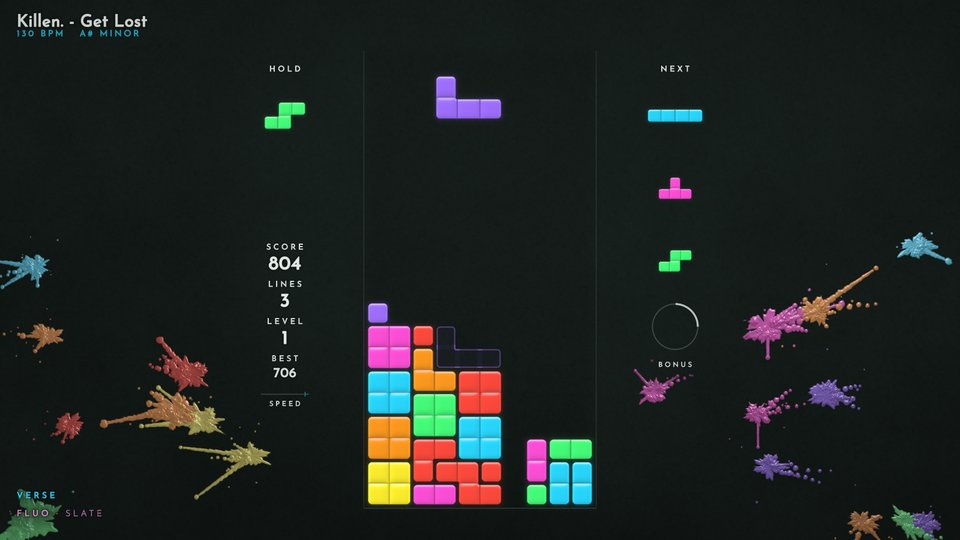

Fluorescent paint splashed on a dark wall. The background is a matte, textured wall (a fine grain, broad blotches of the coat, pits in raw concrete), even and calm, the well marked only by a slightly deeper patch of it and three faint hairlines; the pieces are blocks of flashy fluorescent paint (fluo pink, yellow, green, orange, cyan, violet, blue), one solid shape per piece with rounded outer corners, a glossy rim catching the light along their top edges, running on around the inside corners of a piece (the joints of a T, the inside of an L) with a small fillet, and a soft halo of their own color. When a line clears, its blocks vanish at once and burst into gobs of their paint (one per run of up to three cells of a color) thrown out of the well to the side they are on, the nearest to the completing piece first: each flies along an arc for a third to half a second (a glossy drop, its tail stretched behind it, two droplets trailing, shrinking a little as it goes to the wall) and splashes where it lands, mostly on the free wall beyond the HUD's columns, sometimes under a column, never over its text: a ragged blob spreading from the impact, stretched along the flight, with a few lobes, streaks and trails of droplets flung onward, a spray of fine drops, and sometimes a drip that runs down the wall and slows to a stop in a bead. The paint never goes away: every splash of the song stays on the wall, the newest over the oldest (they are stamped into a persistent paint layer, so the cost is the same with ten splashes or a thousand), until a new song fades the wall back to clean (a change of universe always arrives on a clean wall). Behind the well and the stack (down to the screen's bottom) the paint sinks into the wall, leaving only a faint colorless trace (it comes back gradually beyond the well's edges), and it is softened under the HUD's columns and under each line of text, so the stack and the HUD stay readable however much paint piles up. The stains' edges are anti-aliased at any resolution: a splash is drawn into a "wet" layer while it spreads and stamped once into the persistent one when done (stamping it every frame used to harden its soft edge into jaggies), and the ragged edge's noise is never finer than a few pixels. The paint is real, wet paint, with a relief: its thickness (rising over a short width from the edge, a thicker rim where it piled up as it spread, domed droplets and drips, paint over paint thicker) is lit by a light drifting slowly across the wall (a minute or so to cross it), so sharp glints and a soft sheen slide along the rims, the drips and the droplets; there is no halo around the stains. The room's light follows the song: low at calm, fuller at mid, brightest in a chorus; under it the paint is dull, a little greyed and matte-ish. A drop (a real one, not a chorus: the section shown in the HUD, or the song's drive) turns the lights off and a blacklight on, in a third of a second on its first downbeat: the wall sinks into a deep, slightly darker violet and the stains light up one region after another, saturated and fluorescent like paint under UV (swelling a little on the drop and settling: no pulse), the tube's light glinting violet on their relief; the pieces glow brighter, and the drop's kicks set the wet paint dripping here and there. When the drop ends the lights come back and the stains go dull again over a few seconds. A lock flicks a few specks of paint sideways from the impact, under the piece; a quad throws its gobs bigger and two big ones far onto the walls on either side; slow motion drains the paint of its color (only the pieces keep theirs); game over bursts the whole stack onto the wall, from the top down. Four variants, from the key, mode and brightness: BLACKLIGHT (a matte black coat), CONCRETE (raw dark concrete, blotchy and pitted), SLATE (green-black slate) and NIGHT BLUE (a night-blue coat), each with its own seven fluo paints and accent. The stack, the pieces and the HUD never move, and the scene's light never pulses. The HUD is set on the wall in chalk white over a soft shadow, the section and the universe's name in the variant's accent paint. Its font is Syne (SIL Open Font License, `src/universes/fluo/OFL-Syne.txt`).

## MARBLES

Glass marbles in square tiles, shot out across a dark table where they collide and stain the felt. One world seen from above: a dark table with a fine grain, never busy (navy felt, teal slate or black brushed metal, one per variant), the well floating over it as a dark pane of smoked glass with a hairline edge. Everything on the table (the marbles, the dye, the light) lies under the well and the HUD, never over the game: under the pane a marble is at most a dim shape, under the HUD's columns and text a rolling marble is dimmed and its halo dropped, and the HUD is a gentle slope: a slow or resting marble there is pushed out (to the nearest side away from the well) until it rests outside, so nothing ever settles under the HUD, and no dye settles there either. Each cell of a piece is a big glass marble (nearly the cell's width) held prisoner in a very faint glass box: a barely-there hairline edge and a whisper of frost, so that the marble alone nearly carries the piece and the pieces read by their marbles' colors. The marbles are colored glass, deep and saturated like jewels: through each one the table under it is seen upside down, as through a lens, tinted by the glass, which also holds a little light in its own color (so that a marble reads as its color, never as a gray bead, even over the dark table), darker toward the rim, the sky caught at its edge tinted too; inside, magnified and in two layers for depth, its core, one per piece type (a twisted ribbon, a cat's eye of three curved vanes or a swirl of strands), a few tiny bubbles; on the table each casts a soft shadow away from the light. They are lit by real light: two lamps beyond the table's sides throw wide soft beams grazing it, one over each side of the well, turning and drifting very slowly (a few minutes to sweep the table outside a drop, livelier in one) and fading with distance, the second one coming up from mid on; their rays are traced in 2D on the CPU through the marbles (each a glass ball: refracted in and out, a Fresnel reflection, the light tinted by its glass on the way, focused like a ball lens into a narrow caustic just behind it that opens out into thin streaks of tinted light, a shadow around them; a marble lights its neighbours; the cost is bounded: 44 rays a beam, a capped number of segments, the hashed grid). Each marble is lit by the light that actually crosses it, smoothed: its glass and core glow in their tint, a focused spot inside on the far side, the rim facing the light catching it, the lamp's highlight where its surface faces it; the marbles in the well take the key light from the same side. The light on the table shows the grain and, above all, the dye; it stays secondary, soft-shouldered, never blinding, and it never pulses. Outside a drop it is calm and steady: the traced light is eased into what the table shows over about 0.7 s (0.1 s in a drop) and each marble's received light over about as long, so caustics fade in and out as the beams drift and marbles roll, nothing pops or flickers when the marbles are still, and there are no sparkles: at most a marble now and then swelling softly with light over a second and a half. A cleared row pops: its tiles swell a little and vanish in a moment and each marble drops onto the table under its cell and is shot out along its row to its own side (a slight spread, so it comes out of the well's edge at the height of its line) at a real speed (fast enough to carry it past the HUD's columns), gliding out from under the pane (touching nothing there: nothing ever comes to rest hidden under the well) and rolling across the table, slowed by the felt, knocking into the marbles already lying there: elastic collisions (restitution 0.86), billiard chains; a marble at rest sleeps until it is hit hard enough (a gentle touch leaves it be: no jitter, no creeping); no walls: a marble pushed off the edge of the picture is gone; at most about 250, the oldest at rest fading away; at the real speed, even in slow motion. Every hit spreads color: both marbles stain the felt around them with their dye (a richer shade of their glass), soft ragged blots soaked into the grain, the harder the hit the wider and deeper, and rolling marbles leave faint traces; the dye is painted into a persistent layer (anti-aliased, the cost the same with ten stains or thousands), so a song starts on a dark, empty table and ends on a colorful one; a new song washes the dye out over a couple of seconds and its marbles fade away. Three variants, each with its table and seven saturated jewel colors for its seven pieces (no pale or gray marble), from the key, mode and brightness: MIDNIGHT (navy felt; sapphire, cyan, cornflower, amethyst, magenta, emerald, a gold accent), SEA GLASS (dark teal slate; the deep colors of sea glass: aqua, seafoam, sky, emerald, cobalt, amber, a coral accent) and OBSIDIAN (black brushed metal; fire: crimson, vermilion, amber, yellow, raspberry, violet, an ice-blue accent). The dye takes the marbles' colors, barely deepened, so it never outshines them. The colors are already rich through the song, a little richer in a chorus, and richer still and glowing for a drop, easing back over a few seconds after it (`--universe "marbles:sea glass"`). Calm is still; mid sets a resting marble rolling now and then and lets one swell softly with light on some bars; a chorus brings now and then a marble swelling with light on a kick (no glow around the well, ever). A drop sends waves of light flowing through the marbles every two beats (a stronger, double band on the bars), each drop its own shape: out from the well, in from the edges, sweeping across, rising, rings spreading from a marble, or diagonal bands; the fronts are light travelling through the marbles (each lit from the side the front comes from), their cores glowing first, glints sparkling along it; the beams turn whiter (no brighter: the table and the well's surroundings stay as dark as in the verse, the drop's light lives on the marbles) and each marble splits them into a wider spectrum, rainbow fans across the felt; each lit marble burns brighter (highlights, rims) and throws its light on the table just behind it, a pool of its color split into a little spectrum; and on the kicks a few lit marbles are nudged into their neighbours (more color); its first downbeat sends a triple wave. A lock settles the piece's marbles in their tiles; a hard drop jolts them, the jolt carries a little into the tiles under it and the glass of the bottom marbles flashes. A quad shoots its marbles harder and sends a wave of light out from the well through every marble; slow motion is night (the table sinks into the dark, the marbles glow softly like lanterns); game over shoots every marble out of its tile, row by row from the top; it leaves and enters with the world fading to the bridge, the stack in plain squares of ink. The bonus gauge is a ring of twelve small marbles, one more for each cleared line, a light running around it once it is full. Its HUD fonts are Outfit Light and Outfit Medium (SIL Open Font License, `src/universes/marbles/OFL-Outfit.txt`).

## PRISM

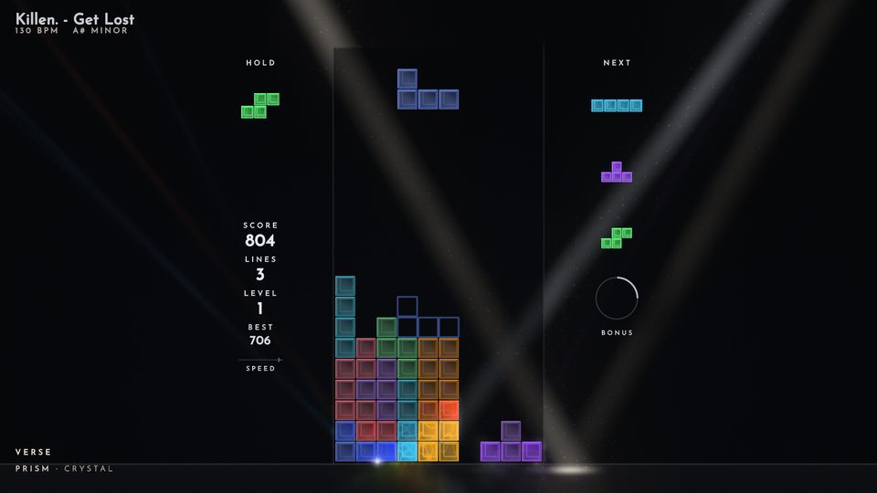

Glass cubes in the dark, crossed by slow beams of light. A near-black room where light is the subject: a breath of depth in the backdrop, a dark polished floor under the well that mirrors the light faintly, a faint haze the beams are seen through (uneven along their length, dust glinting in them), the well marked only by three hairlines of glass edge that catch the light crossing them. The pieces are cubes of optical glass, one per cell, tinted per piece type in clear, saturated glass colors: jewel-like even where no light falls (a body glowing deep in its color at full saturation, a rim bright in its own hue, chamfers catching a key light, the back edges seen through the glass, the haze behind mostly hidden by the glass), coming alive where a beam crosses them (the body glowing in a deeper, more saturated version of its tint whatever the beam's color, the chamfers facing the light blazing, those it leaves by glowing in the glass's color, slow caustic veins inside). One to three soft beams fall from out of frame and drift very slowly across the well (a minute or more to cross it, the angle swaying slowly). Each beam is a bundle of rays traced on the CPU through the glass in 2D: refraction at each face (cut slightly off square, a hand-made glass), total internal reflection (light piped down through the stack), a Fresnel reflection that sends a dimmer beam off the faces, absorption in the glass's tint (light leaving a rose cube is rose), pools of light where the rays reach the floor; the light each cube receives lights it, smoothed so that nothing flickers, and the falling piece takes part (it throws the light around as it falls). Five lights, each with its own seven glasses (CRYSTAL, a neutral white and pale tints; TUNGSTEN, a warm lamp and amber glass; MOONLIGHT, a cold blue light and jewel glass; ROSE QUARTZ, a rose light and pastel glass; AURORA, a pale green light and sea glass), from the key, mode and brightness (`--universe "prism:rose quartz"`). Calm is one beam in a light haze; mid brings a second from the other side and a glint on a lit cube every bar; a chorus brings a third, low and raking, and faint fringes of color. A drop (the section shown in the HUD, or the song's drive) is a rainbow in slow motion, calm on the eyes: over its first seconds the beams swell gently (settling over seconds) and turn white, and the glass disperses them: every ray entering a cube splits into a vivid spectrum that fans out of it (and out of the faces' reflections, diffracted), throwing soft rainbow bands across the room and rainbow pools on the floor for the whole drop, while the white shafts step back. And the light rig moves with the music, slowly: each beam glides to a new angle and position every two bars (the second a bar later, the third every four bars), an even eased move over six beats, so the paths through the stack re-route and the rainbow fans and the pools on the floor drift across the room; three thin white beams fade in from the dark over a few seconds and sway like stage lights over six bars (the two from the upper corners in counter-phase, crossing like scissors, a third raking along the stack from the right), each dispersed by the glass like the others; the kick only breathes the spectra very slightly; a soft colored glint every bar. Nothing flashes or strobes. When the drop ends the rig fades out over two seconds and the beams ease back to their slow drift. The cubes stay the brightest things on screen at every level (a lit cube glows on a soft knee and never burns to white; the final shoulder scales a hot color as a whole, so the light keeps its hue instead of bleaching); the shafts, the haze and the light scattered on the backdrop stay secondary, and nothing saturates over large areas. Nothing pulses the room with the beat, no move is jerky (outside a drop the beams drift over minutes), the stack and the HUD never move. A lock flashes one glint where the piece touched down (a hard drop a brighter one with a few sparks along the contact); a cleared row's cubes vanish at once and the row itself becomes a short burst of light (about 0.4 s, at the real speed even in slow motion), fed to the same ray tracer as the beams: each vanished cube sends rays out in every direction that refract and pipe through the neighbouring cubes (which light up from it), reach only a few cells into the room and pool on the floor, dispersed into spectra in a drop; nothing is drawn over the row, its light is only seen where the rays cross the haze, the glass and the floor. A quad is a stronger, longer burst and throws the beams into a full spectrum for a few seconds; slow motion is moonlight (cold beams, the haze and the dust slowed); game over turns the stack to light, row by row from the top; it leaves and enters with the light going out, the stack in plain ink. The beams are drawn into a half-resolution light buffer (its mipmaps give the light scattered on the backdrop), the tracing is capped at a few thousand segments a frame. The bonus gauge is a thin ring of light. Its HUD font is Tenor Sans (SIL Open Font License, `src/universes/prism/OFL-TenorSans.txt`).

## LIGHTSOURCE

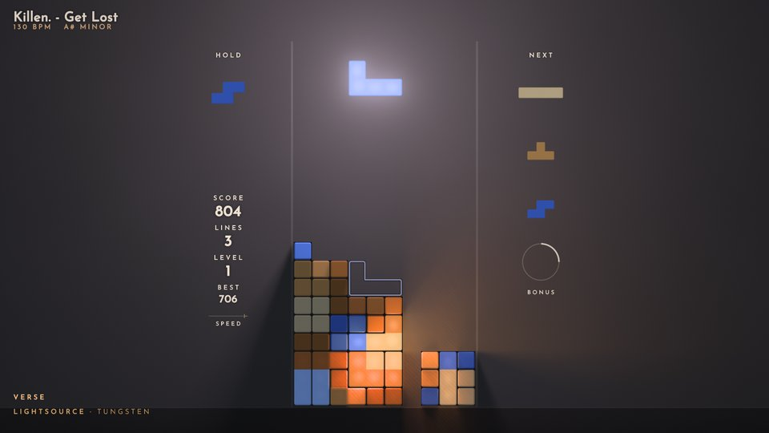

A dim room where the falling piece is the light. One world: a dark plaster wall, a floor under the well and two thin rails marking its sides, under an ambient fill that never lets the darkest places sink to black (the shadows stay clear, the holes under an overhang and the blocks in shadow stay readable); the dominant light is the pieces themselves. The falling piece is the brightest thing on screen at every moment: its face glows in its own color around a white-hot core, a slight bloom around it, and it lights everything around it as an area light reaching across the whole room (its four cells, each sampled four times with a per-pixel rotated pattern), with a soft falloff and real shadows cast in the board's plane: the stack's blocks shadow the wall, the floor and each other, light pours down an open column, the holes under an overhang stay dark, the stack's shadows swing across the wall as the piece moves. The blocks facing a light catch it on their narrow bevels (the light's mean direction is kept per pixel), their far faces stay dark; the cells of one piece are drawn as one shape. A new piece eases its light in as it appears. When a piece locks it takes over the falling piece's light exactly (the room does not dim nor flare on the lock; a small glow along its contact, brighter after a hard drop), eases into a lamp's light over a few seconds, then dims smoothly (an eased fade of about two seconds, its color cooling to a deeper tone, nothing blinks) down to its ember while the next piece already falls and lights the room: two or three lights at once for a while; the cells keep a faint ember afterwards. The ghost is one closed contour around the whole piece, a thin self-lit line in the falling piece's hue on a darker rim: it reads anywhere, deep in shadow or on a lit wall. Every variant paints its pieces in a two-color palette: side A (I, T, Z, L) in one hue, side B (O, J, S) in the other, the pieces of a side told apart by their value, and the falling light carries its piece's hue. Four variants: TUNGSTEN (warm against cold: amber and moonlit blue), NEON (hot magenta against cyan, in a concrete room), CANDLE (the flame's orange against a cool sea green, in a brown room) and SILVER (pale blush against pale ice, in a grey room under a white light), from the key, mode, brightness and tempo (`--universe "lightsource:candle"`). A break dims the room and softens the light (wide penumbrae, a short reach); mid is the plain light; a chorus adds a slow stage spot low in one corner whose narrow beam crosses the well (the stack cutting its shadow into it); a drop hardens the light (crisp shadows), brightens it, lights both corner spots (their beams rising and falling slowly) and relights the whole stack in another pair of fluorescent colors picked for that drop (designed pairs of electric magenta, acid green, cyan, hot orange, UV violet, laser yellow, hot pink and electric blue; from the song and the drop's number, never the last pair, in every variant, SILVER included): each piece keeps its side of the split (the A pieces take the first color, the B pieces the second) and becomes an emissive light again, each type at its own value so the pieces still read apart, casting shadows on the others; each corner spot takes one of the two colors and the room's fill both, the falling piece in its side's color at its brightest with a whiter core. Its first downbeat sends a ripple of light up through the stack from the bottom of the well, which brings the colors (the next and hold previews take them at the same pace, each as it will spawn); for the whole drop each piece shimmers at its own slow pace and a few pieces swell and ease back every two beats (smoothly, no flicker), so the stack lives while the room's brightness stays steady and the falling piece remains the brightest light; when the drop ends they settle back to embers and their own colors over a couple of seconds. The five brightest pieces are lights with shadows, the others glow without shadow tests, so the cost stays bounded (a piece entering or leaving the five crossfades between the two; a light past the budget becomes a glow, never dropped). Every light change is continuous: nothing pulses or flashes but the clears. The room's brightness never pulses with the beat. A cleared row's blocks flare into light and burn out from their edges (under half a second, at the real speed even in slow motion), the row itself a line of light that floods sideways out of the well, lit from the very frame the blocks vanish, its afterlight lingering for a second where the rows were so the room never drops into the dark before the next piece; a quad slowly warms the embers of the whole stack; slow motion turns the light cold and lets the lamps linger; game over puts the stack's lights out row by row from the top, each block fading into the dark; it leaves and enters with the lights going out, the stack in plain ink. The light is computed in a half-resolution buffer (at most 540 lines): each sample is tested against the stack row by row with one 10-bit mask per row (rows falling after a clear at their visual height), so a frame costs a few dozen bit tests per pixel and light. The bonus gauge is a hairline ring. Its HUD font is Sora (SIL Open Font License, `src/universes/lightsource/OFL-Sora.txt`).

## NOTEPAD

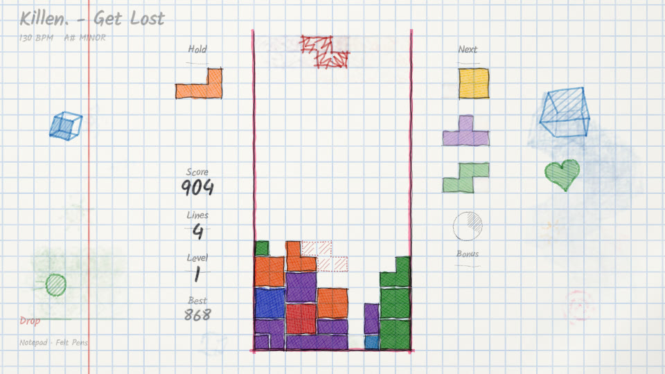

A page of a squared notebook, drawn by hand in stop motion. The well is a box drawn on the grid, one cell per printed square; the pieces are drawn in the squares: one outline per piece that wobbles and overshoots its corners, coloured in with strokes that never stay quite inside the lines, each piece type its own colour and its own way of colouring in (felt-pen bands, hatching, cross-hatching, scribbles, shading). Where the falling piece will land, a dashed outline in its own colour, lightly hatched with a few diagonals: clearly there, clearly not a piece. The HUD is handwritten (Kalam), the labels underlined in pencil. Nothing moves smoothly: the page is redrawn a few times a second (on the beat grid, at once when the game changes), and each drawing is compared with the last one: what stayed is left exactly as it was drawn (no boil: everything keeps its own hand-drawn imperfection, it is not redrawn), what is new is drawn: the falling piece is a quick, loose scribble in its colour (a sketchy outline and a zigzag through each square, a new scribble wherever it goes), and when it lands it gets a proper outline and is coloured in, both in the drawing it lands in. What steps down after a clear keeps its colouring. What moved or disappeared is rubbed out: it leaves a ghost in a residue layer (broken, streaky remains) that the eraser keeps going over, fainter on every drawing, never quite clean. A falling piece leaves a fading trail of its scribbles; old scores leave their ghosts under the new ones. Three notebooks, from the song: **FELT PENS** (a school notebook, blue squares, a red margin, a black fineliner and felt pens), **PENCIL** (engineering graph paper, a bolder line every five squares, graphite and coloured pencils), **CHALK** (a squared blackboard and pastel chalks; dark songs). The music sets the hand: the pieces are always solidly coloured in with a firm outline; a break is drawn slowly, the outlines in pencil; the verse draws in colour; a chorus draws faster, a small doodle now and then under the score; a drop is frantic: about twelve drawings a second, bolder strokes, the well gone over in marker on the drop's downbeat. All song long the margins on both sides of the well (never the well or the HUD) hold a storyboard (code in `src/universes/notepad/story.cpp`): a little stick figure with a scarf lives one adventure after another, each from where the last one left him, like a flip-book in the corner of an exercise book. He is an articulated skeleton (head, torso, two-segment arms and legs) posed from keyframes or from his motion, drawn anew on every drawing while the eraser rubs out his last pose. He walks (in a break) or runs (from the verse on) along the ground, a step on each beat, or skips, moonwalks or tiptoes ("Shh..."); hops from platform to platform up into the margin and back down; climbs a ladder two rungs a beat to a ledge (lower in a break); jumps off a ledge under a parachute (striped gores, its risers to his hands), sways down and lands, or dives off with a somersault; looks up at a "!" as an anvil, a piano, a flower pot or a safe falls from the top of the page, its shadow growing, leaps back just in time and wipes his brow while it lands with a Clang!, Crash!, Smash! or Bonk!; does acrobatics on the bars (cartwheels, a backflip, a handstand, a star jump); in a break sits and taps his foot, reads a book (a page turned each bar) or lies down and sleeps (Zzz); waves now and then. And his gags, each a little story drawn in the notebook's colours: he rides a skateboard across with two kicks and an ollie or a kickflip; bounces along on a pogo stick (Boing! on the bar), the stick tipping over when he hops off; rides a bike (a wheelie now and then) or a unicycle, arms out wobbling; skips rope, a hop each beat, sometimes one big jump with the rope round twice; bounces on a trampoline higher and higher, a front flip, then a star or a backflip (Whee!); dribbles a football to a goal and scores (GOAL!, the net bulging, jumps of joy) or hits the post (Doink!, head in his hands); dribbles a basketball and shoots (Swish!) or dunks and hangs on the rim (Slam!); is chased back and forth by a swarm of bees (Bzz, Aaah!) and ducks until they fly off; strolls along whistling, slips on a banana peel (Whoa!) and sees stars on his back; gets a rain cloud over his head, opens an umbrella and dances in the rain, then a sun or a rainbow; flies a kite (two colours, a tail of bows) high over the margin; sits by a pond fishing, the float bobbing on the beats until a "!" and he pulls out a fish (Yay!), a boot (?) or a can (Meh.); juggles balls, clubs or rings in a cascade on the half beats, the last one landing on his head; plays guitar sitting down or the drums on a stool (Ba-dum tss!), a note out each beat; floats cross-legged (Om), then a tree and a warrior on a yoga mat; looks through a telescope at the moon or a ringed planet and a few stars until a shooting star goes by (Wow!); paints in a beret at an easel, the picture drawn stroke by stroke as he paints (a house in the sun, a flower, a heart, himself, a boat, a cat), then steps back and shows it; throws a stick for a dog that runs off to fetch it (Woof!, Good boy!). He crosses to the other margin in many ways: diving into a hole he throws down and popping out of another one over there; shot out of a cannon (Tsss, Boom!); taking off on a paper plane; floating off under three balloons (one pops as he lands); a rocket pack (3, 2, 1, Whoosh!). Each goes off toward the well and away out of sight (getting small, a twinkle) and comes in over there from the top, growing back; the longer he stays in a margin the likelier he crosses (most often after three or four episodes). The episodes are picked from where he stands (on the ground or a ledge), the room he has and the section (calmer things in a break, more acrobatics in a chorus), seeded by the song, and dealt like a deck: what he has done least this song comes first, so that no gag comes back before the rest have had their turn (the section choosing among what is left), and each gag and each way of crossing deals its variants the same way (the colours are picked anew each time), never the same twice in a row. What he needs (the ground line of his margin, platforms, ladders, ledges, holes, a trampoline, a goal, a hoop, a pond, a cloud, an easel, a telescope and its sky, a cannon) is drawn in just before, a line growing along its length, the colouring stroke after stroke, and rubbed out once he is done with it, so the margins never fill up. Everything is in the notebook's tools: a black fineliner and felt pens in FELT PENS, graphite and coloured pencils in PENCIL, chalk on the board in CHALK. A drop stops the adventures: the margin he is in becomes a dance floor (a cardboard mat under a hanging spotlight, its cone in highlighter, pencil or chalk), the other margin gets the ambiance (a boombox whose speakers kick on the beat with its sound waves, a note flying out every beat, a disco ball whose rays turn on the beat, a little crowd cheering with their arms up on the half beats, a shout now and then), all drawn in over the first beats, and he dances big, about twice his size, breaking on the beats: toprock (a step across on each beat), footwork down on one hand, windmills and headspins (seen in 3D, the legs flying round), a freeze to end each run, in an order varied by the drop. When the drop ends the ambiance is rubbed out piece by piece, he bows, and the adventures go on from the dance floor. Quad stars are drawn small under the score. The well's marker fades when the drop ends; going down to a calmer part, the hand's style (stroke weight, colour, speed) settles over a few seconds instead of at once, while going up is at once. A landing piece is just drawn in place, with no marks at the contact; cleared rows are rubbed out with an eraser in streaks (in real time, even in slow motion), crumbs rolling off, a faint ghost left behind, and the stack above steps down drawing by drawing; a quad gets two coloured-in stars under the score. The slow motion turns the page into an animator's blue-pencil rough, drawn more slowly. Game over: the stack is scribbled over, then rubbed out. Before a song the page's grid is ruled in from the top down; after it, once the game is gone, what is left on the page is wiped off in three passes of broad strokes (no tool shown, only what it does), each taking away much of what is left, the printed grid staying: on the blackboard the felt drags the chalk into long streaks and leaves a haze of dust; on paper the rubber takes nearly all and leaves its crumbs. Between universes the margin and the doodles fade, the stack stays in the bridge's ink.

## CITY

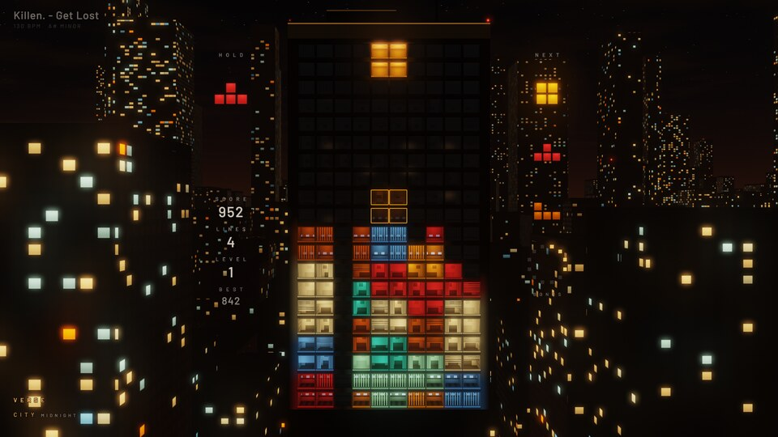

A tower's facade in a 3D night city, its windows the board (code in `src/universes/city/`). We look across at a tall modern tower from about thirty floors up, through a shift lens (the camera looks straight ahead and its image is shifted, so the facade faces the camera, the 10 × 20 window grid stays crisp and the board keeps the layout's pixels while the rest of the city is seen in perspective). Each cell is a window of a home or an office: a recessed opening (its reveals seen in perspective) over a stone sill, a casement frame (pale painted frames with two leaves or a fanlight in homes, dark metal and a transom in offices), glass reflecting the night sky and the skyline, each pane at its own slight tilt (more at grazing angles, beaded with rain in RAIN), and behind it a real room traced per pixel (back wall, side walls, floor, ceiling). The tower is a mixed-use building in bands of three floors, each night its own stack: offices (venetian blinds lowered to different heights or vertical blinds; strip lights, desks, screens, shelves), flats (curtains drawn with a chink of light between them, drapes drawn to the sides, sheers, blinds, exterior roller shutters rolled a little way down (never shut: no window of the board is mostly dark when lit; blinds, shutters, railings and slabs catch the room's light), a window box of plants on some sills; a sofa, a framed picture, shelves, a floor lamp), flats with balconies (French windows down to the floor, and standing out of the facade, traced from the eye, a concrete slab and a railing of balusters or frosted glass, a window box on some, the slabs' undersides lit by the floodlights) and a hotel (sheers and drapes, a bed head between two bedside lamps). Everything at a window belongs to the cell, not to the piece: a cell keeps its room, its curtains, its shutter and its balcony whatever piece lands in it. An empty cell reads as a dark home at night, calm: its frame, its curtains, blinds or shutter faintly lit by the night in their own colors (cream, white, blue-grey, red, olive, ochre), the sky on its glass; on a lit one only the lamp's own color shows through the fabric. There are no people anywhere, in the tower or in the city: the rooms are furnishings and light only. A block is a lit window, its room lit by the piece's lamp; the seven pieces are told apart by their light's color only, and the colors are those of real lamps behind windows at 2 am (a Hopper "Nighthawks" night): I an office fluorescent (pale green-white), O a warm tungsten bulb (amber), T a red paper lantern, S the cold blue of a TV, Z a pale halogen cream, J a deep sodium orange (darker and more saturated than the amber, so O, J and Z part by value and saturation), L an aquarium's teal. The light behaves like a lamp in a room: a pool of light around the ceiling light or the floor lamp, a soft cone on the back wall, paler near the bulb and deeper in the falloff, shadowed corners, blinds and curtains lit from behind. The lit rooms spill light on the mullions and the sill around them and glow into the haze; an empty cell is a dark room behind dark glass. The falling piece is four rooms lighting up as it moves, a little brighter, settling softly to their own brightness when it lands; the ghost is four window frames lit in its color. Lights only ever change smoothly (short eased blends, no surge, no flicker, no blink): only a cleared floor goes dark quickly. The tower has stone piers with a light strip, floodlights washing its base, a louvred crown, a parapet light and a mast. Around it the city in perspective, blocks on a street grid far below, of five kinds mixed differently each night: glass office towers (a curtain wall, mullions, a spandrel band per floor in light or dark panels, glass tinted blue, green or bronze reflecting the sky, a plant room and sometimes a mast on the roof, air-conditioning units), brick apartment blocks (red, brown, yellow or dark brick, its courses up close, punched windows with stone sills and lintels and their bars, stacked balconies with railings on every bay or every other one, a few lit by a lamp under the slab above, a water tank on its legs and a stair bulkhead on the roof), art-deco stone towers (piers running up unbroken between dark spandrel panels, setbacks, a spire, their tops washed warm by floodlights), concrete slabs with loggias (traced in perspective: side walls, ceiling, floor, a glass door and a window at the back, a parapet or a railing in front; a lit room lights its loggia) and precast office blocks (a regular grid of deep windows, units on the roof); the near corners a brick block with a balcony on every bay (left) and a slab with loggias (right). Their faces are lit by a dim moon, the sky, the city's glow and the streets' glow from below (warm low down, colder higher up), their corners and copings catch the light, a lit room lights its sill and its balcony; homes are lit window by window behind their curtains (drawn, drawn to the sides, blinds, a sheer, warm or cool), offices in runs of bays along a floor, blinds half down, in the same real lamp colors (homes mostly tungsten, some halogen, the odd TV, a sodium stairwell; offices fluorescent and halogen), lit and put out slowly, no neon; a few rooftop signs (HOTEL, CINEMA, PRESS...) in soft white letters, only where they stand against the sky over the near corners, away from the HUD and the well. The detail grows with proximity (bricks, bars, railings and loggias up close; window rows, floor bands and lit runs far away); the streets with their lamps and traffic; light pollution on the horizon, a deck of clouds lit from below, haze thickening with distance; red aircraft beacons on the tallest towers, a crane turning slowly; bloom on every light and a filmic curve with deep blacks; the city a little darker away from the well, so the game stands out. Five nights, each tilting the same seven lamps to its mood and with its own tower: BLUE HOUR (a glass tower, the last blue in the sky, the lamps a touch cooler), MIDNIGHT (bronze frames, a sodium glow, the lamps warmest), RAIN (a low sodium haze, rain falling and on the glass), FOG DAWN (the far towers lost in a cold fog, the lamps softer) and SNOWFALL (dark brick, falling snow, the lamps colder), from the mode, brightness, tempo, bass and density (`--universe "city:rain"`). A break is the city asleep (few windows, thick haze, the beacons blinking on their own); mid wakes it (more windows, the traffic, the beacons on the beat grid every two beats); a chorus lights the crowns of the towers and the tower's piers, two volumetric searchlights sweeping slowly through the haze; a new section puts the city's windows out and lights them again elsewhere. A drop switches the city at once on its downbeat: the towers in the middle distance turn their windows to two of the night's lamps, brighter (a warm one, which also takes the horizon's glow and the crowns, and a second warm one or the night's accent lamp; a new pair each drop) in stripes, checks, diagonals or level meters following the music's bands, a new pattern every two bars, the other buildings keep their scattered windows in the drop's colors; four colored searchlights cut through the haze, the crowns and piers lit, the beacons hitting with the kicks. Nothing pulses the whole scene, the stack and the HUD never move, and the buildings behind the HUD's columns stay quiet. A lock leaves the piece lit, a hard drop with a soft glow along the ledge under it; a cleared floor's rooms go dark in about a seventh of a second (at the real speed even in slow motion; nothing is drawn over the row), then the floors above step down one by one in smooth crossfades. A quad sends fireworks up over the city. Slow motion is a long exposure: a colder, deeper night, the city's lights cold and fewer, a wider bloom. Game over is a blackout floor by floor from the top, the city going dark with it and waking up again a few seconds later. It leaves and enters with the world fading to the bridge, the lit windows in its ink. Rendered in HDR: the sky, the ground and the instanced buildings into a depth buffer, the facade as one quad reading the board from two 10 × 20 textures, depth-tested light points (beacons, fireworks, rain, snow), bloom, then the volumetric searchlight beams, cut by the depth, in the final pass. The bonus gauge is twelve small windows in a ring, one lit per line. Its HUD font is Barlow (SIL Open Font License, `src/universes/city/OFL-Barlow.txt`).

## MAGNETS (disabled)

Left out of the default build for now (`-DREFALL_DISABLED_UNIVERSES=""` builds it). The school experiment: magnets lying on a sheet of paper strewn with iron filings (code in `src/universes/magnets/`). Every piece is a matte ferrite magnet painted in two halves, north and south across its axis (its colour, and the same colour darkened); each cell is a small dipole, so inside a piece the poles cancel and each piece is one bar magnet with its poles at its ends; the falling piece and the previews are magnets too. 65,000 filings are simulated on the GPU: each turns toward the real field where it lies (a damped torque: smooth, no jitter), creeps slowly toward the strong field around the poles and stops at a magnet's edge, so the paper keeps the memory of where the stack has been; far from the magnets friction wins and they stay scattered, faint. The falling piece drags its field down the well and the filings turn as it passes. The music taps the paper: a calm part shows a few fine filings, lines only near the poles; the verse taps the sheet on each bar; a chorus taps it on the kicks, with more, darker filings and lines reaching further. The drop turns every magnet's polarity over on its downbeat: every filing spins half a turn the same way at once, the magnets change to their second paint, and for the whole peak the kicks tap the paper hard while every four bars half of the magnets turn over again and the lines re-route. A cleared row is lifted off the paper (a quick fade, its shadow growing), the filings under it jump and resettle and the ones clinging to the stack slide down with it; a landing piece pushes a little dust of filings out from under it; a quad makes the whole sheet shiver round once. The bonus gauge is a compass whose needle follows the field. Slow motion inverts the sheet (pale filings on dark paper). Four variants with their own paints: **GRAPHITE** (white paper, black filings), **SILVER** (black paper, steel filings), **BLUEPRINT** (white filings on cyanotype blue), **COPPER** (copper filings on black). Its HUD font is Space Mono (SIL Open Font License, `src/universes/magnets/OFL-SpaceMono.txt`).

## TOPOGRAPHY

A contour map whose terrain is the stack (code in `src/universes/topography/`). Fine isolines on white or black paper, an index contour every fifth line, a neat line around the well, spot heights, a scale bar and a north arrow. Every locked cell is elevation: the stack stands as a plateau with its foothills (taller stacks stand higher), so the contours hug its skyline, climb the empty well and run out over the margins, redrawn on every lock and always gliding (the map eases toward the terrain). The ground itself is never still: its hills drift, swell, part and merge over tens of seconds (each octave of its noise drifting its own way through a slowly moving warp), slowest at a break and quicker in a chorus and a drop, so the contours and the lakes flow with it; the rain's carving heals slowly and the spot heights follow their hilltops. The pieces are small tinted plateaus, each type its own tint, with a crisp outline and two form lines inside (one shape per piece, two pieces never merge); a landing piece's form lines spring out from its middle as the land rises under it; the falling piece hovers with a soft shadow; the ghost is a dashed border. The song is the weather, and its consequences stay for the song: the rain gathers into a real drainage network (long runoff paths that join, never drawn: the map is only its contours and its water) and carves its valleys, so the map keeps a record. A break drizzles (a few streams, a quiet sheet); mid parts rain (tributaries appear, showers sweep one side on the bars, the hollows fill into ponds, gaps in the stack become tarns); a chorus at the peak floods the valleys; a drop is the flood: the water surges past the well's terrace on the downbeat so the stack stands as an island, the layer tints come in, lines parallel to the shores ripple outward with the kicks and the level swells slowly over two bars. Unlike a chorus, a drop is also a living relief: the land heaves up around the stack on the downbeat, six peaks in the margins rise and fall with the bass, mid and high bands (eased, so their contours flow and tighten as they grow, only breathing in a chorus), one of them sinks and another pushes up elsewhere every four bars, half-interval contours come in so the map gets denser, and the pieces and contours switch to the sheet's drop colors (back over a couple of seconds after it). A hard drop swells the ground a little under the piece; a cleared row sinks into the map (its cells shrink and fade in a third of a second, the contours relax as the land slumps) and leaves its debris as fans against the walls; a quad is a flash flood; slow motion is a low cold dusk sun raking the relief; game over is the sea rising over the stack. Seven sheets, each with its own seven tints: SWISS (brown contours, blue water), NIGHT SURVEY (pale lines on near-black, cyan water, pastel plateaus), QUADRANGLE (survey colors, woodland green), GRAPHITE (grey and black only for the map), GLACIER (blue contours, warm plateaus), CYANOTYPE (a sun print: pale lines on deep Prussian blue, white water, lighter blue lakes and flood, cream and warm plateaus) and LACQUER (gold leaf on black lacquer: bronze contours, gold index lines, pale gold water over bronze lakes, jewel plateaus); dark minor songs take one of the three dark sheets (`--universe "topography:night survey"`). The terrain is a CPU grid of four samples per cell (well under a millisecond a frame), drawn in one full-screen pass with B-spline sampling. The map's lines and shores fade out behind the HUD's text and the previews. Its HUD font is Barlow (SIL Open Font License, `src/universes/topography/OFL-Barlow.txt`).

## HEAT

The stack seen through a thermal camera, as a cinematic shot of molten rock in a volcanic cave (code in `src/universes/heat/`). The frame is one thermal image: the cave, the air and the pieces are written as temperatures into a float target and mapped through the camera's colormap; the flames and the sparks are light beside it, in the colormap's hot colors (they fade to the dark, not through its cold colors), and hot things bloom in their own colors. Every piece lands white hot and cools down through the colormap, so the stack shows its own history as temperature. The pieces are lava: hot, a piece is liquid, slow swirls flowing in it (one lava continuous over the piece's cells, kept by each cell as it moves down); cooling, a dark crust of plates forms on it, cracked by fissures that glow with the heat underneath (wide and bright when warm, hairlines when cold); a molten edge glows round each piece and a dark seam parts it from its neighbours, so the pieces stay apart. The heat is simulated on the 10 × 22 grid: it conducts between neighbouring locked cells (a fresh piece warms the old ones under it), into the well's walls and floor (thin frames that warm where the stack touches them), and leaves through the exposed faces into the air, a coarse grid over the whole view where it rises, sways, spreads and fades: a faint, thin heat haze of flame tongues rises just above the hottest faces (behind the pieces, the grid clear through it; up the outside of the well only where its walls are very hot), a warm column stands over it, and the cave shimmers behind the hot air. The seven types are seven materials of different emissivity, so each settles to its own band of the colormap when its heat has gone (J the coldest, then O, S, L, T, Z, I the warmest), all in the colormap's middle, well above the cave and the glass: a cooled piece keeps a clear body (in LAVA a maroon to red crust, its fissures still faintly lit). The falling piece is the hottest thing on screen; the ghost is a clear contour: a crisp thin line of the piece's outline at a mid-hot temperature (the colormap's warm color, readable over the dark glass in every variant and through the drop), over a very faint fill. The queue warms as it comes: the next piece already white hot, the second warm, the third cold (its material's band shows); the held piece is kept warm. The cave: great rock walls in deep shadow around a dark hollow, their faceted faces catching a faint light from above, quiet behind the HUD columns, smoke drifting up, sparks rising (more near the floor, more in warm parts), two or three lava glows deep in the rock. The well is dark glass etched with the cells' grid, in a thin frame warmed where the stack touches it; the hold and each next piece sit in their own thin-framed box of the same glass. The camera's overlay is restrained: a thin scale bar on the right edge with the range in degrees, the bonus gauge as a thin ring whose charge is drawn in the hot color, the lettering in Noto Sans Mono. The song is the room's weather, with the camera's auto-range: a break or a calm part is cold and quiet (a wide range, cold far shapes, still air, pieces losing their heat faster); a chorus is warmer (the range narrows, the far shapes warm up, the air rises faster, and at the peak a bubble of hot air leaves the stack with the kicks, alternating sides, while a far shape warms on each bar). The drop flares: on its downbeat the whole stack flashes hot and cools over seconds, a sheet of hot air leaves its top, and the camera switches to another colormap for the whole drop (back slowly afterwards); the camera compresses its highlights through the drop, so the stack tops out bright orange, only a little brighter than in a verse, with its swirls, fissures and seams still showing (no white-out), and the drop's energy goes to the cave instead: lava glowing in the cracks of the rock, slowly breathing, the smoke lit warm from below, many more sparks; the flames get no stronger (the drop's extra hot air is offset, and every flame's light is capped, so no plume flares). A lock is the piece landing white hot; a hard drop also heats the cells it hits and pushes a breath of hot air out at the contact. A cleared row vents its heat: its blocks cool and fade out in a third of a second (at the real speed even in slow motion, nothing drawn over the row), the heat passes into the cells above it (they glow where the row was) and a plume of hot air rises out of the stack. A quad is an updraft that warms the whole stack. Slow motion is the camera's isotherm mode: everything grey but the hottest band. Game over is the stack cooling into the room from the top down. Four cameras, each with its drop colormap: IRONBOW (drop: BLAZE, ironbow burning, its cold end lifted to glowing violet and magenta, so the cave burns brighter), ARCTIC (blues and cyans, the heat in gold: an ice cave, the lava turned to glowing ice; drop: LAVA), WHITE HOT (grey: a monochrome film; drop: IRONBOW) and LAVA (the cave's blue-greys, then wine, red, orange, yellow: the molten rock; drop: GLOW, black-red-yellow hot metal) (`--universe "heat:arctic"`). It also takes the FORGE idea of the roadmap (glowing pieces darkening as they cool). Cost: the heat and the air (~150 × 85) on the CPU, two full-screen passes and a quarter-resolution blur (~0.5 ms of GPU at 1080p). Its HUD font is Noto Sans Mono (a subset, SIL Open Font License, `src/universes/heat/OFL-NotoSansMono.txt`).

## BLUEPRINT

A technical drawing whose parts are the pieces (code in `src/universes/blueprint/`). A drafting sheet with its border, zone marks and title block (drawing number, scale, sheet, revision). The well is a container drawn in section: hatched walls, an open top, a center line stub, its width dimensioned below it. The pieces are drafted parts: a crisp outline, a light wash of their tint and the section hatching of their type (45 degrees, cross-hatch, stipple, horizontal, 135 degrees, vertical, steel pairs), so the seven types read apart at a glance; the falling part is lightly hatched, the ghost is a hidden line (one dashed outline around the whole part, each straight run dashed to fit so it starts and ends on a dash and every corner is closed). The drafter draws: every line comes in as a pen stroke. A landing part gets its hatching drawn up from the impact, and is dimensioned: extension lines, arrows and its width lettered above it, held for a second and a half then fading out in a third of a second (only the last part, lifted at once if anything comes above it); the stack's overall height is dimensioned beside the well and glides when it changes. The song is the drawing, and it stays for the song: a break is sparse paper with a few construction lines (a machine drawn earlier left as a faint ghost, inked again by the pen when the music comes back); verse and mid parts draw a machine elevation in the margins, a part every four bars (a spur gear, a cam and its follower, a pinion, a four-bar linkage, a crank and piston in its cylinder, an idler, a Scotch yoke, a spring, the linkage's coupler curve); a chorus draws every two bars and adds center lines, section hatching and the coupler curve. The drop brings the machine to life: the print changes on the downbeat (the blueprint turns into a white redline print, the film is exposed into a blueprint...) and the pieces' fills with it, the gears turn at tempo fractions with an eased ratchet every two beats (one turn of the big gear every two bars), the piston strokes once a bar and its chamber fires on the kicks, the cam lifts its follower, the linkage rocks, the yoke slides; every four bars a new part is drawn. A cleared row is rubbed out (its lines lift in eraser streaks in a third of a second, nothing is drawn over the row); every clear is a revision in the title block (a pen-drawn delta and the next letter, in the accent), a quad adds a revision cloud around the title block. Slow motion dims the sheet and slows the machine; game over strikes the parts' hatching out from the bottom and stamps VOID. Four sheets, each with its own seven tints and drop sheet: CYANOTYPE (white lines on Prussian blue; drop: a white redline print), VELLUM (graphite and non-photo blue on white film; drop: exposed into a blueprint with amber machine lines), CAD (thin colored layers on a black screen; dark minor songs; drop: the simulation in amber with hot layers) and DIAZO (a whiteprint, blue-violet lines; drop: a deep violet print with warm lines) (`--universe "blueprint:vellum"`). The pen lines are instanced segments gathered with MAX blending (joints and crossings never darken). Its font is Share Tech (SIL Open Font License, `src/universes/blueprint/OFL-ShareTech.txt`), slanted like hand lettering for dimensions.

## RECYCLE

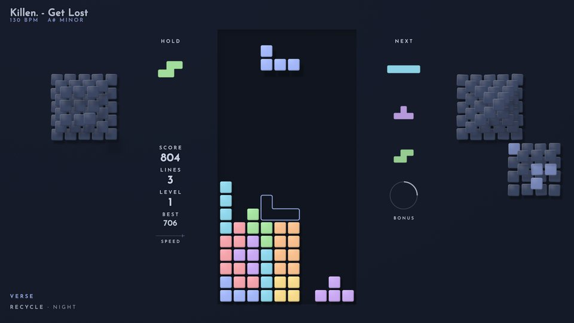

A table seen from straight above where nothing is created or destroyed (code in `src/universes/recycle/`). The well is a shallow tray in the table; on both sides, in the margins, stand stepped pyramids of loose cubes, the same cubes the pieces are made of, neutral in color, their courses told by soft, airy shadows and a delicate contact shade (lit from the upper left) and a slight long-lens parallax. The world holds a fixed number of cubes (176): a new piece takes its four cubes from the top of a heap, and they fly in on a short eased arc (their shadows stretching with the height), taking the piece's color on the way and converging onto it while it is already playable. A cleared row unzips outward: its cubes lift out, the left half flies to the left heaps and the right half to the right, landing on top with a tiny bounce, still tinted by their piece for a moment. The heaps fill one after the other, so they shrink, pyramid by pyramid, as the stack grows: the stack's height reads in the margins at a glance. Holding a piece sends its cubes back; the previews are flat silhouettes printed on the table (the plan, not the material); the ghost is a fine outline on the tray; the bonus gauge is twelve printed pips, one per line. A break is still; mid parts move one cube from a heap to another every bar, a chorus every two beats (the heaps get tidied). A drop throws every cube in the air on its downbeat and lands them in a new formation in the drop's colors (short two-course bars of color with gaps between them, concentric double rings opening away from the well, or towers casting long shadows; a new one every four bars), the pieces switch to the drop's palette, and a hop ripples through the cubes outward from the well every two beats, stronger with the kicks; after the drop they gather back into neutral heaps. A hard drop squashes the landing cubes a little; a quad sends forty cubes high over the table; slow motion is a low evening light with long shadows; game over sends the whole stack back to the heaps, from the top down. Four tables, each with its own pieces and drop colors: PORCELAIN (matte white cubes on a cool white table, pastel pieces; bright major songs), ONYX (glossy graphite cubes on black, jewel pieces), TERRAZZO (honey-oak blocks on a pale warm terrazzo floor with sparse stone chips, under a broad window light; painted pieces) and NIGHT (slate-blue cubes on a navy table, pastel pieces) (`--universe recycle:onyx`). Its HUD font is Outfit (SIL Open Font License, `src/universes/recycle/OFL-Outfit.txt`).

## SUNPRINT (disabled)

Left out of the default build for now (`-DREFALL_DISABLED_UNIVERSES=""` builds it). A cyanotype photogram exposed under the stack (code in `src/universes/sunprint/`). A sheet of paper brushed with sensitizer lies in the sun (the coat's ragged, streaky brush ends show left and right), the pieces are glass plates laid on it, seven tinted glasses with a bevel lit on the sun's side and a fine dark edge. The coat has two close, light tints, and the sheet goes over from one to the other on the bar grid (in about a second), except where a plate lies or the falling plate is held at that moment: there the paper keeps the tint it had. The frame keeps a tint map (two half-resolution float targets, each frame reading the last), so the sheet records where the stack was: a cleared row leaves the stack's old shape in the other tint until the sheet turns again, and the ferns print the same way. The sheet always stays light, so the glass and the dark lettering and ghost outline read on it in every tint. The plates cast soft shadows that keep the glass's color; the falling plate, held above the sheet, casts a longer, softer shadow that tightens as it lands; the ghost is a fine pencil outline. Two pressed ferns lie in the outer margins, as in Anna Atkins's prints. The song is the sun: a calm part is a low sun behind passing clouds (long soft shadows, the sheet turning every eight bars), a chorus raises it (shorter shadows, the ferns stirring every two beats on the beat grid, the sheet turning every four bars), a peak is full sun (crisp colored shadows, a glint running along one plate's bevel on the kicks, the sheet turning every two bars). The drop brings both tints up a little more saturated on the downbeat and every plate catches the sun; they go back slowly after it. A cleared row's plates are lifted off the sheet in a third of a second (they fade as they rise, their shadows growing soft); a quad is a burst of sun over the cleared rows. Slow motion is the sun going behind a cloud (a cool, quiet afternoon); game over turns the sheet once more and lifts the plates off from the top down, leaving the stack's silhouette in the old tint. A new song rinses the sheet to its tint over a few seconds. Four processes, each with its two tints and seven glasses: PRUSSIAN (two pale blues), TANNIN (two mauves), VAN DYKE (two sands) and CHLOROPHYLL (two pale greens) (`--universe "sunprint:tannin"`). Cost: two half-resolution shadow targets blurred into penumbras, the tint pass and one full-screen pass for the sheet. Its font is Cormorant Garamond (SIL Open Font License, `src/universes/sunprint/OFL-CormorantGaramond.txt`).

## EMBROIDERY (disabled)

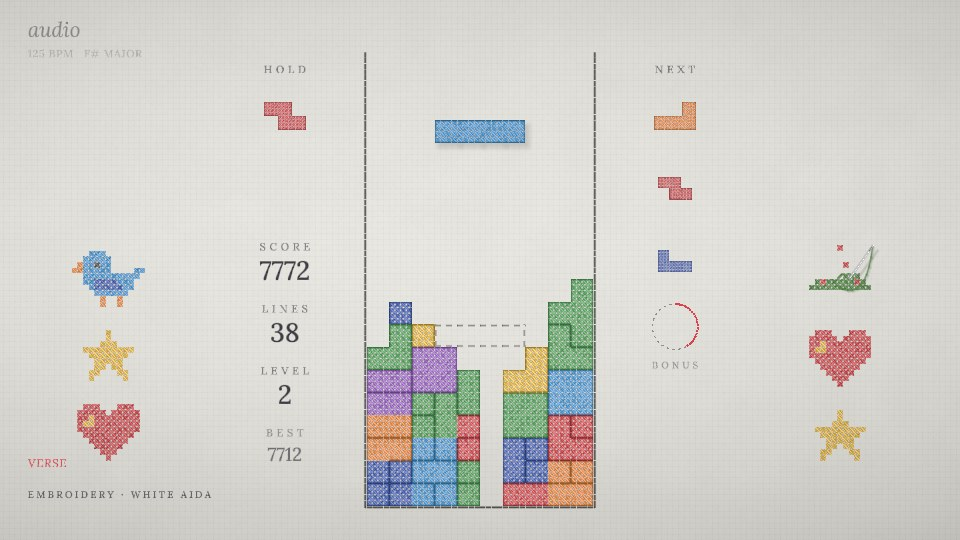

Left out of the default build for now (`-DREFALL_DISABLED_UNIVERSES=""` builds it). Cross-stitch on aida cloth (code in `src/universes/embroidery/`). A sheet of aida under a soft daylight (its weave kept very soft: no grid of holes behind the HUD), the well a backstitched outline on it, open at the top. The pieces are embroidered: every cell is four by four cross stitches of stranded floss (two plies twisted, shaded round, their crests catching the light), and each piece is outlined in a backstitch of a dark shade of its own thread, as charted patterns are, so two pieces of one color never merge. The falling piece is held over the cloth with a soft shadow under it; the ghost is a running stitch around where it will land. In the outer margins, clear of the HUD columns, a sampler is stitched over the song: charted motifs (a heart, a tree, a flower, a bird, a star, a strawberry, a medallion) stacked in two panels in an order of the song's own, then each panel's frame, a budding vine. A needle does it one strand at a time, its thread sagging back to the cloth: the thread comes from the game (each cleared row is a run of stitches, a quad a long one) and from the music (a stitch every two bars in a break, two a bar at mid, one a beat at a peak, two a beat in a drop), so the cloth fills up with the song and with the play. The sampler's state is a small texture (a texel a stitch: its thread and whether one or both strands are in) drawn with the cloth in one full-screen pass; the pieces are instanced cells drawing their crosses procedurally. A cleared row is unpicked: its crosses come out one by one, the top strand first, in a third of a second. A lock pulls the piece's thread tight (a glint); the kicks of a peak run a glint along one piece's floss. The drop turns the cloth over to its drop side and the threads to brighter silks (the sampler with them), on the downbeat, and back slowly after it. Slow motion is the evening: a warm lamp over the frame, the corners in the dark. Game over unpicks the stack row by row from the top; a new song unpicks the old sampler and starts a new one. The lettering is in a thread color, dark on a pale cloth and pale on a dark one; the bonus gauge is a ring of running stitches, stitched solid in the accent as it charges. Four cloths, each with its seven threads and its drop: WHITE AIDA (classic floss; drop: black aida and bright silks), LINEN (natural linen, earthy threads; drop: indigo and pale silks), BLACK AIDA (bright floss; drop: a deep crimson cloth and pale gold silks) and INDIGO (white and pastel threads; drop: white linen and saturated floss) (`--universe "embroidery:linen"`). Its font is Lora (SIL Open Font License, `src/universes/embroidery/OFL-Lora.txt`).

## LANTERNS

Paper lanterns floating on a dark lake, in real 3D (code in `src/universes/lanterns/`). The camera is the layout's reference camera raised to a low eye height and looking straight ahead with a lens shift, so the board's plane keeps its pixels while the lake, a true horizontal plane at the well's floor, recedes in perspective up to a horizon a little above the middle of the screen: a far shore of low hills, a sky darkening upward with a few faint stars (never behind the HUD). The water is drawn per pixel from the camera's ray: rippled normals (slow swells, a finer chop near) reflect the sky (Fresnel: dark near, mirror-like far away, hazy at the shore) and distort a planar reflection of the whole scene (the stack, the well's frame and every lantern rendered mirrored into a half-resolution texture), drawn out into short wobbly streaks toward the eye, a gentle shimmer under each lantern (the stack's own reflection under the well a soft colored shimmer of its papers); a low moon off the left edge of the frame (whatever the aspect) lays a path of glitter on the small waves, fanning out toward the eye, a few glints across the lake (bright on MIDNIGHT and FROST, faint on MOONLESS). The well is a frame of light standing in the water (two uprights and a lintel, frosted cyan-white threads of light with a soft glow, mirrored in the lake) around a dark glass etched with the fine grid of the cells' lines (faint light threads, frosted, a glint here and there; the lake and the horizon seen through it), and the stack floats on the lake, mirrored under it; the hold box has a thin warm frame glowing at the middle of its top and bottom. The pieces are 3D paper lanterns: every cell is a thin opaque box (a third of a cell deep), the faces between a piece's own cells removed so each piece is one solid panel of lit paper whose top and inner sides show in perspective as thin darker rims: washi (a fine fiber, ribs between the cells' junctions), each cell glowing at its core, deeper and more saturated toward a crisp dark wooden frame along the piece's edges and inner corners and a fine seam between its cells, warmer at the piece's heart, and a small candle flame (a swaying teardrop of light) standing in some of its cells, the same ones for the piece's whole life (the falling piece's are the ones it keeps once locked); the previews are thin panels, with their flames too; the ghost is a fine outline of the paper's light, one closed line around the whole piece (its inner corners turned too); a quarter-resolution bloom. The cleared row becomes the lanterns, visibly: each run of one piece in the row turns into a box of its paper that slides out of the well to the nearer side (each half as one block, past the frame, in the 0.3 s the row stays empty, so nothing is left over the row), then folds into a box lantern (a dark cap and base growing on it) as it floats down beside the well onto the water behind it, one after the other, and drifts across the lake to a free place, far into the distance, where it stays lit for the whole song (up to ninety, the oldest going out), each with its rippled reflection; a few far lanterns always light the opposite shore. On the lake they keep clear of the HUD's lettering, and any lantern seen behind it dims. A calm part is a still mirror (more stars); mid parts ripple the water on the beat grid (every two beats) and light far lanterns along the opposite shore; a peak ripples harder, lights more of them, and its kicks make candles flicker (on the lake and in one piece of the stack). The drop lifts every lantern off the water into the sky, each in its own time, rounding into a sky lantern as it goes (a paper balloon wider at its rounded top, its base a dark ring around the flame's glow; the ones going up from the lake are sky lanterns from the start), rising and receding, smaller and smaller, their reflections following them, while more go up from the whole lake every two beats and the horizon warms with one soft swell: a sky full of lights over a lake full of their reflections; after it they hurry away and go out, and new ones gather again. A lock is the piece's candle catching (on that piece only), a hard drop pushes a few embers out at the contact; a quad sends its four rows out as lanterns and a dozen more up from the lake. Slow motion is moonlight: a full moon rises in the right margin, its path of glints on the water, a mist lies on the lake (never over the pieces) and the world turns cool around the warm lanterns. Game over puts the stack's candles out one by one from the top; a new song lifts the old song's lanterns away. Six nights, each with its own seven papers and drop sky: MIDNIGHT (deep blue, classic papers), LOTUS POND (teal, pastel papers), MOONLESS (black water, jewel papers; dark minor songs), DUSK (a plum sky), FROST (a winter night, ice papers and one warm one) and FESTIVAL (indigo, red and gold papers; bright songs) (`--universe "lanterns:dusk"`). The HUD is set straight on the night in warm paper light over a dark halo; the bonus gauge is a thin ring whose charge glows in the accent. Its fonts are Josefin Sans and Cormorant Garamond Italic (SIL Open Font License, `src/universes/lanterns/OFL-*.txt`).

## ORIGAMI

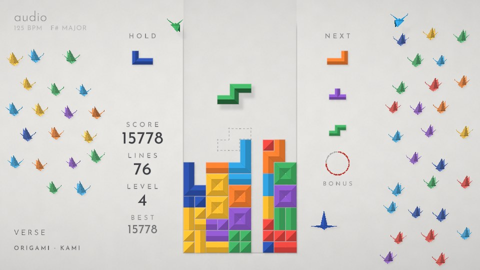

Folded paper on a sheet, every cleared row folded into a paper crane before your eyes (code in `src/universes/origami/`). A large sheet of paper under a soft light from its upper left (a fine, soft grain), the well a shallow tray folded into it: two valley creases and a floor, a lip of light outside them, open at the top. The sheet was folded before: a giant crease pattern lies over the whole view (a square base, a sixteen-fold star, a square base set lower and turned...), its large facets tilted a little and catching the light, a fine pressed line between them; faint at calm, they come up at mid and more at a peak, and after each drop the old pattern fades and another one comes up. The light is two-toned, warm where it comes from and cool across the sheet, and warms at a peak. The pieces are folded paper, each of its own colour: every piece is a strip folded along its length, a ridge running through its cells' centres from neighbour to neighbour (mitred where the strip turns, a valley crease in the inner corner, a lone cell a square folded on its diagonal), its two sides sloping down to the cut edges and lit facet by facet, the cut edge lit on the sides toward the light; a piece has no seam between its cells and lies on the sheet with its own soft shadow (max-blended in a half-resolution target), which keeps two pieces of one colour apart. The falling piece looks exactly like a locked piece of its type, only held a little above the sheet (its shadow wider and further), and its shadow settles on lock. The ghost is a dashed valley-fold line, as in folding diagrams. A cleared row slides out of the well through one of its walls, the other one than the last row's (a double clear sends one row each way), as one strip of paper (out of the row in under half a second, passing under the stack as it settles) and pleats against the wall, a pleat a cell, valley and mountain in turn, each pleat lit by its own slope, its papers turning to the row's most common one; the pleated packet glides to the folding corner on that side (on the right the free corner under the HUD column; on the left the margin above the corner texts, reached along the well's wall and under the HUD column, clear of its text; both kept free of perched cranes, with four spots each so that several rows fold at once), turns over into a square, and is folded into a crane step by step, every flap turning about its crease in 3D and lit by its normal: the kite (the corners fold to the centre), the petal fold (the lower layer swings up and stretches into the near wing), the bird base, the legs narrowed (their outer parts folded behind), the neck and the tail swung up, the head folded down, the wings opened. The crane (a diamond body, a long tail and neck, a pointed head, two wings, every part in two facets with a raised middle crease, a darker rim for the paper's edge, a soft contact shadow) then takes off to a place on its side of the well (or, when that side is full, over the top of the well, behind the pieces, to the other one), and settles there for the rest of the song, facing the well, a shade quieter than the pieces; the margins fill up with the play (when every place is taken, the oldest crane flies off). A row is folded in about 3 s at the real speed, even in slow motion. A quad folds one larger crane in the accent paper and sends a ripple of wing beats through the flock. Calm: the cranes are still, the light soft. Mid: every two beats a few cranes beat their wings (a wing turning about the body in 3D). Peak: half the flock beats its wings in turn every two beats and the kicks make one crane hop; a new section sends a ripple of wing beats. The drop turns the sheet over to its coloured side (and the papers to their drop shades) and sets every crane flying: they take off one after another and fly slow loops in their margins, spread evenly around them, wings on the two-beat grid, their shadows further and fainter, until the peak ends and they land back in their places. Slow motion is the blue hour: a low light raking in from the right (the facets light the other way, the shadows long and to the left). Dimmed (pause, game over) the world fades into the sheet so the text reads; game over folds the stack away row by row from the top (each cell's upper half folding down over its lower half, its white back turning up) and greys the paper; a new song sends the flock away. The lettering is graphite on a pale sheet and chalk white on a dark one (from the sheet's own value, so it follows the sheet when the drop turns it over); the bonus gauge is a ring of folded paper segments, charged in the accent paper. Six papers, each with its seven papers and its other side: KAMI (white paper, classic kami colours; drop: deep blue), SNOW (cool snow grey, soft papers; drop: black, bright papers), GRAPHITE (bright papers; drop: deep crimson, pale papers), INDIGO (pale papers; drop: the white side, saturated papers), FOIL (black paper and foil papers with a metallic glint on the facets; drop: deep teal) and CELADON (pale celadon grey, jewel papers; drop: forest green) (`--universe "origami:foil"`). Its font is Josefin Sans (Regular and Light, SIL Open Font License, `src/universes/origami/OFL-JosefinSans.txt`).

## RAINY WINDOW

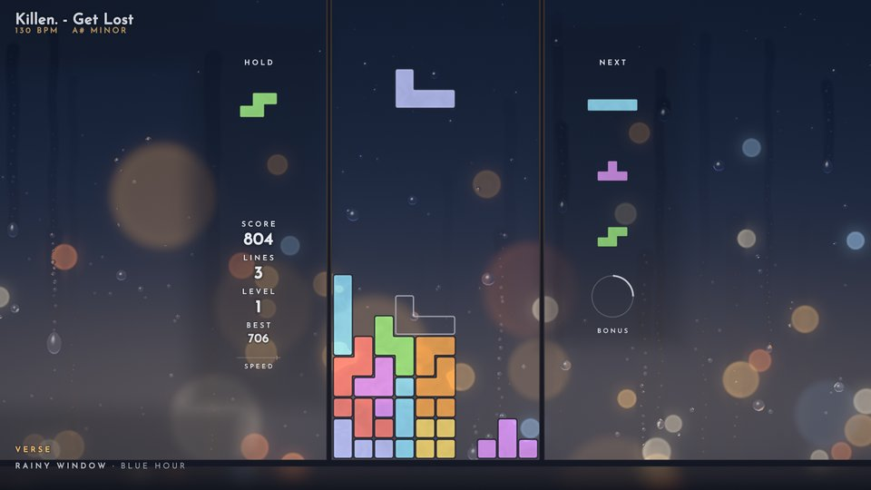

A window pane at night in the rain, the city out of focus behind it (code in `src/universes/rainy/`). The city is only soft bokeh discs of light, slow and quiet (street lamps and windows, most of them low where the streets are, a few big near ones, tower lights up high, cars drifting along a street far below), over a night gradient with the city's glow low behind the glass; the lights stay dim behind the HUD's columns and corners. The glass and the water are the subject: small beads of rain sit everywhere on it, bigger drops hang still and swell as the rain feeds them, and on the music's beat grid some of them let go and run down, meandering, picking up the beads they meet and the drops they hit, leaving a trail of tiny beads that dry away and wiping the mist off the glass (the clear trails fog over again in about ten seconds, so the pane keeps the streaks of the last runs). Each drop is a small lens: the city upside down inside it, sharper than through the mist, the light gathered in its lower part, its rim dark, a small highlight. The well is the middle pane of the window, between two thin dark mullions, above the bottom rail and the sill of the dark room. The pieces are stained glass stuck on the pane: one slab of tinted cathedral glass per piece (a hammered ripple, a brighter line where the glass meets the lead, a broad reflection of the room), leaded around with filleted corners so two pieces never merge, lit from behind by the city (the bokeh glows through the tiles); the falling piece is a slab sliding on the glass, the ghost a pale line traced where it will land. The stack is an obstacle to the water: a drop that runs onto a piece slides along its top to the nearer edge and runs down its side, or settles in a pit, and leaves water resting on the piece, so beads pool along the tops of the stack and stay there (a face covered by the next piece loses its pool). A calm part is a light rain under a thick mist, a drop letting go every eight beats, some windows out; mid sets the drops running every two beats and lights more windows (one changes on each bar); a peak is a downpour: runs of three drops every two beats, the rain thick on the glass, the mist washed thin, the lights brighter, and the kicks light a few of the city's lights (local, never the scene). The drop shifts the whole city to the night's other colors in a second on the downbeat (SODIUM's amber city turns neon pink and cyan, TAIL LIGHTS' red lights all turn green...), with one soft swell, lets every hanging drop go at once and brings more from above; the colors come back slowly after the peak. A hard drop squeezes the water from under the tile: a drop leaves each lower corner and runs down. A cleared row melts: its glass drains down the cell with a bright meniscus and clears to water in a third of a second (at the real speed even in slow motion; nothing is drawn over the row), a few beads of water running down over the stack. A quad lets every drop go and sends the rows' colors into the city as a dozen lanterns of light rising on both sides of the well. Slow motion is a later, colder hour: the rain almost still, the mist thicker, the city drained to blue. Game over melts the stack from the top row by row while the pane mists over. It leaves and enters with the world fading to the bridge, the stack in its ink. Six nights, each with its own city lights, drop lights and seven glasses: SODIUM (amber street lamps; drop: neon), NEON (pink and cyan; drop: gold), BLUE HOUR (a lighter blue sky, warm windows; drop: rose and violet), TAIL LIGHTS (red and amber in the dark; drop: everything turns green), HARBOR FOG (pale lamps in a teal fog; drop: rose and gold) and AFTER MIDNIGHT (deep indigo, a few cold lights, vivid glass; drop: warm gold and red), from the mode, brightness, bass and dynamics (`--universe "rainy window:neon"`). Cost: the city at half resolution (instanced discs) blurred at a quarter, the water as a height field of a few hundred instanced domes max-blended at full resolution, a 400 × 225 mist grid and the drops on the CPU, one full-screen pass for the pane. The bonus gauge is a ring of beads of water, the charged ones lit in the accent. Its HUD font is Josefin Sans (Light and Regular, SIL Open Font License, `src/universes/rainy/OFL-JosefinSans.txt`).

## BRICKS

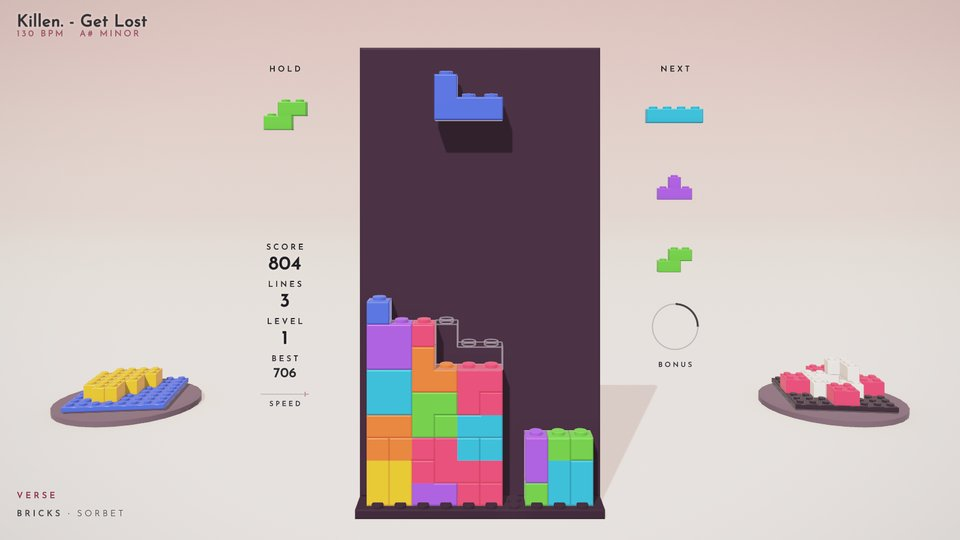

Glossy toy bricks in a photo studio, every cleared row building small models that turn on turntables beside the well (code in `src/universes/bricks/`). Real 3D: the layout's camera raised a little and looking straight ahead with a lens shift (the board's plane keeps its pixels), a seamless studio sweep (the table curving up into the backdrop, a fine grain, a soft pool of light around the well) under one soft key light with a 4096 shadow map, rendered 4x multisampled. The well is a plastic board standing on a floor plate with studs; the pieces are interlocking plastic bricks clipped onto it: one brick per piece (the faces between its cells removed, molded bevels and a fine groove only on its free edges, so two pieces of one color never fuse), a stud on every top face left open, glossy ABS shading (a soft highlight, the studio's softbox in the reflection, a little warmth on the shadow side), real contact shadows on the board and on each other. The falling piece is exactly a locked brick held a little off the board, only its shadow shows it; the lock clicks it onto the board (a stiff spring, one small overshoot); the ghost is a fine outline on the board; the previews are small bricks. A cleared row pops off the board: each run of one piece in it becomes a 1 x N brick that slides out of the well (the left half to the left, the right half to the right, out of the row in 0.3 s) and flies on an arc to the model on its side, reshaping and, when needed, repainting on the way, and snaps into place with a small settle. The models are authored as voxel paintings cut into real bricks (1 x 1 to 2 x 4 in a running bond, rows of slopes for roofs) and built bottom-up, a course at a time: each ejected brick takes one of the bricks the model can take now (nothing missing under it), of its own color when one waits for it, the closest in length; nine models (a cottage, a lighthouse, an apple tree, a windmill whose sails start turning once it is finished, a castle tower, a rocket, a pagoda, a duck, a sailboat), each side in its own shuffled order. A finished model glows softly and turns once, then leaves for the gallery at the back of the table (four per side, receding into the studio's haze, the oldest fading away), and the next baseplate drops onto the turntable (bricks ejected meanwhile wait above it). Outside the drop a model never comes apart: its bricks only move when they fly in and snap on. Calm: slow turntables, a soft light; mid: each model lifts gently, whole, on its turntable on the beat grid (every two beats), the turntables a little faster; peak: a little more light, a higher lift, and the kicks give the models a soft glow. The drop spins the turntables up (eased) and the models come apart and back together on the beat grid, two beats out, two hovering, two back, two still (top bricks leave first and come back last, so it rebuilds bottom-up), a new figure every two bars: a spiral staircase around the axis, an exploded view (the courses apart, as in a building guide), a twisted column of rings; when the drop ends the bricks come home in about a second (eased, the lowest first) and the turntables slow down. A quad throws its bricks higher, makes the models (and the gallery) glow softly, lifts both models whole and gives both turntables one extra turn. Slow motion is an evening light raking in from the right (long shadows to the left, a warm tint, nearly still turntables). Game over pops the stack's bricks off the board from the top down, tumbling off the table. It leaves and enters through the bridge (the studio fading, the stack in the bridge's ink). Five studios, each with its own seven bricks: CLASSIC (white studio, primaries), SORBET (blush studio, bright fruit-sorbet bricks on a deep plum board), NIGHT (dark studio, bright bricks), EARTH (sand studio, earth tones on a walnut board) and SLATE (slate studio, vivid bricks) (`--universe bricks:night`). The HUD is graphite on a pale studio and chalk on a dark one; the bonus gauge is a ring of twelve studs seen from above, charged in the accent. Its font is Outfit (Medium and Light, SIL Open Font License, `src/universes/bricks/OFL-Outfit.txt`).
## CRYSTAL CAVE

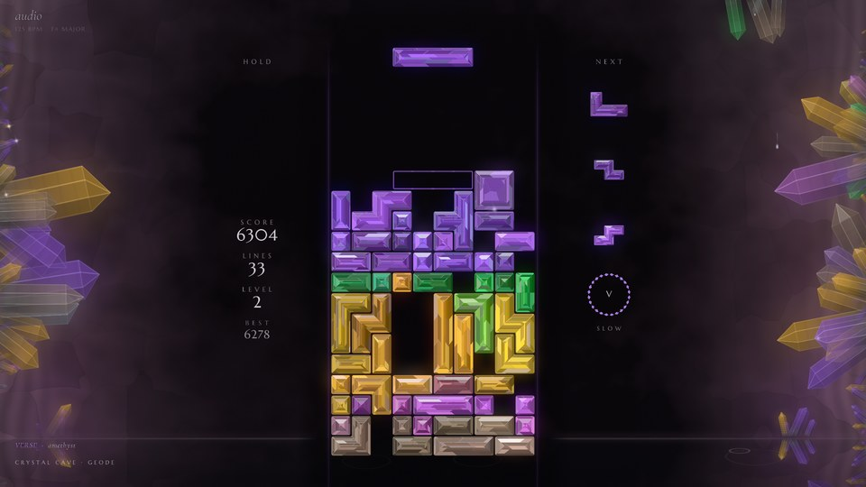

Gemstone pieces in a dark geode cave, each phase of the song cut from its own mineral, so the stack records the song's structure in strata (code in `src/universes/crystal/`). A flat view at the layout's scale with depth in the light: the cave's rock is near black, broken into large angular chunks that catch the light toward the walls (kept smooth and quiet behind the well and the HUD columns), with a thin banded agate shell at the far sides. Clusters of quartz points line both walls in the outer margins, a few hang from the vault on the right and a few stand on the far shore of a still pool along the bottom of the screen: hexagonal prisms with an off-axis point, milky at the root and clearer toward the tip, faces lit differently, fine growth striations, translucent bodies with bright edges, each softly glowing from within and lighting the rock around it. The pool mirrors the cave (the shore crystals, the falling water) and ripples. The pieces are cut gems: each piece one stone (its cells merged, a thin seam between stones), faceted over its whole outline like an emerald cut: concentric steps of facets that follow the outline and meet in sharp mitres at every corner (inner corners too), each side stepped on its own so the steps of neighbouring sides do not line up, each step broken by slanted cuts that zigzag from step to step, and wide parts of a stone get a table of irregular facets. As in a real gem, each facet mirrors another part of the stone: its brightness and its shade of the color are seeded per stone (the falling piece already has the cut it will lock with), from the deep, saturated body to the color lit through, with a slight turn of hue from facet to facet and, on rare facets, a spark of the complementary color; the core glows deep, a thin paler girdle catches the light on the lit side, crisp small highlights sit on the facets turned to the light, and there is only a faint bloom (no halo). The steps' spacing is the piece type's own; the ghost is a fine line of the mineral's light, the well two faint veins of it. The song chooses the mineral: calm, mid and peak each have one, and the drop a special one (GEODE: smoky quartz, amethyst, emerald, citrine). The falling piece and the previews are cut from the mineral of the moment and ease into the next one over a second or two when the phase changes (no snap); a stone keeps the color it locked in, so the stack grows in bands like an agate and a game played over the song shows calm, verse, drop and chorus as layers. A new section of the same level, or a level coming back later in the song (a second verse, a second drop), moves its mineral on to another of its three hand-picked tones, so two choruses stay apart in the stack. Within a mineral the seven piece types differ by a slight shade (a touch of hue, a value of their own) and the spacing of their facet steps. The cave's crystals echo the stack: each one takes a share of the minerals in it (and of the current one), changing slowly, so the walls fill with the song's colors. A calm part is a dim, still cave where a drop of water falls from a hanging crystal every four beats; mid lights the crystals more and the water drips every two beats; a peak lights the whole cave, two drops land together every two beats and the kicks make one cluster glow. Each drop gathers on its crystal's point, falls and lands on the beat with a small ring on the pool. The highs make crystals glint (a small star on a point, the edges lighting up) and now and then a gem's crown flashes softly, never the scene. The drop turns the mineral to the drop's stone for its first eight bars and lights the cave in it, the walls and crystals swelling in over a beat or two (two eased stages: no jump) and settling after; the peak's own mineral follows. A lock flashes the stone's crown and leaves a small star where it touched down; a hard drop knocks a few chips off at the contact. A cleared row shatters: its cells break into shards in their own colors that tumble down behind the stack, flashing as they turn, and fall into the pool, where they sink (the row is empty in under half a second, at the real speed even in slow motion). A quad rings every crystal of the cave, a ring of light running outward from the well. Slow motion stills the cave in a cold, silver light (the minerals drained, the water slowed). Game over puts the light out of the stack's stones row by row from the top, then each row crumbles into the pool; a stack inherited from another universe is cut in strata of the cave's minerals from the bottom up. It leaves and enters through the bridge (the cave fading, the stack in the bridge's ink). Five caves, each with its four minerals in three tones: GEODE (smoky quartz, amethyst, emerald, citrine), AMETHYST (a violet cave: celestite, amethyst, tourmaline, rose quartz; dark minor songs), ICE (a blue-black cave: rock crystal, aquamarine, sapphire, citrine; airy songs), EMBER (a warm cave: smoky topaz, amber, ruby, opal; heavy bass) and FLUORITE (a teal cave: green, purple, blue and yellow fluorite) (`--universe "crystal cave:ice"`). The HUD is set in pale crystal light over a dark halo, the section followed by the name of the mineral of the moment (`DROP · citrine`); the bonus gauge is a ring of small facets, charged in the mineral's light. Cost: one full-screen pass for the rock, about 150 instanced crystals, one pass for the pool, instanced gems and shards, a quarter-resolution bloom. Its fonts are Marcellus and Cormorant Garamond Italic (SIL Open Font License, `src/universes/crystal/OFL-*.txt`).

## ELECTRON

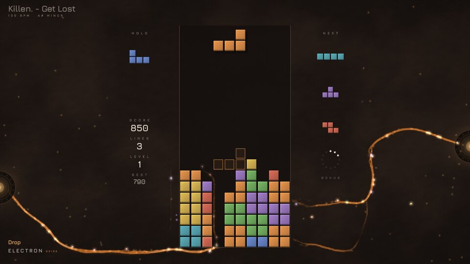

Solid cubes on a dark substrate, and charges wiring themselves to them, seen from above (code in `src/universes/electron/`; it was ANTS, made abstract). The substrate is a dark, softly textured slab (a slow mottling, faint fibres, a fine grain, a vignette); the well's panel stays calm and even. The pieces are plain solid cubes: a flat top with a narrow chamfer lit from the upper left, a shaded front wall, a soft contact shadow. Two terminals sit half off screen, one on each side: a dark plate with a ring of contact pads and a glowing core. The charges run the ant-colony model ANTS had, unchanged, and nothing is scripted: no charge knows where the cubes are. Each one feels two fields under three sensors ahead of it, and the cube right in front of it. Searching charges are faint short dashes in the circuit's colour; a charge that touches a cube throws a few sparks off the contact (a few contacts a second at most, many more in a drop), lights the cube's edges for a moment and carries a hot point of the cube's colour home, laying a field that weakens with distance. Both fields diffuse and evaporate. Each charge brought home calls others out, and the connections grow, straighten and branch differently on every run, drawn as glowing conductive traces with a hot filament along their ridge and a slow shimmer of current. A clear shatters the row's cubes into shards and bursts them into small glowing fragments with a few sparks (the row is gone at once); the fragments thrown out of the well wait to be fetched. A lock scatters the charges at the impact, and a hard drop sprays sparks out from under the piece. A drop pours charges out of both terminals, speeds them up, brightens the traces and the terminals' cores (a swell that settles), and turns the cubes vivid. Game over shatters the stack from the top. Four dark variants come from the song: **GRAPHITE** (blue-white current) and **VERDIGRIS** (mint) for bright songs, **OXIDE** (amber) and **PLASMA** (violet) for dark ones (`--universe "electron:oxide"`). The font is Jura (SIL Open Font License, `src/universes/electron/OFL-Jura.txt`).

## SWISS POSTER

A vintage travel poster in flat design, its landscape travelling by in parallax behind the well (code in `src/universes/swiss/`; no lettering on the poster). Flat shapes with crisp edges and a faint print grain, in seven depths: a flat sky gradient with a still sun and its pale halos and flat clouds in three bands; a far range of peaks in massifs and gaps, each face lit or in shade, snow above a jagged snow line with rock showing through in flat patches (lower glaciers on the high massifs); hero peaks (a snow horn, or a pale limestone tooth with cliff streaks and grass on its lower slopes); two nearer ranges in receding tones (the farther, the paler, a mist at their feet in the misty scenes); a lake with long glints and the sun's path on the water (everywhere in the lake scenes, in stretches elsewhere, its shore running back in perspective to a valley floor of fields); a meadow dotted with flowers and darker patches of grass; a foreground hill with big firs. The camera travels to the right, steadily and forever, each depth at its share of the travel (sky 3 %, far range 8 %, then 16, 26, 38, 60 and 100 % for the foreground): a slow drift when calm, a little faster at mid and peak, much faster in a drop, every change of speed eased. The scenery loops (each depth periodic: 120 to 140 units for the ranges, 384 for the meadow, 576 for the foreground, many screen widths) and changes as it goes: the meadow is a sequence of 16 stretches in an order of the song's own, blended into each other: a village of chalets and houses (gable fronts lit, long sides in shade, red roof slabs, windows, a church with a clock and a spire) among cypresses and firs with a winding path, a hamlet, a pasture and its hut, a forest, a valley with a river winding out of its floor, a valley spanned by a stone viaduct with a little train crossing now and then, a chapel on a hill with a zigzag road, a pass with its switchbacks. Everything casts a flat shadow away from the sun; the clouds drift band by band and the trees' tips sway in the wind. The well stands on a calm, nearly opaque paper panel with two side rules and a baseline; the hold and next previews sit on small paper plates, the host's bonus ring on a paper disc. The pieces are flat, crisp color blocks from the scene's palette (roofs, sky, meadow, path...): one clean shape per piece (its cells merge, a narrow gutter around it), the falling piece exactly a locked one, the ghost a fine outline. Calm is a hazier, softer light; mid and peak clear it and a peak warms it a little. The drop look holds only while the song plan's DROP section lasts (`music.inDrop`): the scene turns to the golden hour in about two seconds (and back over a few after): a peach and rose sky over a gold horizon, rosy-violet far ranges, mauve then amber nearer ones, pink-gold snow, warm walls and lit windows, an orange rim on the trees' sunny sides, a rim of light along the ridges, long flat shadows; the sun sinks low among the ranges, grows and throws strong flat rays, and a light sweeps across the layers on the drop's start. The travel speeds up to about four times the calm drift and the view pushes in, breathing over four bars (each depth scaled by its parallax share), eased in and out with the light; the clouds speed up, the pieces deepen, and flocks of birds cross the sky every two bars (a big flock rises from both sides on the downbeat). LAKE AT DUSK and WINTER MORNING warm to the same golden hour. A cleared row closes into a flat bar and slides out of the well sideways in 0.3 s while a small flock takes off from the meadow on one side and flies away outward (more birds for more lines); a hard drop leaves a thin rule at the contact. Slow motion stills the scene and cools its light. Game over slides the stack out row by row from the top. It leaves and enters through the bridge. Five posters: ALPINE VILLAGE (blue and white peaks, green meadow, red roofs, a church, cypresses), GRAND SOM (teal and green, misty ridges, a lake, a limestone peak, firs, a yellow path), AUTUMN VALLEY (ochre meadows, orange larches, brown chalets under the first snow) for bright songs; LAKE AT DUSK (indigo sky, rose snow, violet ranges, the sun on the lake, lit windows) and WINTER MORNING (snow everywhere, chalets under snowy roofs, a pink dawn) for dark minor ones (`--universe "swiss poster:grand som"`). Cost: one full-screen pass for the landscape, the board, plates and birds as instanced flat shapes. The HUD is the host's; in its own lettering (`REFALL_HUD=universe`) the font is Inter (Bold and Regular, SIL Open Font License, `src/universes/swiss/OFL-Inter.txt`).

## LIMBO

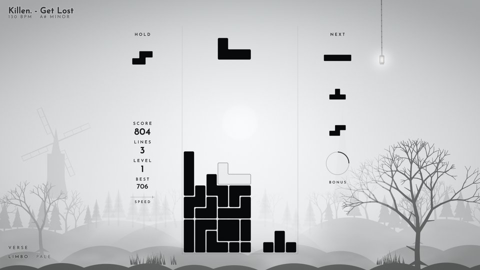

A monochrome world of silhouettes in fog (code in `src/universes/limbo/`). Layered planes of black shapes fade into a luminous grey fog: low hills and grass in front, a big bare tree, a lantern and gears hanging from above on the right, a mid ground of bare trees and fence posts, a forest edge of pines all along (every tree planted on the top of the hills of its own depth, never floating over a dip), distant towers, pylons, a water tower and a windmill far away. Each depth fades to the fog's own color at its pixel (brighter around the light, which also washes out what stands before it), and a drifting fog bank lies between each two depths, so the fog has real depth. A soft light sits low behind the well. The shapes stay faint behind the well, the HUD columns and the title (they fade out there rather than turning to fog in front of what is behind), so the stack and the lettering always stand on bright, quiet fog; a very fine grain (under a step of value: no visible dots) and a soft vignette finish the frame. The pieces are flat deep black silhouettes with sharp edges (no rim, no color): one shape per piece (its cells merged, a thin gap from the others); the falling piece is the same silhouette, the ghost a faint shadow with a firmer outline, the previews small silhouettes. The well is two faint posts and a floor line in the fog. **The world fills up with the play**: each cleared row adds one thing to the landscape for good, in a varied order (a bird glides in and lands on a branch, grass comes up, a tree grows, a distant tower or windmill rises out of the fog, a lantern is lit, a fence post, a gear on a chain...), 48 in all, so the world at the end of a song is much richer than at its start (a new game takes them back). Calm: a thick fog (the far planes gone, the nearest shapes dark, a dim diffuse light, a slow breeze); mid: the fog thins (the forest edge and the towers come through), the trees, grass, ropes and lanterns sway on the beat grid (one side, then the other, every two beats) and the gears turn a notch every two beats; peak: the fog opens (the far planes clear, a brighter light and a soft disk, the banks drifting faster, the windmill turning faster), and the kicks brighten the lanterns (local lights only). The drop tears the fog open, eased in over a beat or two (no jump): the fog banks part from the middle and roll away to the sides, the fog thins to almost nothing, **the whole scene turns to negative** (a quick flip on the downbeat, the lettering with it; the pieces turn white on a dark fog; only while the song plan's DROP section lasts, never on a chorus's peak, easing back to the positive over about a second as the drop ends), and the light sinks into a big low sun setting behind the well; light shafts (the bright fog smeared toward the sun, occluded by every silhouette, sweeping slowly, never over the stack) fan out through the trees, the silhouettes facing the sun catch a rim of light, a gust bends the trees outward and tears leaves off the big tree, a flock of forty birds takes off from the forest on both sides, every lantern brightens, the gears spin and the windmills turn faster. Black silhouettes pass through the side areas and the sky, calm, on the beat grid (a wing stroke or a stride every two beats), never over the well or the lettering: herons gliding up and out across the side skies at varied sizes and depths (a new one or a few crows every two bars), a far train with its smoke crossing the plain, a balloon rising on the right. The look holds for the whole peak (or 16 s for a drop called outside a peak), then the scene flips back and the fog closes in slowly over several seconds. A cleared row dissolves into the fog: its edges erode into mist (gone in under 0.4 s, at the real speed even in slow motion, behind the rows that settle over it) while a few dark motes drift up; a hard drop pushes a breath of mist out from under the piece. A quad sends a flock up from the forest edge, flying off slowly, and warms the light for a moment. Slow motion is a still, moonlit fog (cold, colorless, the world slowed); game over dissolves the stack from the top down while the fog closes in. It leaves and enters through the bridge (the fog fading to the bridge's color, the stack in its ink). Six moods, each with its own fog, light, lantern light and seven rim tints: ASH (neutral grey, a white light), DUSK (a hint of warm grey), MOOR (cool blue-grey), DEEP (a dark fog, a single faint light behind the well, pale lettering), EMBER (grey fog, the light alone in color: a low red sun and red lanterns) and PALE (high key, graphic black) (`--universe limbo:moor`). Cost: one full-resolution float target and a quarter-resolution one for the light shafts, the sky and three fog banks full-screen passes, the silhouettes a few thousand instanced primitives (tapered branches, discs, boxes, gears, triangles) rebuilt every frame. The HUD is quiet lettering with a soft halo of the fog; the bonus gauge a fine ring, charged in the accent. Its fonts are Lato Regular (labels, numbers) and EB Garamond Italic (the song, the section, the celebrations) (SIL Open Font License, `src/universes/limbo/OFL-Lato.txt`, `src/universes/limbo/OFL-EBGaramond.txt`).

## NEON

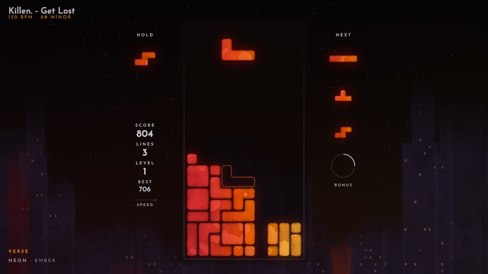

Luminous watercolor shapes over a painted night skyline (code in `src/universes/neon/`). A near-black night with faint stars, dust and a fine grain; low along the bottom of the screen, behind and beside the well, a city skyline painted in dark, translucent watercolor washes: generic towers, setbacks, domes, spires and slanted roofs overlapping and bleeding into each other, their edges ragged, their tops growing wetter and dissolving into the night. Everything takes its color from one spectrum swept across the screen from left to right (five stops interpolated in OKLab, so the colors stay clean): the city in deep, dark tones of it (dark yellows turn to warm browns), the pieces in its full glow. The well is a dark veil over the city with two faint posts and a floor line. The pieces are chunky, rounded shapes, one per piece (its cells merged, round outer corners and filleted inner ones computed across the cells so no seam shows, a thin dark gap from the others), each filled with a glowing wash: cloudy wet-in-wet blotches, blooms with ragged darker fringes, granulation, the pigment pooled into a darker dried rim and toward the bottom, luminous where it is thin, a soft glow around it (no relief). A piece's color is the spectrum at its place in the well, so the stack reads as one teal, violet, magenta, orange and gold sweep; each piece has its own wash, fixed for good when it locks (nothing swims), and a slight nuance of its own (brightness, a shift along the spectrum), so neighbours of a similar color still part. The song's sections move the spectrum (it slides sideways by a step and its hue turns a little, the drop its own way), the falling piece easing into the new colors; a piece keeps the colors it locked in, so the stack keeps strata of the song's sections. The falling piece is exactly a locked one at its place, the ghost a thin line of its outline, the previews washes in the colors of the well's middle. **The city grows with the lines**: a new song starts with only a dark ghost of a city; each cleared row's pigment lifts off (the row is empty in a quarter of a second, the thinnest pigment first, at the real speed even in slow motion) and drifts out behind the stack as soft washes of its colors that float down to the skyline and paint a building in, from its foot up, a wet tide rising, in the colors of the section it was painted in; once every slot is painted, new lines re-tint the oldest ones, and the back row of ghosts takes color too. A quad paints a whole block of four neighbouring buildings at once. A hard drop pushes a small breath of pigment out from under the piece. Calm: a dark, quiet city with a few lit windows; mid: windows light up and go out on the beat grid (each eased in and out over a beat, every 4, 8 or 16 beats, never flashing) and the stars twinkle slowly; peak: a richer glow, more windows, colored mist rising slowly behind the skyline, the kicks lighting a few windows. The drop, eased in over two beats, washes the whole skyline in the luminous spectrum with a glow over the city, then settles back over the following bars. Slow motion is a deep, desaturated night; game over lets the stack's pigment run down in drips and fade, from the top. It leaves and enters through the bridge (the world fading to the bridge's color, the stack in its ink). Five nights, each its own spectrum and sky: NOCTURNE (teal, blue-violet, magenta, orange, gold), AURORA (greens to blues to violet), EMBER (crimson to gold), TIDE (navy to cyan to mint) and ROSEWATER (rose violet to pink to peach), from the mode, brightness, bass, air and the key (`--universe neon:tide`). The bonus gauge is a fine pale ring charged in the spectrum. Cost: one full-screen pass for the sky, the skyline as a few dozen instanced quads, the pieces one instanced quad per cell, a quarter-resolution glow. Its HUD is pale grey, widely letter-spaced Marcellus capitals with Cormorant Garamond Italic for the song and the notices (SIL Open Font License, `src/universes/neon/OFL-Marcellus.txt`, `src/universes/neon/OFL-CormorantGaramond.txt`).

## RIPPLES (disabled)

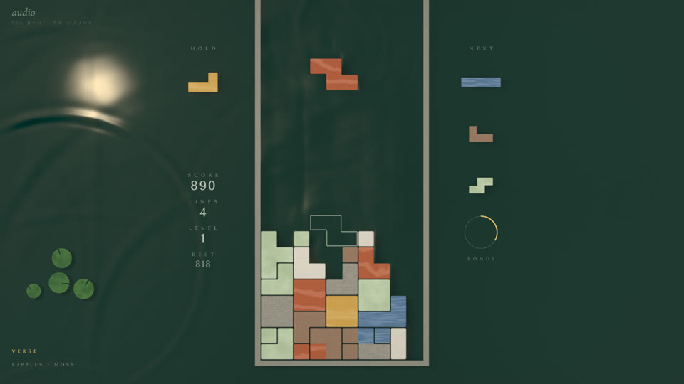

Left out of the default build for now (`-DREFALL_DISABLED_UNIVERSES=""` builds it). Cut stone blocks resting in still water, seen straight from above (code in `src/universes/ripples/`). One world: a quiet pond lit by one light that the water reflects (a soft glint of the sun or the moon on the surface, its halo kept small), the bed seen through the water in a smooth, barely varying tone; a slim honed stone kerb draws the well as a long basin in the pond, open at the top. The pieces are cut stone blocks, one block per piece (its cells merged, crisp slightly rounded corners, a thin dark joint between two pieces, a fine chamfer lit on the light's side and a darker hairline on the other, a faint polish reflecting the sky and the light), their soft shadows falling on the bed through the water, so the stack reads as solid blocks standing in it. Each piece type is its own stone, its grain continuous across the piece and fixed when it lands: slate with fine cleft lines (I), granite with a fine grain (O), marble with thin veins (T), cloudy jade (S), banded jasper (Z), dense basalt (J), travertine with soft bands and pores (L). The falling piece is exactly a locked one at its place, the ghost a fine pale outline on the water, the previews small stones resting on the outer pond. **The water is a real height field**: a wave equation on the GPU at twelve texels per cell (a 9-point isotropic Laplacian, about 3 cells per second, slow damping, the stones and the kerb as walls that reflect the waves; the grid-scale part of the velocity is damped so no grid shows, and the water is damped a little more at the foot of the stones so it never rings between them). Every motion disturbs it, always with a zero-volume impulse so the rings stay fine and no broad swell follows them: the falling stone sliding sideways pushes a small bow wave and leaves a trough behind, falling it trails a faint V-shaped wake from its ends, a rotation stirs a soft ring around its new outline, a lock settles with a small ring at its foot, a hard drop sends one clear ring from the contact and fine troughs along the way it slid; the rings cross, reflect off the stack and the kerb and die away over a few seconds. The surface is shaded from its slope: the sky and the light reflected through a virtual eye above the pond, a fine bright line where a slope faces the light and a slightly darker side away from it (the rings read in relief, lit from one side), the bed refracted under them with faint caustics, the stones' shadows and a slight darkening at their foot. A cleared row's stones **sink**: they darken into the water's color and shrink a little as they go down, gone in a third of a second (at the real speed even in slow motion), while the water closes over them in a line of fine waves that runs up the well from the stack's top and out into the pond from the kerb. **The pond fills up over the song**: each cleared row opens a lily pad on the outer pond (it surfaces with a small ring and unfurls), the pads growing in clusters away from the HUD, a quad a white lotus flower that opens slowly (glowing faintly at night); they tilt with the passing ripples and stay for the song (a new song lets them fade). Calm: still water, nothing moves but the game's own ripples, a single drop every few bars. Mid: a drop of rain on the outer pond now and then, on the bar. Peak: a steady fine breeze ruffles the outer pond (the basin stays sheltered and calm), a drop falls every other beat and on the kicks, the light a little stronger. The drop is a gust of wind: drifting patches of fine, irregular ripples (cat's paws) cross the whole pond, glittering in the light's glint, the light swells once, a few more drops fall, and it settles over the following bars. A quad sends three perfect fine rings from the board over the whole pond. Slow motion is night: the light turns to a cold moon, the water deepens to navy, the stones cool a little (dark ones lifted so the stack still reads) and the waves crawl at a third of their speed. Game over sinks the stack row by row from the top, each row closing in a ring. It leaves and enters with the water settling still and the world fading to the bridge, the stack in its ink. Six ponds, each its own water, light, kerb and seven stones: MORNING (pale grey-green water, a soft white sun, deep clean stones), MOONLIGHT (ink-blue water, a cold moon, pale silvery stones), MOSS (a deep green temple pond, warm afternoon light, earthy granites and rust), DUSK (dark water holding a warm low sun, rosy and lavender stones), FROST (white winter water, ink-dark lacquered stones) and CANDLELIGHT (black lacquer water, a warm lantern glow, ivory, amber and celadon stones), from the mode, brightness, air, bass, dynamics and the key (`--universe ripples:frost`). Cost: the water is 12 texels per cell (about 500 × 290 at 16:9), one to four steps a frame (at most four, 72 steps per second of the world's time), its obstacle mask drawn as anti-aliased rectangles (a sideways jump of the falling stone sweeps it smoothly), one full-screen pass for the surface, one instanced quad per cell and per pad, a quarter-resolution glow. The HUD is quiet lettering with a soft halo of the water; the bonus gauge a fine ring charged in the accent. Its fonts are Tenor Sans (labels, numbers) and Cormorant Garamond Italic (the song, the notices) (SIL Open Font License, `src/universes/ripples/OFL-TenorSans.txt`, `src/universes/ripples/OFL-CormorantGaramond.txt`).

## MICROSCOPE (disabled)

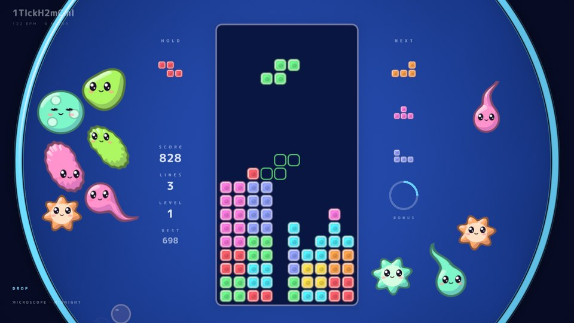

The whole screen is a microscope's field of view, in the soft look of a micrograph (code in `src/universes/microscope/`). No eyepiece: a pale, softly vignetted field of light, a little uneven, a haze of things out of focus drifting through, small round cells and bubbles ringed by phase-contrast halos and fine debris floating in the medium (kept out of the well, thinned behind the HUD). The well is a counting chamber: its walls and floor etched in pairs of fine lines, a faint ruling of one line per row and column. **The pieces are living tissue**: each block one translucent cell of stained cytoplasm (denser along its walls, finely mottled, a pale line of light just inside them) in a darker membrane that breathes a little, with its nucleus, a pale phase halo around it; the four cells of a piece are one colony, joined by thin walls inside one outer membrane (a colony split by a cleared row becomes two; a stack inherited from another universe joins its cells by type). The seven types are seven stains, each with its own inner life: a vacuole (I), refractile starch grains (O), a big nucleus (T), chloroplasts along the wall (S), two nuclei (Z), dense granules (J), a large vacuole pushing the nucleus aside (L). The falling piece is exactly a locked one, the ghost the colony's membrane alone, the previews the same colonies. **A few organisms wander** calmly on the sides, each on its own side and at its own depth, steering clear of the well, the HUD's columns and the corner lines: a large paramecium (a slipper fringed with fine cilia beating in waves, its macronucleus and vacuoles; it backs up and turns away when it bumps into something), a smaller one, an amoeba reaching out with its pseudopods, a pennate and a centric diatom, a volvox rolling slowly. The focal plane drifts and refocuses at each new section, so some are soft. A cleared row's cells burst at once, each scattering into a spray of granules of its stain, flung out and fading; a hard drop pushes a few granules out from under the piece. Calm is a still, dimmer field and slow life; mid beats the cilia on the beat grid (every two beats); a peak brightens the lamp, the kicks flicking the cilia and making the paramecia dart. **A DROP section** (music.inDrop only) switches to the variant's second illumination, sweeping out from the well over the field like a dark-field stop swinging in (and back out when it ends): light on black, the membranes and nuclei glowing, one swell of light, the organisms swimming faster. Game over kills the tissue from the top (plasmolysis: each protoplast shrinks from its membrane, its stain drains to grey, it fades). Around a song the lamp warms up from a dim orange glow while the slide comes into focus (setup), and the slide goes out of focus as the lamp goes down (teardown). Four variants: BRIGHTFIELD (a pale even field, pastel stains; drop: dark-field), PHASE (the grey-teal field and bright halos of phase contrast; drop: fluorescence, GFP-green life and DAPI-blue nuclei), DARKFIELD (light scattered on black; drop: fluorescence) and GIEMSA (azure, eosin and purples on a pale lilac field; drop: dark-field), dark songs in dark-field, the others by the key's hue and mode (`--universe microscope:phase`). The HUD is lettered by the host in a deep slate or a pale ink of the variant, its accent the stain's; its own lettering (REFALL_HUD=universe) is Lato and EB Garamond Italic (SIL Open Font License, `src/universes/microscope/OFL-*.txt`). Cost: one full-screen pass for the field, one instanced quad per organism and per cell, a quarter-resolution blur (the dark-field glow, the focus).

## SPECIMEN (disabled)

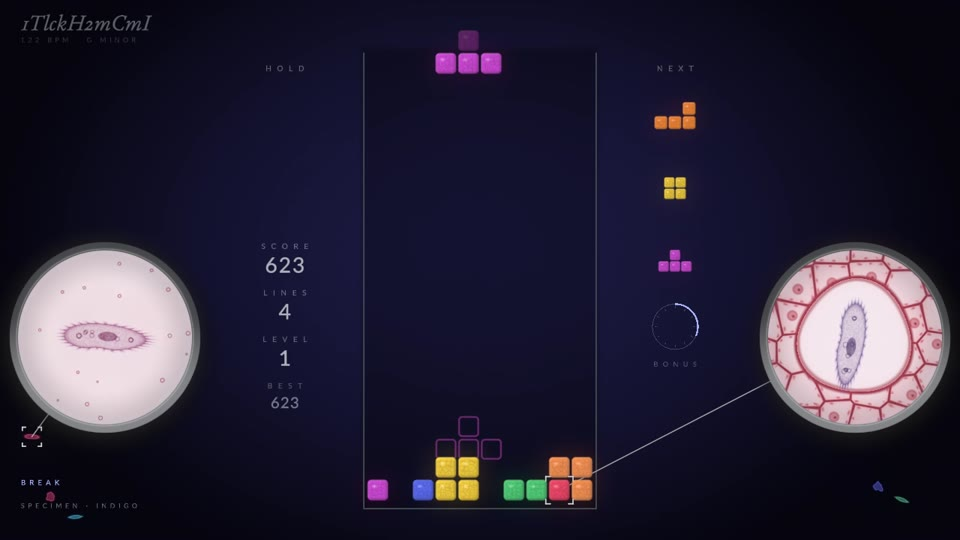

Plump lumps of living tissue on a dark bench, and on each side a loupe looking into one of them (code in `src/universes/specimen/`; born from MICROSCOPE, whose organisms it keeps). A dark, damp bench under one soft lamp, its surface faintly mottled; the well a darker backing, its walls fine pale lines. The pieces are lumps of tissue: each block a plump, glossy rounded cube in a saturated dye, lit from the top left, its fine cells showing faintly through the skin; the ghost a faint outline. **The loupes**: on each side, in the band beyond the HUD's column, a round loupe in a dark bezel looks into one block of its half of the stack (rather one with life in it, on the surface), joined to it by a fine line, four corner brackets around the block: in it the block's tissue magnified in bright-field (cells in the block's dye, nuclei, plastids streaming slowly along the walls, the slide drifting), and when the block has an organism (about one in five), a clear pool in the middle where it lives, in full detail (paramecium, amoeba, pennate and centric diatoms, rotifer, volvox). A loupe stays about twelve seconds on a block, its view fading to a blank slide and back as it moves to another; it glides calmly to its block's height. **A cleared row** bursts (its lumps round off and fade in a third of a second) and frees its organisms: tiny creatures glowing in their cell's dye, they crawl out of the well and off the screen by the nearer side in a crawling pulse, and the loupe of that side follows one out (the creature magnified at its center, crawling over the bare bench, a wet film with fine debris sliding by), then goes back to the blocks. The song: calm is a dimmer bench and slow life, mid beats the cilia on the beat grid, a peak brightens the lamp and the kicks flick the cilia; the drop washes in the variant's second set of dyes, soaking unevenly into the tissue and the loupes, with one swell of light. Slow motion drains the dyes to silver; game over shrinks, drains and fades the lumps from the top. Five variants, by the bench: TEAL, INDIGO, MOSS, OXBLOOD and GRAPHITE, each with its own dyes and the stain of its loupes' slides.

## SONAR

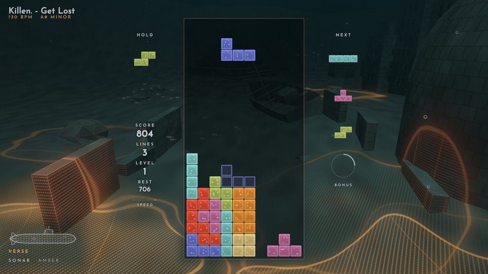

A dark sea where shapes surface from the black when an echo returns from them (code in `src/universes/sonar/`). Deep water, near black with a breath of light far above, and nothing to see in it until an echo comes back. Down there is a true 3D world (`scene.cpp`: one static mesh drawn in perspective with a depth buffer): a seabed of long dunes, rocks, a wreck lying on its side and a sunken city, and the camera glides through it behind the well along a closed loop, down a colonnade, under an arch and a broken arch, past a tower, an obelisk, a dome on its drum, low ruins and fallen columns, over the wreck, past a stepped pyramid, along a street of towers and a round temple, the city's heart of taller towers and a great dome seen across the water. The glide is slow and calm (about 0.8 units a second), a little livelier from a chorus on. Unlit, the nearer shapes only stand out as darker than the water. The pings run on the beat grid (every four beats in calm parts, every two from a chorus on), each one around a single point in view on one side of the well (a point of the seabed, a rock, the wreck, a building): never a rotating beam, never a wave across the screen, and the scene's light never pulses. The surfaces around that point that face it glow up softly in the variant's echo color, every polygon's edges as fine lines of light (the hull's ribs and strakes, the columns' flutes, the dome's grid, the pyramid's courses, dark window openings), and fade back over a second or two, a few particles drifting in the water glinting only where the echo passes (the faintest of them show the glide). The well, the lettering's columns and the bottom-left corner keep a quieter, darker ground. The pieces are solid blocks, one cube per cell (a deep face lit from within, brighter toward its top, a crisp luminous edge), crisp with no glow around them (the glow pass takes the world only), each of the seven types its own clean color; the falling piece is exactly a locked block, the ghost the blocks' faint edges. **The chart grows with the lines**: a cleared row's blocks sink into the dark (down and out in 0.4 s, at the real speed even in slow motion) and their light sinks on, as one point, out of the well and down to a spot of the seabed in view (after the first few, now and then a building or the wreck), following it as the camera glides on; that spot stays charted for the rest of the song: its edges faintly lit for good, the seabed's depth contours drawn there, found again on the next lap of the loop. A new song (or a new game) lets the chart fade. A quad charts four spots at once and lets the whole city glow up for a few seconds. A lock flashes the blocks briefly; a hard drop leaves a faint glint of light at the contact. Calm: the dark sea, the slow glide and a slow ping now and then on the seabed; mid: a ping every two beats, the wreck and the city among them; peak: both sides at once, mostly the city, which glows faintly out of the black for the whole peak, its windows lit by the kicks, and the glide quickens a little. **The drop**, eased in over two beats, raises the whole sunken world out of the dark in the drop's own echo color (TRENCH's teal turns violet, AMBER's red, ICE's mint...), mostly as lines (the edges, the seabed's contours) over faint faces, and the glide surges to about twice the peak's pace (up to ~2.9 units a second): the speed follows its target through a critically damped spring, so it eases up over two or three seconds and back down with no jerk, and the camera only ever integrates it along the loop (never a jump). Both settle back over the following bars. Slow motion is silent running: the echoes linger, pings every four beats, the glide slows with the world's clock, the world drawn toward one cold light (the blocks keep their colors). Game over sinks the stack into the dark from the top, the chart fades and the glide drifts to a halt. It leaves and enters through the bridge (the sea fading to the bridge's color, the stack in its ink; the stack never moves: only the world behind it has a camera of its own). Six seas, each its own echo, city echo, drop echo and seven block colors: TRENCH (teal), AMBER (a warm side-scan amber), ICE (pale blue-white, pastel blocks), VIOLET (jewel blocks; dark minor songs), JADE (green) and CORAL (rose), from the mode, brightness, bass, air and key (`--universe sonar:amber`). Cost: a mesh of ~120k triangles at full resolution (8 pings and up to 64 charted spots per fragment), 1600 point particles, the blocks one instanced quad per cell, a quarter-resolution glow of the world. The HUD is pale, widely spaced Tenor Sans capitals with Cormorant Garamond Italic for the song and the notices; the bonus gauge a fine ring charged in the echo's color (SIL Open Font License, `src/universes/sonar/OFL-TenorSans.txt`, `src/universes/sonar/OFL-CormorantGaramond.txt`).

## GLOWING FOREST

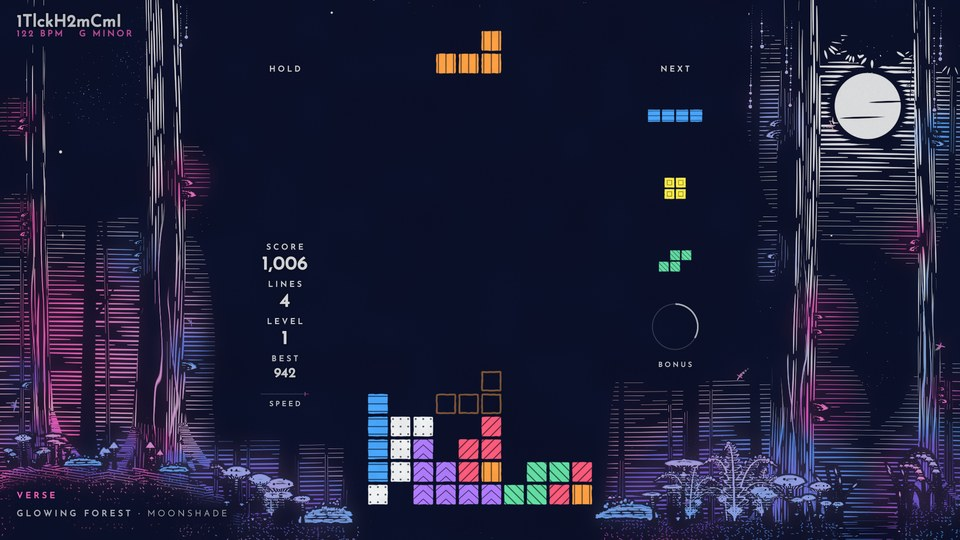

A night forest as a hand-carved relief print with fluorescent inks (code in `src/universes/forest/`, `--universe forest`), complete from the first frame. The whole frame is a key block of black ink on paper, its detail cut away with a gouge, and every cut is shading: a cut swells where the light is, thins to a point and stops where it fades (never a hairline haze), the cuts run together where it is brightest, and large areas stay solid ink. The sky is solid night cut in long horizontal strokes that thicken toward a moon cut out of the block (bare paper in a ring of solid ink, two strokes of cloud left across it, high on the right in the widest gap between the near trunks; in a narrow view the trunks step aside for it) and low in the forest, a few stars nicked where it is dark; a far glade glows low on the left between the trunks, under the title. Three depths of far trunks stand against it in vertical strokes, the farther the more carved away (the forest recedes by carving, not by grey); in front, the big trees (three on the left, three on the right around the moon) are solid ink with bark cut along them, their edges and their bare crowns forking into twigs cut in white lines, the same strokes the drop lights in neon; the canopy hangs over the top in black masses whose edges are cut into fans of leaves where the moon catches them, vines at the sides; the near trunks frame the view, solid ink with a few long strokes along the bark's ridges, a broad lit edge on the moon's side, the light low on the side facing the well, buttress roots and glowing veins cut up them. The floor is solid ink nicked with U-gouge dabs where the light falls, black grass tufts against the light, patches of glowing moss, stones with contour cuts, a large rock in the bottom-left corner (the section and the universe's name on its solid face, its top cut in facets) and, when there is room, a pool on the right whose surface is cut in long strokes as wide as the print above it is light. The well, the HUD's columns and every line of the HUD's text (from `Frame::hudBoxes`) sit on solid, uncut ink, the cuts thinning out toward them.

Everything that glows is printed in two fluorescent spot inks rolled under the key, showing only where it is cut: low in the forest and in the glade the cuts open onto them in long soft bands (the life's light in the air, in banks drifting slowly). The life is placed among the trunks and stays: large clusters of mushrooms of one form each (domed and spotted, conical bells, flat parasols; gills under the wide caps, a ring on the tall stems, pins at their feet), slender mycena, big ferns, saplings with branching tops, arching stems of bell flowers, reeds with seed heads, cushions of moss, on the floor beside the well (low there and under the HUD's columns, tall out at the sides, a smaller row behind), on the rock's top and the pool's banks; bracket fungi stacked up the near trunks (high on the left, under the title); glowworm threads beaded with light hanging from the canopy (never across the moon or the title). Each plant is cut bare and inked, its bright parts solid, its body shaded by cuts across it, a margin of uncut key around it so that its shape stands out of the light; the light it gives widens the cuts all around it (the sky's, the trunks', the floor's) and rolls its ink under them. Everything that stands sways in a slow breeze, the big trees too (their crowns bending more the higher up they are). The print is pulled with its artefacts: the two glow plates a couple of pixels out of register, the key's carved edges pressed into the paper (a shadow along one side of every cut), its solids starved here and there by a light roller, the paper's tooth and fibres, and a faint fluorescent glow the inks give off into the dark. A new song in the same forest only changes its inks.

The blocks are neon tubes, in and out of drops: each cell a rounded square whose rim is a bright line in its type's color (a near-white core, a tight glow just outside), its inside dark and faintly tinted, the type's pattern drawn in it in thin neon lines (I rows, O a square within, T chevrons, S and Z diagonals both ways, J dots, L columns); a small gap between cells; the falling piece is exactly a locked one, the ghost the same tube unlit, the previews the same cells, smaller. Each print has its seven colors (I a blue, O a yellow, T a violet, S a green, Z a red, J white, L an orange). A cleared row flares white and goes out in strokes where it stands in a quarter of a second (real time, even in slow motion), nothing leaving the well; a hard drop knocks a few chips out from under the piece. On the black of the print outside drops they read as lights in the night forest.

The song: calm is a quiet but living print, the plants' light short and the fluorescence restrained, breathing slowly with the song's energy and bass (a bar-long swell, never on the beat): the mist banks drift, a few shafts of moonlight fall from the moon through the trees and shift slowly, pollen drifts low in the light, moths flutter in loops around the glowing plants (cut in ink, wings beating), a few fireflies (small sparks cut in ink, a dotted trail of nicks), none of it over the well or the HUD; mid lights a quarter of the plants every two beats in turn (the cuts around them widening, local and eased), more fireflies; a peak widens the light (a steady level), the pulses swell with the bass, a kick lights a single plant, spores rise. **The drop turns the forest to neon**: on its downbeat a wave runs out from the well at a walking pace and, as it passes, the print gives way to a clean navy night where the same forest is drawn in neon tubes (a near-white core, the saturated color, a soft glow): the big trees' trunks and limbs as two edge tubes around a dark tinted inside, their limbs leaving at an angle and curving up, forking into ever thinner twigs, most of them in the crown, each crown kept within its tree's strip (the edge ones leafy), each tree in the neon of its place on a gradient from the HUD's column out to the edge (HONEYCAP: blue, violet, magenta on the left; cyan, green, lime on the right), the moon a ring in a neon of its own (violet on HONEYCAP) with strokes of cloud, a dense band of life on the floor (clusters of mushrooms of varied sizes in warm and coral neons with glowing spots, coral bushes beaded with light, fern fans; the trees' feet fade into the ground), young firs in line art, a path of steps climbing the far right, drifting dots, a violet aura behind the left's trees, a warm and a green glow on the ground with a field of glowing specks, neon tubes up the well's sides. The neon forest plays with the music for the whole drop, energetic but never stroboscopic (no full-screen flash, the board never washed out): every beat swells the tubes (the kicks the most) and lights the next band of the floor's life out from the well, so the plants light up in sequence bar after bar; every kick (two beats) sends a wave of light out from the well's foot, along the floor and up the trunks and crowns (the trunks' insides glowing as it climbs, the ground's glow and its specks flaring under it, a softer pulse up the well's tubes) and bursts neon spores out of a few plants; the backbeat (the snare) makes a few of the trees and plants flicker like neon; the colors cycle through the drop's palette (each tree sliding along its side's gradient, the mushrooms swapping warm and coral, once around in sixteen beats, from the forest's own gradient on the downbeat); fireflies drift in neon. It goes out over a few seconds after the drop, the print coming back; the HUD's columns and text stay dark. The stack, the pieces and the HUD stay in register and unlit. A quad makes the whole forest flare and breathe out spores. Slow motion prints both glow inks in one cold ink, the plates in register; game over drains the stack's ink to the paper from the top, the roller then inking it over in black. Before a song the print is pulled: the key's cuts first, white on the black, then the glow inks roll in and the plants are cut in and lit one by one; after it the light goes out plant by plant and the sheet sinks into the dark. It leaves and enters through the bridge. Five prints, each with its paper, key, inks, drop ink, neon gradients and blocks: FOXFIRE (chartreuse and cyan on black, the drop in pink), MOONSHADE (cyan and pink on an indigo key, the drop in yellow), HONEYCAP (yellow and orange on a warm black, the drop in blue), SPOREBLOOM (pink and lemon on a plum black, the drop in cyan) and VERDIGRIS (green and teal on a verdigris black, the drop in pink), from the mode, brightness, bass, air and the key (`--universe forest:verdigris`). Cost: one full-screen pass for the key block, a quarter-resolution field of the plants' light, two instanced quads per plant (its margin, then itself), one per firefly, moth, pollen grain, spore and cell, a quarter-resolution fluorescence, the forest's strokes (carved in the plates, and on the drop drawn once more as neon in a full-resolution target), and the print in the final pass (about 0.5 ms a frame at 1600x900, 0.56 ms at 1080p calm and 0.59 ms through a drop, on an RTX 4090; the painted forest it replaced took about 0.54 ms at 1600x900). Its HUD is pale, widely spaced Cormorant Garamond Medium capitals in the paper's white with EB Garamond Italic for the song and the notices (SIL Open Font License, `src/universes/forest/OFL-CormorantGaramond.txt`, `src/universes/forest/OFL-EBGaramond.txt`).

## DOCKS

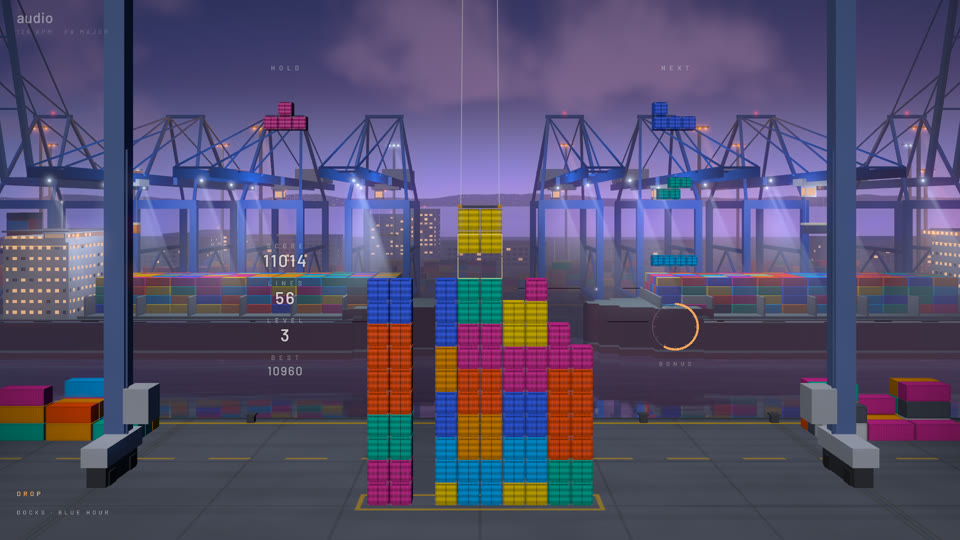

A container port at dusk or by night, in 3D (code in `src/universes/docks/`, `--universe docks`). We stand on a quay under a gantry crane whose legs frame the screen; the well is a bay painted on the concrete where containers are stacked. Across a wide basin, two container ships lie at the far quay bow to bow (dark hulls with their red bottoms, white deck houses with lit windows out at the screen's edges, funnels banded in their line's color, lashing bridges, cargo stacked in bays) under six ship-to-shore cranes working them (portal legs, A-frames, stays, booms over the decks, trolleys with their cabs and spreaders, red beacons) and two idle ones with their booms raised; behind them the terminal's yard of stacked boxes, its lamp masts, sheds and offices with lit windows, and beyond, the far shore's hills with the town's lights under the sky of the hour (its gradient, the sun's glow at the horizon, thin clouds, stars and a moon by night). The basin mirrors everything (a half-resolution reflection pass, rippled into long streaks of light), the haze softens the distance; nothing near the well is hazed.

The pieces are shipping containers, one per cell: crisp steel cubes with corner posts and castings, corrugated walls and their doors facing us (two leaves, four locking rods, horizontal panels), each of the seven types a clean color of the variant. **The falling piece hangs from the gantry**: a slim graphite lifting beam with yellow twistlock housings rests on the piece's top, a hanger reaching down to each lower column, hairline cables running up out of frame to the trolley; it follows the piece exactly (moves, rotations, soft and hard drops) and lets go on the lock, rising away. The ghost is a thin outline; the previews are the same containers. **A cleared row is taken by other cranes**: its containers are lifted swiftly back out of the well on their own cables (up and back in 0.4 s, at the real speed even in slow motion), then carried across the basin, their cables taken up to the cranes' booms, and set down on the ships' decks (the left half on the left ship, the right half on the right one), where they turn into the deck's boxes. **The ships fill up over the song**, bay after bay from their deck houses toward the bows; a full ship casts off and leaves (one at a time), an empty one comes in to the berth.

The song: calm is a quiet port at rest (thicker haze, few lamps, dim floods, the cranes mostly idle); mid wakes it up (more masts lit, the cranes working a step of their cycle on the two-beat grid, faint light cones under the floods); a peak lights every mast, the cranes work faster, their beacons blink on the grid and the kicks spark their trolleys' lamps. **The drop switches the port to full light**: the masts come on in a sequence from the well outward with a swell, cones of light pour from the crane floods and the masts into the haze, the colors deepen and the sky glows, settling over the following bars. A quad flashes the lamps in a wave and lights the ships' decks. Slow motion is a sea fog rolling in (the lamps haloed, the port cooled, time stretched); game over lifts the stack away container by container from the top. It leaves and enters through the bridge. Six hours, each with its own sky, lamps, crane paint, hulls and seven container colors: SODIUM DUSK (an orange horizon, white and red cranes), BLUE HOUR (cobalt, blue cranes), NIGHT SHIFT (stars and a moon, yellow cranes, LED floods), DAWN (lilac to peach, the morning mist, red cranes), NORTH SEA (a grey-teal night, green cranes) and AFTERGLOW (violet and magenta), from the mode, brightness, bass, air and key (`--universe docks:"night shift"`). Cost: instanced boxes for everything solid (a static buffer for the port, a few thousand dynamic ones), one multisampled pass, a half-resolution reflection pass, screen-space hairline cables, additive lamp sprites and light cones, a quarter-resolution glow. The HUD is Barlow, spaced capitals like stencilled markings, the bonus gauge a fine dial ring charged in sodium amber (SIL Open Font License, `src/universes/docks/OFL-Barlow.txt`).

## BAUHAUS

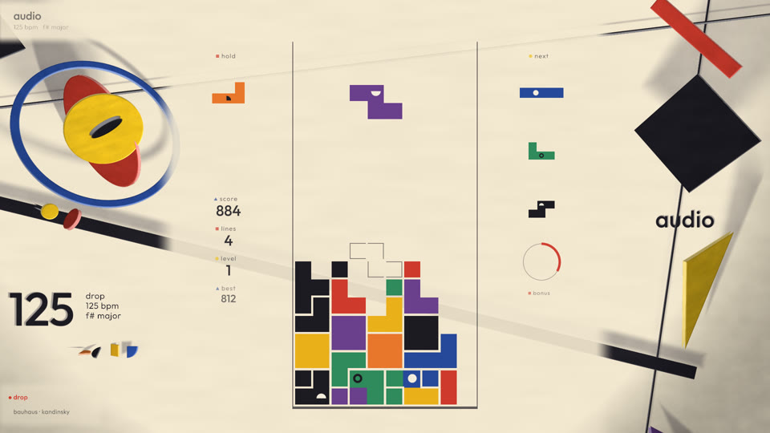

A Bauhaus poster in the spirit of Bayer, Schmidt, Kandinsky, Moholy-Nagy and Albers, recomposed by the song (code in `src/universes/bauhaus/`, `--universe bauhaus`). The sheet is paper (a fine grain, long soft fibers) carrying a strict, balanced composition of geometric forms in the primaries and black, each **cut out of thick colored paper and laid on the sheet in relief**: every form is a card at its own height, with a soft shadow cast by a far sun from the upper left (wider and softer the higher the card, a faint contact shade under it), a thin bevel along its cut edge lit on the light's side and shaded on the other, and its own faint paper texture; a form over another casts its shadow on it, so the layers read as layered paper (the long bar over the circle, the triangle over the bar, the dots on top, the rings of a Kandinsky circle and the nested squares of an Albers each a card on the one before). A form on the move is picked up off the sheet and laid down again, its shadow growing and offsetting as it lifts. The forms: a great circle, a triangle, a square, a half disc on the sheet's edge, a quarter disc in a corner, a long black bar on the diagonal that ties both sides of the sheet together (it runs on faintly behind the well), a short bar, thin rules, small dots threaded on the bar (no type: the song's title, tempo and key stay in the HUD alone). The balance is asymmetric: the circle weighs one side, the triangle and the square answer it diagonally on the other. The poster lives in the free zones beyond the HUD columns; the band of the well and the columns, and a crisp box behind each HUD line in the corners, veil it toward the paper, and the forms keep clear of the HUD's corner lines.

The pieces are flat blocks in the variant's primaries: one clean shape per piece (its cells merge, a narrow gutter of paper around it so two pieces never fuse), plain, with no mark on them, so the seven types read by color alone; the ghost is a fine outline, the well two side rules and a heavier baseline. **A cleared row** rounds its cells into discs and slides out of the well to a random side (0.35 s, clipped at its edge), leaving no mark on the poster. **A quad** hops every card off the sheet for a moment as every big form turns a quarter.

The song: on the bar grid the forms recompose, sliding, turning and scaling into a new balanced arrangement with slow eased motion (small changes every bar, the structure every four bars, eight when calm; a form that must cross the sheet, or a bar turning far, shrinks away and grows again in its new place instead of sweeping across). Calm is sparse (the circle, the bar, much paper); mid adds the triangle, the square, the half disc, the short bar, a rule and dots that step along the bar every two beats; a peak is dense (a ring around the circle, a second rule), its triangle and square turn slowly and the dots and the ring swell with the kicks. **The drop (a real DROP, not a chorus) unfolds the poster into a kinetic sculpture**, after Moholy-Nagy's Light-Space Modulator: the cards peel off the sheet one after another over about a second and rise toward the eye (each keeping its place on screen and most of its size, drifting a little into its free zone, away from the well), and turn in space as flat cards with a thickness, each on its own axes at its own pace on the beat grid (the free forms a quarter turn every two or four beats about a tilted axis, with a lean; the bars and rules rolling about their length like rods; everything bobbing gently on the bar). The sun swings in to a spotlight circling the sheet a turn every four bars: its pool of light moves over the paper, the cards' moving shadows sweep and stretch across the sheet (paler the higher the card) and the cards catch the light as they turn. While it lasts the sculpture holds the arrangement it rose from; when the drop ends everything folds back flat over about two seconds, each card unwinding its turn as it glides down onto **a new composition**. The stack and the HUD never move; the veil behind the well and the HUD's boxes feathers out a little while the shadows pass faintly behind. Slow motion turns the sheet into a photogram (a dark ground, the cut-outs pale where they held back the light, the soft shadows of their raised edges a grey halo, the darkest papers palest; the pieces keep their colors, a black one turning pale). Game over slides the stack out row by row from the top. It leaves and enters through the bridge. Five sheets, each with its own paper, inks, composition and seven piece colors: DESSAU (red, yellow, blue and black on cream), KANDINSKY (circles in concentric rings, violet and green beside the primaries, more rules; airy songs), ALBERS (warm earths, the square nested in squares; slow major songs), NACHT (the primaries printed on black, cream for the ink; dark minor songs) and MOHOLY (translucent vellum planes, black and red rules on a grey paper; bass-heavy songs) (`--universe bauhaus:kandinsky`). Cost: a few dozen cards, each its box rasterized once through the reference camera and the ray cast into it in the fragment shader (its faces and its cut edge marched on the outline's distance, the depth written), each with one analytic soft shadow quad on the plane just under it (multiplied over the sheet and the lower cards), SDF type and the game's flat shapes, into one full-resolution poster target with depth; one composite pass for the print. The bonus gauge is a fine ring charged in the signature color, a small triangle inside once it is ready. The HUD is Outfit (Medium and Light, SIL Open Font License, `src/universes/bauhaus/OFL-Outfit.txt`), lowercase in the Bauhaus manner, each label after a small square, disc or triangle in the primaries.
## CELESTIAL OCEAN

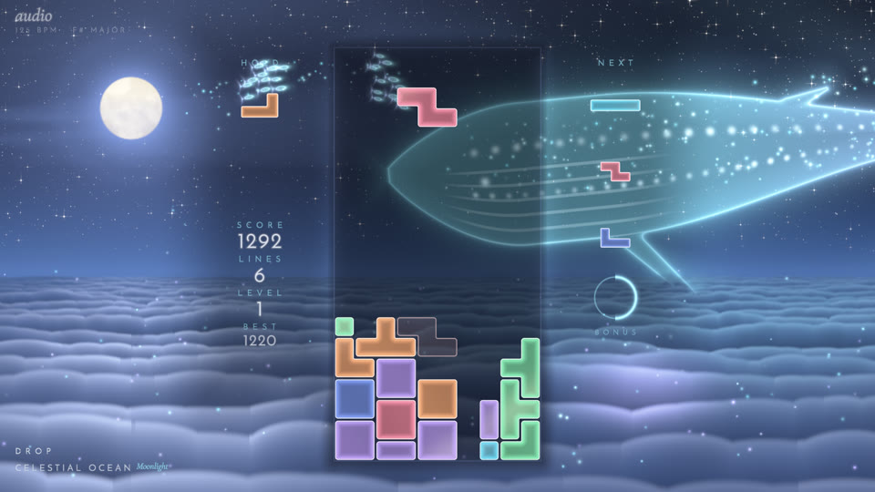

A sea of clouds at night, seen from just above the cloud layer, where every cleared row rises as a creature of light (code in `src/universes/skyocean/`, `--universe "celestial ocean"`). Soft rolling cumulus tops stretch to the horizon in rows (rounded domes, smaller ones riding on them, great heaps here and there), each row hiding the farther ones; a big moon lights them: a silver lining on the tops (brighter on the side facing it), a broad column of moonlight on the sea of clouds under it, patches of brighter and dimmer moonlight, blue shade in the valleys, the far rows fading into the haze along the horizon. Above: a deep starry sky (fine stars and fewer bright ones with a faint cross of light, each twinkling at its own pace), a faint Milky Way, the moon with its halo and a faint corona, thin wisps drifting across it. The rows of clouds drift sideways, the near ones faster. The pieces are moonstone: each piece one translucent glowing shape (its cells merge), lit toward its edges and deeper in the middle, a bright inner rim, a fine line of light just inside it, a slow sheen of moonlight drifting across the stack and a faint pearly shimmer; the ghost is the rim alone. The well is a calm veil of deeper night edged with a hairline of moonlight, and the HUD's columns sit on softer veils (deeper while the drop's whale passes behind them), so the stack and the lettering stay readable whatever swims behind them.

**Every cleared row becomes a creature of light**: its cells brighten and dissolve into light (in about a third of a second, at the real speed even in slow motion), flow out of the well as motes in an arc down to the cloud tops on one side (the sides alternate), and a creature rises out of the clouds there, breaking through a misty edge in a burst of motes and lighting the tops under it, then swims away across the sky, bobbing gently, and fades into the night after half a minute or so (or leaves the screen). The creatures are translucent and bioluminescent: a faint body, a bright membrane along the outline, a soft halo, lights of their own and a trail of motes; their color shifts along the body to the variant's second hue. A single row brings a school of small fish (each fish wagging its tail, following the leader's path with its own lag and offset), two rows a jellyfish (its bell pulsing, four rings glowing through it, seven tentacles and two frilly oral arms trailing), three rows a manta ray (seen from above: falcate wings flapping, pale shoulder chevrons, spots of light along its leading edges, a whip tail), a quad a whale (a humpback in side view: a blunt head, grooves under the throat, two rows of spots pulsing along the flank, long pectoral fins swaying, flukes beating) with a school of fish around it. When the sky stays empty a while, a small dim creature drifts by in the distance near the horizon. The creatures light the cloud tops beneath them (up to ten lights on the clouds). A hard drop puffs a few motes out from under the piece.

The song: calm drifts the clouds slowly under steady stars, a few motes of light rising from the clouds; mid drifts them faster, twinkles the stars on every other beat and sends up more motes; a peak brightens the creatures, the haze along the horizon, the moonlit tops and the aurora, the creatures' light swelling softly on the beat, the stars twinkling on each beat and the kicks sending up waves of motes. **The drop brings a giant whale** (on a real drop only, not a chorus): it rises at one edge of the sky and passes slowly across the whole of it (about a minute to cross), huge, glowing and translucent, its tail beating once a bar on the beat grid, the cloud sea lit beneath it and motes streaming off its body; when the drop ends it dives back into the clouds, pitching down through the misty edge. Slow motion slows the world to a third and brightens the moon and the silver linings; game over sends every creature diving into the clouds and drains the stack's light from the top down. It leaves and enters through the bridge. Four nights, each with its sky, moon, clouds, creatures and seven pieces: MOONLIGHT (a cold white moon on a blue night, cyan and lilac creatures; the most frequent), DAWN (before dawn: a rose and peach horizon, a big golden moon low in the sky, gold creatures turning pink toward the tail; bright major songs), AURORA (a teal night under two folding curtains of green and violet aurora, sea-green creatures) and AMETHYST (a deep violet night, pink and periwinkle creatures; dark minor songs), from the mode, brightness and key (`--universe "celestial ocean:aurora"`). Cost: the sky and the clouds (eighteen rows of domes, a few square roots each, front to back with an early exit) are drawn at a reduced resolution (at most 540 lines); the stars, the creatures (one instanced quad each, its body a signed distance), the motes (instanced sprites), the veil and the pieces at full resolution; no blur pass. The HUD is moonlit lettering, Josefin Sans Light capitals widely spaced, with Cormorant Garamond Italic for the song, the variant and the notices; the bonus gauge a faint ring of moonlight charged with a bright arc (SIL Open Font License, `src/universes/skyocean/OFL-JosefinSans.txt`, `src/universes/skyocean/OFL-CormorantGaramond.txt`).

## STAR CHART (disabled)

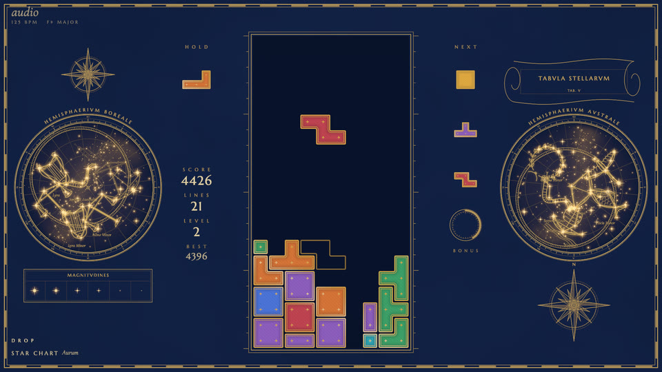

Replaced by CELESTIAL OCEAN above; its code stays in `src/universes/starchart/`, left out of the default build (`-DREFALL_DISABLED_UNIVERSES=""` builds it). Its description as it was:

An antique engraved celestial map, like the plates of the old star atlases (code in `src/universes/starchart/`, `--universe "star chart"`). Gold engraved on deep navy: a neatline around the sheet (a heavy and a fine rule with alternate bars between them, one a unit), and in the margins two hemispheres, each a planisphere on its pole: a fixed rim graduated every five and fifteen degrees with the hours in Roman numerals and the hemisphere's name lettered along it, and inside it the turning sky (declination circles, hour lines, a graduated double ecliptic), a field of engraved stars of six magnitudes (a round core with fine tapering rays, eight for the brightest, four, none for the faintest, a soft glow around them) and the Milky Way as a soft band of fine stippling that turns with its disc. Above and below them: a scroll cartouche (TABVLA STELLARVM and the plate's number), a table of the six magnitudes and two compass roses with shaded points, kept clear of the HUD's text. The well is a calm, deeper panel in a double rule, graduated with a tick per row (longer every five). The pieces are enamelled plaques: each piece one field of translucent enamel over fine guilloché lines (seven sober jewel tones: turquoise, topaz, amethyst, emerald, garnet, sapphire, carnelian) inside a single gold rim, a fine inner rule following it and a small engraved star on each cell; the enamel deepens toward the rim and the gold catches a slow sheen drifting across the stack. The ghost is the rim alone, the previews the same plaques. **The sky fills up over the song**: a cleared row's gold leaf flakes off (gone in a third of a second, at the real speed even in slow motion) and each of its cells flies out as a star on a gentle arc (out through the well's side, under the HUD's columns and up into a hemisphere, faint while it crosses the lettering), where they light up as a new constellation: the brightest on the joints of its figure, the others scattered around it as faint stars. Its lines are engraved one by one on the beat grid (calm: one a bar; mid: every two beats; peak: every beat), stopping short of the stars, and its name is lettered under it in italics once it is complete (Serpens, Piscis, Cygnus, Corona, Lyra, Arcus, Libra, Navis, then Minor, Australis, Borealis... when a figure comes back). A hemisphere holds six lettered constellations: the oldest then retires (its lines and name fade, its stars stay as faint ones), so by the end of a long song both skies are full and still readable. A quad brings a great constellation (a scorpion), sends a comet across its hemisphere (a bright head and a tail of fine diverging engraved lines) and leaves a stippled nebula there for the rest of the song. A lock leaves a small glint at the contact, brighter for a hard drop.

The song: calm is a still plate (steady stars, a fainter Milky Way, the burin slow); mid twinkles a few stars every two beats; a peak twinkles more on every beat, engraves faster and adds detail (the half-hour lines, every two degrees of the ecliptic), the kicks flaring a bright star or two. **The drop brings the figures to life** (on a real drop only, not a chorus): around every constellation its line-art figure (an original drawing: a serpent with its belly scales, a fish, a swan in flight with fanned feathers, a laurel crown, a lyre, a bow drawn with its arrow, a pair of scales, a ship under sail on an engraved swell, a scorpion) traces itself in gold, one after another, and starts to move slowly around its stars (the serpent winds, the fish beats its tail, the swan its wings, the lyre's strings tremble, the bow is drawn, the scales rock, the ship rides the swell, the scorpion lifts its tail), both skies turn slowly on their poles (in opposite directions, staying where they turned to) and the stars shine brighter, all eased in over half a second; after the drop the figures stay faintly engraved. Slow motion lays a silver armillary sphere over each hemisphere (its meridian, horizon, equator, ecliptic band and colures turning slowly about the tilted axis) and turns the gold to silver light under a cooler ground. Game over drains the stack's enamel from the top down, leaving the gold rims, and the sky dims. It leaves and enters through the bridge. Five plates, each with its own ground, metal, star style and seven enamels: AURUM (gold on navy), ARGENT (silver on black; dark minor songs), SEPIA (brown ink on pale parchment, hand-colored pieces; bright major songs), VERMILION (gold on red lacquer, the stars as open circles like a Chinese star chart) and PLANISPHERE (brass on teal, verdigris accents), from the mode, brightness and key (`--universe "star chart:vermilion"`). Cost: one full-screen pass for the sheet (the stippling one hashed dot per small cell), the engraving as instanced line segments gathered with MAX blending (so joints never double), the stars as instanced sprites, the pieces one instanced quad per cell; no glow pass. The HUD is engraved lettering: Marcellus capitals, widely spaced, with Cormorant Garamond Italic for the song, the constellations' names and the notices; the bonus gauge an engraved dial ring charged with a gold arc (SIL Open Font License, `src/universes/starchart/OFL-Marcellus.txt`, `src/universes/starchart/OFL-CormorantGaramond.txt`).
## MANGA

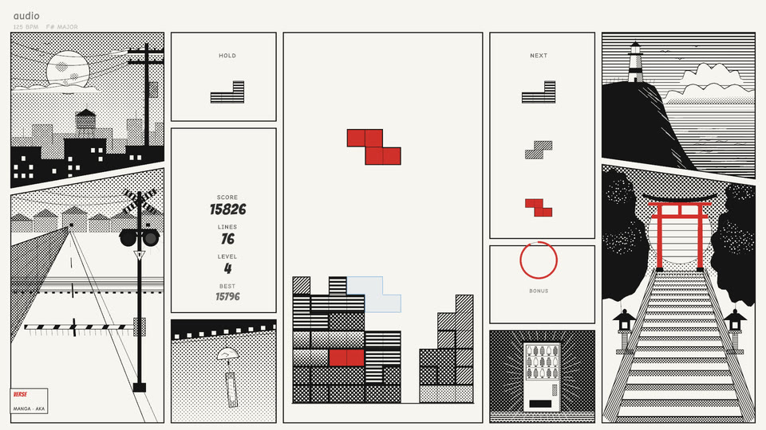

A manga's color page, like the color illustrations at the start of a volume: crisp ink lines and screentones over soft washes of color (code in `src/universes/manga/`, `--universe manga`). The well is the tall panel in the middle of a grid of panels and white gutters; the HUD sits in its own quiet panels beside it (the held piece, the score, the next pieces, the bonus gauge), and the outer columns and two small panels under the HUD hold original drawings of an evening in a seaside town (`art.cpp`): the town at dusk from a rooftop (a moon behind thin clouds lit from below, a skyline with warm lit windows, a water tower, a utility pole and its sagging wires, birds), a lighthouse with a red band on a dark cliff over a teal sea under a big sunset cumulus, a railway crossing at street level (the road running into the distance, a block wall, the rails, the signal with its yellow and black crossbuck and two red lamps, the lowered yellow and black barrier), stone stairs climbing to a vermilion shrine gate against the setting sun between lit stone lanterns and deep green trees, a wind chime under the eaves and a vending machine glowing in the dark. Everything is ink on paper: tapered lines, solid blacks, white knock-outs and screentones (halftone dots, gradients of dots, line tones, crosshatch), anchored on the page and antialiased per pixel, their cells never smaller than a few pixels so they stay calm in motion; under the ink, washes of the variant's palette (each sky a gradient from the zenith through violet to the glow on the horizon), gently textured like watercolor on paper (a slow mottle, a fine grain), the screentones printed over them in darker shades of their colors. The title sits in the page's top margin, the section and the universe's name in a caption box in a panel's corner; the lettering is Comic Neue and Bangers, the sound effects katakana in Dela Gothic One.

**The page is drawn over the song**: it starts as a pencil draft in non-photo blue over the colorist's faint flats (each panel's ground), inside frames inked by hand (the well's, the HUD's, the drawings' and the caption box's alike: each edge one brush stroke, its width swelling and thinning along it, a slight bow and wobble, running on past the corners into a dry-brush flick of three strands, now and then a blot of ink where the brush came down; seeded, so they hold still, and a frame breaking up breaks into pieces of the same strokes); every cleared row inks the next element of the drawings (its lines drawn along their length, then its tones laid down as their dots grow in), then its washes of color flood in under the ink through a noise with a wet edge, like a colorist working after the inker, panel by panel, so the page fills up and keeps it; a new song fades the ink and the color off to a fresh draft. The pieces are plain, flat blocks of color, each type its own clean color (cyan, yellow, violet, green, red, blue, orange, tuned per variant) on the paper of the well: faint seams between its cells and one bold line of the same brush around each piece, a stroke per straight run of its outline running a little past the corners (seeded by its place in the piece's shape, so it holds as the piece falls and locks; touching pieces share a bold line). The falling piece is a locked one; the ghost is its pencil sketch, a faint flat under a light line of the same hand; a hard drop draws a few short impact lines at the piece's feet. A cleared row breaks up into its color's dots, which burst out of the well sideways and fade in half a second (real time, even in slow motion).

The song: calm is the still page; mid sets the crossing's lamps glowing red in turn on the two-beat grid ("kan" lettered in red by the lit one, once the crossing is inked) and the wind chime swaying; a peak adds the lighthouse's warm beam sweeping slowly over the sea and short focus lines reaching in from the page's edges. **The drop is one of six manga moments** (on a real drop only, not on a chorus), never the same twice in a row (a shuffled rotation, seeded per song and carried on across songs), a long drop moving on to another every 32 beats (crossfading in under half a second); each is a full page in some color, lives calmly on the bar and stays behind the well's and the HUD's panels (`drops.cpp`; `REFALL_MANGA_FX=N` forces moment N, 0 SPLASH .. 5 BARRAGE). SPLASH: the drawings fade back to the paper, the frames of their panels break into shards that drift away, a burst of color floods the page from the well out (the variant's three burst colors: pale gold to orange to red in SHONEN), focus lines burst in over it from the page's edges toward the well over half a second and a huge "DON!" is lettered down the left column in a bold color outlined in black; while it lasts, a rumble of "GO" letters builds up on the right on the two-beat grid and a rotating quarter of the focus lines lunges in with it. DASH: the page turns into speed lines streaming past at an easy pace (blunt at the front, sharp at the tail, some in the burst's deep color, a few in white) over a soft wash of the sky's middle color warming to the burst's glow at the foot (a line tone at the top and the foot), streaks of the burst colors blurred by the speed, a big sound effect ("ZUBA'", "GOO'", "BYUN") sliding across a column with the stream on every bar; the stream turns around every sixteen beats. PANELS: the outer columns slide away and break into three slanted panels each, every one a fully inked close-up of a subject of the drawings (the crossing's lamps, the gate, the moon, the lighthouse...) slowly pushing in, some under a heavy crosshatch shadow, focus lines or a gradient of dots; on every bar the gutters swing to new angles and every panel cuts to a new close-up, "DODODODO" and "GOGOGOGO" lettered down the page's edges in turn every two bars; the small panels between the HUD's take the burst's colors under a dot tone. IMPACT: impact frames on the bar: a bar of the page's negative (the drawings in white lines on ink tinted with the burst's red, white focus lines), then three bars of a red frame of black silhouettes glowing toward the burst's middle color at its foot, a soft flash of paper as the frame flips; on every bar a shock wave spreads out of the well in two ellipses and shards and sparks drift out with it, "DOGOON!" in white down the left column and "DON'" on the right. SHOJO: a soft pastel page (lavender to pink to cream, gradients of dots at its top and foot), screentone flowers blooming one on each half beat and slowly turning, sparkles twinkling on the beats, bubbles rising and petals swirling down, "KIRAKIRA" lettered in outline. BARRAGE: a warm page (the burst's pale center at the top to its middle color at the foot, a halftone of dots swelling toward the page's edges); sound effects burst out every two beats in spiky balloons, the columns in turn (paper, the burst color, or ink for the big one every other bar), each over blots of the burst's deep color with accent lines around it, soft short focus lines onto a new big one, the older balloons shuddering a little as a new one bursts in. After, the panels and their drawings come back. A quad inks four elements, bursts a lighter flood of color and focus lines in, letters "ZUDON!" over the right column and sets its toast in a spiky balloon. Slow motion is a quiet moment: a deep blue night settles over the drawings with night tones, pink petals drift down through the panels and "SHIIN" (the sound of silence) is lettered in outline. Game over turns the stack back to pencil from the top, then erases it. It leaves and enters through the bridge. Five variants, each its own color mood: SHONEN (a bright summer evening: a blue to violet to orange sky, warm windows, a teal sea), NEWSPRINT (a Sunday comic: muted inks printed in CMYK halftone rosettes on yellowed paper, warm black ink, coarser tones), AKA (dusk reds: a wine sky burning down to orange, a red sea, the gate aflame), YORU (the night page: pale ink on deep blues, warm windows, a pink neon vending machine and cyan glows) and AI (an indigo watercolor, the windows, the lamps and the gate its only warm notes), from the mode, brightness, dynamics and key (`--universe manga:yoru`). Cost: a few thousand triangles of ink and washes and the lettering into one 4x multisampled target, resolved once.
## STAINED GLASS (disabled)

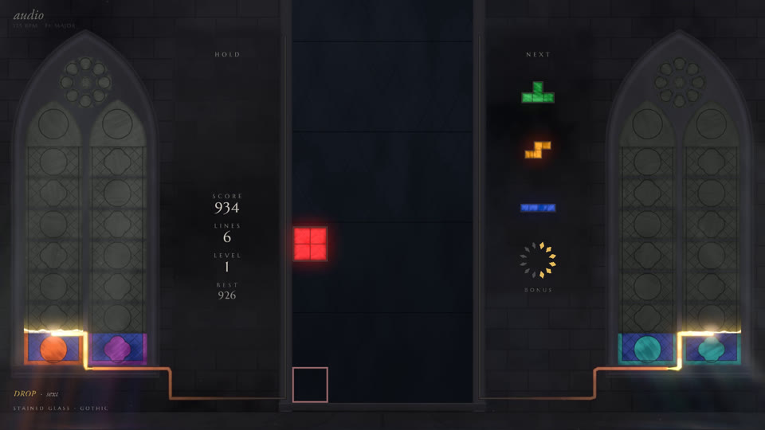

The inside of a dim stone chapel, facing a great window (code in `src/universes/stainedglass/`, `--universe "stained glass"`). The well is the window's central light, set between two slender stone jambs over a sill: its empty glass is a dark, clear glazing of diamond quarries in lead. Past the HUD's stone piers (faint ashlar courses, quiet behind the text), a two-light window stands in each margin under a pointed arch with a moulded surround: two lancets parted by a mullion, each a column of panels between iron saddle bars (a roundel or a quatrefoil medallion on a ground of quarries, inside a border), a rose of eight petals around a sexfoil in the head; a single lancet on narrow screens. Below, a strip of flagstones in perspective.

The pieces are the window's colored glass: each piece one sheet (its texture runs on across its cells: an uneven thickness, its color densest where the glass is thick, streaks from the sheet's draw, small seeds that catch the light) cut into cells and leaded, a fine came between its own cells and a broad one around it, so that two pieces never merge. The painter's matting darkens the glass toward the piece's lead, and each piece type has its own grisaille pattern painted thin across the sheet (quatrefoils, a trellis, scales, a vine, ripples, feathered strokes, rosettes); the modern window has flashed glass instead, a second layer of the color thinned in broad strokes. The falling piece is exactly the glass it will lock as; the ghost is its empty came, a faint line of its color. **The side windows are glazed with the cleared rows' molten glass**: their panes start clear (pale painted grisaille). A cleared row goes incandescent in the well (its glass glowing in its own colors, the lead melting with it) while the game holds the stack, then runs out of the well's side as a stream of liquid light, viscous and glowing (white-hot at its head, the row's glasses carried along it cell by cell, ripples running down it), along lead channels cut in the stone: down a groove in the well's jamb, along a string course under the HUD, up beside the window and along its sill, then up the mullion and along a saddle bar to the next empty pane (bottom up, from side to side). It pours into the pane from the bottom, the level rising with a bright wavering meniscus that climbs at the lead, then the glass cools from white-hot through orange to its stained-glass color (the variant's ground glass with the row's main glass in the medallion and the border, or the row's two glasses), a crackle of light running through it and a few sparks as it sets; the stream leaves a trace cooling in the lead and lights the stone it passes. A double or a triple sends one quicker stream per row, branching at the window; a quad sends its four rows together up to a whole rose, where the stream branches around the ring and in along the spokes into every petal, and the rose blazes in a halo of its colors once set. A long song ends with both windows complete (then the oldest panes are glazed again); a new song drains them.

The light: the sun stands behind the window, its glare moving across the glass with the song (low at one side in a calm part, higher at mid, high at a peak; each new section takes it to the other side). Its light comes through every pane in color: on the stone around the windows (their mouldings, the jambs, the sills), in shafts through the dusty air (the glass's light streaked from the sun into separate rays, faint over the well and the HUD, barely over the glass itself), where motes of dust drift and only show in the beams, and in pools of color thrown on the flagstones, the stack's included. Clear glass throws less than colored glass, so the shafts take on color as the windows fill. Calm is a dim, still morning; mid brightens it and a few glazed panes glint on the two-beat grid; a peak is high noon, glints on the grid and with the kicks, a piece of the stack catching one now and then. **The drop is the sun striking full through the window**: it comes overhead, its glare, the shafts and the pools blaze, eased in over half a second and settling over the next bars (the pieces only catch a little of it and stay crisp), and molten light runs out from the well through the whole lead network (the channels, both windows' mullions, saddle bars and roses); a chorus's rise only brightens it a little. A lock pushes a small puff of dust out from under the piece. The molten glass runs at the real speed even in slow motion. Slow motion is night: the sun gives way to a cold moonlight and the candles on the window sills are lit (VESPERS, already at night, turns to a silver full moon, the candles burning low). Game over puts the light out of the stack's glass from the top, then it falls as shards. It leaves and enters through the bridge. Five windows, each with its own glass, ground, stone and light: GOTHIC (jewel tones on a deep blue ground), GRISAILLE (pale glass and silver-stain amber on a pearl ground), ABSTRACT (a modern window: a mosaic of small squares in vivid flashed glass, no painting, concrete), VESPERS (night: the moon behind deep blue panes, candles lit inside) and LAPIS (blue and violet with a touch of gold on a midnight ground), from the mode, brightness, air, bass and dynamics (`--universe "stained glass:vespers"`). The section line names the hour of the light (lauds, terce, sext, noonday at the drop, compline in slow motion). The bonus gauge is a small rose of twelve petals glazed in the accent. Cost: one full-screen pass for the chapel (analytic tracery and panes), the same at a quarter of the resolution for the light through the glass, a 28-sample quarter-resolution shaft pass, quarter-resolution blurs and bloom, instanced cells and sprites, a few hundred instanced capsules for the molten glass (about the cost of CRYSTAL CAVE on Mesa; a burst of quads adds about 10 % on llvmpipe). Its fonts are Marcellus (labels and numbers, capitals cut in stone) and EB Garamond Italic (the song, the section, the celebrations) (SIL Open Font License, `src/universes/stainedglass/OFL-Marcellus.txt`, `src/universes/stainedglass/OFL-EBGaramond.txt`).
## BRUTALIST

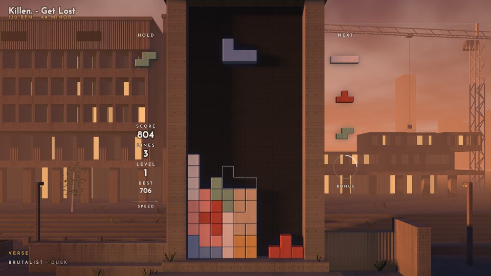

Raw concrete under a hard sun, in 3D (code in `src/universes/brutalist/`, `--universe brutalist`). A plaza seen frontally like an architect's photograph (a shift lens: the verticals stay vertical); the well is a tall slot cut into a monument, between two piers and under a heavy lintel, its back lined with dark concrete so the stack always reads on it. Across the plaza, up a long flight of steps, a civic building stands on pilotis over a deep glazed ground floor, its upper floors cantilevered behind fins over deep-set windows, a heavy ribbed attic, a stair tower and an outside stair at its end; on the right a pile of cast modules stands beside its blind service core with a tower crane (lattice mast, slewing jib, concrete ballast, trolley and hook); beyond, the far city in the haze. Weeds grow from the cracks along the sill, the walls' feet, the steps and the coping, a birch sapling from the paving. Every surface is a material: board-marked concrete (the boards' tones, grain and seams, the formwork panels' joints and tie holes, the lifts of the pour), ribbed and precast concrete, rain streaks running down from the copings, damp at the walls' feet, glazing reflecting the sky in its reveals, paving with weeds in the joints.

The pieces are cast concrete blocks, each piece one cast (the joints show between pieces only, their arrises chamfered), each of the seven types its own concrete or a sober pigment (white, ochre, oxide red, sage, rose, slate blue, sand) and finish (smooth with blowholes, exposed aggregate, fine board marks). The sun casts hard shadows through a shadow map: the stack's on the slot's lining, the lintel's and the piers' over the stack, the fins' across the facades, the monument's long shadow over the plaza; it moves on along its arc with every phase of the song, its shadows sweeping the place. Dust drifts in the air and shines only where the sun crosses it (each mote looks the sun up in the shadow map). The ghost is a fine chalk outline; locks and hard drops push a little dust out from under the piece.

The song: calm is a veiled sun (a thin high cloud, soft shadows, a flat cool light); mid brings the sun out; a peak is the hard light (crisp shadows, the dust glittering on the two-beat grid, the crane working faster). **The drop is the sun breaking through** (a real drop only, not a chorus): the veil clears, the light swells over half a second and settles over seconds, the shadows turn razor sharp, the colors deepen, the glazing glints and a cloud of dust shaken out of the slot glitters in the light; by dusk and by night the monument's floodlights come up and more windows light. A cleared row's blocks pop out of the slot and tumble down onto the sill and the plaza (they bounce, roll to a stop and shrink away), and the crane lowers a module onto the growing pile for each row (from its foot, hoisted, slewed, set down): over the song the building grows level by level, half a module out on every other level, its shadows longer and more complex. A quad flashes the sun on all the glazing at once and sends four modules up. Slow motion is the evening: the sun sinks low and warm, the shadows stretch across the plaza, windows light up, time stretches. Game over topples the stack out of the slot onto the sill and the plaza, block by block from the top, in dust. It leaves and enters through the bridge. Six hours and seasons, each with its sky, sun, concrete, crane paint and seven blocks: MIDDAY (a high summer sun, a deep blue sky), MORNING (a low sun from the left, long cool shadows), WINTER (snow on every ledge, a pale low sun, a red crane), AUTUMN (a warm raking sun, ochre concrete, rust in the weeds), DUSK (the sun on the horizon, orange light, lit windows) and MOONLIGHT (a cold moon, stars, windows and floodlights), from the mode, brightness, bass, air and key (`--universe brutalist:winter`). Cost: instanced boxes for everything solid (a static buffer for the place, a few hundred dynamic ones), one 2048² shadow map, one multisampled pass, the sky only where nothing stands, additive dust sprites, a quarter-resolution glow. The HUD is Space Mono (bold), charcoal on a pale halo by day and pale on a dark one by night, the bonus gauge a square frame charged clockwise (SIL Open Font License, `src/universes/brutalist/OFL-SpaceMono.txt`).

## TILES

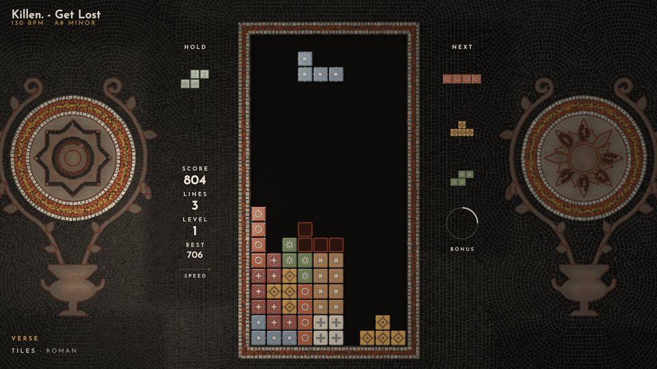

A great wall mosaic of thousands of tesserae, the pieces glazed ceramic tiles (code in `src/universes/tiles/`, `--universe tiles`). The mosaic is laid on the CPU like a mosaicist lays one (`mosaic.cpp`): the design is painted into a raster (the well's frame, and on each side a medallion with its ring of gold between rows of color, its figure on a ground, a vase below it and a vine springing from it around the medallion, leaves and grapes), then the tesserae are laid in rows following the outlines (andamento): an exact distance transform gives each point its row, each row is walked along its iso-line, a tessera after another with a grout gap, their ends cut square to the row (wedges on the curves), the outlines first, then row by row inward, so the ground echoes the figures in rows rippling out from them, with the medial seams real mosaics show; holes where rows pinch out get smaller pieces. Every tessera has its own size, shade and tilt in the mortar, and its material: gold and silver smalti (dark until their tilt catches the light), glass (deep color, a sharp highlight on its fractured face) or matte stone. The well is a recessed bed of dark mortar inside three rows of tesserae.

**The cleared rows lay the figures.** The ground, the frames and the rings are laid from the start; the figures, their grounds, the vases and the vines are only the painter's sketch in red ochre on the bare lime setting bed, washed with the colors to come and with the guide lines of their rows. A cleared row's tiles crack and break into chips that stream out of the well along arcs, each taking its smalto's color as it flies, and are tapped in one after another along the next rows of the figures (the outline first, then inward; the medallion's ground, the vase, the stems, the leaves, the grapes), each one standing proud a moment and catching the light (a gold one flashes); the rows alternate between the two sides, a double or a triple lays more and faster. A quad sends a swarm that lays a large part of a figure in one sweep, then a glint runs around its medallion's gold ring. Once both sides are complete the rows re-set tesserae of the ground, each one glinting. A new song pries the figures out back to the sketch.

The pieces are glazed tiles set in the bed: a pillowed glaze rounded over its edges, a motif per type painted in a second glaze between thin dark lines (cuerda seca), standing a little proud and meeting across the tiles' edges and corners as azulejo patterns do (rings, quatrefoils, lozenges, rosettes, stars, discs, crossed leaves), a faint craquelure, an even sheen of the room on the glaze, a shadow on the bed. The ghost is the painter's sketch of where the tile goes; a lock squeezes a little mortar dust from under the tile.

The light is a lamp moving over the wall, its raking light making each tilted tessera glint in turn. Calm: dim and still, the lamp parked high over a side; mid: it travels across the wall and a few smalti glint on the two-beat grid; a peak: brighter and quicker, more glints, the kicks too. **A real drop brings the wall alive** (not a chorus): the whole ground turns over like a stadium's card display. On the hit a wave runs out from the well and every tessera turns over about the line of its own row (slowly, over a beat and a half, squeezed to its edge, the bed shaded in its shadow), showing on its back a tessera of a new design laid over the whole wall in the variant's dark, metal and two accents, so the mosaic re-tiles itself: a sunburst out of the well whose rings turn against each other, frames echoing the well marching outward, a turning spiral, a lattice of lozenges with a diagonal running through it, waves rising from the floor (each design drifting slowly). On every bar the next wave turns the wall to the next design, each with its own sweep (diagonals, a spiral around the well, in from the sides, out of the medallions, up from the floor, here and there). The medallions keep their figures: their gold rings chase their light around, the two counter-rotating, a soft pulse runs out from the heart of each figure every two beats, and the lamp sways from side to side every bar so its raking light glides over the turning metal. It is kept soft on the eyes: one wave a bar, no flash, no slap. Successive drops start from other designs and sweeps. When the drop ends (or after 64 beats) a last wave out from the well lays the original mosaic back. The old fire of the smalti stays underneath, lower; behind the HUD the designs fade toward their dark. It is all done in the lighting pass from a per-tessera texture (center, row direction, width): no re-upload, about the same cost on llvmpipe. Slow motion is night: an oil lamp low under the wall, flickering, the gold glowing warm in the dark. Game over: the tiles come off the wall row by row from the top and fall. It leaves and enters through the bridge. Five variants, each with its own tesserae, materials and seven tiles: BYZANTINE (a gold ground, lapis and crimson, a sun and a rosette), ROMAN (a floor of black basalt, marble, terracotta and ochre stone, matte), NOCTURNE (a vault of deep blue glass strewn with gold stars), TRENCADIS (broken glazed tiles in bright colors, irregular shards in pale grout) and LAGOON (Venetian sea-green glass and silver), from the mode, brightness, density, bass, tempo and air (`--universe tiles:nocturne`). Cost: the mosaic is laid once per variant and screen size (~150 ms on the CPU, about 18 000 tesserae) and drawn once into a G-buffer (albedo and material, normal, id; a per-tessera state texture says which are set); each frame is one full-screen lighting pass over it, instanced tiles, chips and sprites, a quarter-resolution bloom (cheaper than STAINED GLASS on llvmpipe). Its fonts are Cinzel (labels and numbers, Roman capitals) and Cormorant Garamond Italic (the song, the section, the celebrations) (SIL Open Font License, `src/universes/tiles/OFL-Cinzel.txt`, `src/universes/tiles/OFL-CormorantGaramond.txt`).

## GIANT TREE

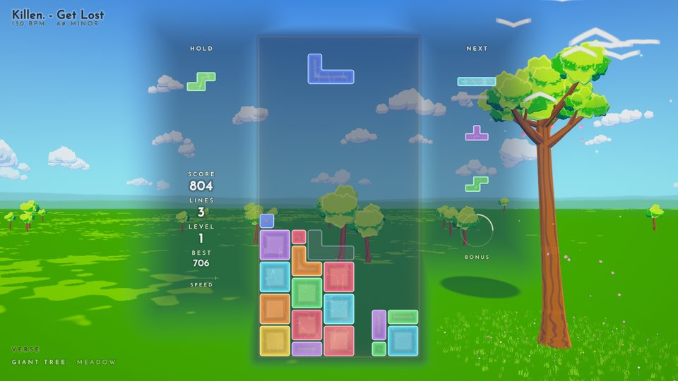

A toon world tree shoots up behind the well with the cleared lines, absurdly: from a little round sapling in a bright meadow it rises past the hot-air balloons, through the clouds, into the stratosphere where the sky deepens to ultramarine and the horizon curves, out into orbit among the satellites, on until the planet is a ball under its roots, past the moon, and out among ringed planets and a galaxy (code in `src/universes/gianttree/`, `--universe "giant tree"`). Its growth is G = ln(the trunk's height in meters), from 1.3 m at the first line to some two million kilometers: about 2.4 km (above the clouds) at 10 lines, 15 km (the stratosphere) at 16, 350 km (orbit) at 26, 6000 km (the planet a ball) at about 33, 360 000 km (the moon) at 45, the ringed planet and the galaxy at 50 (the whole journey in one song; these are lines at the reference pace: the scene completes at `sceneLines()`, 15 lines a minute of song, 50 for a 3:20 song, and every count here scales with it; the spurt's speed cap of 3 keeps a short song's bigger steps calm), then slower and slower, from a table interpolated in log space. The tree is parametric (`tree.cpp`, the same functions on the CPU and in the shaders' `TREE_GLSL`), generated once per game from a seed and never rebuilt or uploaded while it grows: the trunk is rings of vertices at heights spaced in log space, which the vertex shader places on the trunk's winding axis with the radius it has at the current G (thick at the foot and flaring into roots, slender under the crown, the rings above the growing tip gathered into it); the crown is built in its own space (unit: a crown scale that grows more slowly than the height, so the tree gets ever taller for its width, a lollipop at first, a beanstalk with a crown at the end) and rides the tip up: a round dome of foliage puffs, then seven limbs born one after the other over the first lines (each growing from its base to its tip, the pom-pom of puffs at its end and the smaller ones on its twigs popping open with an overshoot as it reaches out), fruits and blossoms appearing as it grows grand; vine leaves spiral up the trunk, sprouting as the tip passes them, sized on the trunk's radius where they sit. A few round trees stand in the meadow for scale (at the first line they are taller than the sapling; a few lines later they are specks).

**Each clear is a spurt**: the growth springs to its new target (a critically damped spring, a second or so), the crown squashes and stretches like jelly, sparkles and leaves burst out of it, streaks rush down past it while it climbs, and the cleared row's cells dissolve into light that flows out of the well to the crown. A quad is a huge spurt (in the meadow it can make the tree some fifteen times taller; the spurt's speed is capped, so it takes a breath longer instead of jolting), with a pulse of light up the trunk and a burst of blossoms. The camera rides with the crown a moment behind it (the crown shoots up, then the camera lurches after it): low in the grass by the sapling, the whole little tree at the right of the scene; then up with the crown, looking down the soaring trunk at the land falling away, the clouds sinking under it, the horizon curving; looking straight down the trunk at the planet a ball far below; then out again at the moon and the stars. The tree keeps to the right of the well (the board and the HUD never move). Game over: every leaf falls (autumn colors); the next game sprouts a new seed and the camera dives back down to the meadow.

The world, in one ray-traced pass per pixel at a reduced resolution: the planet (a sphere of the Earth's size under the tree's foot: the meadow near it in crisp two-tone patches at every scale the pixel resolves, flowers in the near grass, continents, oceans with a glint, deserts, forests, snow on the poles, the cities' lights on the night side, the crown's shadow), its atmosphere (an exponential atmosphere: a saturated sky near the ground, deepening to space with the altitude, the limb glowing; the aerial perspective in color, never grey, nothing of it left in space), far hills along the horizon near the ground, the sun (a crisp disc and halo), the moon (a sphere floating high behind the tree: crisp terminator, maria and craters), and in space a nebula, a ringed gas giant (it fades in only once the moon has gone by under the crown, from about 47 lines) and a spiral galaxy. Its depth is written, so the trunk's foot meets the ground. Then the bark (toon: two bands of light with a cool tinted shade, a warm rim, grooves winding up the wood, node bands receding down the trunk), the puffs of foliage (billboards drawn as spheres with a scalloped leafy edge, their depth written as spheres' so they cluster into round masses; a cool shade, the leaf color and a sunlit band shifted by painterly leaf strokes, blossoms dotting them, a darker outline on the shade side, a warm rim on the sun's; fruits are glossy spheres that glow like stars once in space), toon cumulus puffs in a layer at ~1.9 km (crisp bands, flat bellies, a warm rim when backlit), and once above them a ray-traced shell of clouds around the planet (its coverage keeping the same contrast at every scale, from billowing tops just under the camera to the planet's weather seen from orbit). In the air: grass tufts and wildflowers by the sapling, flocks of birds, hot-air balloons around the clouds' height, satellites in orbit, petals, sparkles, streaks; a soft quarter-resolution bloom, the stars at full resolution where the sky is dark.

The song: calm is a light breeze; mid stirs the wind and lets petals drift; a peak sways the tree, shimmers the leaves and fills the air with sparkles. **The drop** (on a real drop only, not a chorus: the HUD's section, else the music's pace) shoots the tree up an extra burst (+57 % height, kept), while a rainbow of light runs up the trunk from the roots and out through the crown, then rushes on up into space as a rainbow beam full of sparks, the crown blooms and rainbow petals shower down. Slow motion softens and cools the light. It leaves and enters through the bridge. Four variants, each with its sky, light, land, tree and seven pieces: MEADOW (a bright day: a deep blue sky, a warm high sun, a vivid green crown with pink blossoms and red apples; bright major songs), SUNSET (a golden hour: an orange and rose sky with the sun low on the left, an autumn crown of orange and gold with golden fruits, pink clouds), STARLIGHT (a vivid night: an ultramarine sky full of stars, a glowing turquoise tree with magenta blossoms on a violet trunk, the planet's night side lit by its cities; dark minor songs) and CANDY (a pastel fantasy: a lilac sky, a pink cherry crown with white blossoms on a lavender trunk, mint meadows; airy, sparse songs), from the mode, brightness, air, density and key (`--universe "giant tree:starlight"`). The pieces are seed glass: translucent glass shapes with a warm seed of light inside, fine leaf veins. Cost: the ray-traced sky and ground at a reduced resolution (at most 720 lines, the planet's limb antialiased, its depth in a texture), upsampled with its depth into a 4x multisampled target at the full resolution (up to 1440 lines) where the geometry is drawn, then resolved: the bark (one indexed draw, ~28k triangles), the puffs (one instanced draw, ~1.2k, most of them too small to draw at any time and dropped in the vertex shader), the cumulus (only those over a pixel, sorted, alpha blended), the cloud shell once above it, the lights in the air as one instanced draw; a quarter-resolution bloom; the stars, the veil, the pieces and the lettering at full resolution. Under half the cost of DOCKS on llvmpipe. Its fonts are Marcellus (labels and numbers) and Cormorant Garamond Italic (the song, the variant, the notices) (SIL Open Font License, `src/universes/gianttree/OFL-Marcellus.txt`, `src/universes/gianttree/OFL-CormorantGaramond.txt`).

## MYCELIUM

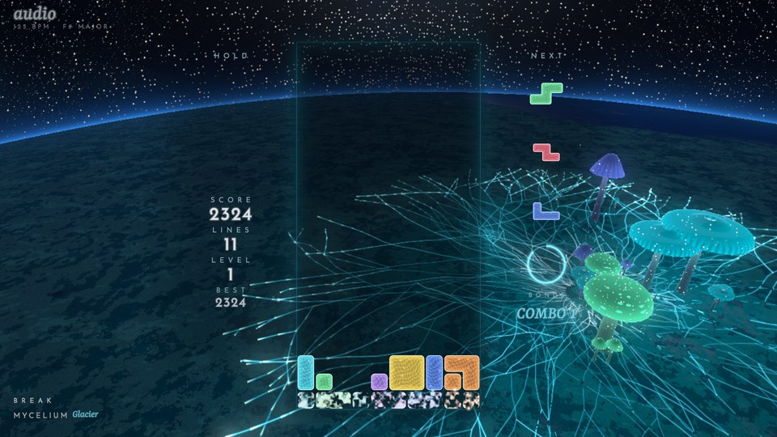

A glowing fungal network grows over the forest floor at night with the cleared lines, from a single spore among the moss until it wraps the whole Earth in filaments of light, in the spirit of GIANT TREE (code in `src/universes/mycelium/`, `--universe mycelium`). It starts as close as a macro lens: one spore glowing on the forest floor under the moon, its first germ tubes a tiny tuft a couple of millimeters across in a frame about a centimeter and a half tall (the camera only starts pulling back once the network fills it), among things plainly bigger than it: dew drops, soil grains, pine needles, fallen leaves with their veins, moss sprigs and their capsules; the background is out of focus (a thick mist behind the tuft, a soft tree line, the moon a blurred disc, few stars) until the network is some 30 cm across, and the first mushroom waits until it is about a centimeter across. Then the camera rises and pulls back with the network: the moss, a clearing in the grass, the forest, a valley with a river and a village under the clouds, a region where the threads glow under the land like veins of light and the horizon curves, a continent, and at last the Earth seen from space on its night side, wrapped in a living web of light, the moon beside it, the camera turning slowly around it. Its growth is G = ln(the network's reach in meters): 2 mm at the start, 0.9 m at 8 lines, 22 m (the forest) at 13, 550 m (the valley) at about 20, 2.8 km at about 23, 75 km (the region) at about 30, 2000 km at 38, 6500 km (the planet a ball) at 43, 12 000 km at 46, 16 000 km (all the globe but around the antipode) at 50 (the whole journey in one song; lines at the reference pace: the scene completes at `sceneLines()`, 15 lines a minute of song, 50 for a 3:20 song, and the counts here scale with it; the spurt's speed is capped so an early quad stays calm), from a table interpolated in log space.

The network (`network.cpp`) is grown once per game from a seed, in log space: every step a fixed fraction of its distance from the spore, so it has the same density of threads at every scale it reaches. It grows on a plane of geodesic polar coordinates around the spore (the distance along the surface, the bearing) mapped onto the planet, so a millimeter of hyphae and a web around the globe are the same thing. Tips wander outward on slow curls, branch, fuse into the threads of other lineages they meet (anastomoses: bright knots), die out where it is crowded, and leave fine hairs along the frontier; at the planet's scale they wander more freely and there are more of them, so the network becomes a web rather than a star. Each thread (some 90 000) carries the growth at which it is born and the shaders reveal it against the growth, from its base to its glowing tip, so nothing is rebuilt or uploaded while it grows: a crisp ribbon lying just over the ground, never thinner than a pixel (a thinner one fades instead), a few bright cords among a fine web of fainter threads, the old cords thicker, a pool of their light glowing under the land in patches, a soft bloom.

**Each clear is a spurt**: the network springs out to its new reach (a critically damped spring, a second or so) with bright tips, the cleared row's cells fray into light that flies to the network's heart (the spore, glowing), and a pulse of light runs out from it along every thread, while the camera follows a moment later. A quad is a bigger spurt with a burst of glowing spores rising all over the network. **Mushrooms burst up where the threads run**, one every third of an e-fold of growth, each bigger than the last: placed once per game at a site the threads reached a little before, at some 0.7 of the reach from the spore, where the camera will see it in the open beside the well; half the network's reach tall when it bursts up (at most 80 km: then glowing pins all over the globe), with one to three smaller ones at its foot; they keep growing afterward (three times taller over the next scales), so the caps among the moss become parasols taller than the trees, then towers standing above the clouds. Each is turned on a lathe in the vertex shader (one instanced mesh, its profile from its form and how far its cap has opened): a pin first, an egg, then the cap opening with a little overshoot and a burst of sparks. Three forms: parasols (a broad cap with an umbo, fine striations near the rim), domes with glowing spots, slender bells; translucent caps lit from within, brightest toward their rim and edges, gills glowing underneath, pale fibrous stems lit by their own cap; the six biggest in view light the ground around them; spores drift up from them.

The world, in one ray-traced pass per pixel at a reduced resolution: the planet (a sphere of the Earth's size under the spore) with the forest floor near it in moss, soil and crisp fallen leaves at every scale the pixel resolves, forests (their canopy crown by crown) and a patchwork of fields with hedges farther, the valley opening away from the spore, rolling hills whose slopes catch the moon, a winding river with the moon in it, the village's warm windows, continents and oceans and towns' lights from high up, the day side's thin crescent from space; the night sky (deepening into space with the altitude, a dusk glow along the horizon toward the sun's side, the limb's airglow and the sunlit crescent of the atmosphere seen from orbit, the sun rising over the limb on the way up), the tree line along the horizon near the ground, a big moon (a sphere with craters, low over the forest from the ground, beside the planet from space), the nebula; its depth is written. Then the mushrooms, the ground cover at every scale around the spore (moss sprigs and their capsules, moss cushions, pebbles, grass tufts, bushes, trees: toon puffs written with a sphere's depth, lit by the moon, the network's glow on their undersides; each scale shown while it is a sensible size on screen, never right in front of the lens), the village's houses with lit windows, toon cumulus at night around 2 km and the sea of clouds seen from above, hot-air balloons glowing from their burners over the valley, airliners' blinking lights at cruising height, satellites in orbit, clouds of spores drifting off the glowing planet into space; a night mist that scales with the view (a macro's haze close up) and the air's perspective farther out.

The clouds drift with the wind at the music's pace (integrated, so a change of pace never jumps them), and each puff fades in and out over a second or more on screen at any growth speed: none too close to the camera (judged a moment ahead, so it fades before the camera gets there), under a pixel or two, high in space, or sweeping fast across the view while a spurt or a drop shoots the camera up through them; the sea of clouds under the camera eases the same way.

The song: calm is a still network breathing; mid sends pulses of light out along some of the threads every two beats (each follows the threads' paths, so the light spreads unevenly); a peak along all of them every beat, the caps brighter, more spores. **The drop** (a real one only, not a chorus: the HUD's section, else the music's pace) sends one wave of light from the spore out through the whole network (a front running out through the threads' pulse coordinate, slowing as it spreads); as it reaches each mushroom the light climbs its stem, the cap flares and a cloud of glowing spores rises into the night; the network spreads a little farther (kept). Slow motion cools the night (a bluer mist and dusk, a brighter moon). Game over: the light drains out of the threads and the mushrooms wilt and darken; the next game grows a new network from a new spore and the camera dives back down to the moss. It leaves and enters through the bridge. During a break between songs it draws the world alone, the network as it was. Four variants, each with its own night, ground, threads, three cap colors and seven pieces: GLACIER (ice-blue threads, turquoise, blue and mint caps under a deep blue night; airy songs), ORCHID (magenta threads, pink, violet and coral caps in a plum night; dark minor songs), EMBER (amber threads, honey, gold and red caps in a teal night; bright major songs) and JADE (green foxfire: lime threads, emerald and chartreuse caps), from the mode, brightness, air and key (`--universe mycelium:orchid`). The pieces are mycelium felt: deep translucent shapes woven of glowing threads in three directions, with knots of light, a bright inner rim. `REFALL_MYCELIUM_LINES=N` adds N lines to the growth (to look at a late stage in a short shot), `REFALL_GROW_RATE=R` R lines a second (a time-lapse). Cost: the ray-traced sky and ground at a reduced resolution (at most 720 lines, the planet's limb antialiased, its depth in a texture), upsampled with its depth into a 4x multisampled target at the full resolution (up to 1440 lines) where the geometry is drawn, then resolved: ~90k thread quads in one instanced draw (most culled in the vertex shader: not born yet, or far under a pixel), the visible mushrooms in one instanced draw (~1.8k triangles each), a few thousand puffs and billboards built for the view, the clouds; a quarter-resolution bloom; the stars, the veil, the pieces and the lettering at full resolution. About GIANT TREE's cost on llvmpipe (some 1.3 times it once the planet is wrapped). Its fonts are Josefin Sans (light labels, regular numbers) and Yrsa Italic (the song, the variant, the notices) (SIL Open Font License, `src/universes/mycelium/OFL-JosefinSans.txt`, `src/universes/mycelium/OFL-Yrsa.txt`).

## TERRARIUM

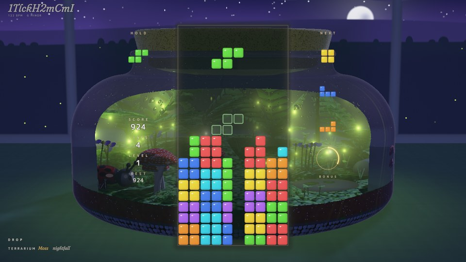

A sealed glass jar on a windowsill whose little world grows over the song, joined one at a time by other jars, each its own little world, until a small cluster of terrariums linked by glass tubes glows at night, seen in 3D behind the well (code in `src/universes/terrarium/`, `--universe terrarium`). The camera starts close on the bare jar (soil, a pebble, a tiny tuft of moss) and pulls back, calmly and continuously (a spline through nine keys, holding while a jar grows): **0-15 lines** the first jar goes from its first plants (moss cushions, ferns whose fiddleheads uncurl into arching fronds, toadstools, a sapling, a pond) to a dense miniature jungle (towering ferns pressing on the glass, a mossy rock with a thin waterfall into the pond, mushrooms everywhere, violets, vines climbing the inside of the glass, a moss carpet); **15-28** one second jar is set down gently beside it, the beetle's tube grows from one to the other, and the camera holds on the two while the new one, a flowering meadow, comes alive from bare soil: sprouts, moss, flowers opening one after another, a fern, a little flowering sapling, toadstools, and a snail crawling slowly round it; **28-38** a third jar (a pond with lily pads, a waterfall, reeds) and a fourth (a desert) arrive one at a time, linked by tubes (one with water trickling along it), each filling up in turn; **38-50** a few more on the shelves beside and above the window, nine jars in all, and the finale at nightfall: the cluster glowing, fireflies living in every grown jar and streaming along the tubes. Every jar is the first one's twin: the same glass, the same plant system (its slots, ferns, flowers, mushrooms, succulents, ponds), scaled and placed, with its own biome (moss forest, desert, orchid jungle, flowering meadow, pond; the variant's own is the first jar's), colors and growth, its meshes in that jar's units, drawn with its place and size. The tubes are quadratic curves swept into glass tubes, laid over the world as glass (a rim, the room's reflection, a tint), grown from one end. These are lines at the reference pace (`paceLines()`: the scene completes at `sceneLines()`, 15 lines a minute of song, 50 for a 3:20 song, and every count here scales with it). **Clears keep growing life where the camera looks**: from about 16 lines their seeds drift to the soil of the newest jar in view. **The light outside the window follows the same arc**: a blue morning sky, a warm afternoon, the golden hour (the sun low over the hills on the right, glowing through the window, clear of the song's title), the sunset, dusk and nightfall (a violet band low over the dark hills, the moon, stars, far fireflies in the garden); the time of day closes the HUD's corner line. **At dusk the fireflies come out** (from ~33 lines, one by one, 32 of them by nightfall): soft points of light wandering inside the jar, each pulsing slowly on its own (eased, never flashing), lighting the leaves and the moss around it, their glow seen through the glass and the mist. A little kawaii beetle lives in the jar and wanders the soil all the time (a ladybird in the forest): once the tube to the second jar is there it now and then walks to its mouth, along the tube's floor into the meadow jar (where it meets the snail), wanders in, turns to look at us and comes back; at home it walks to a spot beside the well, steering around what grows, stops, turns round to face us, looks at us and around, blinks, walks on; its legs keep an alternating tripod gait (front and back on one side with the middle on the other; a foot on the ground moves back at the body's speed, so it stays planted, and the feet fan out wide enough never to cross or touch), its antennae wiggle, its pale face has two big glossy black eyes, a blush and a tiny smile.

The world is meshes at the full resolution (up to 1440 lines), 4x multisampled, built on the CPU from the same shapes and parameters the jars always had (`world.cpp`, no asset files): the room (the window wall, its panes showing the sky and the garden, the sill, the shelves); each jar's glass, a revolved profile found from its signed distance (a wide body with round shoulders, a neck, a lip) and its cork; the soil (the heightfield, and its section against the glass: a layer of grey pebbles, a dark charcoal line, the earth with perlite and roots; layers of coral and cream sand in the desert), the pond; every plant as explicit geometry at its growth (the fern's fronds are arcs carrying their lobed pinnae and a curled fiddlehead at the tip, uncurling as they grow; toadstools with leaning stems, warts and gills; lumpy moss cushions; flowers with cupped petals; rosettes, aloes, ribbed cacti, saplings, pebbles, mossy rocks and their trickles), each slot's mesh rebuilt only when its growth or its soil changes, so a still jar uploads nothing; the sprouts, the beetle (its legs, head and antennae posed every frame) and the snail. Their surface detail stays in the shader, in the jar's units (moss fuzz, warts, stripes, aloe dots, the beetle's spots and kawaii face, the soil's section), lit in a toon way as before: two bands of light from the window, a cool sky ambient, a warm fill from the room, translucent leaves glowing when backlit, a soft sun shadow map (fitted to the jars standing), contact shadows at the plants' feet, a rim of light; plants are clipped to the jar's cavity, so nothing ever shows through the glass. Then the glass: its far side is laid over what is behind it (the room's faint reflection, mist and drops, the vines painted up its inside), the world is resolved with its depth, and the front glass marches its bent ray through that depth, refracting a little (tinted and thicker toward its edges, where it sees the room past it), a fresnel reflection of the room (a soft bright window strip runs down its curve), a bright rim along its silhouette, the low mist integrated over the ray's way through the jar. The fireflies, the seeds and the lights along the tubes are glows at their depth over the world. **The calm parts bring mist and condensation**: a low mist over the soil, drifting, thicker in a calm section, and condensation on the upper glass, fine droplets that whiten it and larger drops that act as small lenses (a glint, a dark edge), with a few drops trickling down and leaving clear trails; a mid section clears the glass, a peak clears it most. The ferns sway a little, more as the song rises.

**The drop is a summer shower**: the sky turns slate, rain streaks fall past the window and drops slide down its panes, the room dims, and every firefly in the jar lights at once, glowing through the rain-dimmed light; the shower and the fireflies settle over several seconds after the drop. In a peak the fireflies swell together every two beats and with the kicks (small, local lights only). **Clears release seeds**: two glowing seeds from inside the jar behind each cleared row, drifting out from behind the well and floating down to a free spot of soil beside it over five seconds or so; one in two takes root there and sprouts (a seedling with two seed leaves, a tuft of grass or a clover in the forest and the tropics, a round succulent pup in the desert), growing over a few seconds and staying. The cleared cells shrink softly away; a hard drop pushes a little puff of soil from under the piece. Slow motion is a cool hush. Game over: the pieces dull from the top down and the fireflies go out; a new game starts again from bare soil (the plants sink back, the seedlings fade). It leaves and enters through the bridge.

**The pieces are polished stones from the jar's gravel**: one clean rounded cell each, in natural, slightly soft stone tones (jade, sand, amethyst, moss green, terracotta, slate blue, rose quartz; each variant its own seven), the stone's surface in restrained relief (soft cloudy patches, faint strata at its own angle, now and then one fine pale vein, a few speckles), a satin dome lit from the window with no glint, a thin light bevel, a crisp darker rim of its own color and a soft contact shadow under it; the well's backing is deep and even, so the stack stands out at every time of day. The ghost is the outline. Three variants, each with its own world, colors and seven pieces: MOSS (a mossy forest jar: deep earth, emerald moss and ferns, red toadstools, violets, a pond, a red ladybird with black spots; a sage sill; quiet minor songs), DESERT (a desert jar: layered sand art, echeverias, aloes with white dots, ball cacti in pink flower, driftwood, a turquoise scarab; a terracotta sill; bright, airy songs) and ORCHID (a tropical jar: rich dark earth, broad striped leaves, magenta orchids, orange caps, a pond, a jewel beetle; a dark teak sill; warm, heavy songs) (`--universe "terrarium:desert"`). Cost: the world at the full resolution (up to 1440 lines, 4x multisampled), the veil, the pieces and the lettering too; on an RTX 4090, about 0.55-0.6 ms a frame at 1080p and 0.75-0.85 ms at 1440p from the bare jar to nine full jars (the ray-marched world at at most 620 lines cost 1.3-1.7 ms), and about 1 ms of CPU while the plants grow (a growing slot rebuilds and uploads only its own mesh). Test hooks: `REFALL_TERRARIUM_LINES=N` adds N lines, `REFALL_GROW_RATE=R` adds R lines a second (a still starting at a stage also gets the seedlings its clears would have left). Its fonts are Fraunces Soft Italic (the song, the variant, the time of day, the notices) and M PLUS Rounded 1c Medium (labels, numbers) (SIL Open Font License, `src/universes/terrarium/OFL-Fraunces.txt`, `src/universes/terrarium/OFL-MPLUSRounded1c.txt`).

## MEGACITY

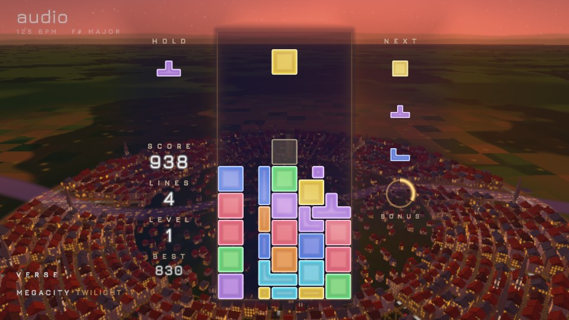

A single hut on a riverbank grows behind the well into a city that covers the whole planet, with the cleared lines (code in `src/universes/megacity/`, `--universe megacity`). At the first line it is a hut at dusk, seen close at the right of the well: its window glows with the fire, smoke rises from its roof, round trees stand around it and the river behind it mirrors the afterglow. The city then sprawls the way cities do, never as a circle: houses string along the river and the road, a village with its church, a medieval town of steep red and slate roofs and spires inside a wall that follows its ragged edge, a stone city of perimeter blocks around courtyards, mansards and domes, spreading in lobes and fingers along the river, six highways (glowing streams of headlights and tail lights) and the coast of a bay, around parks and green fingers, while satellite towns founded along the highways grow on their own and merge into it. Then the long skyscraper stage, the money shot (some 18 lines, from ~11 to ~29): seen from a low camera slowly circling the main downtown, towers rise in clusters (the main downtown by the old town, midtowns across the view, more in the satellite towns), taller and more numerous line after line, in varied silhouettes (setbacks, tapers, twisted towers, octagons, slabs, pyramid tops, spires, lit crowns in warm, white or the variant's accent, red beacons), then megatalls kilometers high; then arcologies rise on the horizon like mountain ranges, the camera climbs to see the continent (the bay's coast, the sprawl's lobed edge), the space elevator's tether rises into orbit, and the city covers the continents, then the oceans, until the planet is one glowing ball of lights (at 43 lines) under an orbital ring built around it from the elevator's top over some 7 more lines, done by about 50 (one song; lines at the reference pace: the scene completes at `sceneLines()`, 15 lines a minute of song, 50 for a 3:20 song, and the counts here scale with it; the growth's speed is capped so a short song's bigger steps stay calm). Dusk turns to night as the town grows, so the lights read, and the sun sinks behind the planet at the end (its glow on the limb).

The growth is driven by a frontier F (meters, from a table of lines interpolated in log space: 4 m at the start, the walled town at ~7 lines, the first towers at ~11, megatalls from ~24, arcologies from ~29, the continent from ~35, the planet at 43), and each place rises when F passes its organic distance D (`mcity::field`, the same function on the CPU and in the ground's shader): the distance from the hut, shortened along the river, the highways and the coast and stretched across the land, warped by noise into lobes and fingers at every scale (in log-polar noise, so the shapes stay organic from a village to a continent), and short again around the satellite towns. The plan is generated once per game from a seed (`city.cpp`): past the hand-laid village, square lots sized by D (an octave of D a level: the older the district, the smaller its buildings), on street grids turned district by district (a patchwork of grids with plazas where they meet, never a ring grid), each built in its era's style (town houses, stone blocks, modern mid-rise, megablocks, arcologies); the downtowns are planted on their own, each a cluster of towers whose birth spreads over a decade of F, the tallest near its core (`mcity::towerH`: ~95 m at the first towers, ~1 km at 40 km, ~4 km megatalls), and the old town sinks back where they rise (buildings carry a death as well as a birth). Every building rises out of the ground (with a slight overshoot) as the frontier passes it: nothing is uploaded while the city grows. The ground's shader draws the same lots: streets and their lamps, lanes cutting big lots into blocks, the highways' traffic, the lots too small to draw as buildings as rooftops with lit windows; from far away organic clusters of light on the sphere, glittering with points of light kept a pixel wide (two layers of cells cross-faded with the scale, the stars' trick; the far towers' windows do the same).

The drawing is detailed wherever the pixel can read it (every detail fades into its average once it is smaller than a pixel or two). The buildings: the hut's log ends and thatch in rows; houses with a plinth, half-timbering (posts, rails and braces), painted shutters, a door with a warm fanlight, tiled roofs in staggered rows with a ridge, and brick chimneys, the nearest smoking; the church's ashlar, lancets of colored glass, a rose window on its gable, a clock face (twelve ticks and its hands, no numbers) and the belfry's lit openings; arrow slits on the wall's towers; stone blocks with pilasters, string courses, a cornice, balconies, chimney stacks along the mansards and lit dormers in them, and on the ground floor shopfronts warm with light under colored awnings and glowing sign bands (no lettering); glass towers with curtain-wall seams and spandrels, structural bays, lit corner strips, a bright lobby and its canopy at the foot, lit crowns, the neighbours' lights mirrored in the glass, helipads with a ring of lights and roof gardens with lamps, rooftop plant (air conditioning units, water tanks, antennas), and a crane beside each tower while it rises (gone once it is built). Every window has its room: warm lamps, cool white, an orange shade, now and then a television's soft blue, curtains half drawn, a mullion cross, whole floors lit or dark together. The ground: street lamps with their pools of light, parked cars along the kerbs and trees lining the pavements at close range, streets with traffic streaming in the blocks, highways; bridges over the river (stone arches, a lit parapet, lamps along the deck). Life: boats on the river with their masthead and side lights, a lit train running out of the city, ships in the bay, an airport west of the town (runway edge lights, approach lights flowing in, planes taking off and climbing with their beacons), helicopters circling the downtown with a searchlight, steam over the towers lit from below, birds flying over the village at dusk; a thicker haze between the tower rows in the skyline stage. The ray-traced sky and ground are drawn at up to 1080 lines (the planet's limb antialiased), upsampled with their depth under the buildings and the lights, which are 4x multisampled at the full resolution (up to 1440 lines).

**Each clear** dissolves the row's cells into light that flows out of the well to the city's edge, which then springs out to its new radius (a critically damped spring), with a line of work lights along the frontier; a quad adds fireworks over the edge. **The drop** (a real one only, not a chorus: the HUD's section, else the music's pace) raises a whole new district out of the ground in a slow wave (the frontier jumps out by half, kept: in the skyscraper stage a whole wave of new towers) while the camera pulls back after it, and the district's lights come on patch by patch on the beat (a share each beat, the patches organic, each a little brighter as it comes on); over a town, sky lanterns rise from it, over a modern city searchlights sweep the sky from behind it while the peak lasts. Calm keeps the traffic slow and fewer windows lit; mid and peak bring more lights, faster traffic, flying traffic over a big city and, at a peak, the towers' red beacons blinking on the beat grid (each its own phase). Slow motion slows the traffic and cools the lights; game over turns the lights off from the edge inward, and the next game starts again from a hut (the camera dives back down). It leaves and enters through the bridge.

The world, with depth: one ray-traced pass per pixel for the planet (an Earth-sized sphere: grass in soft patches at every scale near the hut, the river between sandy banks mirroring the sky and the city's lights, fields and woods around the town, continents, oceans, deserts, snow; the city's carpet), its atmosphere (the dusk sky deepening to night, the afterglow on the sun's side, the city's glow on the haze, the limb from space), far hills, an aurora in one variant, the moon and space; the buildings in one instanced draw (a box with a gable roof, tapered, on the sphere; windows by era with groups of floors lit or dark together, timber framing, stained glass, torches on the walls, glass mirroring the sky, glowing crowns and bands of light on the arcologies; toon light from the low sun with an afterglow rim, the moon at night, the city's glow from below), drawn only from the era whose lots are big enough to see; then the lights in the air (trees, smoke, fireflies, beacons, flying traffic, lanterns, searchlights, the elevator's tether, the ring) in one instanced draw; a quarter-resolution bloom; the stars, the veil, the pieces and the lettering at full resolution. Four variants, each with its sky, land, buildings, lights and seven pieces: TWILIGHT (an orange afterglow into a deep blue night, amber lamps in the old town, white towers, teal arcologies), NEON (a magenta dusk into a violet night, pink and cyan lights, a neon skyline; driving songs), AURORA (a snowy north under a peach dusk, then a night of aurora curtains, red wooden houses, warm gold windows; dark minor songs) and DUNE (a river in the desert, green irrigated fields in the sand, a burnt orange dusk, golden lights; bright songs), from the tempo, bass, mode, brightness and key (`--universe megacity:aurora`). The pieces are lit glass: tinted glass lit from within like a window at night, a cool sheen sliding down them like the sky on a tower's glass. Its font is Jura (Light and Medium, SIL Open Font License, `src/universes/megacity/OFL-Jura.txt`). Test hooks: `REFALL_MEGACITY_LINES=N` adds N lines to the growth, to look at a stage without playing to it; `REFALL_GROW_RATE=R` adds R lines a second (a time-lapse).

## ORBITAL STATION

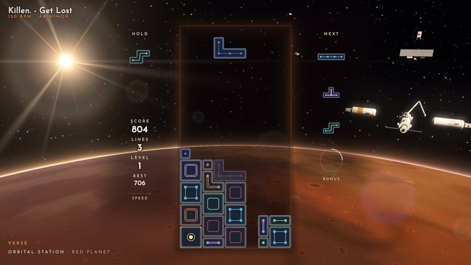

A space station builds itself in orbit behind the well and then grows absurdly, an order of magnitude a stage, from a lone crew capsule over the planet to two rings that dwarf the planet and the Moon (code in `src/universes/orbital/`, `--universe "orbital station"`). **Each cleared line flies new modules in** (two a line at first, then several; a big batch, a quad late on, comes in closer together, all on its way within some nine seconds): the row's cells flare and shrink into light that flies out of the well to the module's seat, tugs carry it in from far off and push it to a point off its seat (braking on their thrusters), then it eases home while they back off and leave; within reach, the robot arm on the first lab guides it in; the seat lights up as it latches and welding sparks fly. Nothing is ever replaced. The stages: nodes and labs, the truss with its solar arrays turning to the sun, a cupola (the first two or three lines); the habitat wheel behind the core, turning once complete (by about five lines); a visiting ship, more arrays, radiators, a dish, a spindle down to a great hub and the great forest ring, 18 km across, brought in by squads of giant tugs (forests, a river, lakes, clouds and towns inside; by about 11 lines); spires on its rim; three nested rings round it, 50 to 150 km across, tilted and counter-rotating (a band of land, a tube of windows, a wider band); four shipyards each building a huge ship that grows in its cradle under welding sparks, then sails off as a new one starts; a space elevator from the ground through the station's height to a counterweight 2,200 km up, its climbers riding up and down; a ring round the whole planet; then that ring becomes a wheel round the planet: three more elevators in its plane, a rim ring through their counterweights, and two rings crossed over it, tilted and counter-rotating, at 1.75 and 2.1 planet radii, each with four elevators climbing up to it (lit tethers, a port at the station's height, climbers, a counterweight with its arrays on the ring); a fleet of O'Neill cylinders (and, when the sun is in view, rings of glinting collectors round it: a Dyson swarm's hint) 2,500 km long turning against each other; the Moon taken in hand (rings round it, mining spires, a lattice shell, its seams and the great pit of its hollowing lit, a mass driver flinging loads toward the planet); and the finale (at 50 lines, one song, at the reference pace: the scene completes at `sceneLines()`, 15 lines a minute of song, 50 for a 3:20 song, and every count here scales with it; after the forest ring a new stage every four lines or so: the nested rings by ~18, the shipyards ~22, the elevator ~26, the ring round the planet ~30, its wheel of rings and elevators ~36, the fleet ~40, the Moon ~44): two crossed rings of 230,000 and 290,000 km round the planet and the Moon, a band of land and a tube of windows turning against each other, with spokes of light down toward the planet, which is now a small ball at their heart. Traffic never stops: convoys and lone ships with glowing drives on their courses round the works at the scale of the frame, construction sparks on the newest modules, drones at the start. The camera pulls back with it (a spring in log space; every module kept in frame; the anchor never runs ahead of the framing): from some ten meters round the capsule to some 400,000 km. While the station is small it sits in the strip right of the previews, clear of the HUD; big, it is centered behind the well, under darker veils behind the well and the HUD columns. Past the space elevator it looks at the planet from outside, the planet's true geometry, ever smaller in the frame; structures pass behind it (the planet writes its depth).

The planet below is ray-traced at full resolution in its own pass: continents with fractal coasts and terrain detail down to a couple of pixels at every scale (the octaves fade with the pixel's footprint), natural forests, grasslands, savanna browns, deserts, tundra, rock and snow on the high ranges, oceans with turquoise shallows and the sun's glint, crisp swirling clouds (thick and thin, textured) with their shadows on the ground, the terminator (pink clouds), clustered city lights by night, a crisp limb of air, blue by day and red at the terminator, a thin airglow by night; it turns slowly under the station. Space has the Milky Way and stars measured in screen pixels through the projection's Jacobian (as GIANT TREE does), the sun with its glow. The Moon (brought in to 55,000 km for the show) is a lit sphere with seas and craters. The station is instanced solids (boxes and parametric cylinders, cones, spheres, tori and bands, at any scale) in 4x multisampling with their own materials: quilted white insulation blankets, crinkled gold foil, solar cells with bronze frames, ribbed radiators, lattice trusses (alpha to coverage, a mean coverage when too fine), glass, the rings' land; lit by the sun with its shadow map and the planet's shadow, by the planet's light from its side and its reflection, a rim of light on the edges turned from it; lamps, nav lights, windows and thruster plumes glow under a soft bloom.

The song: calm is a quiet station (a few lamps, the nav lights blinking slowly); mid lights more lamps, the nav lights blink every two beats and a few drones make their rounds; a peak lights everything, more drones, welding sparks on the beat grid, lamps lifted by the kicks. **The drop** (on a real drop only, not a chorus: the HUD's section, else the music's pace) switches every lamp on in a sequence from the core outward, spins the rings up (slowly: the wheel to a turn every twenty seconds, the great ring every four minutes) and sends heads of light chasing round them on the beat grid, along strips of light on the wheel's tube and a band along the great ring's hull (round the wheel every two bars, round the great ring every four); before the wheel exists, the drones gather into a halo round the station and chase their lights round it. A quad runs a wave of light out from the core through every lamp. Slow motion is an eclipse (the sunlight fades, the windows and the cities glow). Game over powers the station down from its rim inward; a new game takes the modules away (they shrink back, the outermost first) and the camera dives back to the capsule. It leaves and enters through the bridge.

The pieces are panels of colored light: satin color lit from the top left, a line of light just inside their edge like an edge-lit pane, a glow at their heart; the ghost is the line of light alone. Four variants, each with its own seven pieces: **BLUE MARBLE** (the day side under a high sun, white and gold), **ORBITAL DAWN** (the sun rising over the limb in the frame, a red and gold line of air, the night below with its cities, the station rim-lit, amber chases), **AURORA NIGHT** (the night side, green and violet aurora curtains along the horizon, the moon, the station in moonlight with its windows lit, aqua chases) and **RED PLANET** (a rust world with craters, canyons and dark plains, a thin dusty air blue at its sunset, colony lights, a copper-trimmed station; the ring's forests green against it). Jura (Medium and Light) for the HUD. Cost: the planet pass at most 600 lines, the station in one instanced draw per mesh (a few thousand instances at the end), a 2048 shadow map, a two-level bloom.

`REFALL_ORBITAL_LINES=N` (a test hook) adds N lines to the station, to look at its later stages in a screenshot; `REFALL_GROW_RATE=R` adds R lines a second (a time-lapse).

## LIBRARY

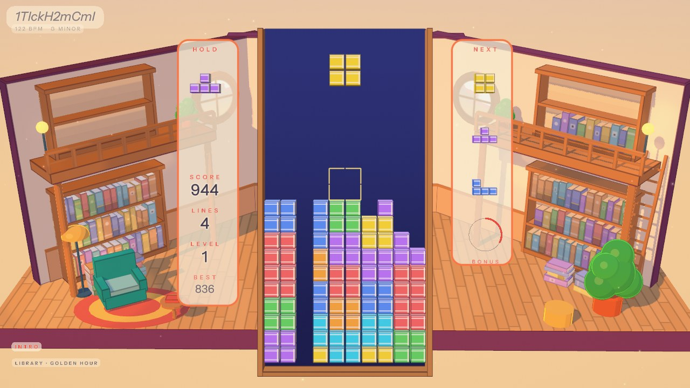

The blocks are books, and every cleared line brings big books (three at the reference pace) to a small, cosy library room that fills with the game over about one song, in 3D (code in `src/universes/library/`). The room is a diorama, a tabletop model seen from above through a long lens and framed around the well, drawn as a toon picture book in the spirit of the 3D Zelda games (Link's Awakening): a thick floor slab and walls cut in section (their cut a deep color), chunky painted furniture, cel shading in crisp bands with a cool colored shade, soft dark ink along the edges, round friendly shapes. It is calm and lower in contrast than the board: calm walls with large empty areas, few, big bookcases, big books in the pieces' colors muted toward the walls.

The board stays a clean game board: each cell is one toy block in its piece's color (bright, a gentle step toward pastel), separated from its neighbors by a clear gap. The block is a bound volume with its spine toward us: a bright bevel band at its head and a shaded one at its foot, two cream rules, its pages showing in a narrow strip down its right side, its top a lighter band, its edges inked in a dark shade of its own color. The board's camera is raised a little and shifted back down, so the board keeps its pixels and the blocks' tops show. The well is a chunky painted frame over one deep, saturated ground (indigo, navy, deep teal, night blue) that all seven piece colors stand out against; the ghost is an outline in the piece's color. The HUD sits on light, see-through rounded cards edged in the variant's accent (the room shows through them, the piece previews on top), the corner texts on small rounded tags.

**The room**: a short back wall behind the well and two long walls angled toward us, on a plank floor. On each angled wall, a big three-shelf bookcase and, nearer the back, a round window with the sky and a round wall lamp. At the front left a reading nook (an oval rug, a chunky armchair, a floor lamp with a round shade, a round side table); at the front right a big round bush in a pot and a pouf.

**A clear**: the row's blocks dissolve into their own light in about a quarter of a second, where they stand, before the stack above comes down. Some of each cleared line's cells send a book to the room, spread along the row: three at the reference pace (cells 1, 5 and 8), and in general 3 × 50 / `sceneLines()` on average (the scene completes in 15 lines a minute of song: 1.5 a line in a 6:40 song, 7.5 in a song of 1:20 or less; the fraction carries to the next line), so the room still fills by scene completion and every book still leaves from a cleared cell (a quad's dozen spread over two seconds, a bigger batch within 2.5 s, each on its own arc), on a slow, legible arc of about two seconds: out from behind the cell's place in the well, a rise beside the board, then a glide through the open room in front of its shelf (past the HUD's columns) and in. On the way it is bigger than life, in its piece's full color with a soft glow and a short ribbon of light trailing behind it, turning over once; it takes on its muted shelf tint as it lands, and a soft pulse of light marks the place it went. The room is drawn under the board and the HUD, so none of this ever passes in front of the well, the stack or the HUD. **Every book in the room came from a cleared line**, placed in the order they came and never moved again. The room fills in order, complete at scene completion (about 50 lines for a 3:20 song; the line counts below are at that pace): the two big bookcases shelf by shelf from the bottom, right and left in turn (from the start); when the top shelves are reached, a ladder appears (about line 14); then piles of books lying on the floor in front of the bookcases (about 21); then a mezzanine grows along both angled walls, on round columns, with a low rail, a lamp, a little bush and its own bookcases, which fill next (about 27); then two more bookcases appear at the back (about 40), full by about 50. After that the room is complete: no more books come and nothing new appears (the exact lines vary by a line or so with the books' thicknesses). Each new piece of furniture grows in from its floor (a little toy overshoot) when it is first needed. Every book is one simple box, its spine with a light band, a dark title or a round label.

The song: dust drifts in the light; the lamps follow the music (a little brighter at a peak, lifted by the kicks). **The drop** (a real one only, not a chorus: the HUD's section, else the music's pace) makes the shelves breathe: on every beat a wave rolls along each shelf, the shelves alternating directions, the books it passes sliding out and tipping their heads forward, lit for a moment, then gliding back exactly into place; loose pages flutter up from the bookcases into the room; a soft light runs slowly along the collection in the order it came (a quad runs one light along it). All of it stays behind the well. Slow motion is blue hour (the sun and the sky cooled and lowered). Game over topples the blocks out of the bottom of the well, away from us. It leaves and enters through the bridge.

The room is instanced boxes, cylinders and hemispheres (two make a sphere) with their materials: painted wood, the bookcases' backs, flat painted plaster, the plank floor, the round toy shapes (bushes, pots, shades, glowing globes, the rug, the armchair), the round windows (a disc showing the sky through a cross of bars), the backdrop (the variant's sky, with stars at night) and the books. The furniture that comes later is built with the rest and scaled from its floor in the vertex shader by its feature's growth. The toon look is all in the one solid shader: the sun's light quantized into three bands (the shadow map's edge through the same bands), the shade a colored ambient light (cool from the sky, a tinted bounce from the floor), a crisp highlight, the lamps' light in two soft-edged pools; ink lines a few pixels wide along every box's edges (lighter on the room than on the board), a dark rim and a warm rim along the silhouettes of round shapes; then a tone curve that stays linear up to 0.8 and a little extra saturation. It is lit by the sun with a 2048 shadow map, the 16 lamps that matter most and the bookcases' own soft light. It uses 4x multisampling and a quarter-resolution bloom. Settled books are kept in their own buffer.

Four variants, the same room in four moods, each with its seven bindings, its well ground and one accent for the HUD's cards and labels:

- **GOLDEN HOUR**: warm cream walls over an apricot wainscot, honey floor and bookcases, a teal armchair, a low golden sun and lavender shade, an indigo well; coral.
- **SUNNY NOON**: soft white walls over a sky-blue wainscot, light wood, a yellow armchair on a blue rug, a high white sun, a navy well; cobalt.
- **MORNING**: mint walls, butter floor, coral bookcases, a lilac armchair on a pink rug, a pink dawn sky, a deep teal well; pink.
- **STARRY NIGHT**: indigo walls and floor, honey bookcases glowing under the warm round lamps, stars in the windows and the backdrop, a night-blue well and night-blue cards; gold.

The variant is picked from the mode, brightness, air and dynamics (`--universe "library:sunny noon"`). Its font is Instrument Sans (Regular, SemiBold, Italic; SIL Open Font License, `src/universes/library/OFL-InstrumentSans.txt`).

Test hooks:

- `REFALL_LIBRARY_LINES=N` adds N lines to the collection, their 3 N books (of random colors) already in place (and the furniture they need), to look at a long game in a screenshot.
- `REFALL_GROW_RATE=R` adds R lines a second, each shelved like a real line (its three books flying to their places), for a time-lapse.
- `REFALL_LIBRARY_RUNS=1` prints where each run of places (a shelf, a row of piles) starts, in books and lines.
- `REFALL_TEST_QUAD=1` (in the game's autoplay, for any universe) keeps the right column free and waits for an I, so a clip shows real quads.

## SKY WHALE

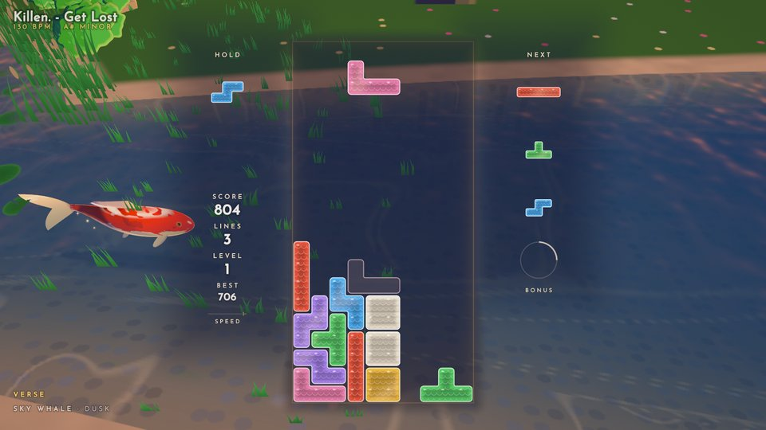

A little koi swims in a lily pond at dusk behind the well, and every cleared line makes it grow, without end: it outgrows the pond and slips into the river, which widens to the sea; as a whale it surfaces and breaches in the open sea by a lighthouse; then it leaves the water and swims up past the hot-air balloons and through the clouds, on into the stratosphere where the horizon curves, into orbit where it glides over the Earth with aurora trailing from its fins, around the planet until the Earth is a ball under it, and out to the Moon (a small pale disc in the sky from the start, on the axis of its orbit: it stops circling the Earth and heads straight for it, the Moon ahead of it on its heading, up and right of it in the free band, growing steadily over some fifteen lines: a great disc, its craters, its horizon flattening, the Earth falling behind), and it comes down and glides low over its craters (code in `src/universes/skywhale/`, `--universe "sky whale"`). GIANT TREE's world, adapted. Its growth is G = ln(the creature's length in meters), from a 30 cm koi at the first line: 1 m (leaving the pond) at 3 lines, a 12 m whale reaching the sea at about 7.5, 160 m leaving the water at 14.5, the clouds' height at about 18.5 (the cumulus dissolving one by one into the sea of clouds over the next four or five lines), orbit around 26, the journey out to the Moon from about 33 (low over its surface by about 50: the whole journey in one song of play; lines at the reference pace: the scene completes at `sceneLines()`, 15 lines a minute of song, 50 for a 3:20 song, and the counts here scale with it; the growth's speed is capped so a short song's bigger steps stay calm), then slower and slower (at most 60 000 km), from a table interpolated in log space. Its path is a function of the growth: down the river's meandering centerline, out to sea, up into the sky (its altitude grows with its length), around the planet (the angle around it saturating so it keeps circling), then over to the Moon; so every clear moves it forward along its journey. **And it never stops swimming**: between the clears it cruises on, at a pace from the music's energy (calm: a slow glide, peaks: quicker), round the pond on a wide circle, down the river (held short of the sea until it has grown into a whale), then on and on around the planet (out to sea past the lighthouse, through the clouds, which tile around it, around the Earth in orbit, over the Moon), the scenery scrolling past. **Its swim is physical**: the tail's strokes give thrust (twice a stroke, as the tail sweeps through the middle) against drag, so it accelerates, coasts between strokes and keeps its momentum. The koi swims in bursts of quick beats (about 2 Hz) and coasts, its whole rear half sweeping in a wave that travels from its head to its tail; the whale strokes its flukes slowly and steadily (about 0.3 Hz), its body flexing mostly at the tail stock, its head steady, stroking harder when it falls below its pace. It steers toward goals off its line that drift slowly (smooth noise): its heading turns with angular inertia, it banks into its turns with a lag (the sideways pull of its speed and its turn), its body bends into the curve, its flippers tilt with the bank (the koi's pectorals fan as it coasts), its pitch follows its climbs and dives; now and then, in the air and in space, a slow barrel roll. A clear is a few power strokes (wider, quicker beats), so it speeds up through its own strokes and coasts back.

The creature is one mesh for its whole life (a grid per part: the body, the tail fin, the dorsal fin, the pectoral and the pelvic fins, ~20k triangles, uploaded once), placed by the vertex shader against the morph (koi to whale, between about 1 m and 15 m): the slender, laterally flattened koi with its forked tail and long dorsal fin thickens into a whale with a throat and a flat head, the tail's plane turns from vertical to horizontal into flukes with a notch, the pectorals grow into a humpback's long scalloped flippers, the pelvic fins fold away, the dorsal shrinks to a small hook. It swims with a traveling wave down its spine (side to side for the koi, up and down for the whale: the wave's plane turns with the tail's), its fins beating slowly, normals taken from the deformed neighbors; in orbit its spine bends into an arc around the body it circles. Toon light like GIANT TREE's (two bands, a cool tinted shade, a warm rim, a crisp wet highlight, a fill from the sky), the koi's markings (red patches on white, ink spots, fine scales, a gold-ringed eye) becoming on the whale a dark back over a pale belly with the throat's pleats, the old markings drawn as soft lights along their edges, with dots of light that glow at night and in space. **Each clear is a slow, powerful stroke of the tail**: the growth springs to its new target (a critically damped spring of about a second), the wave quickens and swells, the creature surges ahead along its path (its cruise speeding up, then easing back), glints and streaks pass it, the camera follows a moment later, and the cleared rows' cells melt into bubbles of light flowing out of the well to its head. A quad is a huge one, with a burst of sparkles and a ring of light, and at sea a breach at once.

The world, in one ray-traced pass per pixel at a reduced resolution: the planet (a sphere of the Earth's size under the pond), the pond, the river and the sea at local scale (with the same functions on the CPU, so the path follows the river), a shore of sand and pebbles, meadows in crisp two-tone patches, wildflowers, lily pads with lotus flowers on the calm water (they hide what swims under them), and farther the continents, oceans, snow, the cities' lights on the night side; the water's floor under the shallow water (pebbles, drifting caustics, the koi's soft shadow) absorbed with the depth, the surface reflecting the sky (Fresnel) in rippling bands with the sun's glint in crisp streaks, the floating lanterns' long reflections, and at sea the whale's wake (a broken trail, the V of crests from its snout, foam where its body breaks the surface, the rings of a breach's splash); the exponential atmosphere, far hills on the land's side, the sun, the stars, the moon, a galaxy far out, and in the AURORA variant curtains of polar light over the sky. The creature underwater is absorbed and reflected the same way (its path in the water measured in body lengths, so it reads at every size), with a line of foam where it meets the surface. In the world: toon trees and bushes on the banks (scalloped puffs with painterly strokes, trunks as impostors), reeds and grass by the pond, stone lanterns (toro) with lit windows, paper lanterns drifting on the pond, the red and white lighthouse on its rock with its beam sweeping the dusk, toon cumulus (lobed, cauliflower outlines with their relief, three bands of light, shaded bases and hollows, warm sunlit rims; the field tiles around the whale and its puffs fade gradually: thinning as it enters them, below a pixel or two, before the tiling's edge, and as the field falls away below it) and the sea of clouds seen from above (on the planet's sphere, by the altitude, its great octaves swirled into bands; it fades in over the field as the whale climbs and merges into the Earth's cloud cover from orbit), seabirds in flocks of their own (boids: together, aligned, apart, each flock with its own heading; flapping and gliding in turns, banking into their turns), which come in ahead or across, ride the whale's wake for a while, scatter from its body and its surges and are left behind as it outpaces them while new flocks come; hot-air balloons drifting on the wind where they are, passed as it climbs, satellites in orbit, spray, glints, dust lifted from the Moon in its wake, and in orbit ribbons of aurora (green to violet curtains with rays) trailing from its flippers and flukes along its arc.

The camera rides with it, a moment behind, pulled back so the creature sits small in a wide scene (it follows a part of its wandering, so the creature moves in the frame while the world scrolls past): looking down into the pond at the koi among the pads, low over the river, at the sea's level from ahead as the whale surfaces and leaps (the camera follows its path, not the leaps, so it bursts out of the frame and falls back), alongside it up through the clouds, looking down at the curving horizon, then across the orbit's plane (in the local frame of the body it circles, so it keeps its bearings all around the planet), pulling back to keep the Earth inside its arc, then low over the Moon looking ahead along its ground. **The finale**: the Moon is one fixed world (a fable's Moon, far bigger and farther than the real one), ray-marched at every distance (at the sky's resolution, with its depth, its rim antialiased, over the sky), from the small disc to the landscape under the whale: grey regolith and darker maria, ridged mountain ranges in the highlands, craters at six scales (bowls, raised rims, ejecta blankets, central peaks in the great ones, the young ones bright with rays), rilles; a low sun from the side with hard shadows marched toward it, the whale's own shadow on the ground, in the black sky. The scene is drawn mirrored (the composite flips the world, so the light, the lighthouse, the river and the parallax stay coherent): the creature keeps to the left of the well, in the band left of the HUD's left column, and swims left to right (the board and the HUD never move). The music: calm is a slow glide; mid and peak swim livelier (a quicker, wider wave, more glints around it). **The drop** (on a real drop only, not a chorus: the HUD's section, else the music's pace) is its song: a great stroke and an extra surge of growth (kept), its lights brighten and run from its head to its tail, and soft rings of light (about half its length) ripple out of it through the sky or space on the beat (one every two beats, on the beat grid, expanding slowly over four seconds), then it settles. Slow motion softens and cools the light and slows the swim; a level up sends one ring out. Game over: it sinks into the deep, fading; the next game hatches a new koi in the pond (with new markings) and the camera dives back. It leaves and enters through the bridge, and in a break between songs the world stays on its own with the creature swimming. Four variants, each with its sky, light, water, banks, creature and seven pieces: DUSK (an indigo sky over a peach horizon, warm lanterns, a kohaku koi, red on white), MOONLIGHT (a deep blue night, cool light, a platinum and red koi whose lights turn cyan), DAWN (pastel pink and blue, cherry trees on the banks, white lotus, a golden ogon koi) and AURORA (a polar night with green curtains over the sky, snowy banks with dark pines, a showa koi), from the mode, brightness, air, density and key (`--universe "sky whale:aurora"`). The pieces are koi-scale enamel: glossy, deeper toward their middle, covered in fine overlapping scales lit row by row, a wet glint, a bright inner rim, a slow shimmer like light under water; a cleared row melts into bubbles. `REFALL_SKYWHALE_LINES=N` (a test hook) adds N lines to the growth; `REFALL_GROW_RATE=R` adds R lines a second (a time-lapse). Cost: the ray-traced sky at a reduced resolution (at most 720 lines, its depth in a texture), upsampled with its depth into a 4x multisampled target at the full resolution (up to 1440 lines) where the geometry is drawn (the creature in one indexed draw, the props, the trees and the lights in the air in two instanced draws, the clouds, the sea of clouds), then resolved; a bloom at a quarter of the sky's resolution; the stars, the veil, the pieces and the lettering at full resolution. The creature's markings, scales, pleats, eye, fins' rays, highlight, waterline and foam are antialiased in the shader (their widths from fwidth), the planet's limb and the horizon are blended over a pixel and a half, and the noises use a sin-free hash so they keep their precision far out. `REFALL_GPUTIME=1` prints its GPU time per frame. Its fonts are Quicksand Medium (labels and numbers) and Fraunces Soft Italic (the song, the variant, the notices) (SIL Open Font License, `src/universes/skywhale/OFL-Quicksand.txt`, `src/universes/skywhale/OFL-Fraunces.txt`).

## PLANKS

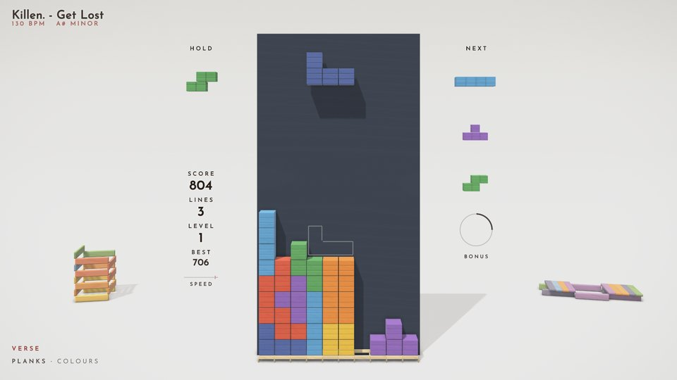

BRICKS' studio made of wood: thin wooden plank blocks, all the same (1 : 3 : 15, the proportions of the real ones), stacked the way a child builds with them in the village, the board kept clean (each cell one solid stained block), and every cleared row pushes its planks out of the well to build a plank village beside it (code in `src/universes/planks/`). Real 3D through BRICKS' raised camera with a lens shift (the board's plane keeps its pixels while the table recedes), a seamless white studio sweep under one soft key light with two shadow maps (the village at 4096, the well up close at 2048, soft spiral taps), screen-space ambient occlusion from a prepass (the gaps between planks, the openings, the table under the builds) and up to 8x multisampling. Every plank is one instanced box shaded as wood: rounded arrises computed from the box's own coordinates (the normal leans out within a radius of every edge, so the edges catch the light), procedural growth rings around a pith off the plank (its own per plank, drifting along the length: cathedral arches on the wide faces, straight lines on the edges), fine fibers, darker end grain with pores, a translucent stain or paint that keeps the grain, a satin sheen. **The board stays a clean game board**: each cell is one solid block of three thick planks laid flat one on the other, tight (only fine seams between them, their end grain at the cell's sides, a small gap around each cell), all stained in its piece's color over the grain, so every piece reads at a glance by its color in every variant (a first version built each cell as a see-through log-cabin stack with colored stripes; it made the board too hard to read, so the plank architecture lives in the village only). The well is a painted board standing on a plinth of crossed planks; the falling piece is held a little off the board, its courses a hair loose, and they settle when it locks (a small spring onto the board); the ghost is a fine outline on the board; the previews are small planked pieces. **A cleared row**: the row's cells tip back like dominoes, a wave from the middle out, and slide back into the board (under half a second, nothing left behind); each cell's middle plank is pushed straight back into the board, Jenga style. Hidden behind the board, it comes down to the table and slides out from under the well's back, low on the table (the left half to the left, the right half to the right), below the HUD's columns, and only once past them does it rise on an arc away from the camera to its place in the village, landing on the music's half beats: nothing passes in front of the well, the stack, the falling piece or the HUD. Every plank of the village is a cleared cell. **The village**, authored plank by plank (`build.cpp`), each build laid bottom-up, each side its own builds in turn: on the left a tall tower with two floors and a gable roof, the left half of a track close behind the well (rails of planks laid end to end on sleepers, like the real train sets; low on screen under the HUD's columns, ending before the corner labels), a pagoda far back (a wide base, lean-to skirts, a core tower, a gable roof and a spire); on the right a temple (a core tower between two porches on columns under lean-to roofs, a stepped top), the right half of the track, a train (a locomotive with buffer beams, a boiler of planks laid flat, a cab on four columns and a chimney; a carriage on six columns under a roof), a long house; then more houses, towers and pagodas farther and farther back on each side, receding into the studio's haze, kept out of the HUD's columns. The music: calm, the village stands still; mid and peak send a gentle ripple up the constructions every two beats (each plank lifting a hair and settling, bottom to top); a peak sets the finished train shuttling along the right half of its track, from behind the well to the end (slowing to turn); the drop speeds it up, ripples higher and warms the light once (a slow swell). A quad is a big ripple through the whole village, and its planks keep their paint, so a few colored planks stay in the village as a record. Slow motion is an evening light raking in from the right. Game over: the stack's cells drop into the plinth, from the top down, and every plank of the village topples gracefully onto the table around its build, from the top down; the next game sweeps them away and starts a new village. It leaves and enters through the bridge, and a break between songs shows the village alone. Four variants: PINE (natural pine on white, the pieces in clear stains, a natural village), COLOURS (the colored planks of a toy set: lacquered colors over the grain, the planks across left natural, a colorful village), HONEY (late afternoon: a peach studio, a low honey light from the left, oiled pine, warm stains and a teal I) and HARDWOOD (a dark studio under one lamp, the pieces in natural hardwoods: maple, yellowheart, purpleheart, olive, bloodwood, blue-stained ash, padauk). The lettering is Nunito. `REFALL_PLANKS_LINES=N` (a test hook) lays N lines' planks at once, `REFALL_GROW_RATE=R` adds R lines a second, each cleared like a real line (a time-lapse), `REFALL_PLANKS_QUAD_AT=T` plays a quad's choreography at T seconds (four rows in the middle of the well: the autoplay never makes one).

## TIDE POOL

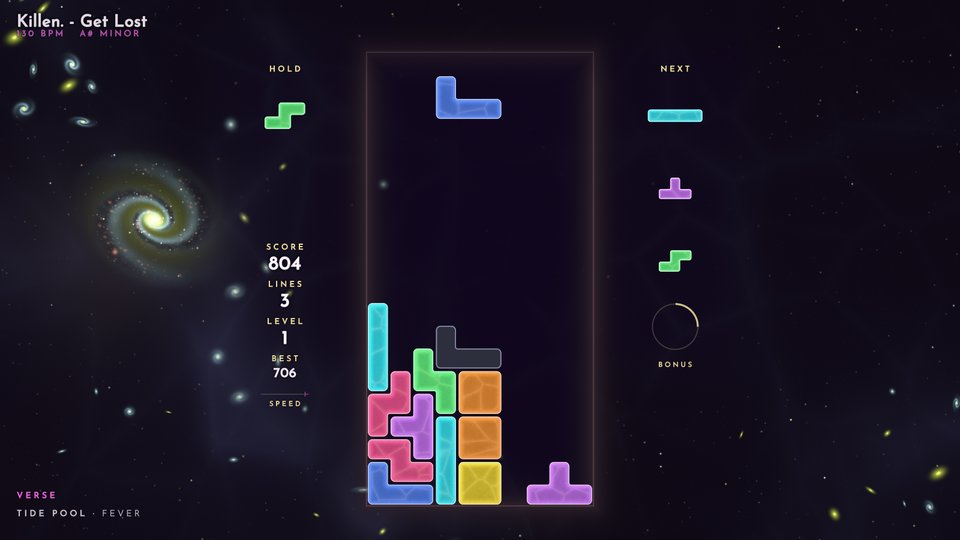

Attention as a journey (code in `src/universes/tidepool/`, `--universe "tide pool"`). Behind the well, the whole universe: the cosmic web, filaments of galaxies glowing in the dark (cool blue and violet threads, warm clusters at their nodes, galaxies strung along them as points of light that resolve into little spirals and ellipticals as the zoom comes near). Every cleared line zooms deeper, one continuous dive inward through fifteen scales, each 16 times smaller than the one before and each already there in the one before, tiny, at the focus: **the universe**; **a galaxy**, the one at the web's node at the focus, among its neighbours, a spiral seen a little tilted (a golden bulge, blue arms with dust lanes on their inner edges, rose knots of star birth, its stars resolving as we come near), the focus in one of its arms; **a star** there, by a rose and teal nebula, its corona breathing, its planets on orbits drawn as fine threads of light (a ringed giant among them); **the planet** on the orbit that crosses the focus, lit from the sun: oceans with turquoise shelves and the sun's glint, continents green and ochre with mountains, snow and ice caps, swirling clouds, the cities' lights on its night side, the air blue at its limb, a cratered moon; **its coast** from high above (the planet's surface is one function from orbit down to the rocks, octaves of relief appearing as we come near, its coastline running through the focus at every scale: bays, beaches, forests, the shallows' sand); **the shore**, surf rolling in along it in broken lines of foam, a lace on the sand, a shelf of slate by the sea with tide pools in it, and at the focus the very rock pool of the next stage; **the rock pool**, almost nothing to see: clear water over rippled sand and pebbles, caustics, dark wet slate around it with lichen high up, pink coralline crust and green weed by the water; **its floor** (stones with limpets and barnacles, colonies of beadlet anemones with blue beads at their rims, blades of sea lettuce, a shore crab or two walking), dotted with specks of plankton; **the water**, teeming: amber copepods hopping, nauplii rowing, chains of diatoms with their spines, little glass discs of diatoms, motes in and out of focus; **one diatom** (the one at the focus, among others drifting by), a jewel of golden-green glass lit like a shallow dome: rings of pores with a sieve in each once it is big, a band of clear glass and a crisp bright rim, thin-film colors, a light turning round it, the golden living cell glowing through every pore; **the cell**, cytoplasm streaming, chloroplasts with their thylakoids and pyrenoids, granules and oil drops; then the dive leaves realism for imagined physics: **molecules** jostling, orbs of light bonded by threads of light in Brownian jitter, double helices of light crossing the field; **an atom** (the one at the focus), its orbital clouds breathing in nested shells with more lobes outward, a slow quantum beat between states, the phase in warm and cool, drawn as contour lines of light, bonds leaving as threads; **quantum foam** inside its nucleus, iridescent cells that swell, thin and burst, each burst a ripple that interferes with its neighbours' like rain on the pool, virtual pairs of sparks spiraling apart and annihilating; **strings**, loops of light ringing in harmonics fed by the song's bands over a fabric of interfering ripples; and the whole universe again, a knot of light at the focus of the strings that opens as it comes: the zoom never ends. The HUD's corner line ends with the scale of what is behind the well, a power of ten in meters, and the stage's name (from 10^26 m for the universe, through 10^7 m for the planet and 1 m at the pool, to 10^-35 m at the strings, after which the smallest holds the largest again).

The dive is one similarity transform about a point in the free band left of the HUD's left column (wandering a little; never behind the well or the HUD's text), so every visible thing grows at the same exponential rate and streams out from it across the screen: a depth z in octaves of zoom, four octaves a stage, fifteen stages a loop. It drifts inward slowly all the time (about 0.3 octave a minute, a little more in a peak), each cleared line pushes it 1.1 octave deeper and a quad its four lines, about a stage (4.4 octaves). The zoom's speed always eases in and out and never exceeds a third of an octave a second, so even the far edge of the screen moves only a few pixels a frame, a line is a glide of three or four seconds and a quad a long, calm glide of some thirteen seconds down through the next stage (never skipping it). The strings, the last stage, come at scene completion, one song (`sceneLines()`: 15 lines a minute of song, 50 for a 3:20 song; the line counts below are at that pace and scale with it, and in a song shorter than ~2:45 the zoom's speed cap rises with the pace, up to twice, so it can still reach the strings): in a typical game (some 15 lines a minute) a stage every ~3.6 lines, the galaxy at ~3.5, the star ~7, the planet ~11, the coast ~14.5, the shore ~18, the rock pool ~22, the floor ~25.5, the plankton ~29, the diatom ~32.5, the cell ~36, the molecules ~40, the atom ~43.5, the foam ~47, the strings ~50 and the universe again at ~54 (by lines alone: every 3.6 lines, strings at 51). The pace doubled from the first version (strings at 100) by doubling each line's push rather than shortening the stages: the worlds nest 16 times smaller each, and a stage of 2 octaves would barely grow before the next one fades in; the zoom's top speed is unchanged, so it simply glides more of the time. Each stage is a whole world filling the plane, drawn procedurally in its own frame, its things of a fixed size in that world (scattered on grids of cells, in colonies), so they grow from sub-pixel specks to the full screen as the zoom goes on. The shader draws the stage we are in with the next stage's things already over it, tiny (where the current world can host them: the pool's water, the diatom's pores), then crossfades into the whole next world over the stage's last octave and a half; there are no insets or circular boundaries. From the universe to the shore the stages nest exactly: each stage's frame is the one before it 16 times larger (and turned by the zoom's turn), so each draws the one before it as its background (the web's glow and neighbour galaxies behind the galaxy, the galaxy's arm, nebula and stars behind the star, all of it behind the planet) and the coast and the shore draw the very surface the planet's disc shows; those crossfades are between two drawings of one picture. Light glows in the dark there: every source is added, stars stay points of light however close (finer levels of fainter stars coming in as the zoom makes room), and the diffuse glow of the web and of the galaxy thins as the zoom resolves it into galaxies and stars, so the sky between them stays dark. Every edge is anti-aliased against the pixel's size in the stage's units, and patterns fade out before they get under a few pixels (no shimmer). Behind the well and the HUD's columns the world is a little softer and less saturated, so the stack and the score read over it. The zoom turns a little as it dives. Game over: the zoom pulls all the way back out to the universe (through every scale on the way), and the next game starts there.

The music is the tide: it swells slowly, once every two bars, at every scale (the galaxy's bulge and the sun's corona breathing, the waterline creeping over the rock, the anemones opening, the copepods sweeping their antennae every two beats, the light turning round the diatom's glass, the cytoplasm's stream, the molecules' slow Brownian drift, the orbitals breathing, the strings ringing with the song's bands, eased over seconds); calm is almost still, mid stirs it, a peak keeps it moving. Everything is meant to be meditative: each stage has its own clock that slows as the zoom goes into it (so its life keeps a calm pace on the screen however magnified), nothing's pace follows the music multiplied by time (it would jump), and nothing flashes. **The drop** is a wave: a lace of foam drifting over the pool's floor (the pool's level rising), and at every scale a slow ripple through the fabric, out from the focus, settling over seconds. Kicks (in a peak only) are eased into soft swells (rising over a fifth of a second, fading over a second) that light small things: a few bright stars flaring, dinoflagellates glowing at night, a few pores of the diatom glinting, virtual pairs, the strings stirred. Slow motion is a hush: silver and cool, time stretched. It leaves and enters through the bridge.

The pieces are sea glass: frosted, worn round, each piece one pebble, deeper in tint where it is thick, the water's light moving through it, a bright worn edge; the ghost is its edge alone; cleared rows melt into bubbles that rise and are gone; a hard drop pushes a little puff of silt from under the piece; at game over the glass dulls from the top down, like sea glass left to dry. Four variants, each with its own seven pieces: MORNING (teal water over warm sand, rose anemones, golden light; bright major songs), MIDNIGHT (black water lit by living things: glowing anemone tips, sparks in the pool, plankton flashing on the kicks; dark minor songs), NORTH SEA (slate water, kelp ochre, dark red anemones, a pale steel light; dull, cold songs) and FEVER (a psychedelic pool, violet water and acid life, the hues turning as the dive goes deeper; heavy, dynamic songs) (`--universe "tide pool:midnight"`). Cost: one full-screen pass at the full resolution up to 1080 lines for the world (two stages a pixel; about 0.5 to 2 ms a frame at 1080p and 1440p on an RTX 4090, the rock pool the dearest; at 1440 lines it cost 2.7 times what it did at 810), the veil, the pieces and the lettering at full resolution. Test hooks: `REFALL_TIDEPOOL_LINES=N` adds N lines to the dive, `REFALL_GROW_RATE=R` adds R lines a second, `REFALL_TIDEPOOL_DEPTH=Z` holds it at depth Z (octaves, 4 a stage: the planet at 12, the rock pool at 24). Its fonts are Instrument Serif (labels, the song, the notices) and DM Mono Light (numbers, the scale) (SIL Open Font License, `src/universes/tidepool/OFL-InstrumentSerif.txt`, `src/universes/tidepool/OFL-DMMono.txt`).

## MUSIC BOX (disabled)

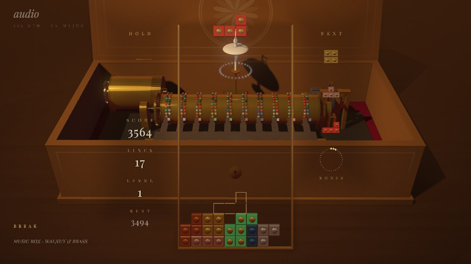

Left out of the default build for now (`-DREFALL_DISABLED_UNIVERSES=""` builds it). A Swiss cylinder music box on a table under a warm lamp, in 3D, and every cleared row pinned on its cylinder (code in `src/universes/musicbox/`). The well stands in front of the open box: a lacquered case on a plinth, its front inlaid with stringing and a brass escutcheon, the lid open behind with its inside inlaid (stringing, a crossbanded border, a rosette in an oval medallion); inside, velvet lining, a black iron bedplate, the brass cylinder on its steel arbor between two cocks, the steel comb with its ten teeth in front of it, the spring barrel with its great wheel and ratchet on the left, the governor on the right (a pinion and wheel, the endless screw, the spinning fly). The camera looks down at it from in front; the cylinder's ten tracks sit over the well's ten columns. The pieces are plates of metal or enamel with a domed brass boss (the pins' heads), seven clean materials per variant (brass, copper, nickel, blued steel, rose gold, gilt, enamels); the ghost is a fine brass outline, the well two brass rails.

**Every pin is a cleared cell**: the cylinder starts empty, and N rows make exactly 10 N pins. A clear: the row's cells lift out of the well one after the other, leave the well's space for the box's at the same pixel and size, and fly calmly to the cylinder, shrinking into pins, one in each track under its tooth, at the next free angle (one in view on the cylinder's front, just over the comb), with a soft glint as they land. The cylinder turns with the song, locked to its beat grid: one slot of pins passes the comb per beat (one per two beats in calm parts), so each pinned row plucks the ten teeth on a beat of the song: each tooth is lifted by its pin, slips off and rings down (the bass teeth slower). The cylinder holds 32 rows round its circumference and 4 tunes side by side along its axis, as on a real multi-tune cylinder: when a tune's slots are full the next tune starts, offset a little, and the cylinder shifts sideways at each turn to play the pinned tunes in turn. A full cylinder (128 rows) is lifted out, turned and laid on the table beside the box with all its pins, and a fresh one is set in. The pins stay for the song; a new song played in the box starts a fresh cylinder.

The song: calm is the still, warm lamp and a slow turn; mid and peak a slightly livelier lamp, glints on the pins' heads and, at a peak, sparks on the teeth as they ring. **The drop** (a real drop only: the HUD's section, else the music's pace) opens the velvet trap behind the cylinder, and a small porcelain dancer rises on her spindle above it and turns, half a turn every two beats, in a ring of light, while a soft light runs round the pins; she stays a few bars after the drop, then sinks back and the trap closes. A quad runs a gleam round the pins in the order they came. Slow motion slows the governor and the cylinder and the light falls to evening; game over winds the box down (the cylinder and the fly slow to a stop, the lamp dims); a level winds the spring (the ratchet clicks round). It leaves and enters through the bridge. In a break between songs (`Frame::bare`) the box keeps turning alone.

Instanced boxes, cylinders and hemispheres with procedural materials (lacquered veneers and inlays, velvet, brushed, turned and polished brass, steel, enamel, porcelain), lit by the lamp (a warm pool with a 2048 shadow map), a cool fill from the window and a small procedural room reflected in the metals; 4x multisampling, a quarter-resolution bloom. Four variants, each with its seven pieces: **WALNUT & BRASS** (burgundy velvet), **EBONY & NICKEL** (black ebony, midnight velvet, a nickel-silver mechanism, enamels), **ROSEWOOD & GILT** (green velvet, gilt) and **BIRCH NIGHT** (pale birch, the lamp low, moonlight), from the mode, brightness and air (`--universe "music box:ebony & nickel"`). Its fonts are Playfair Display and its Italic (SIL Open Font License, `src/universes/musicbox/OFL-PlayfairDisplay.txt`); the bonus gauge is a ring of 32 pins set in brass as it charges.

`REFALL_MUSICBOX_LINES=N` (a test hook) pins N rows (random cells) at once, to look at a full cylinder in a screenshot (over 128, the full ones lie beside the box); `REFALL_GROW_RATE=R` clears R rows a second, each like a real clear (ten cells fly from the bottom of the well to the cylinder), for a time-lapse.

## LOST PANDA

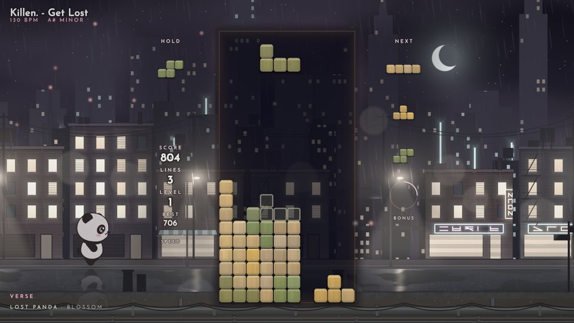

A journey home in one continuous shot (code in `src/universes/lostpanda/`, `--universe "lost panda"`). A little kawaii panda cub is lost in the city at night, alone under the rain, in the free band left of the HUD's left column (some 190 pixels tall at 1080p; smaller on narrower screens). Every cleared line takes it a few steps further through **one world the camera follows it through, never cutting or dissolving**, drawn as an illustrated side view whose near plane is cut away like a cross-section where it goes underground: **the rainy street** becomes **the shopping street** as the cub walks on, a cartoon night city in layers of parallax (after a reference the owner chose: thin dark outlines, flat shading, warm windows, glowing neon; an indigo starry sky with a soft violet haze and a crescent moon fixed on the screen; far misty skyscrapers with spires, antennas and their blinking red lights, sparse windows, cyan neon strips; a denser middle row of towers with water tanks; stretches of an elevated line on a viaduct, a lit train running along it now and then, cars' lights on its lower deck; the street's brick buildings of three to five storeys, warm or cyan windows, some with blinds, cornices, fire escapes, tanks and boxes on the roofs, shopfronts with striped awnings or neon shop signs of abstract lettering, tall vertical neon signs, arcade cabinets glowing in some shops; power lines sagging between poles; people hurrying by under umbrellas in the rain, street lamps and their cones of light, reflections in the wet pavement; black silhouettes of bins, sign posts, bollards and traffic lights at the very front, fastest of all; every layer its own row of hashed cells, so the city never repeats); it reaches a **subway entrance** (a glass canopy, railings, a lit sign) and **goes down the stairs** step by step (eleven steps a quarter of its height, a handrail, a tiled wall, the flight drawn in section in concrete; the camera follows it down, the street and the rain still above the earth's cut, the cavities lined with concrete; in the band of earth between the street and the station run the services, after a second reference: a water main with its flanges, a bundle of conduits, cables sagging between hangers, pipes dropping from the street, a sewer pipe below glowing green through its cracks here and there); on **the platform** (pale tiles grimier low down, graffiti, a band of color, the station's name, posters, pairs of lit vending machines, benches, a ticket machine, commuters waiting as silhouettes, strip lights hanging from the ceiling) a train glides in on its timetable from the tunnel, its head lamps lighting the walls ahead (a cab at each end: a slanted nose and windscreen, the driver in the side window of the leading cab, an amber destination sign, a green route disc, white head lamps ahead and red tail lamps behind, a coupler between the cars) and stops, its doors open, the cub **steps in**, the doors close; **the train** (silver, seen in cut-away: benches, poles, straps swaying, passengers' silhouettes, the world through its back windows; sparks from its bogies now and then at speed) pulls out, gathers speed hard over some 5 s and runs flat out (some 50 units a second, more than a screen's width a second) through a tunnel more than a thousand units long under the city (the street, its lamps and passers-by whipping past above the earth's cut, the far facades and skyline slower behind them, the city never repeating; the tunnel's vault (ribs, pillars, ventilation grilles, the contact wire on its hangers, cables) and its lamps drawing light streaks, its refuge niches and signals smeared by the speed, the lamps' light sweeping along the cars, the straps swinging harder), leaves it by a portal and climbs a long cutting (a grade of under 7 degrees, the cub leaning with its car; a retaining wall, a grassy bank, overhead line posts) into **the dawn** and brakes, over some 7 s up the cutting, into a **terminus in the industrial district** (a canopy on posts with knee braces and lamps hanging in each bay, a name board on its rods; behind it, in layers: misty works far away, chimneys banded red and white trailing smoke that leans and widens as it rises, gas holders in their frames, cranes; nearer, halls with saw-tooth, gabled or flat roofs, short banded stacks, silos, water towers, pipes on trestles, a few windows lit; warehouses of corrugated sheet with glazed saw-tooth roofs, roller doors, painted signs, stacks of shipping containers in faded colors; at the very front, black silhouettes of chain-link fences, drums, pallets and warning signs; against a rose sky with flat, inked clouds); the cub **steps out** onto the platform (a buffer stop at the track's end, a gate with a lit sign out to the street) and the train backs away; it walks on along **the canal** (cobbles, coping stones along the quay's edge, a stone wall, the water in the sky's colors with drifting ripples and the sodium lamps' reflections wavering in it), past the last fences into **the fields** (morning: misty mountains in three rows, rolling hills in a patchwork of fields with hedgerows, round trees along their crests, farmhouses and barns, pylons striding over them, flowers, tall grass and wildflowers dark at the front, a butterfly), the first bamboo, **the bamboo forest** (after a third reference: far culms dissolving into a turquoise mist with banks of mist drifting between them, misty mountains in the gaps, mid culms in two tones with inked nodes and sprays of narrow leaves, some sunlit yellow-green, a few big dark culms and leaves framing the view at the very front, fastest of all and quieter behind the well, stone lanterns grown with moss, mossy rocks and ferns along the way, a dirt path with moss creeping in from its edges and fallen leaves, shafts of light, fireflies), over a little wooden bridge across a stream (coming from the distance, falling in a little waterfall over mossy rocks at the front) into **the glade** at sunset (the mountains purple, the hills golden, the stone lanterns lit). Past the subway the world keeps the city's drawing: thin inked outlines, flat shading in two tones, layers of parallax, every layer its own row of hashed cells. Where each thing stands along the way is fixed (far layers fade in and out gently with the way); the time of day and the weather follow the cub's progress (night, dawn as the train rides out, morning, gold, sunset).

The journey completes within a song: the stages are at 0, 7, 13, 19, 25, 32, 38 and 45 lines (the stairs around 11-12, the platform's end around 19, the terminus around 25), and the family is reached at 50 lines; after that they stay together. These are lines at the reference pace: the walk's stages complete at `sceneLines()` (15 lines a minute of song, 50 for a 3:20 song) and scale with it, while the ride shortens with a shorter song's scene (30 s in a 50-line scene, less below) and the cub walks faster the further behind its lines it is (a stroll, a brisk walk, then a trot), so the reunion stays within reach in any song. **The subway comes on its own timetable**: a train glides in from the tunnel some 18 s into the scene (easing in over 10 s), opens its doors and **waits for the cub** with its doors open, however long it takes it to reach the platform's end (around 19 lines); once the cub has stepped in, the doors close and it leaves (a train that left without it would make the reunion unreachable in a short song). The ride runs on the train's clock (some 30 s for some 1200 units: about 5 s gathering speed out of the platform, a run flat out under the city, then about 7 s braking up the cutting into the terminus; the world's motion is blurred over a 1/30 s shutter). The camera holds back a moment as the train pulls out, so the train leaves ahead on the screen (some 10 units), then catches up within a few seconds and rides along with it at speed, the world streaming past; near the end it runs a few units ahead into the terminus and the train glides in under it; lines cleared meanwhile still feed the cub and are banked, and from the terminus it walks on with them (a brisk walk, a trot when far behind). **The reunion:** the family waits in the free band right of the HUD's right column and comes into view on the right as the cub nears; at 50 lines the camera stops, the cub sees them, pauses, and runs across the whole screen, behind the well and the HUD (under their veil, never in front of the well, the stack or the lettering); the parents stand up and open their arms; then they hug (the mother leaning over it; from the moment the cub sees them no more snacks come and it eats no more: it is only with its family), eyes closing in joy, and soft sticker hearts rise from the three of them, swaying and fading (on the right of the screen only).

**Fed on the way:** a clear sends a few warm lights and a bamboo snack (a whole little stalk for a quad) from the row, behind the well, to the cub; it catches the snack and munches it (paws at its mouth, cheeks puffing, a w of a mouth), then walks on; fed, it grows stronger over the journey (standing straighter, ears higher, a bouncier waddle, a little rounder), alongside its mood (hunched and teary in the rain, upright and smiling in the forest). Between clears it lives: it breathes, blinks, looks around, looks back, sits, sighs, wipes a tear; later it hops, follows a butterfly; every value of a pose eases toward its target. The pandas are kawaii chibi pandas drawn after the owner's reference image, in a shader (no textures), and measured against it: rendered alone, big, facing us and in profile (the test hook below), scaled to the reference's height and segmented, their silhouettes overlap the reference's by 98 % (intersection over union) facing us and in profile, their black parts by 88 to 89 %. A sticker's look: flat fills, no shading, a uniform thick dark outline (1.6 % of the height) around every part; cream fur, pure black ears, patches, shoulder band, arms and legs. A round head 0.63 of the height wide and 0.55 tall (round above, fuller below; 0.54 x 0.49 in profile, a little jaw), its bottom at 0.42 of the height; round ears 0.24 across high on its corners and clearly apart from it; big round black patches leaning in (drooping more when sad), each holding a big eye: a thin white crescent around its outer side, a big dot of light up toward the nose and a small one down on the other side (^ ^ closed in joy); a small rounded black nose; flat pink oval blush; an open D of a mouth with a w on top and a pink tongue when happy, a w when content, a small frown when sad, a little o when surprised. A slim body clearly narrower than the head (0.4 of the height wide, boxy facing us, an egg in profile), a black band over the shoulders like a shawl, a white oval belly, arms hanging close to the body, short black legs (0.1 of the height) with a gap between them, a small round black tail. They turn between the sheet's front view (the patches side by side, the arms at its sides: standing, sitting, sighing, wiping a tear, waving with both arms up) and its side view (a single patch near the front of the head, the snout with its nose and smile, the near arm hanging from the band and swinging, the legs striding front and back, the tail: walking, the run to its family, the parents' hug reaching out); facing us the cub waddles from foot to foot, in profile it bobs along. The parents wave with both arms up and happy closed eyes in three-quarter view when they see it coming (little pink hearts float up by their heads, as by the cub's when it hops for joy), then turn to it for the hug; when the cub first sees them it is surprised (eyes wide, a little o of a mouth, two yellow sparkle stars).

The music: the scene's light holds steady per section (brighter at a peak); in a peak the cub nods along every two beats and the fireflies wink on the beat grid. The drop lifts its spirits: a warm glow from the ground, lights rising around it, a few happy hops (it never walks further: a drop never skips a stage). **The pieces are bamboo:** one clean solid cell per block in its piece's color, a short segment of a stalk (a soft cylindrical shading across it, a sheen, a node ring near its base, a faint fibre, a thin darker line of its own color around it); the ghost is the outline; a cleared row shrinks softly away; a hard drop pushes a little puff of dust. Game over: the cub sits down, sad, and the world dims; a new game starts again in the rainy street. Four variants, each with its own seven pieces, HUD accent and warmth of the lights: LANTERN, SUNNY, BLOSSOM and JADE (`--universe "lost panda:jade"`). Cost: one full-screen pass at the full resolution (up to 1440 lines) for the world (its shader in three builds: the whole way, the city only, the countryside only, picked by the camera's place; some 0.3 to 0.45 ms of GPU at 1600x900), a full-resolution pass for the train's near side while it is on screen, the pandas, the pieces and the lettering at full resolution. Test hooks: `REFALL_LOSTPANDA_LINES=N` adds N lines to the way, `REFALL_GROW_RATE=R` adds R lines a second (the cub then walks and the train runs faster to keep up), `REFALL_LOSTPANDA_SHEET=1` draws over everything the pandas' model sheet as the owner's reference lays it out (the cub facing us happy and surprised, in profile, big, on a plain ground under a plain white light; with `REFALL_BARE=1 --review-shot`), `=2` their other poses (sad sitting, wiping a tear, waving, munching, walking, the hug, a blink, the parents). Its fonts are Fraunces Soft Italic (the song, the place, the notices) and Nunito SemiBold (labels, numbers) (SIL Open Font License, `src/universes/lostpanda/OFL-Fraunces.txt`, `src/universes/lostpanda/OFL-Nunito.txt`).

## CORAL REEF

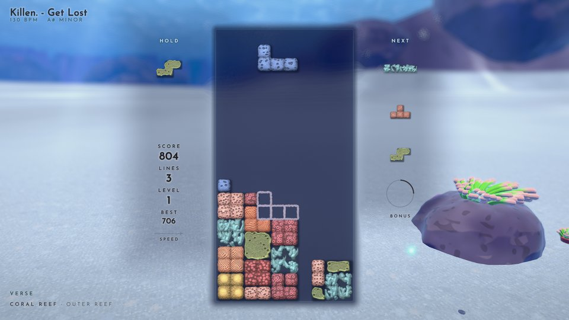

A coral reef growing with the cleared lines, from a single polyp to a towering coral mountain, in one continuous camera pull-back that never leaves the water (code in `src/universes/coralreef/`, `--universe "coral reef"`), in a sunny toon light: caustics on the sand, shafts of light from the rippling surface, saturated corals. **A polyp:** the scene opens under a macro lens on one tiny coral polyp a centimetre tall, its tentacles waving on a bare pebble, the sand's grains big and round, the background melting into a shallow depth of field. **A coral head:** buds around it, then the colony a fist-sized brain coral, a first goby. **A bommie:** boulders rise around it, colonies settle on them, a few little fish, the camera pulling back steadily (the focus deepening). **The reef:** at 30 lines the full patch reef, as before, with its schools, clownfish and the drop's mantas. **A mound, a stack, a tower, a mountain:** from the reef stage on, the reef grows up, not out: the ground around it sinks away while the reef stacks up into an ever taller pinnacle, the reef where it all began its sunlit summit in the shallows (still marked by a soft glow and one great shimmering school circling above it). Its flanks plunge steeply in terraces, ledges and buttresses down to a deep sand floor some 430 m below at completion, and they are built of the reef's own coral colonies, instanced at growing scales down the flanks (colonies on colonies, some 3300 at completion): brain corals and tube sponges on the cliffs, table corals jutting from the ledges like shelves, sea fans on the edges, staghorn thickets, the rock between them crusted pink and green; each colony appears when the tower's foot has sunk past it. The camera keeps the summit in view right of the well, drawing back and down round the tower: a three-quarter view of the summit's rim, looking up the flanks, then out at the whole coral mountain against the blue, schools wheeling round its flanks as shimmering clouds, the mantas small beside it at the drop. The camera never leaves the water; the water's absorption is gentle on the tower's upper half and thickens on its far flanks and deep base. Each stage builds on the last and stays. The camera is keyed on the lines (the distance to what it frames from 4.5 cm, eased in log space, on a calm spring, then down and back round the coral tower, some 560 m away at completion), its depth range following its scale and the world drawn relative to the eye; the seabed is one log-polar mesh around what it looks at, the tower a height field beyond the summit, sinking with the lines. At 0..4.5 lines the polyp, 5..9 the coral head, 9..17 the bommie, 17..31 the reef, 31..36 a mound, 36..42 a coral stack, 42..47 a coral tower, 47..50 a coral mountain (at the reference pace, `paceLines()`: 50 lines a 3:20 song, every count scaling with the song). Every cleared row still bursts into bubbles behind the well and sends glowing seeds to settle where the next corals grow, at the scale the camera shows. `REFALL_CORALREEF_LINES=N` adds N lines, `REFALL_GROW_RATE=R` R lines a second (a time-lapse of the whole arc). The reef's own forms: brain corals (meandering grooves between rounded ridges), bubble-tip anemones, staghorn thickets (pale tips), lacy sea fans swaying in the surge, tube sponges, sea whips, table corals, the rocks crusting over in pink coralline and green turf as the reef matures; the schools come with the reef stage: chromis, anthias, yellow and blue tangs, moorish idols, parrotfish, two clownfish in each anemone.

The corals are crafted procedurally once (`reef.cpp`): tapered tubes with rounded tips along branching paths, lathes and parametric sheets with their normals taken from the surface itself, three templates per form, instanced with a size, a turn and two of the variant's eight reef colors; their patterns are drawn by the shader in their own space (grooves, corallites, radial ridges and growth rings, the fan's lace cut out of its sheet, the sponges' pits), in a crisp toon light (a cool, water-tinted shade, a soft rim). **The fish are boids**: each keeps away from its nearest neighbours, matches their heading and keeps with them and with its school's target, stays over the reef and under the surface; its heading turns at a limited rate (smooth arcs, never a snap), it banks into its turns and its body ripples with a wave stronger at the tail, faster with its speed. The schools' targets wander along their stretch of reef, their height following the melody (the spectrum's centroid in the middle bands, eased), their pace the energy. Clownfish hover in their anemone's tentacles.

The music: calm is still, slow water; mid stirs the fish and the surge; a peak brightens the shafts a step and the schools swim fast and tight, and the kicks gently pulse the caustics (a little brighter, the water surging on). **The drop is a mass coral spawning**, for the whole drop section: on its downbeat every grown coral releases its egg bundles at once, and they keep coming while the drop lasts (up to some 3000 small glowing beads, pink, peach and cream, rising slowly and wavering like upside-down snow through the whole water column, dimmed behind the well's backing); the light eases to a dusky blue-violet so the spawn glows, and the corals breathe with the beat (every two beats), their tips swelling a little and glowing. A pair of mantas glides in and loops slowly through one side band and the open water above it (their path set in screen space so they stay in view, coming near and going away), while all the schools gather into one great bait ball on the other side. When the drop ends the spawn thins out over several seconds, the mantas glide out, the bait ball disperses and the light eases back (the sides alternate from one drop to the next). The spawning follows the scale: at the polyp's scale the eggs drift past huge, at the reef's the mantas come, at the tower's a pink haze of eggs rises from the colonies along its flanks, the mantas small beside it. A quad gathers the schools into one big swirl beside the well (one side, then the other) for a few seconds. Slow motion turns the light deep blue (the water, the shade, the caustics and the shafts; the pieces and the HUD keep their colors). Game over sinks the light toward the deep. **The pieces** are coral blocks: one clean rounded block per cell of pale, sun-bleached coral, one pastel hue per piece type (sky blue, pale yellow, lilac, mint, coral pink, periwinkle, peach), their porous calcified surface (polyp cups with raised lips, a fine grain) shaded as a restrained relief lit from the top left (fading out when tiny), a crisp rim in a deeper tone of their own hue, a soft contact shadow under them (a soft glow around them in MOONLIT), and a faint ripple of light drifting over the stack. The contrast comes from the background: the well is backed by a deep-blue water column (the world behind it blurred and nearly hidden); the ghost is the outline; a cleared row shrinks away in place (its bubbles and seeds travel only in the world behind), a hard drop squeezes a few tiny bubbles out at the sides of the piece. The HUD is set in Nunito SemiBold capitals and Fraunces Soft Italic, the reef's stage after the universe's name (a polyp, a coral head, a bommie, the reef, a mound, a coral stack, a coral tower, a coral mountain). Variants: **LAGOON** (turquoise water over white sand at midday), **GOLDEN HOUR** (the sun low on one side, long warm shafts, warm corals), **OUTER REEF** (deep cobalt, crystal-clear water, a white sun high above), **MOONLIT** (a night dive: indigo water, moonlight shafts, the corals glowing in fluorescent colors). Cost: the world 4x multisampled at the full resolution (up to 1440 lines), every world shader writing its distance for the shafts, which the full-resolution composite draws from a point high above the view; about 0.3 ms a frame on the GPU at 1080p at the polyp, about 1.2 ms with the full tower (some 3300 colonies, culled under two pixels) (some 650 corals, 200 fish; an RTX 4090), the boids on the CPU.

## ARCHITECT

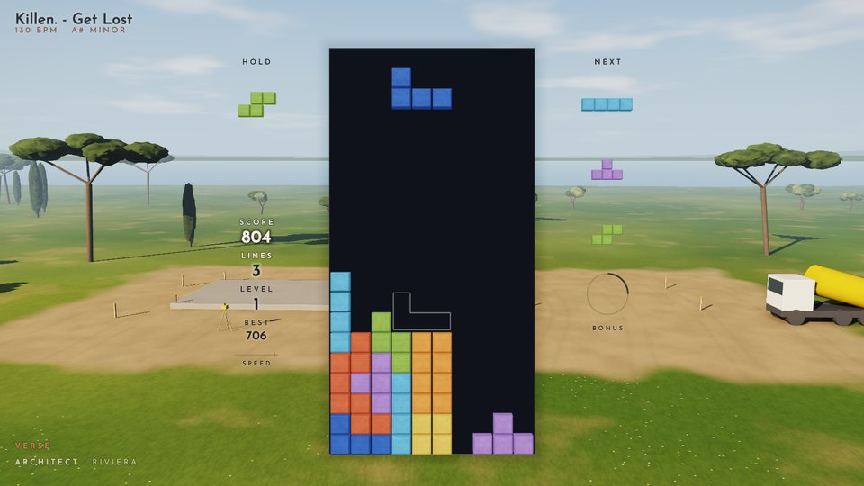

A modern villa built over one song on an empty field, its rooms lowered by two tower cranes, one delivery for every cleared row, seen as an architectural rendering in 3D behind the well (code in `src/universes/architect/`, `--universe architect`). Human scale and calm: one house, from the morning field to the finished villa lit at dusk. **The construction arc** (paced lines, `paceLines()`: the scene completes at `sceneLines()`, 15 lines a minute of song, 50 for a 3:20 song, every count here scales with it; `site.cpp` authors the program element by element): the empty meadow with wildflowers and the surveyor's stakes and level (0), the site levelled into compacted soil with tyre tracks and the slabs poured (from 0.6), the cement mixer driving in, pallets of materials, the two tower cranes climbing up mast first and swinging their jibs out (4.5), the rooms lowered one by one (from 8: the living room, the guest wing, the kitchen, the stone walls laid course by course, the suite's cantilevered slab, the suite and the upper box, the roofs), the glazing (from 20: big panes in slim frames with the rooms seen behind them), the cladding, the canopy cantilevered over the guest wing's deck, the roof terrace's balustrade and pergola, planters; the pool (30 to 37): its outline sprayed on the soil, the excavation dug out progressively (an earth pit with sloped sides, deepening line by line, lit and shaded as soil, the dug earth heaped beside it), the concrete shell cast in it, tiled into mosaic, the margin backfilled, the coping laid and the water rising; the garden (decks, the new lawn with mowing stripes, trees planted one by one, loungers and a parasol, hedges, a table under the canopy, garden lamps; 36 to 42); the cranes lowering their jibs and masts and leaving (44); and the finished villa at dusk, its rooms lighting up one after the other, the pool glowing turquoise, the garden's lamps on (45.5 to 50). Every stage builds on the one before and stays. **The light follows the same arc**: a low morning sun from the left, midday, a warm afternoon, the golden hour, the sun setting on the right and the blue-violet dusk with its first stars.

**Every cleared row is a delivery**: the row's concrete panels slide back into the board (under half a second), and a crane picks the next element up in the yard behind the well (hidden by it), hoists it, slews and trolleys out with the load swinging on its cables and turning a little on its slings, waits for the swing to settle and lowers it softly into its place (the last meters slower). Every delivery is planned from outside: if anything already standing overhangs its place (a glazing under a roof or a cantilevered slab), the load comes down along the facade, beside it, shifted just far enough out to clear it, is released there and slides the last meters into place; nothing comes down through the building. The cranes are critically damped springs with capped speeds (eased starts and stops), the load a damped pendulum driven by the trolley's acceleration; between deliveries they wander slowly over the site, never still; a backlog (a quad in a short song) makes them work faster. **The house's state comes from the paced lines**, like the pool and the garden: an element is earned when the lines reach its mark, and the cranes only animate the deliveries; an element left waiting too long for its crane (or with no crane standing to lower it) is set down directly, settling softly from above, so nothing structural is ever skipped, and the cranes leave and the rooms light up only once the house is complete. (A paused frame, e.g. while the next song loads, used to turn the load's sway into NaN and stall the first delivery for good: the house was never built.) Calm is a still site; mid and peak turn the cement mixer's drum faster and send soft welding sparks from the last element placed every two beats; at a peak the cranes' red beacons blink on the grid. **The drop switches the site's floodlights on**: two light towers light the site with a warm swell, held through the peak and settling slowly after it. A quad lights every crane lamp and sends a shower of sparks over the villa. Slow motion is a hushed, misty blue hour. Game over greys the pieces from the top; the next game starts from the field again (the villa sinks back). It leaves and enters through the bridge.

The world is instanced solids (rounded boxes, spheres, cylinders, cones) shaded by material: white render with a trowel cloud, board-formed concrete with its tie holes, wood cladding and decking board by board, travertine ashlar, glass with the room behind it traced per pixel (floor boards and a rug, a painting, a sofa, ceiling lamps that light up at dusk) and the sky in it, pool water with caustics and the sky's reflection, foliage clumps with broken outlines lit through the leaves, the cranes' painted lattices cut out of their boxes, palm fronds cut into leaflets; one sun with a 4096 soft shadow map, sky and ground ambient, half-resolution ambient occlusion, up to 24 point lights at dusk (the rooms' light through the glass, the pool, the lamps, the floodlights), additive glows, aerial perspective, a filmic tone map; the sky (gradient by the hour, the sun, high clouds, two layers of far hills, the sea in two variants, stars) and the ground (the meadow, the site, the lawn, the pool's excavation ray-traced as a convex pit) are one ray-cast pass with depth. The camera orbits slowly a few degrees each way. **The pieces are pigmented architectural concrete**: one chamfered block per cell, cast in a board formwork (three boards' faint imprint and grain), a cloudy mottle, rare blowholes and the four tie holes of the formwork, one strong pigment per piece type, a crisp darker rim and a soft contact shadow on the well's deep, opaque backing (a fine pale border round it); the ghost is an outline. Four variants, each with its land, villa materials, flora, crane paint and seven pigments: RIVIERA (white render and travertine, stone pines, olives and cypresses, the sea behind, yellow cranes), PINEWOOD (board-formed concrete and larch, firs and birches, misty hills, red cranes; dark minor songs), TROPICS (white render and teak, palms, the lagoon, white cranes) and MESA (warm render and rammed earth, cacti and agaves, red mesas, orange cranes), from the mode, brightness, air, bass and tempo (`--universe architect:pinewood`). Cost on an RTX 4090 at 1080p (measured while the GPU was shared): about 0.4 ms a frame mid-construction and 0.65 ms for the finished villa at dusk. Test hooks: `REFALL_ARCHITECT_LINES=N` adds N real lines (a still of a stage: everything due stands in place at once), `REFALL_GROW_RATE=R` adds R lines a second, `REFALL_ARCH_CAM="dist,pitch,fov,yaw"` moves the camera. Its font is Josefin Sans (Regular and Light, SIL Open Font License, `src/universes/architect/OFL-JosefinSans.txt`); the HUD's corner line names the site's stage after the universe.

## GROCERIES (disabled)

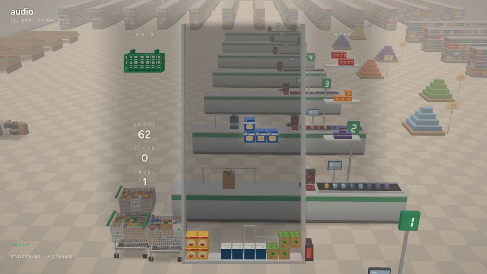

Left out of the default build for now (`-DREFALL_DISABLED_UNIVERSES=""` builds it). A cashier's checkout counter seen from above, calm and everyday (code in `src/universes/groceries/`, `--universe groceries`). One counter fills the frame behind the well and the HUD, seen straight down: the belt runs down the middle (the well: black rubber, its ribs running toward the scanner, a divider bar riding it now and then, between steel rails; it carries the falling piece: it runs exactly as far as the piece falls, row for row, and stands still while nothing falls); a steel lane along its right rail leads down to the scanner's glass with its soft red laser lines and the upright scanner behind it; beside it the bag being packed, held open in its rack, a stack of folded bags, and along the counter's right edge the full bags set aside; on the left the till with its screen and keys, the receipt printer, the card terminal; a rack of sweets at the top right. Everything is instanced boxes with procedural materials (packaging, laminate, oak or brushed steel, rubber, paper and fabric, thermal paper, a shopping list), lit from above with soft contact shadows on the counter; the camera stays put.

The pieces are products seen from above, one per cell, a family per tetromino, cubes in clean packaging with invented, illegible labels: cartons of milk (their gable, I), cereal boxes lying on their backs (O), punnets of berries under their film (T), trays of apples (S), packs of tins (their lids, Z), boxes of pasta with a window (J), cartons of juice (their cap, L). The ghost is a hairline outline; the held product sits in a wire basket, the next ones are set down on the counter. **A cleared row is packed**: its products are lifted off the belt and glide one after the other to the steel lane, down it, across the scanner (a soft red flash and a glow for each beep), and hop into the open bag, where they stack neatly, six on the bottom and four on top, seen from above. A full bag is set aside at the counter's edge and a new one is opened (kraft paper, a reusable fabric bag, now and then a white one); when the edge's eight places are full, the bags are taken away and the edge fills again.

Nothing grows beyond the counter. Over the song the receipt prints longer, draping from the printer down the counter and curling at its end, and the customer's things are set down one after the other: a shopping list (from the first line), keys (4), a wallet with a card peeking out (9), a takeaway coffee (15), sunglasses (24), a loyalty card (35), a folded tote (50).

The song: calm is a soft, slightly cooler light; peaks warm it. **The drop** (a real drop only, not a chorus: the HUD's section, else the music's pace) stays gentle: a soft warm glow runs down the belt's rails on the beat, the scanner pulses on the beat, and the receipt prints a burst. A quad glows along the rails and prints a little more. Slow motion dims the counter toward evening; game over sweeps the stack off the counter, product after product. It leaves and enters through the bridge.

Four variants, the hour and the counter: **MORNING** (a white speckled laminate, the window's light through blinds across the counter, a fresh green), **LATE NIGHT** (brushed steel under cool light, a red accent), **CO-OP** (an oak counter in the golden afternoon through the blinds, earthy packaging, kraft bags, sage), **BLUE HOUR** (a navy counter in the evening's blue, a warm lamp's pool over it, amber). Figtree (SemiBold and Medium, SIL Open Font License, `src/universes/groceries/OFL-Figtree.txt`) for the HUD. Cost: about 0.13 ms of GPU time a frame at 720p (4x multisampling, a quarter-resolution bloom).

`REFALL_GROCERIES_LINES=N` (a test hook) adds N lines (a longer receipt, more of the customer's things, bags at the edge); `REFALL_GROW_RATE=R` adds R lines a second (a time-lapse); `REFALL_GPUTIME=1` prints the GPU time of a frame.

## SUSHI (disabled)

Left out of the default build for now (`-DREFALL_DISABLED_UNIVERSES=""` builds it). A kawaii kaiten sushi bar where the cleared rows feed a counter of cats (code in `src/universes/sushi/`). Everything is drawn flat and minimal in light, quiet tones (plain plaster, pale wood, one ink color). The well is a bento box of pale hinoki wood with a fine grain and a dark lacquered rim, standing on a wooden counter; a conveyor belt runs along the counter behind it, carrying little dishes of nigiri (it starts with a rounded end left of the seats, clear of the corner lettering). Each cell is one maki standing on its own, a squared roll as blocky as a cube, seen nearly from the side (the cut face on top, the nori wrapped around its side, orange tobiko and sesame for the inside-out roll): crab (I), tamago (O), an inside-out roll with sesame, avocado and salmon (T), cucumber (S), tuna (Z), avocado (J) and salmon with its white lines of fat (L); the dark nori and the orange tobiko stand out on the pale wood in every variant. The falling piece is exactly a locked one, the ghost the rolls' faint outlines, the previews small maki. Behind the counter sit round cats of an original, minimal design: each one flat color with a hairline edge, dot eyes and a small mouth (white, sand, black with pale eyes, ginger, grey, a cream colorpoint with a darker face). **A cleared row feeds them**: its maki slide sideways out of the box (the left half to the left, the right half to the right, out of the row within 0.3 s, before the stack settles), then hop in arcs to the cats, who look up, open their mouths, catch them and chew, eyes squeezed shut with joy, a heart and a little "nom" rising. **The counter fills up over the song**: two cats at its start, one more popping up from behind the counter every two lines, two more for a quad (a feast: a stream of maki, sparkles all along the counter), up to the seats on both sides (fewer on the left, where the song's section and the universe are written); a new song sends the extra cats away. The one ornament is a noren with す and し in the upper right. Calm: a quiet shop (the belt still, most cats dozing with sleepy eyes and a drifting "z"). Mid: the belt starts, the cats wake and bob their heads on the beat grid (one way, then the other, every two beats), the noren sways. Peak: the cats bounce on the two-beat grid and the maneki-neko among them wave a raised paw, the wall a touch warmer. The drop is a festival, eased in over two beats: every cat cheers with both paws up, mouths open, the belt runs faster; it settles back over the following bars. Locks give the maki a small bounce. Slow motion is dusk at the counter (a violet evening, the cats sleepy); game over feeds the whole stack to the cats from the top down. It leaves and enters through the bridge. Five shops, all light: HINOKI (white plaster, a charcoal rim, an indigo noren), SUMI (cool pale stone and ink, a black rim; dark minor songs), MATCHA (pale sage, a moss rim), SAKURA (a faint blush, a plum rim; airy bright songs) and AI (indigo and white, a navy rim) (`--universe sushi:sumi`). Cost: one full-screen pass for the shop, instanced signed-distance sprites for everything else (one quad per cat, per maki, per dish). The HUD is rounded lettering with a soft halo of the wall (light on the box for the dialogs); the bonus gauge a soft ring charged in the accent. Its font is M PLUS Rounded 1c (Bold and Medium, subset to ASCII and four kana; SIL Open Font License, `src/universes/sushi/OFL-MPLUSRounded1c.txt`).

## FRACTAL

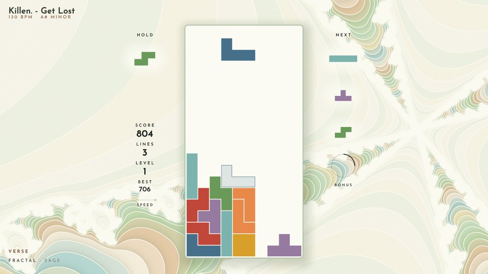

An infinite pastel flower, a Julia set zoomed for ever (code in `src/universes/fractal/`, `--universe fractal`): the whole screen is the filled Julia set of z -> z^2 + c for c at the center of the Mandelbrot set's 1/4 bulb (four petals meeting at every pinch point), in flat pastel bands: the convergence count inside the petals (one gradient step a band, each band one flat color), the smooth escape count outside, pale like paper; a fine line between bands and a soft shadow under each, like cut paper, and where the bands get finer than a pixel (along the frilled contour) they melt into the wash color, so the endless detail never shimmers. The camera zooms for ever into a self-similar point of the set (the alpha fixed point where four petals meet, the beta fixed point, a point of the 2-cycle, or a preimage of one): near it one more level of zoom (its exact multiplier) is the very same picture, so the view loops seamlessly while the contour keeps revealing finer petals, and the bands' count follows the levels zoomed, so each band keeps its color as it grows and new ones bloom with the next colors of the gradient. Each song picks its point; now and then (a change of section) the camera glides to another one: it zooms out until both are in view (the whole flower), pans across and zooms back in. The zoom never stops, very slow in calm sections; a line clear makes it accelerate (a burst eased in and out, about x1.27 a line, more for a quad); a DROP section (`music.inDrop` only) zooms in steadily and faster, the bands cross-fading into the palette's drop colors; no beat pulses. The well is a calm pale panel inside a slim line with a soft shadow; the blocks are truly flat (one square of a single soft retro color per cell, no outline, shading or highlight, a hairline gap between cells); the ghost is a faint wash of the piece's color inside a thin line of it. Slow motion is dusk; game over greys the stack from the top. Five palettes (SUNSHINE, APRICOT, SAGE, MIDNIGHT, a deep pastel night, and RAINBOW), each with its drop colors, from the key, mode, brightness and air. Its own lettering (`REFALL_HUD=universe`): Fraunces Soft Italic and Comfortaa Bold (SIL Open Font License, `src/universes/fractal/OFL-*.txt`). Test hooks: `REFALL_FRACTAL_TARGET=i` starts at point i, `REFALL_FRACTAL_LOG=1` logs the glides, `REFALL_GPUTIME=1` prints the fractal's GPU time (under a millisecond at 1080p).

## ISLANDS

One continuous flight over an endless tropical archipelago, like drone footage, seen in 3D behind the well (code in `src/universes/islands/`, `--universe islands`). It is not a growth universe: the flight simply goes on, and never visibly repeats. **The archipelago** (`world.cpp`) is procedural: a route steered through the sea (its heading wanders on slow sines, its curvature eased in and out, so the path is smooth to the second order), hero islands placed along it one after another from a per-variant sequence, and filler islands in jittered cells all around (kept off the route) for the vistas. Six kinds of island, each one height function (shared by its terrain mesh and the camera's terrain following): big green volcanic islands (a summit off center with radial gullies and spires, cliffs on some sectors of the coast with a waterfall down the cliff facing the route, beaches elsewhere, dense jungle); little sandy cays on wide turquoise sand flats with a few palms (an umbrella, a kayak or an anchored catamaran nearby); atolls (a ring of reef breaking the surface, motus of white sand and palms, a turquoise lagoon with coral heads; a jungle peak in the lagoon in POLYNESIA); a rocky islet with its red and white lighthouse and keeper's house; a village (pastel houses on the slope behind the beach, and a boardwalk out to bungalows on stilts with thatched roofs; white cubic houses with blue doors and a blue-domed chapel in MEDITERRANEAN); a white villa (a long white volume with an upper box cantilevered over the glass, deep roof slabs, a teak deck around a turquoise pool, loungers and a parasol, steps to the beach, a jetty with a moored speedboat, palms and umbrellas, its pad levelled into the terrain). Under the water every island has its shelf: shallows of white sand, reef patches (coral pinks and greens), the drop-off to the deep. Each island is one terrain mesh at a level of detail picked by its distance (33² to 385² vertices, built on a worker thread, swapped when ready) with its sand, vegetation, rock and reef weights and a cavity occlusion per vertex, and its instanced content (palms: a curved ringed trunk and a crown of arching fronds with their leaflets, swaying; jungle and olive trees: lumpy clumps with leaf tufts; cypresses; buildings, decks, boardwalks). Life: sailboats (a mainsail and a jib, heeling), catamarans, speedboats and kayaks steer around the islands with their wakes, a seaplane crosses the view now and then, and flocks of seabirds.

**The rendering**: the world is drawn relative to the eye and bent by the sea's curvature, which grows with the altitude (the horizon curves only from high up); one sun with a 4096 soft shadow map around where the camera looks (snapped to its texels), sky and sea-bounce ambient, an exponential haze thinning with height (warmer toward the sun). The sea is one fullscreen pass: the curved surface hit per pixel, eleven directional waves each faded out once a pixel covers it (no glitter aliasing; the unresolved ones roughen the glint instead), the seabed seen through it (a half-resolution pass of the terrain under the water, its color and distance) with the absorption of its thickness per channel (white sand turns turquoise in the shallows, deep blue offshore) and the scattering of the water, the islands reflected (a half-resolution mirrored pass, below 900 m) and the sky with fresnel, the sun's glint, foam at the shore and in the surf over the reefs, the boats' wakes (a white trail and the Kelvin V), the waterfalls' white water and the clouds' shadows. Scattered cumulus at 650 to 1100 m are soft lit puffs (a silver lining against the sun, warm at the golden hour), sorted back to front. **The day passes over the song**: bright midday, the afternoon, the golden hour, the sunset (the sun's disc going down between the islands), dusk; the villas, bungalows and houses light up their windows, the pools glow turquoise, the lighthouses sweep their beams, stars come out.

**The camera** flies it like a drone, always smooth: it rides the route, its altitude (in log space, so a climb to the clouds or a dive to the waves is one smooth move), speed, heading offset, pitch and bank each on a critically damped spring; it banks into the route's turns (a coordinated turn, at most ~9°), its speed is capped by the curvature ahead (never a fast turn: the view turns under ~10° a second), it turns its view so the island it passes stays in the band beside the well (the target itself slew-limited), and it follows the terrain and what stands on it ahead, rising well before a hill, a palm or a roof. Some heroes are orbits: the route loops round the island and the view looks in at it. **The music**: calm is high, wide and slow (230 m, and every other minute or so a long climb above the clouds to 2300 m, the islands scattered on the curving sea, then down again); mid cruises at 15 to 90 m and dips to a few meters past each hero island (over the water beside its beach, its deck, its palms); a peak skims the waves 3 to 6 m up, fast; a build climbs; **the drop is one big dive** from wherever the camera is (often high after the build) down to skim the waves, over about six to eight seconds, **and a regatta for the whole drop section** (from the HUD's section, eased in over a second, out over a few seconds after it): the fleet races faster alongside the camera and the light eases to a real golden hour (a low warm sun with long shadows, a warm horizon under a blue zenith, golden glitter on the sea); pods of dolphins leap beside the camera, two or three at a time on the beat grid, each leap lasting two beats and landing on the beat, with a soft splash; at dusk and at night fireworks bloom softly over the villas and villages in view (sparks in the piece colors, warmed), reflected on the sea. At a peak the sun's glints sparkle on the beat grid (every two beats) and with the kicks (small, local). Slow motion is a glassy blue hour (the sea goes calm, the camera slows to a third). **Every cleared row launches a sailboat, and the fleet grows over the song**: the boat sets out from the beach nearest the band beside the well (the sides alternate; from the open sea there when no beach is near), its sails unfurling in bands of the colors of the row's pieces (up to four, the most frequent at the head: each boat a souvenir of its row), with a burst of seabirds rising around it; then it eases into its place in the fleet, which sails along the route with the camera (each boat at its own place beside the route, slower than the camera when it skims, so the camera passes among the sails; a boat left behind sails in again from the haze ahead; boats slide aside around the islands). From high up the fleet spreads out and the boats grow (a stylized regatta, readable from 2000 m). A quad launches a big catamaran and a great flock. Past 48 boats the oldest sails away. At dusk every boat lights a lantern at its masthead and over its stern: by the finale the fleet is a field of warm lights on the dark sea; the clears also light lanterns along the nearest shore. `REFALL_ISLANDS_FLEET=N` starts with N boats. The cleared glass brightens and melts away in a third of a second; a hard drop puffs fine sand from under the piece.

**The pieces are painted driftwood boards**: one board per cell (softly worn corners, one clean silhouette), one paint color per piece type over sun-bleached grey wood: the grain runs along each board (its own direction and figure), the paint worn thin along it and chipped back to the wood here and there at the edges, two old nail holes; lit by the scene's own sun and sky (golden in the drop, warm at dusk, lantern-warm at night), a crisp outline in a deeper tone; they are kept out of the world's tone curve. The well's backing is a tinted pane of deep water (about 80% opaque, denser toward the bottom where the stack stands) through which the sea and the islands show, darkened, with a fine pale rule and a soft shade around it; the ghost is an opaque outline in the piece's own color, a little lighter, over a faint fill; the bonus gauge is a ring of twelve glass beads. Four variants, each with its land, water, flora, palette of hours and seven pieces: CARIBBEAN (white sand cays and villas over turquoise shallows), POLYNESIA (jagged jungle peaks, emerald lagoons, atolls with a peak, overwater bungalows of thatch), MEDITERRANEAN (pale limestone, maquis, olive trees and cypresses, white villages with a blue dome, a deeper blue sea, no atolls) and SUNSET (the whole flight from the golden hour into the sunset and the night, the lanterns lit along the shores), from the mode, brightness, tempo, bass and air (`--universe islands:polynesia`). It leaves and enters through the bridge. Cost at 1080p on an RTX 4090: about 0.9 ms a frame above the clouds and 1.2 to 2 ms low over the islands, 1.4 to 2.1 ms with a full fleet of 48 boats in a drop (CPU 0.5 to 1.4 ms) (the shadow, seabed and reflection passes draw the terrain again; the far islands are coarse meshes, palms and trees are dropped beyond 2.6 to 3 km). Test hooks: `REFALL_ISLANDS_TOD=T` holds the hour (0 midday .. 1 dusk), `REFALL_ISLANDS_ALT=A` the altitude, `REFALL_ISLANDS_S=S` starts the flight S meters along the route, `REFALL_ISLANDS_DEBUG=1` logs the flight and the heroes, `REFALL_ISLANDS_TRACE=FILE` writes the camera of every frame. Its fonts are Outfit (Medium and Light) and Playfair Display Italic for the song, the hour and the notices (SIL Open Font License, `src/universes/islands/OFL-Outfit.txt`, `src/universes/islands/OFL-PlayfairDisplay.txt`).

## RAIN

It rains everywhere, over a colorful street at dusk, and the rain falls on the game (code in `src/universes/rain/`, `--universe rain`). One world seen flat in the board's plane: a procedural street behind everything, blurred by the rain (the far windows turned to bokeh, a few warm ones in the near facades, the variant's lights glowing on the wet walls), the wet street below mirroring it in puddles (the lights stretched into long streaks, rippled by the drops), the far rain as thin slanted streaks over the whole picture; the well is a dark glass backing that shows the rain behind it only faintly, the HUD columns a light veil. **The near rain has physics**: a few hundred to a few thousand thin, translucent streaks (stepped on the CPU) fall until they meet a solid: the top of the stack in their column, the falling piece's cells, the floor of the well, the side piles, or the street at their own depth. The falling piece shelters the cells under it, so a dry rain shadow follows it down the well (slanted with the rain). Where a drop lands it splashes (a small crown and two or three droplets); near an exposed edge some of the water runs down the face as a drip, falls off the bottom of the face and splashes again below (a drip that reaches a neighbour's top soaks in). The rain stops on the blocks and never crosses a cell, so the stack always reads. The solids are rebuilt every frame as per-column spans of the stack (at the rows' visual heights while they fall after a clear) and of the piece (at its visual position). **The street** is one procedural shader in layers: the sky (lightning glows inside the clouds and silhouettes the skyline), a far skyline with its windows as bokeh, the street's buildings with grids of windows lit in many colors (some with blinds), ledges and the variant's signs (vertical neon in NEON STREET, strings of paper lanterns in MONSOON), the shop fronts at street level (a lit shop window with shelves and goods in silhouette, a door, a striped scalloped awning, a sign board with glowing lettering, flower buckets in FLOWER MARKET), passers-by walking slowly under colored umbrellas, two big blade signs over the heaps, drifting bokeh and mist, all mirrored in the wet street.

**The pieces are wet glazed ceramic tiles in pastel glazes**: one rounded tile per cell, one soft, light glaze per piece type (seven distinct pastels per variant, bright against the dark backing), deeper at the rim, a thin bright bevel, the street's neon caught in a soft sheen, a film of water along the top edge, beads of water on the face (a darker lens with a bright point) and now and then a rivulet sliding down it; a cell under the rain stays wet (its beads and film come up with every drop it takes), a sheltered one slowly dries. The previews are the same tiles, dry and plain, drawn over the rain. The ghost is a fine outline in the piece's glaze. A lock squeezes a little water out from under the piece (a hard drop more, with a crown at the contact).

**Clears**: a cleared row's tiles are thrown out of the well, half to each side (the ones nearest the walls first, row after row): each gets an impulse, out and up with a spin, aimed at the top of the heap at a spot of its band, its apex two to three units above the heap all along the way whatever the row's height (a low row gets a stronger kick; a real ballistic flight under gravity from the first frame), behind the stack and behind the HUD (dimmed while they cross its columns). They are rigid boxes in a small 2D solver of our own (box against box by SAT with up to two clipped contact points, corners against the street and the band's walls once the box reached its band, ten iterations of sequential impulses with friction, a little bounce and Baumgarte correction, at a fixed 240 Hz): they tumble, bounce, knock into each other and settle into messy heaps at all angles; a box nearly still for half a second falls asleep and is static for the others, a hit or a lost support wakes it. The heaps grow wide over the song as low mounds: each throw aims at the lowest place of its band (of six tried), so a heap spreads before it climbs; once even the lowest place is high (about the middle of the HUD's lower half) or a heap holds 150 (left) or 170 (right) tiles, the oldest tile fades away and what rested on it falls again. The left heap spreads to the screen's edge, its tiles dimmed behind the HUD's corner lines. The heaped tiles are lit by the street, not the board's even light: darker in the shade low in the heap, the blade signs' colors spilling on them with a rim on the side facing each sign. **The rain washes their paint off, and it is alive**: rivulets of paint, each with its own width, speed and meander, run down every heaped tile (a darker wet trail behind a bead that flows over the bottom edge), the first ones within seconds of landing; as the drops take the paint off (fast at first, then slower), the rivulets' paths and blotchy patches spreading from the top turn to bare ceramic. The paint runs onto the tile under it, landing as spots and runs of its color (mixing gently into it), and on; drops of paint fall off the heap's tiles. The rain falls on the tilted faces, splashes, and slides down the slopes to drip off the lower corners. A new song washes the heaps away; game over throws the whole stack out, row by row from the top.

**The music sets the rain**: a drizzle when calm, steady rain at mid, a downpour at a peak (a gust of drops on the kicks). **The drop is a thunderstorm** held for the whole drop section: sheets of rain sweeping across in gusts at a steep slant (the near rain and the far rain alike), the street flooding (the water rising around the heaps, the reflections everywhere), the neon flaring (the signs, the windows and their light on the heaps), dark and moody between lightning strikes on the half bars (most bars, some second beats): a cold bluish double pulse decaying in a fraction of a second, from the sky behind the skyline, lighting the whole street, the rain streaks and a rim on the upper edges of every tile; the neon signs surging on the beats and flickering, a colored light sweeping across the wet street (from the HUD's section, so it holds from the drop's start to its end in the song plan, and eases back over a few seconds after): the heaviest rain at a steeper slant, the sky darker over a horizon glowing in the street's first color, the city's colors and lights intensified, and now and then on a bar line a soft lightning glow inside the clouds (a tinted glow that fades over a second, never a white flash). Slow motion slows the rain until it hangs in the air as short beads, under a bluer night. It leaves and enters through the bridge (the world fades to the bridge's color, the tiles turn to its ink). Three variants, each with its street and seven glazes: NEON STREET (a magenta dusk, vertical neon signs in pink, cyan, violet and yellow), FLOWER MARKET (a peach dusk, striped awnings over the stalls, buckets of flowers, string lights) and MONSOON (a deep teal mist with warm paper lanterns, the steepest rain), from the mode and brightness (`--universe "rain:monsoon"`). Cost: one fullscreen backdrop pass, the rain's collision tests (a few dozen per drop, at most 4000 drops), instanced shapes and tiles. Its HUD font is Manrope (Medium and Light, SIL Open Font License, `src/universes/rain/OFL-Manrope.txt`), set over a soft dark halo so it reads over the rain and the piles.

## PINK VIBE

A soft, girly pink world of satin ribbons and pearls (code in `src/universes/pinkvibe/`, `--universe pinkvibe`). Behind everything, wide ribbons of pinks wave diagonally across the screen (one fullscreen shader): pale blush, rose, salmon-pink, a deep raspberry-wine band in the middle, then back to blush, in soft relief lit from the top left. Each ribbon lies over the one below it: its lower edge is a rounded lip rolling down onto that ribbon, its satin face slopes gently toward the light (a faint sheen where it turns to it) and curves away under the ribbon above, which casts a soft shadow on it, longer where the light comes across the ribbons; the shading follows the waves, so the relief shifts as they roll. A warm light glows in the top left corner, the far bottom right a little deeper. The ribbons undulate slowly and continuously: the waves' height breathes with the section's energy (slow envelopes; almost still at a calm part, rolling at a peak) and they sway gently on the half-time beat grid from mid on. A few soap bubbles (a soft shadow on the ribbon, a faint pearly disc, a bright rim, a highlight), sparkles and glints drift very sparsely upward in the free zones (never behind the well, fading out near the HUD columns). The well is a translucent deep wine pane (about 92%) in a rounded rose neon frame, a fine bright line glowing softly inside and out, with a faint diagonal sheen of glass, the ribbons faintly showing through. The blocks are candy cubes, one per cell, facing us like dice: a flat, opaque, creamy fondant face in the piece's pastel, an even soft rounded bevel all around it (lit top left, softly shaded bottom right, a gentle gloss on the lit side), the very edge a little translucent and glowing from within like sugared gummy candy, a faint sugar grain and mottle and a few pearly micro sparkles twinkling in the sugar (the texture travels with the cube; it fades out on the small previews). On each face sits a gold foil stamp, nearly flat, its edges catching the light, pressed in with a faint shadow: a quiet fine frame set in from the bevel (dropped on the small previews) and one motif per type: I three pearls, O a four-pointed star, T a diamond, S an X, Z four dots, J a heart, L a ring. Every block pools a soft shadow just under it, darkest in the narrow gaps (all the shadows are drawn under all the blocks); the falling piece glows softly rose instead. The seven types are seven pinks of clearly different lightness and hue (ivory, peach, rose, deep raspberry, hot pink, lilac, coral). **The drop is a sunset**, held for the whole drop section (from the HUD's section): the ribbons swirl around the well into one big rolling wave and the palette swings to the variant's deeper rose-gold and magenta tones, eased in over a second or two and out over a few seconds after; the blocks and previews glow with it into vivid hot pink, magenta, coral and violet, and the HUD turns to pale letters on a deep plum halo so it reads on the deep ribbons. A landing leaves a little gold sparkle dust under the piece, rising and fading within a second. A cleared row's cubes swell softly and vanish, each releasing a little sparkle dust and a few slower gold and rose bokeh motes that rise high above the stack, then a petal and a bubble that drift out sideways behind the well and float up (dimmed where they cross the HUD columns); a quad swells the waves and sends a soft shower of hearts, petals and bubbles from both sides; a hard drop pushes two small petals out from under the piece; slow motion is a lavender dusk with slower waves; game over greys the stack from the top. The bonus gauge is a ring that fills, with a heart when it is ready. Three variants, each with its ribbons, drop ribbons, well, neon and seven pieces: BLUSH (classic pinks), ROSE (warm peach and rose-gold) and CANDY (cooler bubblegum and lilac), from the mode, brightness and key. Its HUD is deep plum lettering on a feathered blush halo, in Quicksand Medium and Nunito SemiBold (SIL Open Font License, `src/universes/pinkvibe/OFL-*.txt`).

## SHADOW

The game is a shadow (code in `src/universes/shadow/`, `--universe shadow`). A dark room: at the bottom left, on a little round table, stands a model of the game, a wooden well with little glass blocks in it (the stack, the falling piece moving and turning, every lock and clear, in real time), lit by a vintage spotlight on its stand beside it. The big board on screen is that model's shadow on the plaster wall behind, inside the lamp's focused circle (a faint colored fringe at its edge, darkness around): the model is built at the board's own scale, so its shadow lands cell for cell on the grid. The frame's posts and base are solid shadow, the table's edge darkens the wall under the well, and each glass block lets its color through: a pool of colored light with a dark rim where the glass bends the light away and a slight waviness, a piece one seamless shape; the ghost is a fine outline, HOLD and NEXT small shadows beside it, and the HUD letters are set on the wall dark where it is lit, pale in the dark. The model is ray marched in its corner (soft shadows from the lamp, ambient occlusion, see-through colored glass blocks (the view behind refracted and tinted by the thickness crossed, Fresnel reflections, bright edges, the lamp light glowing through them and coming out colored on the table), grained wood, an enamel and brass lamp with cooling fins), the beam's haze and dust drifting between the lamp and the model, never over the well or the HUD. **The music**: the lamp breathes with the energy and flickers very slightly (no pulse), calm is dimmer with a few motes, a peak warms it, the kicks swirl the dust and glint the lens. **The drop** turns on a second lamp of another color for the whole peak: its circle floods the wall beside the first and casts a second, stretched shadow of the model (colored shadows, the playfield kept in its own colors), eased back after. **Clears**: the row's shadow shrinks away while, on the model, its blocks are lifted out one by one and set aside, out of the beam, on low stacks sorted by color in a tray at the front of the table (two layers each), the oldest then going into a small wooden box beside it that fills up over the song (`REFALL_SHADOW_SPENT=N` starts with N spent blocks). Slow motion turns the lamp to a cool moonlight, game over dims it. Three variants: CINEMA (a tungsten lamp on warm plaster, walnut and birch; the drop lamp is cold blue), BLUEPRINT (a cold daylight lamp on pale drafting paper; an amber drop lamp) and COLOR GEL (a white stage lamp on a cinema screen, theatre gels, black velvet; a magenta drop lamp), from the mode, brightness, dynamics and density. `REFALL_SHADOW_SS=S` sets the model's supersampling (1.5 by default). Its HUD font is Marcellus (SIL Open Font License, `src/universes/shadow/OFL-Marcellus.txt`).

## MIRROR

A dark, liminal room lit by its glass (code in `src/universes/mirror/`, `--universe mirror`). A quiet space like a gallery at night, traced per pixel in real 3D through the layout's camera: a seamless floor curving up into walls that round into each other (an infinity cove), a two-tread step and one slim pillar far away, all deep and dark, only faint ambient light and two dim colored accents out of frame picking them out. The pieces are solid glass cubes, one per cell, with rounded bevels, standing in front of a smoked glass panel: each glows softly from within in its own color (a brighter core, crisp brighter edges, the falling piece brightest, a soft halo only), refracts and reflects the room and shows its back edges through the glass. Their light carries the scene: each column's colors pool on the glossy floor around the well's base (analytic soft lights, one per column, and the falling piece), the cubes are softly reflected in the floor in front of the well like a polished surface, and they glow through the smoked panel behind them. **The mirrors**: a gallery of six frameless mirrors with rounded corners, a fine bevel and a crisp polished edge, three in each side band (never over the well or the HUD columns), each drifting and rolling gently on its own slow curves and always turned to show the stack (its normal halves the angle between the camera and the stack). Every one is a real planar reflection (the room traced in the mirrored ray, the cubes drawn through the mirrored camera), rendered into its own tile of one atlas at twice the screen resolution over its footprint only and read back with a 2 x 2 box filter, so the reflections are crisp and steady: the stack, the falling piece and the room seen from six angles. Each bounces the stack's light into the room: a soft colored glow on the floor below it and on the surfaces nearby, and its edge catches the stack's color. The music's energy sets their drift's speed and reach; a peak's kicks make their edges glint. Calm: dim accents and a slow drift; mid and peak brighten the accents and widen the drift. **The drop** makes the light the star: the floor pools bloom, the cubes swell brighter every two beats, the accents swing to the variant's drop colors (one swell on its downbeat that settles), and it gathers each side's mirrors into a ring that turns slowly, the mirrors rolling with it like the petals of a kaleidoscope, for the whole drop, drifting apart after. A lock or a hard drop brightens the piece's glass briefly; a cleared row's cubes shatter into small glinting shards that fly back into the room and dissolve (under half a second, at the real speed), and the light of the clear sweeps across the mirrors; a quad turns the mirrors once around, one after the other, their thrown light sweeping the room. Slow motion is a cool moonlight from the right; game over frosts the stack row by row from the top; it leaves and enters through the bridge. Three variants: DUSK (a warm dark, amber accents; rose and violet in the drop), NOCTURNE (a blue dark, one cyan accent; a magenta counter-light in the drop) and VAPOR (a violet dark with pastel glass, pink and blue; violet and teal in the drop), from the song's brightness, mode and key. Cost: one traced room pass, six small reflection passes (each mirror's footprint only, 2x supersampled), instanced glass cubes with 4x MSAA, a mip-chain bloom. The HUD is Manrope Light and Medium, widely tracked small capitals for the labels (SIL Open Font License, `src/universes/mirror/OFL-Manrope.txt`).

## RUINS

Time runs backwards over the song, behind the well, in real 3D (code in `src/universes/ruins/`, `--universe ruins`). **A progression universe** (paced on `paceLines()`, complete at 50 paced lines, then it holds): a song starts in a dense jungle (great trunks standing in the avenue, a mass of crowns burying the temple, tall ferns, lianas, the canopy hanging low, ivy and moss over every stone, at most the shrine's top peeking through); over the first 12 lines the jungle recedes (the trees shrink back, the crowns sink, the roots of KHMER's strangler fig withdraw tip first, the moss leaves the stones) and uncovers the ruins; then time rewinds and the ruins repair themselves, **on screen, one repair at a time**: the repairs are planned in an order the camera can follow (the avenue's columns down one side and back up the other, then the temple in eight steps through its parts), and as the lines owe the next one the camera glides to it (critically damped springs, no jumps), frames it close in the open band beside the well, and only then does it start, 2.5 to 3 s long, the stone glowing softly and golden dust converging on it (a clear during a repair sends a burst of dust to it); between repairs the camera holds a moment, then pulls back to the whole temple. The repairs: the fallen tops of the avenue's columns lift from the ground, turn upright and set back onto their stumps, their breaks closing; the blocks fallen beside them fly back up onto them; tumbled blocks fly back up into a collapsed corner of the pyramid as it closes; missing stones re-form out of golden dust (each one growing back from its edges, motes swirling on it, and dust sprites converging on the next repairs behind the well on every clear); the Khmer towers regain their tiers and lotus buds, a fallen stretch of gallery rebuilds; the Greek columns grow back to their capitals, the entablature and the pediment close; edges sharpen, carvings come back crisp, lichen and rain streaks fade. From 43 lines the temple stands **in its prime**: painted (MAYA's red stucco with blue and yellow glyph bands, KHMER's gilded tower tops and red-ochre carvings, GREEK's white marble with a blue and red frieze), its braziers lit, the plaza clean. A new game sends time forward again, quickly. The world is **meshes**, rasterized at the full resolution with 4x multisampling (up to 1440 lines; `world.cpp`, `shaders.hpp`), built once per variant on the CPU, procedurally, from the ruin's parameters (no asset files, about 150k to 200k triangles): the ground, the avenue's stylobates and columns in drums (MAYA's square carved pillars, KHMER's octagonal ones, GREEK's fluted Doric drums with their echinus), the temple (MAYA's terraces with their talud and cornice, the 35 steps and their ramps, the shrine and roof comb in blocks; KHMER's terrace, its gallery in blocks with turned balusters and pitched roof, the towers' redented tiers with corner antefixes and lotus buds, the strangler fig's trunk and roots as tubes; GREEK's stylobate, the cella in coursed blocks, the colonnade, the entablature and the pediment in slices), the great trunks with their buttress roots, the braziers. Repeated parts (blocks, drums, balusters, roof spans) are instanced. **The restoration is instance transforms and dissolves**: a column's fallen top lifts, turns upright and sets back onto its stump, tumbled blocks fly back up, a drum lying on the ground flies back to its column; the shrine, the cella's walls, the gallery's fallen stretch, the towers' tiers, the Greek columns' drums, the entablature and the pediment re-form out of golden dust as their conditions are met (each piece fades in over 0.8 s, a golden edge on it); the jungle's own trees shrink back. The stone's material is shader work on the meshes, from rest-pose coordinates (so the patterns stay on a part as it moves): coursed masonry, the carved relief (Maya glyph cartouches, Khmer lotus friezes and devata niches, a Greek triglyph frieze), moss, lichen, rain streaks, ivy, the prime's paint, all driven by the same uniforms (wear, jungle, prime); the missing blocks are holes seen into the walls (each hole's inside traced in its cell, lit through its opening), MAYA's collapsed corner a core of rubble stones with holes at its fringe, closing as the temple is repaired. The sun casts a shadow map (3072, soft-edged), dappled by the canopy; sky light and warm bounce. The foliage is cards (jungle walls, the jungle's mass before the temple, undergrowth, ferns, lianas, the canopy's edge) whose leafy masks the shader computes at the full resolution, alpha to coverage. Only the soft terms are at half resolution (at most 540 lines): the mist and light shafts integrated along each ray to the depth, and a little screen-space ambient occlusion, upsampled with the depth. Outside the repairs (the jungle, the prime) the camera drifts slowly around the temple, keeping it beside the well. **Variants**: MAYA (a seven-terrace pyramid, its staircase and shrine with roof comb), KHMER (a temple mountain with redented towers and a strangler fig) and GREEK (a Doric temple under umbrella pines). **The pieces are carved stone column drums**, one clean silhouette per cell (roundness, shallow flutes, a carved band, grain, a touch of moss), each type its own stone (sandstone, ochre, jade, slate blue, terracotta, white marble, rose granite), over a translucent dark backing; a cleared row's drums crack and crumble away (0.5 s), chips and dust falling behind the well. Leaves, lianas and shafts sway more as the music rises, birds take off on strong peak beats. **The drop** turns the sun to golden hour for the whole drop section (a low warm sun raking the stones, golden mist; the rewind runs a little faster and the dust glows), easing back after it. Slow motion is a cool blue hush; game over greys the drums. The HUD's universe line ends with the era (overgrown, time rewinding, in its prime) or the hour. Test hooks: `REFALL_RUINS_LINES=N` adds N lines, `REFALL_GROW_RATE=R` R lines a second. Cost (the whole frame's GPU time on an RTX 4090): about 0.9 ms at 1920x1080 and 1.2 to 1.3 ms at 2560x1440 (the ray-marched version took 1.6 to 2.6 ms with its world at 1067x600); building a variant's meshes takes about 16 ms of CPU, once, when the scene comes in. The HUD is Marcellus capitals with Cormorant Garamond Italic (SIL Open Font License, `src/universes/ruins/OFL-Marcellus.txt`, `src/universes/ruins/OFL-CormorantGaramond.txt`).

## The break between songs

A new song comes in through a break (`src/main.cpp`, `App::updateBreak`). 7.5 s before a song ends the game freezes,
and the HUD and the game fade away over 1.6 s: each universe then draws its world alone (`Frame::bare`: no well,
previews, gauge or blocks, on a blank board), which stays a few seconds and fades to black as the song ends. The
next song starts on the black, its title and universe lettered big in the middle by the host (`src/titlecard.*`,
Cormorant Garamond Italic and Tenor Sans, SIL Open Font License, `src/embed/`); they shrink into their corners as
the new world fades in, where the universe's own HUD takes them over; the game comes back last, its falling piece
back at the top. "Next song" plays a shorter outro. The program starts the same way: on the black (a quiet "loading the first song"), the first song coming in with its title card (`REFALL_INTRO_TEST=1` plays it in a `--clip`). `REFALL_NO_BREAK=1` goes back to the transitions below (still
used by T / Y and `--universe-on-peak`); `REFALL_BARE=1` shows the bare world in screenshots, `--clip-break` records
a break, `REFALL_TEST_CARD=<seconds>` holds a review shot on the break's intro at that moment (the title card).

The HUD is unified by default (`REFALL_HUD=universe` goes back to each universe's own lettering): every universe's HUD in one typographic system
(`src/hud.*`): Josefin Sans in two weights, a fixed size, case, tracking and opacity per `HudRole`, the host's
layout. Only the colors adapt: the host reads the frame behind each line (a mipmapped copy read back a frame late)
and letters it in the universe's deep ink on a light world or its pale ink on a dark one (`Universe::hudInk`, by
default from its `hudLine` or its hints), over a soft veil of the world's own tone as dense as the world is busy.
The universes that letter their own HUD are handed their lines silent (alpha 0) and draw no text.

## Transitions between universes

A new scene comes in with its universe through a transition, started on the next downbeat (or the next beat when
the bar is far) and lasting 1 to 4 bars (about 4 s at the song's tempo). Both universes render during it (each
gets every game event and phase change, so locks and line clears look right in both halves, and persistent
buffers such as VECTOR's phosphor keep running); outside transitions only one renders. Since every universe puts
the well at the same pixels (the layout contract), the stack stays where it is and only its material and its world
change. The transitions, universe-agnostic and driven only by data each universe declares once (its hints):

- **REBUILD**: the stack re-materializes row by row from the bottom under a scan beam, then the world follows,
  outward from the well.
- **RIPPLE**: a refracting ring leaves the well's outline, with an echo ring a beat behind. Never picked at random (it read as a shockwave on the drop); only with `--transition ripple`.
- **INK**: an organic dissolve spreading from the well, with fibrous edges (inked toward a light universe,
  glowing toward a dark one).
- **CURTAIN**: the old universe opens like curtains from the well's axis, gathered in folds at the edges.
- **LUMA**: darks switch first, highlights last.
- **TILES**: the screen in cells of the well's size, aligned with it, flipping like cards: the well from the
  bottom up, then the cells around it, on the eighth notes.

The pick favours the styles both universes declare, transitions that bridge brightness gracefully between a
dark and a light universe, and never repeats the last one. Between a dark and a light universe the blend goes
through the lighter (or darker) of the two instead of gray, and the front glows (toward a dark universe) or is
inked (toward a light one). In the middle of a change both universes go to the **bridge**: their world fades,
the stack turns plain, in their own tones; so the two halves meet in a neutral state whatever the pair.
